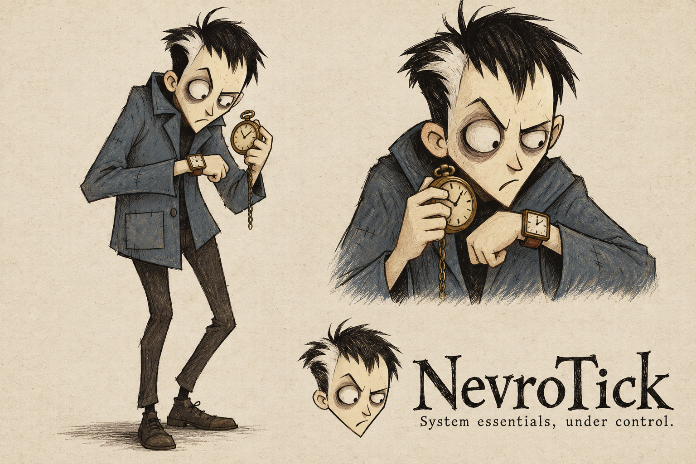
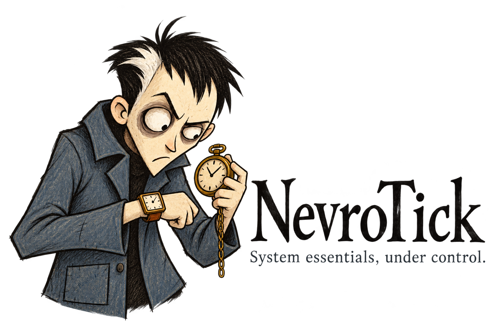
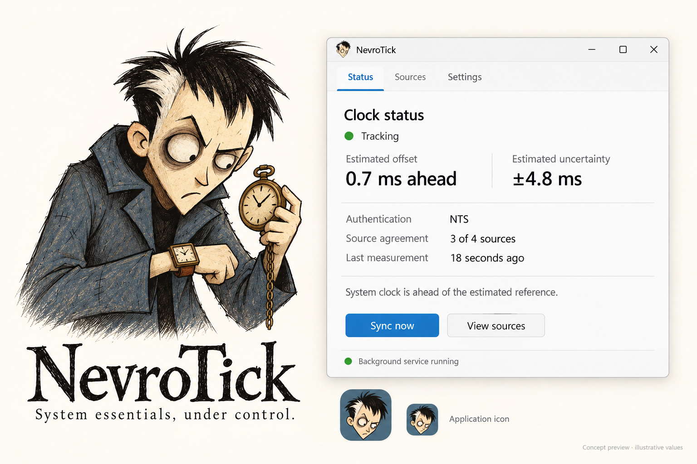

# NevroTick — продукт и визуальная идентичность

**Редакция:** 0.2 · 28 октября 2026  
**Статус:** выбранное пользователем направление бренда; UI — проектирование.  
**Техническая основа:** [RWTC-ARCH-001, revision 1.4](../references/source-docs/windows-time-architecture.md).

Редакция 0.2 уточняет интерфейс по отдельному features-плану. Название, подпись, выбранный персонаж и исходные брендовые изображения сохранены без изменения.

## 1. Зафиксированные решения

| Решение | Основание |
| --- | --- |
| Название **NevroTick**, техническое имя `nevrotick` | Пользователь выбрал в обсуждении |
| Windows-приложение на Rust | Продуктовая задача и исходная архитектура |
| Первая версия занимается синхронизацией времени | Прямое ограничение пользователя |
| DNS рассматривается как будущее расширение | Пожелание пользователя; функции DNS не входят в UI v1 |
| Общая подпись **System essentials, under control.** | Принятое направление в обсуждении; не ограничивает весь бренд временем |
| Маскот — выбранный **третий** персонаж последнего набора | Явное решение пользователя; изображение ниже является визуальным источником истины |
| Пользователь может сам вводить серверы и выбирать NTS либо NTP | Новое явное требование пользователя |

Обозначение `branding is undecided` в неизменённой архитектуре 1.4 отражает состояние исходного документа до этого обсуждения. Этот документ фиксирует более позднее решение по бренду; технические требования архитектуры он не отменяет. Более ранняя копия архитектуры 1.3 оставлена только для происхождения материалов; актуален комплект `references/source-docs`.

## 2. Персонаж

Человек, который перепроверяет показания двух часов. Характер передаётся выражением лица и позой: сосредоточенность, подозрительный прищур, поднятые плечи. Юмор сухой и доброжелательный.

Обязательные признаки для следующих изображений:

- Чёрные растрёпанные волосы; крупная белая клиновидная прядь **слева для зрителя**.
- Узкое угловатое бледное лицо, острый подбородок.
- Асимметричные глаза: слева для зрителя глаз больше, справа — прищурен.
- Потёртая синяя куртка с поднятым воротником и видимыми швами.
- В основном жесте сравнивает квадратные наручные часы с круглыми карманными; металл приглушённый, латунь/медь.
- Неровный тушевый контур, сухая штриховка, сдержанные цвета. Полноразмерная иллюстрация может сохранять фактуру бумаги.

Не менять сторону белой пряди между ассетами. Не выравнивать глаза, не заменять выражение типовой улыбкой. Для маленького значка сохранять силуэт и крупные черты, сокращая фактуру.

## 3. Варианты применения

| Поверхность | Представление |
| --- | --- |
| Сайт, документация, About | Поясной или полный персонаж, при необходимости с двумя часами |
| Основной логотип | Персонаж + надпись NevroTick; общая подпись необязательна на маленьких размерах |
| Значок приложения | Голова с белой прядью, асимметричными глазами и синим воротником |
| Трей / 16–32 px | Отдельная упрощённая отрисовка и проверка на светлом/тёмном/контрастном фоне |
| Рабочие формы | Маленький значок в заголовке; свободное место отдано содержанию |

Файлы PNG — растровые исходники концепции. Они не являются SVG, финальным ICO, проверенным пиксельным набором или результатом проверки читаемости в реальном трее Windows. `logo-light-transparent.png` содержит альфа-канал и тёмную надпись: его следует размещать на светлой подложке.

## 4. Визуальная система интерфейса v0.2

Это предлагаемые токены прототипа, а не зафиксированные системные цвета Windows:

| Назначение | Светлая тема |
| --- | --- |
| Основная поверхность | `#FFFFFF` / `#F7F8FA` |
| Текст | `#1B2026` |
| Вторичный текст | `#59636F` |
| Разделители | `#DDE2E7` |
| Действие и выделение | `#176DA8` |
| Положительное состояние | `#247C42` |
| Внимание | `#8B5E09` |
| Ошибка | `#B4232D` |

Основной UI использует системное семейство `Segoe UI Variable`, `Segoe UI`, затем системные sans-serif fallback. В нативной реализации предпочтения ОС, contrast themes и text scaling имеют приоритет над фиксированными цветами и размерами макета. Текстовые состояния обязательны рядом с цветом.

В v0.2 значение Appearance по умолчанию — **Use Windows setting**. Таблица выше сохраняет выбранное светлое направление; оно применяется при светлой системе или явном выборе Light. Это уточнение поведения UI не меняет визуальную идентичность бренда.

Для native-реализации цвет задаётся семантической парой «текст/фон», а не переносом светлого hex-значения на все темы. Отдельно нужны обычная, выбранная, историческая, успешная, предупреждающая и ошибочная поверхности, а также видимый фокус. Dark не должен сочетать светлый success-фон с почти белым текстом; contrast themes используют системные цвета. Значок или цвет дополняет текстовый исход, но не заменяет его.

Критерий дизайна: контраст обычного содержательного текста не ниже **4.5:1**; собственный индикатор фокуса — не ниже **3:1** к относящейся к нему соседней поверхности. Проверяются и выбранные строки, и диалоги успешного результата, а не только главный экран. Основание: [Microsoft — Accessible text requirements](https://learn.microsoft.com/en-us/windows/apps/design/accessibility/accessible-text-requirements) и [W3C — Non-text Contrast](https://www.w3.org/WAI/WCAG22/understanding/non-text-contrast.html). Это критерии будущей проверки, не заявление о соответствии WCAG или готовности Win32.

Ритм отступов: 4/8/12/16/24/32 px в прототипе. Типовой текст 14–16 px, заголовок окна 22–26 px; числовые оценки имеют равный визуальный вес. В нативной реализации размеры выражаются в подходящих логических единицах и проверяются при DPI/text scaling.

## 5. Область v1 и дальнейшее развитие

V1: состояние синхронизации, ручные источники NTS/NTP, политика доверия и коррекции, явное восстановление, диагностика, предпочтения UI и обслуживание единого MSI. В прототипе нет функций управления DNS.

Общий характер маскота — привычка перепроверять — позволяет позднее использовать его в DNS-контексте, сохранив лицо, прядь, одежду и общую подпись. Это направление бренда, не утверждённая архитектура будущего DNS-модуля.

## 6. Происхождение и статус иллюстраций

Референсом общего рисованного настроения служил персонаж игры Knock-Knock. Новые иллюстрации создавались с изменёнными лицом, волосами, одеждой и жестом. Сохранены собственные выбранные генерации; оригинальные игровые изображения в пакет ассетов не включены. [Официальная галерея](https://knock.ice-pick.com/art.html) и [страница разработчика](https://ice-pick.com/knock-knock/) фиксируют источник визуального исследования.

Предыдущие отвергнутые маскоты и геометрический N не считаются альтернативными актуальными логотипами. Проверка регистрации названия или товарных знаков этим документом не выполнялась и не заявляется.
