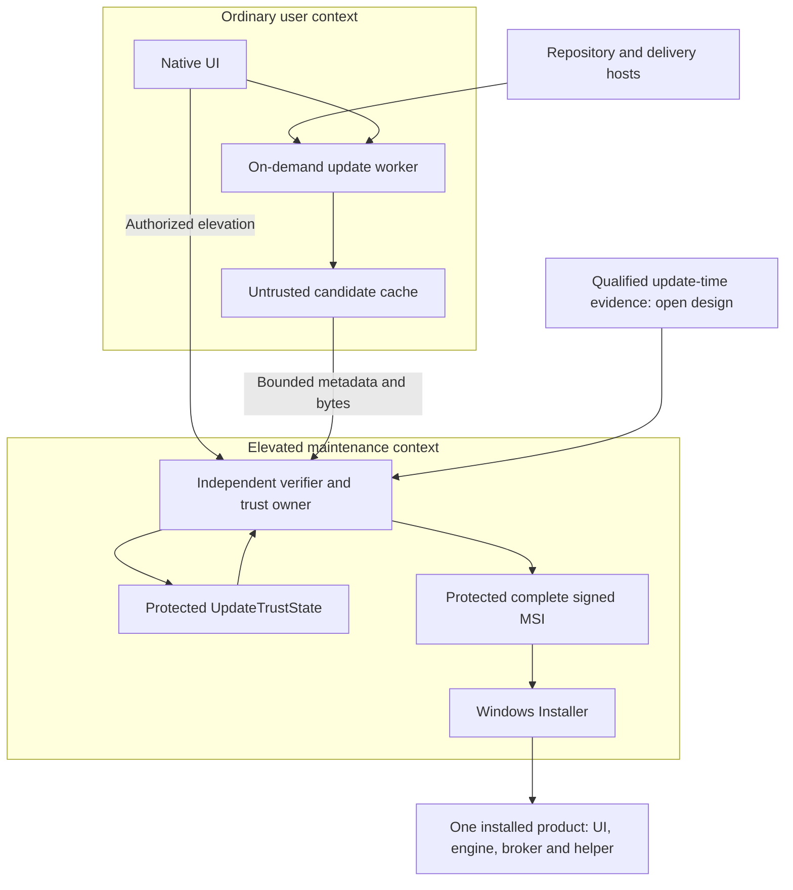

# TUF-authenticated updates: assessment for the Windows time client

**Date:** 28 October 2026  
**Status:** Candidate assessment; no protocol, dependency, updater topology or signing policy has been adopted.  
**Baseline:** `windows-time-architecture.md`, RWTC-ARCH-001 revision 1.4.  
**Input:** David Osipov's ArtCraft proposal, issue 888, its supplied Markdown attachment, and the live issue discussion. [P1, P2]

## 1. Assessment

**The proposal is relevant to this product. Independent release authorization, persistent trust, explicit downgrade policy and preservation of verified bytes would strengthen a future update path. TUF is a credible framework to evaluate for that purpose. Its implementation cannot be selected yet.**

The largest additional problem is specific to this application: it must repair incorrect time, while authenticated-update freshness needs a defensible time basis. The inspected `tough` 0.24.0 client also retains system wall-clock history and rejects backward movement. That can conflict with a legitimate clock repair. Dependency compatibility and the Windows installation boundary create two further gates.

The current plan already specifies a complete signed MSI and no bespoke privileged auto-updater. TUF could authenticate acquisition of that same complete MSI, including a user-initiated update. It need not imply automatic installation, separate UI/service packages, or another continuously running privileged service. Those are integration choices, not consequences of choosing the protocol. This assessment leaves revision 1.4 in force. [A, §19.5]

The user's follow-up comment makes a useful distinction: independent release authentication can have its own milestone, while the full TUF lifecycle has a separate cost and decision. This evaluation preserves that distinction. The fetched discussion contains the proposal, a related-issue bot comment, and the author's impact assessment; it does not establish maintainer approval. [P2]

### Review method and confidence

Three independent reviewers examined protocol/time, Rust dependencies, and Windows integration. They received the relevant pinned website guidance: independent review, architecture, threat modeling, dependency discovery, cryptography, build/deployment and fault recovery. Their initial observations were retained before technical reconciliation. The coordinator separately checked the consequential `tough` source paths, Microsoft interfaces and current specification.

This is source and document evidence. No application was built, dependency graph resolved, package installed, clock changed, signing key created, repository published, or Windows behavior tested. Proposed scenarios below are unexecuted. A source-derived failure possibility is not a demonstrated vulnerability in a deployed product.

## 2. Requirements worth carrying forward

The following transfer directly from the proposal as candidate requirements. Most concern the application's authority boundaries as much as its cryptography. [P1]

| Requirement | Interpretation for this product |
| --- | --- |
| Release authorization is independent of delivery | A feed, allowed hosting account, filename, redirect or downloaded checksum cannot authorize replacement code by itself. |
| Authenticate the complete target identity | Enforce product, complete-package format, architecture, supported OS policy, channel, release version, digest and exact size. Authenticated fields still need application policy. |
| Retain trust across restarts | Bootstrap once, retain authenticated root and required metadata, and reload them on later attempts. Ordinary errors must not restore the embedded root. |
| Distinguish root administration from release approval | Independent root custodians do not compensate for a compromised release signer that alone can approve targets. |
| Verify all downloaded bytes | Completion, cached files, resumed transfers and the final privileged copy must satisfy the same authorized identity. |
| Preserve platform verification | Required Authenticode publisher policy remains an additional admission condition. |
| Fail update admission safely | An update failure leaves an otherwise valid installed time client usable under its existing clock-safety rules. |
| Assign operational ownership | Bootstrap, renewal, intermediate-root retention, compromise recovery and long-offline clients need maintained procedures. |

The launcher/app delegation hierarchy is not immediately useful here. The time client has one product lifecycle. A single complete target per supported architecture/channel is a reasonable starting candidate; separate UI, broker, engine or helper updates would reopen the deliberately unified lifecycle. Delegations can be evaluated later if there is a concrete authority-separation need.

TUF's security model addresses substitution, replay, inconsistent repository views and bounded freshness. It cannot compel delivery or detect malicious behavior in code approved by sufficient authorized signers. A compromised build followed by the required valid approvals remains a release-process problem. [S2]

## 3. The clock is the decisive adaptation

### 3.1 What the protocol provides

The inspected TUF specification is **1.0.37, dated 8 October 2026**. It uses a fixed start time for an update workflow. It allows an expired installed root and expired intermediate roots during sequential authenticated rotation, but requires the final root to pass expiry before continuing. Ordinary failure is not permission to reset trust. Some authenticated key-rotation transitions intentionally discard specified timestamp/snapshot history; an application must preserve those protocol rules rather than invent a universal never-reset-counter rule. Support for bogus clocks remains an open question in the specification. [S1]

Consequently, this product must supply a separate answer to: **what evidence is sufficient to evaluate freshness at the start of this update?** Neither the protocol's timestamp role nor a publisher's release date supplies current UTC to the client.

### 3.2 Concrete `tough` behavior

At the package-associated source commit `98d8eb8b2ce63515d9b4981c938ef6453c5b5771`, `Datastore::system_time()` samples system wall time, compares it with `latest_known_time.json`, rejects a smaller value, and saves the new sample. `Repository::load` invokes that routine before loading and validating repository metadata. The examined loader offers no caller-supplied verification-time parameter. [S4, S5, S6]

**Source-derived failure scenario:** Windows incorrectly says 2040; an update attempt persists that sample and subsequently fails metadata verification; the time client legitimately repairs Windows back to the correct date; a later update attempt encounters a persisted time floor above the repaired clock. The source supports this possible availability failure. Its exact reachable behavior and recovery require fixtures against the selected artifact; no reproduction was performed.

A normal backward correction can also interact with that floor, even without an extreme date. Setting `ExpirationEnforcement::Unsafe` is not a resolution: it removes expiry protection, and the inspected load path samples time regardless. [S5, S7]

An entry check that waits for acceptable OS time is useful but insufficient on its own. Windows time may change between that check and subsequent library reads or writes. Qualification needs a supported caller-time interface or an evidenced transaction/time-generation policy covering every consequential read, persistence operation and final admission. This assessment does not propose freezing the global clock.

### 3.3 A time value needs provenance and uncertainty

NTS authenticates exchanges with an identified peer; it does not guarantee every peer's UTC claim. RFC 8915 explicitly discusses the initial certificate-time difficulty and residual delay attacks. A successful NTS exchange therefore cannot erase an earlier weak bootstrap basis or the assumptions behind source selection. [S8]

| Available evidence | Candidate update treatment to evaluate |
| --- | --- |
| Fresh NTS-derived estimate under an independently qualified policy | Consider only with explicit source authority, provenance, age and uncertainty assumptions. |
| Qualified holdover during known continuity | Consider only while its growing uncertainty remains within policy; specify sleep and elapsed-time behavior. |
| Persisted conservative authenticated-time floor from a previous boot | Derived from the accepted estimate minus its uncertainty under the qualified model; useful as a historical lower bound, but insufficient by itself to establish present freshness after an unknown offline interval. |
| NTS acquired using plain-NTP or operator-approximate certificate time | Preserve that provenance; decide explicitly whether it satisfies update policy. |
| Plain NTP helper, HTTP Date, release date or unreliable OS clock | Cannot become release-freshness authority merely because the value looks plausible. |

A useful candidate rule follows from elementary interval reasoning. If a justified model places current UTC at update start in `[L, U]`, and expiry is `E`, conservative freshness admission requires **`E > U`**. If expiry falls inside the interval, freshness is uncertain. A historical lower bound gives no finite `U`.

This is an additional application policy for evaluation, not a standardized TUF extension. The actual interval must be defensible under the chosen threat and oscillator model; statistical confidence alone is not an unconditional security guarantee. The selected library must still execute the normal protocol correctly.

There is also an authority issue. The accepted threat model includes a compromised synchronization engine. A `time_is_trusted` boolean or interval supplied by that engine cannot silently become new authority to install privileged code. Its influence would concern freshness and release eligibility; it would not let the engine forge target signatures. The update-time evidence producer and verifier need a documented trust boundary. Broker clock-correction limits do not, by themselves, prove UTC to an updater. [A, §§6.3, 14.2–14.4]

### 3.4 Recovery must avoid circular dependence

An engine defect might prevent acceptable time acquisition while an update is needed to fix that defect. The eventual design needs one qualified remedy:

1. Restore acceptable time through an already authorized, adequately authenticated path, then perform normal update verification.
2. Provide an explicitly authorized complete-MSI maintenance route with independently authenticated artifact identity and version policy, preserving existing trust state.
3. Remain blocked when neither route can meet policy, while retaining the installed client's safe operating state.

The second route cannot be an automatic fallback after TUF rejection. Its trust bootstrap, publisher verification under a wrong clock, version restrictions and state preservation require evidence. An arbitrary checksum from the failed delivery channel is insufficient. Resetting the root, ignoring expiry or writing Windows time from an untrusted helper merely to unlock installation is not an acceptable recovery design.

## 4. A concrete Windows integration option

**Option A, for evaluation:** an ordinary on-demand acquisition worker plus the installed elevated maintenance helper, all delivered within the same MSI. The ordinary worker can preview and download. The helper is the sole writer of authoritative machine update trust and independently authorizes installation.

This diagram describes a candidate, not an adopted architecture. Its important cost is that the helper gains bounded offline metadata parsing and signature verification. It avoids assuming that a normal-user process can safely own machine trust history, but it does not make that added privileged parsing surface free.

### Authority and handoff

1. **Preview:** the ordinary worker reads an allowed snapshot of current trust and downloads into a disposable cache. Its result is nonauthoritative. It cannot write the canonical root, metadata history or installed-version policy.
2. **Admission:** after authorized elevation, the installed helper takes the machine update lock and loads protected state itself. It independently verifies bounded metadata and target eligibility. A serialized `VerifiedTarget`, digest or success flag from the worker remains untrusted input.
3. **Final staging:** the helper copies into its own protected location, completely verifies the final artifact, and applies the required publisher policy. It constrains names, paths, parent directories, reparse points and links.
4. **Installation:** the helper invokes only the permitted local MSI and fixed, allowlisted parameters. The existing product lifecycle then quiesces and replaces the coherent component set.
5. **Commit:** installed-version state follows the real MSI outcome. Authenticated trust progress is not automatically undone when installation fails. Unknown outcomes are reconciled before retry.

The proposed privileged routine needs no direct download access; missing metadata can cause a bounded refetch request or failure. Verification still parses hostile material. Limits must cover file size, role/delegation count, rotations, signatures, strings, total work and storage before expensive processing.

**Actual-byte continuity is a qualification gate.** `WINTRUST_FILE_INFO` can identify an open file handle, whereas `MsiInstallProductW` receives a path and properties, including potentially a URL or network path. Therefore, verifying a handle and later passing a path does not itself establish that Windows Installer consumes the same bytes. Protected final staging, constrained parameters and real Windows reopen/read behavior need verification. [S9, S10]

The package must already contain all required product payloads. Later signing, timestamping or any byte mutation invalidates an earlier target digest, so repository metadata must describe the final signed MSI. External transforms, repair sources or custom-action arguments cannot acquire authority merely because the base MSI is authenticated.

### Boundaries retained

The clock broker receives no updater HTTP client, TUF parser, arbitrary executable path or installation command. The engine does not acquire update dependencies simply because it already performs networking. The UI presents operations and status without owning machine trust. A separate restricted updater identity is another possible topology, but would add provisioning, IPC and trusted-output questions. It is not selected here.

For a future complete MSIX distribution, deployment ownership must be resolved separately. A voluntary in-app TUF check does not demonstrate enforcement over every Store, App Installer or managed repair/update path. Keep one supported update owner per distribution route; do not create competing installers. This is an integration requirement, not a claim that MSIX makes TUF impossible.

## 5. Persistent trust and four different rollback policies

Use a distinct conceptual **UpdateTrustState**. Existing clock trust, correction budgets and W32Time ownership journals have different writers and purposes.

| State or operation | Required distinction for a future design |
| --- | --- |
| Metadata replay protection | Retain authenticated history and follow protocol-defined recovery transitions. |
| Application downgrade | A new metadata version can identify an older application; enforce product policy separately. |
| MSI transaction rollback | Restore a compatible authorized previous installation after failure without silently restoring obsolete update trust. |
| Repair/reinstall | Preserve established update identity, policy and accepted trust unless an explicit supported reset is authorized. |
| Disposable download cache | May be deleted and refetched; it carries no authoritative machine history. |
| Installed-version record | Records committed installation, not merely discovery or acceptance of newer metadata. |

For ordinary update and repair, missing, corrupt or unwritable established trust blocks update admission rather than triggering fresh bootstrap. Full uninstall/reinstall needs an explicit retention/reset policy. An intentional administrator or complete VM/disk snapshot rollback can defeat ordinary filesystem history; no device-wide irreversible antirollback guarantee is established here.

The proposal's persistent-datastore warning is correct: the `tough` loader defaults to temporary storage. Its caller must also explicitly supply the retained trusted root on restart. In the inspected implementation, state uses direct file writes and root replacement includes remove/create operations. This does not establish the required atomicity, power-loss durability or cross-process ownership contract. A persistent directory setting alone is insufficient. [S4, S5, S6]

Trust-state commit is not one all-or-nothing transaction that necessarily rolls back every accepted role if a later target fails. The application must preserve valid protocol progress and separately track the installer transaction. Conversely, no target installation may proceed when a required persistence step failed.

## 6. Dependency findings

| Candidate | Verified or qualified observation | Disposition |
| --- | --- | --- |
| `tough` 0.24.0 | Own license is `MIT OR Apache-2.0`; package-associated source pin recorded below. Mandatory AWS-LC metadata crypto; hardwired wall-clock history; persistence integration remains open. | Credible candidate; not admitted. |
| `tuftool` 0.17.0 | Publisher-side repository/signing tool from the same project. | Assess independently as release tooling; not a Windows runtime prerequisite. |
| `tuf` 0.3.0-beta14 | Registry release observed by dependency reviewer; mandatory `ring`. Release-era source has supplied-time methods but constructor paths still use wall time. Exact published archive/source parity unverified. | Comparison lead; no demonstrated compatible replacement. |
| `libdd-tuf` 0.3.1 | Reviewer observed a registry fork with mandatory `ring`; exact source association unresolved. | Secondary lead only. |
| `tuf-on-ci` 0.21.0 | Publisher tooling at pinned release commit; online signing choices require client interoperability checks. | CI/signing candidate; no selection. |

The primary `tough` package is **not Apache-only**. Its own license does not clear the entire linked graph. The current Chrony-derived plan holds AWS-LC/ring native graphs pending authoritative review of the exact distribution. This remains an existing dependency-admission constraint, not a new blanket legal verdict about every possible use of TUF. A process split does not automatically resolve that question. [A, §§18.6–18.7; S11]

The distinction between TLS and metadata crypto matters. `HttpTransportBuilder` has a TLS `CryptoProvider` hook, but metadata verification directly calls AWS-LC. Disabling HTTP or supplying the planned CNG TLS provider does not remove the mandatory metadata dependency. A supported compatible metadata backend would require additional evidence or upstream work. [S11, S12, S13]

Stream completion is another concrete integration obligation: `read_target` exposes data before final checksum validation. Successful stream creation or a verified prefix is insufficient. Consume and validate the whole target before treating it as executable material, and require exact signed size in the qualified path. [S14]

The evidence identifies candidates, not a complete dependency audit. No new Cargo lockfile, native graph, SBOM, Windows build or resource measurement exists. Publisher tools and runtime libraries need separate manifests and admission records. The dependency reviewer also recorded vendor patch floors; these do not constitute current whole-graph vulnerability clearance.

## 7. Release operations and Windows signing

The proposal appropriately treats key custody as an operational design. Candidate root and targets thresholds must be chosen separately. Two keys accessible to one compromised release job do not create independent approval. Root backups, successor-root publication, targets approval and emergency recovery need named maintainers with rehearsed procedures. [P1]

A small first repository can avoid delegation complexity, but it still needs renewal monitoring, retained intermediate roots, an explicit supported offline window, and a process for an authorized release that later proves unsafe. Expiry periods must fit real maintainer availability and the intended security window; no numerical periods are selected by this assessment.

Publisher/client compatibility must be demonstrated with the exact keys and metadata formats. In the inspected `tuf-on-ci` documentation, Sigstore online signing is experimental and not supported by all clients. A shared TUF label does not establish compatibility. Do not select experimental or newer algorithms merely because a publishing tool offers them. [S15]

TUF metadata signatures do not substitute for Windows publisher signing, installer UAC behavior, DLL-loading protections or enterprise application-control policy. The existing free-OSS-signing objective remains a separate provider/eligibility question. This assessment offers no guarantee of free Authenticode issuance or reputation.

## 8. Threat-model delta

These are assessment-local scenarios, not new canonical THR identifiers. They describe candidate controls and remaining assumptions; likelihood and CVSS are not established.

| Scenario | Proposed control to evaluate | Residual or unresolved question |
| --- | --- | --- |
| Delivery host supplies replacement executable and digest | Independently authorized target plus required publisher verification | Compromise of sufficient release authority remains capable of authorizing bad bytes. |
| Old metadata replayed after restart or repair | Protected retained history and explicit initialization | Valid whole-machine rollback is outside ordinary file-based protection. |
| New metadata withheld while time is wrong | Qualified time basis, expiry and observable failure | Delivery cannot be forced; false or unbounded time can defeat freshness claims. |
| Future OS time contaminates saved client clock history | Qualified time interface and explicit recovery | `tough` behavior is source-supported; a safe integration has not been demonstrated. |
| Compromised engine supplies a trusted-time label | Explicit update-time authority and evidence checking | Reusing engine status as privileged release authority is unresolved. |
| Worker/cache altered before installation | Helper re-verification and protected final artifact | Real MSI path/reopen behavior must be tested. |
| Crash or disk-full during accepted metadata persistence | Durable ordered state transitions and restart recovery | Existing library writes do not establish product durability. |
| Failed update restores obsolete keys or resets clock budgets | Separate trust, install and clock state ownership | Compatible rollback and blocked-release policy still need concrete definitions. |
| Routine update failure disables healthy time synchronization | Separate update health and time health; admission before quiescence | Existing unsafe clock states must remain blocked under their own rules. |

## 9. Lightweight operation and user experience

An on-demand worker would be a way to preserve the lightweight goal: start for an explicit or later approved scheduled check, stream bounded data to disk, publish status, and exit. It is an architectural option, not a measured performance claim. Measure idle footprint, active memory, package size, network use and cancellation after selecting a real graph.

The UI should keep synchronization health and update health distinct. For example: “Time synchronization is healthy. Update verification is waiting for reliable time,” or “An update was found; administrator approval is needed to install.” Messages should reflect actual state rather than claiming the device is fully secure. Preserve keyboard operation, screen-reader labels and actionable error details without exposing secrets.

An update error must not reopen the W32Time ownership race, relax time-step budgets, erase mandatory policy or label weak bootstrap as authenticated tracking. Only an admitted installation should quiesce the services. If recovery cannot restore a valid coherent product, report that blocked state honestly.

## 10. Evidence required before a decision

Keep this investigation finite. The next decision package should answer four questions:

1. **Clock:** name the authoritative time source and allowed provenance, uncertainty/age limits, fixed-start handling, clock-change behavior and independent repair route. Demonstrate a usable library interface rather than an assumed wrapper.
2. **Dependencies:** identify a maintained client and exact compatible metadata-crypto graph, storage capabilities and package/source relationship. Compare upstream-supported changes with alternatives; do not solve this by blindly adding a fork.
3. **Windows authority:** select the sole UpdateTrustState writer and specify byte continuity through the actual MSI entrypoint, including repair and concurrency.
4. **Operations:** assign root/release custody, renewal, offline support, key compromise recovery and publisher/client compatibility, with a sustainable cost model.

After those choices, a bounded qualification campaign should include these paired observations:

| Hostile or fault case | Legitimate neighboring observation |
| --- | --- |
| Far-future time, backward repair and restart | Qualified correct time remains usable without resetting trusted roots. |
| Only a saved lower bound or fabricated engine status | An admitted current interval/provenance passes; insufficient evidence does not. |
| Expired final metadata, insufficient distinct signers, skipped root | Valid sequential rotation, including permitted expired intermediates, succeeds. |
| Replayed or corrupt state after reboot/repair | Current consistent metadata works with retained authenticated progress. |
| Interrupted trust writes or simultaneous helpers | One owner commits; failures preserve recoverable legitimate state and block installation when required. |
| Partial stream, modified resume/cache, copied-file race | Complete final artifact matches independent expected bytes, exact size and identity. |
| Valid TUF target with wrong publisher, or valid publisher on forbidden target | Both authorization layers pass only for the policy-eligible package. |
| Path/link replacement or hostile MSI properties | Actual installer consumes the protected authorized MSI with allowed parameters. |
| Installation fails after root rotation | Compatible authorized recovery preserves current update trust and one clock owner. |
| Time engine is broken and update is required | The documented independent maintenance/time-recovery route works, or remains explicitly blocked. |
| Workflow stalls, sleeps or changes time generation | A fresh bounded workflow works; old admission is not reused indefinitely. |
| Release metadata renewal or intermediate-root publication fails | Monitoring and a rehearsed repair restore update availability without a weaker automatic path. |

## 11. Documentation impact if adopted later

The current architecture, diagrams and ASVS profile must receive one coherent revision after a choice. This assessment is input to that revision; it is not a parallel normative security plan.

Affected areas include architecture/process boundaries (§§3–6), time and recovery (§§8–10), durable ownership and lifecycle (§§11–12), threat model (§14), mitigation qualification (§15), dependencies (§18), distribution (§19) and verification/rollout/open questions (§§20–22). Existing OPEN-1 and OPEN-8 remain relevant; CHECK-13/15/18/23/25/26/27 need update-specific cases rather than being presumed satisfied by earlier review.

The ASVS 5.0.0 worksheet needs targeted reassessment for actual update HTTP, URL construction, signatures, target selection, privileged authorization, persistence and check-to-effect continuity. In particular, the existing conditional HTTP rows 4.2.1/4.2.2/4.2.3/4.2.5/12.2.1/15.3.2 gain an explicit client workflow; 1.2.2's prior dynamic-URL assumption needs review. Adding an HTTP client does not introduce an HTTP server or invalidate every server-only exclusion. No ASVS conformity or implementation status changes follow from this research.

**Recommendation for discussion:** keep TUF as a serious candidate and retain the proposal's independent-authentication requirements. Defer protocol/library/topology adoption until the clock, dependency, Windows handoff and release-operation gates have concrete answers. A smaller signed-manifest milestone remains possible, but its missing freshness, rotation and replay guarantees must be stated; adding those back informally risks recreating a bespoke update protocol.

## Sources and reproducibility

- **P1:** [User's proposal, issue 888](https://github.com/storytold/craft-launcher/issues/888). Supplied attachment SHA-256: `5b2bf4eabb183dcec647232e0cf1e8533ccef2281db59532d0bd6dd35a0e0694`. The attachment and live issue body were read in full.
- **P2:** [Author's impact assessment and prioritization](https://github.com/storytold/craft-launcher/issues/888#issuecomment-6401872434). Both live comments were read. Linked launcher implementation and incident accounts were not independently re-audited in this assessment.
- **A:** `windows-time-architecture.md`, revision 1.4; SHA-256 `a9bd1432ecb2d04e55b77e1a270eb1a135027d9f4a7988d58d9299367a6ca075`. Pinned website guidance commit: `6530d3a8d44cbe4f829b1e09edd3a1c90cffc087`.
- **S1:** [TUF specification](https://theupdateframework.github.io/specification/latest/), observed version 1.0.37, 8 October 2026, especially §§5.1–5.6 and 7.1. A live version, not an immutable source pin.
- **S2:** [TUF security model](https://theupdateframework.io/docs/security/).
- **S4:** [RepositoryLoader 0.24.0](https://docs.rs/tough/0.24.0/tough/struct.RepositoryLoader.html).
- **S5:** [Pinned tough lib.rs](https://github.com/awslabs/tough/blob/98d8eb8b2ce63515d9b4981c938ef6453c5b5771/tough/src/lib.rs), particularly loader, root reload and persistence paths.
- **S6:** [Pinned tough datastore.rs](https://github.com/awslabs/tough/blob/98d8eb8b2ce63515d9b4981c938ef6453c5b5771/tough/src/datastore.rs), clock and file writes.
- **S7:** [ExpirationEnforcement 0.24.0](https://docs.rs/tough/0.24.0/tough/enum.ExpirationEnforcement.html).
- **S8:** [RFC 8915](https://www.rfc-editor.org/rfc/rfc8915.html), especially §§8.5–8.7.
- **S9:** [Microsoft WINTRUST_FILE_INFO](https://learn.microsoft.com/en-us/windows/win32/api/wintrust/ns-wintrust-wintrust_file_info).
- **S10:** [Microsoft MsiInstallProductW](https://learn.microsoft.com/en-us/windows/win32/api/msi/nf-msi-msiinstallproductw).
- **S11:** [Pinned tough Cargo.toml](https://github.com/awslabs/tough/blob/98d8eb8b2ce63515d9b4981c938ef6453c5b5771/tough/Cargo.toml). Reviewer observed registry 0.24.0, publication 10 July 2026, checksum `35b378d98765c2ae9cdc3e9963ea7e670da8cdd9ee39611b8d722083c7f1ac11`, and package VCS association to this commit. Full archive/source parity was not established.
- **S12:** [Pinned metadata crypto](https://github.com/awslabs/tough/blob/98d8eb8b2ce63515d9b4981c938ef6453c5b5771/tough/src/schema/key.rs).
- **S13:** [Pinned HTTP/TLS provider hook](https://github.com/awslabs/tough/blob/98d8eb8b2ce63515d9b4981c938ef6453c5b5771/tough/src/http.rs).
- **S14:** [Repository 0.24.0 target-stream contract](https://docs.rs/tough/0.24.0/tough/struct.Repository.html#method.read_target).
- **S15:** [TUF-on-CI online signing at release commit](https://github.com/theupdateframework/tuf-on-ci/blob/662382a8295b89a9d538390ce8b9bb85b207a93d/docs/ONLINE-SIGNING-SETUP.md).
- **Alternative-client evidence:** [rust-tuf registry](https://github.com/rust-lang/crates.io-index/blob/master/3/t/tuf), [beta14-era source](https://github.com/theupdateframework/rust-tuf/blob/37b51666633b100a51eb1e6eaf700314e17ccfb4/tuf/src/client.rs), [libdd-tuf registry](https://github.com/rust-lang/crates.io-index/blob/master/li/bd/libdd-tuf). Evidence and parity limits are stated in §6.

Independent first-pass records are retained under `architecture-research/tuf-assessment/{protocol,dependencies,windows}/`. Those records are research evidence, not additional accepted product specifications. All maintained revision 1.4 documents remain unchanged.
