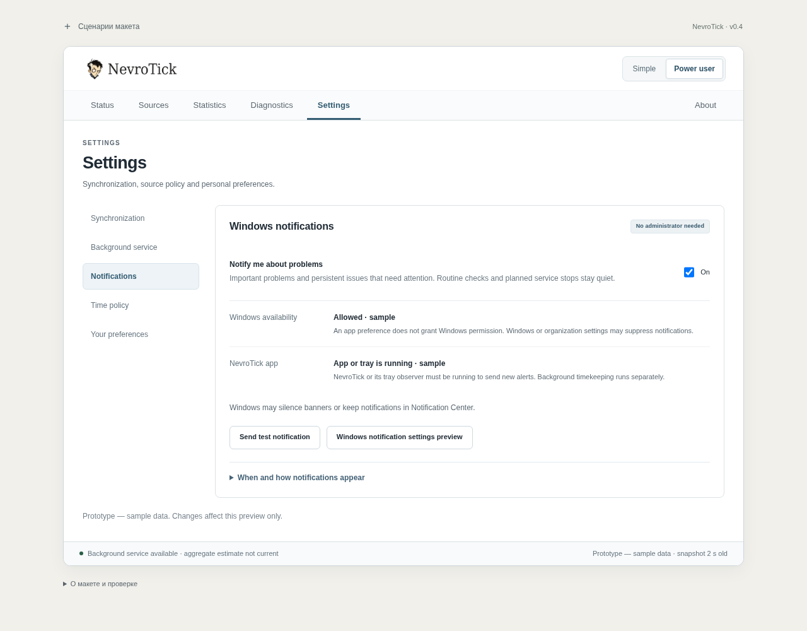
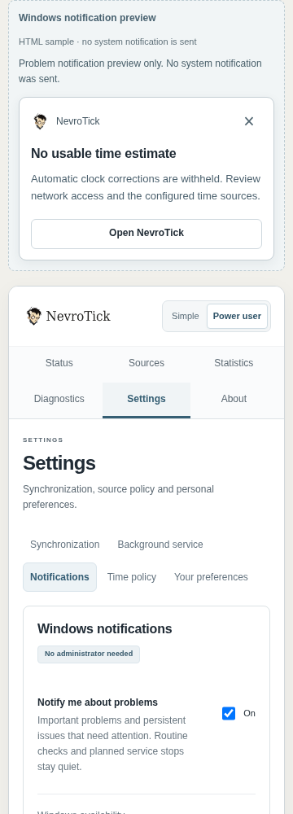

# Проверка статусов и уведомления Windows

5 ноября 2026 года. Обновлён отдельный HTML-прототип NevroTick. Канонический репозиторий и настоящие службы Windows не изменены. Предыдущая сборка сохранена отдельно.

## Проверенные шаги

1. **Открыть Status в Simple и Power user.** Проверены все 30 исходных сцен: обычная работа, деградация, потеря связи, остановка, конфликт, восстановление даты, коррекция и неизвестный результат. Аутентификация ответа, согласие источников, пригодность оценки и разрешение менять часы остаются разными фактами.
2. **Выбрать следующее действие.** Исправлена активная Sync now при остановленной или неподтверждённой службе. При подтверждённой остановке предлагается управление службой; при неизвестном состоянии — диагностика. Проверка источников в режиме наблюдения явно отличается от коррекции часов. Обычное восстановление остановленной службы больше не начинается с требования repair.
3. **Сопоставить владельца и результат команды.** Неизвестный результат изменения часов больше не показывает NevroTick подтверждённым владельцем в других разделах и экспорте. Неизвестный ответ команды NevroTick-наблюдателя не стирает отдельное подтверждение Windows Time. Observe only описан как наблюдение без права менять часы; Windows-владелец из него не выдумывается.
4. **Открыть Settings → Notifications.** Раздел доступен из обоих режимов. Предпочтение Notify me about problems отделено от разрешений Windows и наличия работающего приложения/трея. Тестовое сообщение не подтверждает здоровье часов, доставку или прочтение уведомления.
5. **Опубликовать образец проблемного статуса.** Внешняя панель сценариев позволяет воспроизвести уведомление и отдельный признак затянувшейся проблемы. Срочные инциденты отличаются от обычного ожидания и мягкой деградации. Внутри приложения проблема остаётся видна независимо от возможности показать уведомление.
6. **Повторить наблюдение, закрыть и открыть сообщение.** Повтор одного инцидента не должен создавать новый баннер; закрытие не устраняет ошибку. Учитываются Off, запрет Windows, Do Not Disturb, неизвестная готовность и отсутствие отправляющего процесса. Переход открывает актуальное состояние, не одобряет коррекцию и не повторяет операцию. Старые идентификаторы проверяются заново.
7. **Сверить окончательную сборку.** Source `62aa971` прошёл независимые source/semantic и браузерные проверки. Итоговые идентификаторы и результаты записаны в [verification-summary.json](verification-summary.json); сборка и проверенный автономный файл совпадают по SHA-256.

## Когда уведомлять

Явная политика охватывает все 30 сцен и результаты управления службами. Одного цвета карточки недостаточно для отправки сообщения.

| Условие | Поведение |
| --- | --- |
| Нет пригодной оценки, текущие источники конфликтуют, активный проверенный конфликт подписанной даты, конфликт управления часами | Важное сообщение с последствием и безопасным переходом. Без неподтверждённых обвинений в атаке. |
| Актуальная коррекция требует рассмотрения | Предложить открыть текущий обзор. Нажатие не выдаёт административное разрешение. Просроченный обзор не становится действующим. |
| Исход операции неизвестен или передача завершилась частично | Сообщить именно о неопределённости/неполном результате. Не называть это подтверждённой ошибкой или успехом, не предлагать слепой повтор. |
| Потеря ответов, holdover, недоступность статуса, отказ источника, общие ограничения запросов, недоступная основа даты | Уведомлять после опубликованного признака persistent/actionable. Конкретный production timeout здесь не придуман; число кликов и опросов его не заменяет. |
| Автозапуск не подтверждён, но синхронизация работает | Сообщение только о конфигурации будущего запуска. Текущая синхронизация и диагностика не объявляются потерянными. |
| Штатная проверка, resume, постепенная коррекция, выбранный NTP/observe-only, один RATE при пригодных альтернативах, старые события | Без нового предупреждения только по этому основанию. |
| Запрошенный Stop/Disable, успешный Start/передача, обычный Pending, отмена или отказ до эффектов | Результат внутри приложения; сами по себе не являются новым фоновым сбоем. Уже существующая независимая проблема при этом не скрывается. |
| W32Time запущен или управление передано Windows | Не объявлять проверенную синхронизацию или устранение прежней проблемы по одному факту Running. |

Повторные успехи и отдельные уведомления о восстановлении в эту итерацию не добавлены. Текущая нерешённая проблема хранится отдельно от результата последней команды. Закрытие диалога, отмена разрешения и отказ до выполнения не устраняют её, не меняют её идентификатор и не создают повторное уведомление. Если Windows раньше не позволяла показать сообщение, такая отмена не должна лишать проблему первого уведомления после восстановления доступности. Ограниченная память инцидентов и идентификаторы защищают от повторов и открытия устаревшего контекста. Смена целой демонстрационной сцены — независимый набор наблюдений, а не доказательство восстановления.

## Локальные уведомления и WNS

Для локального состояния часов нужны **Windows app/toast notifications**. Облачный **Windows Push Notification Services (WNS)** предназначен для сообщений от backend и не требуется для этой задачи. Сервер, push-канал, новая постоянно работающая служба и новый UI-фреймворк не добавлялись.

В будущей программе уведомление показывает пользовательский процесс без повышения прав, получающий ограниченное состояние по защищённому IPC. Служба Session 0 не показывает пользовательский интерфейс напрямую. Закрытие окна при работающем трее отличается от выхода из последнего пользовательского процесса: во втором случае новые локальные предупреждения обещать нельзя, хотя службы синхронизации продолжают работу.

Windows может запретить или подавить баннер. Приложение не обходит эти настройки и не считает отправку подтверждением прочтения. Текст сообщения ограничен названием программы, проблемой, последствием и переходом; приватные адреса, учётные данные, пути и диагностическое содержимое не выносятся на экран блокировки.

Основания: [Microsoft: app notifications](https://learn.microsoft.com/en-us/windows/apps/develop/notifications/app-notifications/), [облачный WNS](https://learn.microsoft.com/en-us/windows/apps/develop/notifications/push-notifications/wns-overview), [интерактивные службы](https://learn.microsoft.com/en-us/windows/win32/services/interactive-services). Полное исследование с 11 официальными источниками: [WINDOWS-NOTIFICATIONS-RESEARCH.md](WINDOWS-NOTIFICATIONS-RESEARCH.md).

## Доказательства и ограничения

Исходный model/view-аудит охватил 300 поверхностей, 599 вариантов команд/ответов и 9 600 дополнительных представлений. Исходный браузерный проход — 240 Status-захватов, 180 дополнительных поверхностей и 88 lifecycle-поверхностей. Это база ed523ef; эти результаты не выдаются за приёмку новых уведомлений.

Первый кандидат исправлений статусов cd90ed0 проверен независимо. Остаточные замечания к тексту неизвестного ответа и ARIA-ссылке трея устранены в 7f0a933. Затем независимый review обнаружил две ошибки сохранения unresolved incident и его identity после отмены; они устранены в 62aa971 и повторно проверены. Открытых материальных замечаний в пределах проверки HTML нет. Подробности: [финальный source review](SOURCE-REVIEW-RU.md) и [браузерная приёмка](BROWSER-QA-RU.md).

| Проверка итогового кандидата | Результат |
| --- | --- |
| Тесты модели и представлений | 197/197, без пропусков; прежние 175 сохранены, добавлены 22 проверки. |
| Структура, CSP и AVIF | 1 247 вариантов, ноль структурных ошибок; CSP соответствует скрипту, исходные AVIF сохранены, внешних зависимостей автономного HTML нет. |
| Выделенный Chromium-набор | Оба HTML на 360/1280: 4 комбинации, 120 проверок политики 30 сцен, настройки, блокировки, повторы, открытие, фокус и reset. |
| Независимый браузерный проход | Широкий проход 7f0a933: 6 комбинаций обоих HTML на 360/480/1280; после финальной delta 62aa971 — 90 ограниченных проверок сохранения проблемы, identity и трея плюс свежие снимки настроек/уведомлений. |
| Независимые semantic-пробы | 1 440 вариантов классификации/доступности, 120 проверок повторов/готовности, 32 activation, 32 overlays, 22 cancel-scope и 33 status/ARIA; открытых находок нет. |

В принятых браузерных наборах нет ошибок JavaScript, неожиданных удалённых запросов или вызовов browser Notification API. Нативная доставка Windows не проверялась. Неизменные сервисные, startup/ownership, recovery-history и navigation/reset наборы также прошли на родительском кандидате; они не подменяют финальную проверку изменённой логики.

## Снимки

Ниже — выбранные снимки финальной сборки; полный рабочий каталог независимой проверки сохранён в `/workspace/nevrotick-ui-audit/notifications-work/final-qa`.

**Шаг 4: настройки уведомлений, Power user.**

**Шаг 5: важное уведомление на узком экране.** Это область HTML-образца над окном, не системная доставка Windows.

[Simple Settings](screenshots/standalone-360-final-simple-settings.png) · [Do Not Disturb](screenshots/standalone-1280-final-suppressed-settings.png).

В облачном Chromium оба HTML открываются через локальный HTTP. Прямые file:// запрещены административной политикой. Проверка HTML, DOM, фокуса и снимков не подтверждает Windows registration/activation/delivery, Narrator, реальную политику SCM/UAC или точность часов. Макет не запрашивает browser Notification permission, не регистрирует push и не вызывает системные действия.
