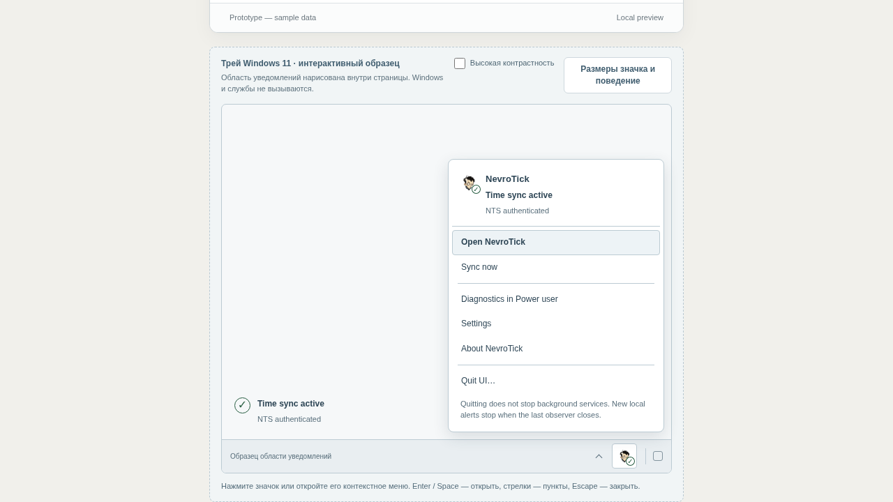
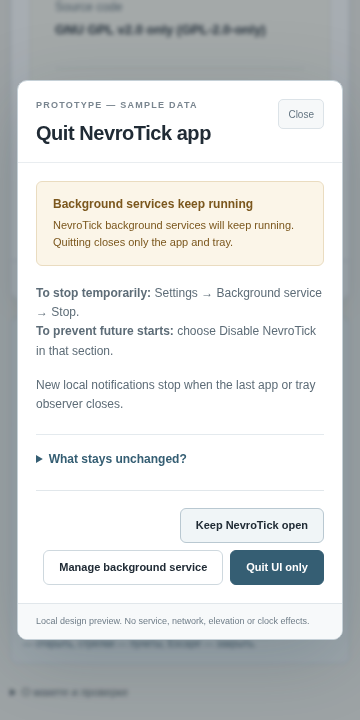

# Трей, меню и выход из приложения

5 ноября 2026 года. Дополнение текущего HTML-прототипа по запросу владельца;
это визуальный и интерактивный референс для будущего интерфейса Slint.

## Поведение

Под окном приложения находится отдельный образец области уведомлений Windows.
Трей выключен по умолчанию; его настройка и отдельный запуск при входе доступны
в Simple и Power user. Внешняя панель проверяющего позволяет осмотреть пример,
контрастность и размеры 16/20/24 px. Критические настройки доступны и без трея.

Меню содержит Open NevroTick, контекстный Sync now / Check sources / Time
management, Diagnostics, Settings, About NevroTick и Quit UI. Первое действие
открывает Status; общие страницы сохраняют режим, Diagnostics явно переходит в
Power user. Пункт проверки использует ограничения текущего состояния; неизвестная
или ожидающая операция не превращается в безопасный повтор. Открытие меню само
ничего не проверяет и не меняет службы, владельца часов или историю уведомлений.

Значок сочетает бренд и различимый символ: подтверждённое tracking, checking,
attention, blocked, unknown, paused, observing или Windows Time. Подсказка
использует текущее представленное состояние и возраст снимка. Историческое
свидетельство не становится текущим; запуск службы не доказывает синхронизацию.
Неудачная передача с отсутствующим синхронизатором остаётся предупреждением,
а намеренная остановка/отключение — отдельным состоянием. Подтверждённый владелец
Windows Time не исчезает при ожидающей операции NevroTick; его синхронизация
помечается неподтверждённой.

**Quit UI** обязательно открывает предупреждение. Для работающих служб сказано,
что они продолжат работу; для остановленных или неизвестных показано именно это.
**Manage background service** открывает Settings → Background service без выхода
и без команды службам. Там **Stop** означает временную остановку, а **Disable
NevroTick** — запрет будущего запуска; их подтверждения остаются отдельными.
Отмена сохраняет наблюдатель. Подтверждение выхода меняет только пример активного
наблюдателя: значок и новые локальные уведомления исчезают, настройки трея/входа,
службы и владелец часов сохраняются. Внешняя кнопка вновь открывает пример.

Меню поддерживает мышь, правую кнопку, Enter/Space, Shift+F10, стрелки, Home/End,
Tab и Escape. Escape возвращает фокус к значку, переход фокусирует страницу;
Tab выводит фокус за пределы меню.
Внешний щелчок закрывает меню. Во время другого диалога значок недоступен и не
заменяет незавершённую форму. Переход из справки о трее также передаёт фокус меню.

## Проверка

Проверенная автономная сборка: **865972 байта**, SHA-256
`a363c40201f4e238a49523bc7fb45c1a789f37114fe5c7e53f5fb56627c9b9fb`.
Основа документации — `8a66af924c509e898a9bab9bb3282f11b24fba93`; текущие исходники
и изменения находятся в рабочей копии. Старые отчёты относятся к своим кандидатам.

- 207 Node-тестов проходят, включая 10 новых проверок трея: все 30 сцен,
  неизвестные/частичные исходы, подтверждение выхода, навигация и отсутствие
  изменения служб. Первые проверки отсутствующей функции были красными;
  отдельно воспроизведён и исправлен ошибочный нейтральный статус частичной передачи.
- Структурная проверка: 1 427 документов, без ошибок; добавлены меню,
  подтверждение выхода и закрытый наблюдатель для всех сцен в обоих режимах.
  CSP соответствует конечному скрипту, внешних зависимостей нет, исходные байты
  AVIF сохранены.
- Chromium 155: шесть полных маршрутов для обоих HTML-входов при 360/480/1280 px
  и высоте 720 px; ещё 60 представлений меню для всех 30 сцен при 360/1280 px.
  Проверены фокус/клавиатура, правая кнопка, подсказка, контрастность, About в
  Simple, предупреждение/отмена/подтверждение выхода, переход к управлению,
  сохранение настроек и защита незавершённой формы. Меню помещается в viewport.
- Повторная проверка существующей компоновки: 360 Status и 12 About вариантов.
  Проверка уведомлений: оба HTML при 360/1280 px, все 30 политик и прежние
  сценарии доступности/повторов/активации. Ошибок страницы, внешних запросов
  и вызовов browser Notification не обнаружено.
- Независимый аудит выявил и помог исправить два случая статуса и фокус при
  переходе из справки. Повторная проверка исправлений: PASS, без оставшихся
  существенных замечаний. Текущий manifest проверяет намеренно изменённый комплект;
  исходный импортный manifest сохранён как историческая квитанция.

Изображения финальной сборки осмотрены визуально:

## Граница результата

Это HTML-симуляция. Она не создаёт значок Windows, не закрывает настоящий процесс,
не отправляет системные уведомления, не вызывает UAC/SCM и не меняет часы.
Системная доступность, реальные UIA/Narrator, ресурсы, выход процесса и доставка
уведомлений требуют отдельной нативной проверки. UI-M0/D1–D3, выбранный Slint,
лицензионные требования и ограничения исполнения сохраняются. Контрастный
образец в браузере не является квалификацией Windows high contrast.

Предыдущая основа: [статусы и уведомления](../status-notifications/REPORT-RU.md).
