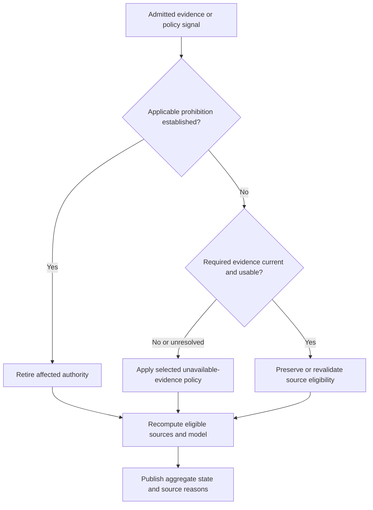

# Post-V1 certificate distrust and revocation

**Document:** NV-TRUST-001, revision 1.2

**Roadmap workstream:** TRUST-0

**Prepared:** 14 November 2026

**Status:** planned; all implementation and native qualification deferred until
the first software version, V1, has actually been released.

**Post-V1 rank:** second, after MATH-0/MATH-C01 and before MT-0/MT-C01;
KHR-0, GEO-0 and Android follow in their existing order.

**Local exit:** TRUST-C01, finite qualification and explicit disposition.

**Inspected product:** `bad2db638bb112496d16bb1172835473440b421e`.

## 1. Goal, authority and activation

David requests a post-V1 plan for both Mozilla OneCRL and CRLite, following a
review of the AdGuard certificate-interception issue and Windows/browser trust
differences. The intended result is timely additional rejection of compromised
or distrusted certificate paths used for NevroTick's own NTS authentication.
Investigate supplementary public-root removals and distrust-after constraints as
well: adopting the two feeds alone must not be described as Firefox-equivalent
certificate policy.

[OD-20](../nevrotick-owner-decisions.md#24-od-20--supplementary-certificate-distrust-after-v1)
and [TRUST-0](../../ROADMAP.md#trust-0--post-v1-certificate-distrust-and-revocation)
own the activation and ordering: actual V1 release → MATH-C01 → TRUST-C01 →
MT-C01 → KHR-C01 → GEO-C01 → Android. Existing V1 bounded workers are sufficient
for the initial qualification design; MT-0 is not a prerequisite.

This plan adds no V1 release gate, dependency, updater, trust-store mutation,
background activity or experimental execution. Continue the existing
[development plan](development-plan.md#7-next-executable-task-for-a-development-agent).
Actual V1 release, the roadmap's selected predecessor, a scoped execution card
and applicable environment admission are prerequisites for implementation.
The existing Windows, fuzz, storage and UI holds retain their separate owners.

The [architecture](../windows-time-architecture.md#1871-license-gate-and-finite-provider-choice),
[R-05](../nevrotick-research-handoff.md#7-r-05--windows-trust-with-a-wrong-system-date),
[crypto task](../../tasks/s0.1-crypto-feasibility.md) and
[engine task](../../tasks/engine-transport-pilot.md) retain technical authority.
Reuse OPEN-8, CRYPTO-04 and CHECK-6/8/9/15/26/27 as applicable; TRUST identifiers
are local planning identifiers, not replacements for canonical requirements.
Deferring these enhancements does not weaken existing V1 trust, revocation,
wrong-date, egress, association-lifetime or actual-native-completion obligations.

**24 November 2026 scope clarification.** The preparation record reports David's
separate deferral of enterprise Windows certificate pinning compatibility until
actual V1 release; [review advisory ARC-1](windows11-integration-follow-up.md#independent-proposal-review--24-november-2026)
retains the original-instruction provenance limit without reversing that reported
deferral. Its
[WINSEC-0 roadmap entry](../../ROADMAP.md#winsec-0--post-v1-windows-security-compatibility-and-evidence)
owns the later compatibility evaluation; it is not a new TRUST-C01
prerequisite or a OneCRL/CRLite requirement. Preserve current OPEN-8/R-05
trust-policy obligations and explicitly avoid claiming Schannel-specific
pin-rule enforcement from use of CNG or Windows chain APIs alone. No enterprise
pinning implementation or additional trust weakening before V1.

## 2. Evidence and its limits

The research supports additional protection, not a claim that Windows is always
slower or that every Windows-accepted chain would pass NevroTick's eventual
production policy. No reviewed incident is a demonstrated NevroTick exploit.

| Evidence | Supported conclusion and limitation |
| --- | --- |
| AdGuard CoreLibs issue 2110 [S01] | A TLS interceptor can conceal an origin chain from a browser's independent distrust policy. NevroTick is an NTS client, not a browser interception proxy; the relevant analogy is divergence between certificate-policy authorities. |
| eMudhra, October 2026 [S02–S03] | Mozilla reports notification on 17 October at 20:06 UTC and OneCRL distribution complete at 22:59 UTC for standard Firefox configurations. Microsoft records publication of an emergency Disallowed CTL at 11:00 Pacific on 20 October, or 18:00 UTC. The 67-hour-1-minute difference compares unequal milestones, not measured device exposure or a general update SLA. |
| Further eMudhra actions [S02–S03] | Microsoft's 26 October root changes and announced 16 November remaining-root removal are separate from its 20 October intermediate-key block. Mozilla also records an Android bundled-blocklist startup correction on 21 October. Publication, distribution and actual client enforcement must remain separate. |
| Entrust [S04–S06] | Mozilla's TLS issuance cutoff was 30 November 2024; NSS 3.107 carried the change on 21 November. Microsoft's 25 February 2025 deployment selected 16 April 2025. These cutoff dates differ by 137 calendar days; this is policy divergence, not a measured rollout or compromise interval. |
| e-Tugra [S07–S09] | NSS 3.92 removed the identified roots in July 2023; Microsoft's 2025 notice applies a 15 September issuance cutoff to the same RSA v3/ECC v3 roots. Full root removal and a new-issuance restriction have different semantics. Match certificate identities, not vendor names alone. |
| Windows cache semantics [S10–S13] | Native validation may reuse still-valid CRL/OCSP evidence. Fail-closed handling of unknown status does not establish newest evidence. CTL updates, CA revocation publication, local caches and application policy have different owners. |
| Contrary Windows evidence [S03, S11] | Microsoft has an emergency Disallowed CTL path and documents daily CTL retrieval capability. Do not claim a universal monthly/weekly delay. Local delivery still depends on policy and connectivity. |

The two Mozilla feeds complement each other but share ecosystem dependencies.
CRLite still depends on CA reporting and CT ingestion; neither feed discovers
every unreported compromise. An incident-specific timing comparison cannot
establish coverage or latency for the eventual NevroTick peer population.

## 3. Protection scope and selected initial policy

| Mechanism | Planned role | What it does not establish |
| --- | --- | --- |
| Windows chain and SSL policy | Retain the selected native trust, chain, name, EKU, signature, time and revocation checks, including enterprise policy and explicit distrust | Identical Mozilla policy, newest published intelligence, or current application-owned evidence age |
| OneCRL | Apply authenticated issuer/serial and subject/public-key matching semantics to the applicable validated path, including intermediate and cross-signed cases | A complete public-root trust store or an exhaustive leaf-revocation service |
| CRLite | Additional revocation evidence for covered, enrolled public TLS end-entity certificates | General root/intermediate distrust, unlogged/private-CA coverage, or validity of the rest of the chain |
| Supplementary public-root constraints | Investigate explicit public-root removal, usage restrictions and distrust-after semantics absent from those feeds | Automatic import of Mozilla roots, a selected data source, or approval to override enterprise/local trust |

OneCRL has two paired match forms: **issuer AND serial**, or **subject AND
`SHA-256(DER SubjectPublicKeyInfo)`** [S15]. Preserve Mozilla's decoded byte
representations for the DER-encoded issuer/subject names and certificate serial;
do not normalize display names or convert the serial through a numeric type.
The second form is neither a hash of the raw public key nor a global SPKI-only
block. Apply matching to leaf, intermediate and root certificates on the accepted
path. This scope still does not supply every Mozilla root-program constraint.

**Initial integration is rejection-only.** A valid applicable overlay rejection
vetoes native success; overlay absence or `Good` never overrides native failure.
Keep native known-revoked, explicit-distrust and unrelated policy failures fatal.
An ordinary accepted chain still needs every pre-existing product requirement.

Do not infer trust from absence in OneCRL or infer revocation from absence in a
public-root list. Distinguish explicit distrust from unsupported membership.
For root constraints, freeze the intended public-PKI scope, exact root/key
identity, cross-sign/alternate-path treatment, certificate-time field and cutoff
comparison, usage, exceptions and enterprise/private-root interaction. Evaluate
a maintained authenticated source and update path before choosing a mechanism.
Do not scrape announcement prose into a live security policy.

Whether fresh overlays become mandatory for a named assurance mode is an open
owner decision. In an additional-veto mode, native success without usable overlay
coverage may remain permitted only with the approved explicit status. In a
mandatory-overlay mode, unavailable required evidence yields holdover/Blocked.
This document selects neither an offline grace period nor a weaker fallback.

## 4. Current source and the integration boundary

Reinspect the actual released tree at activation; the following map is a dated
source observation, not an instruction to preserve a laboratory topology.

| Current owner | Observed behavior and required handoff |
| --- | --- |
| `crates/nevrotick-engine/Cargo.toml`, `src/lib.rs` | `ke-association-prototype` is default-off; actual TLS transport is Windows-gated. This source is not a public production NTS-to-clock path. |
| `crates/nevrotick-engine/src/nts_ke_experiment/transport.rs::connection` | Constructs explicit CNG, rustls TLS 1.3, `ntske/1`, ordinary platform verifier and no extra roots; disables resumption/early data. `.dangerous()` installs the custom verifier and does not by itself disable verification. |
| Vendored `verification/windows.rs::verify_certificate` | Builds a native chain, supplies stapled OCSP when present, evaluates SSL policy and returns success only for zero policy error. Its cache-only flags and zero ignore flags do not provide a separate product evidence-age guarantee. |
| Same verifier's `verify_server_cert` | Returns rustls's success marker, not a validated-path receipt. The input peer intermediates are not necessarily the selected Windows path. Adding a wrapper around this marker alone cannot recover path identity. |
| `transport.rs::InternalCandidate::publish`, `association.rs::AssociationCandidate` / `AssociationOwner::receive` | Move same-connection exporters/cookies through a private complete candidate and serialized publication guard. Future trust evidence must join this custody chain; a disconnected boolean or global last-verification slot is insufficient. |
| Request ledger, protected sender and production acquisition owners | Recheck current authority at use. The existing invocation/expiry controls are not evidence that production trust-feed revision and full-authentication-age suppliers already exist. |

Implement at the selected Windows chain/verifier owner while the actual path is
available, before success can authorize exporter/association publication. Retain
bounded immutable certificate identities/path material or a sealed equivalent
needed for later trust-change evaluation. Do not export native handles beyond
their valid owner or reconstruct the issuer from untrusted peer ordering.

Bind the result to the connection, server identity, selected chain, native-policy
context, trust-policy generation, feed identities and evidence-time basis.
Publication must recheck current policy after any concurrent update. The engine
owns networking and association state; the broker receives no feed-fetch or
certificate-policy bypass authority, and the UI only projects truthful status.

Preserve the distinction between observation freshness, cookie receipt, key age,
original full certificate authentication and current trust revision. Feed refresh,
cookie renewal and TLS resumption do not reset full-authentication age. Route
detected distrust, required full-authentication/key/association lifetime expiry,
or unknown required age through R-05's bounded invalidation and reauthentication
policy, including already-active UDP associations and queued work. Original TLS
certificate expiry alone does not imply association expiry [S23]. A stale receipt
must not survive an update between preparation and send.

## 5. Typed state and ownership contracts

The names below describe proposed semantics, not existing Rust types. Use private
fallible construction and the existing contract-enforcement conventions.

| Proposed state | Required distinction |
| --- | --- |
| `FeedIdentity` | Publisher, collection, channel, format, signer-policy identity and revision; identities cannot be interchanged |
| `AdmittedSnapshot` | Verified signed metadata, exact attachments, parsed bounded representation, revision/coverage and admission provenance |
| `RefreshState` | `Changed`, `UnchangedAuthenticated`, `Unavailable`, `Invalid`, `RollbackRejected`; transport success alone cannot mint authenticated currentness |
| `OneCrlDecision` | Applicable match, no match, or unavailable/invalid policy; no match is not a certificate-validity assertion |
| `CrliteDecision` | `Revoked`, `GoodCovered`, `NotCovered`, `NotEnrolled`, `Unavailable`, `Stale`, `Invalid`; preserve the cause of inconclusive evidence |
| `RootConstraintDecision` | Applicable explicit prohibition, applicable satisfied constraint, out of selected scope, or unresolved policy |
| `CertificateTrustReceipt` | Same-verification native result, actual path identities, all applicable overlay outcomes and revision/time basis |
| `AssociationTrustState` | Original authentication receipt plus current invalidation/full-auth-age guards; historical success alone grants no present send authority |

Keep authenticated publication/revision time, last successful refresh observation,
data coverage horizon and elapsed local observation age separately. A feed that
has not changed is not automatically stale; a legitimate empty changeset can
retain the same revision. Conversely, replaying an old signed response or reading
an unchanged disk file must not renew its freshness indefinitely. Define what
authenticated evidence permits an unchanged refresh and which age it advances.

The update owner admits one complete immutable revision atomically. Readers hold
a consistent snapshot during a decision; installation cannot mix generations or
drop a necessary delta. Association publication and use compare against the
current required policy, with defined invalidation on changes. The source-specific
snapshot store is mandatory security state if the selected mode depends on it;
it must not inherit an optional-cache fallback merely because the bytes are public.

### 5.1 Application and stored-state compatibility

At TRUST-W02, apply the existing
[data-contract transition procedure](../../.agents/skills/implementation/evolve-data-contracts/references/transitions.md)
before introducing new persisted or independently consumed representations.
Feed encoding compatibility is separate from NevroTick application compatibility.
Inventory the writer, version decoder, mandatory checked constructor, publication
point and readers of snapshots, anti-rollback state, trust receipts, IPC/status
events and any persisted association/model references.

Declare each required old/new writer–reader–stored-generation combination
supported, deliberately unsupported or unverified. Cover UI, engine, broker and
the existing maintenance owner, including old processes surviving a package
transition; one complete MSIX does not prove simultaneous process replacement.
Choose the bounded supported update/downgrade order and explicit negotiation or
rejection behavior before new writes. Unknown required policy semantics cannot
default to acceptance, reset security history or become a green UI status.
Where no old data or independently surviving reader exists, record that boundary
instead of inventing a migration requirement.

Migration must validate original version/provenance and use the same checked
construction and current authorization as fresh state. Stage and publish under
the protected owner; distinguish rejection before publication from replacement
whose acknowledgement was lost. Reconcile disk and service state before retry.
Compatible code rollback cannot restore consumed authority, erase a known
prohibition, lower anti-rollback history or turn unknown age into fresh evidence.
State offline disk/VM rollback assumptions explicitly; protected files alone do
not establish a monotonic hardware history. No new rollback mechanism is selected.

TRUST-W05 must exercise supported mixed versions, incompatible refusal,
interrupted migration/restart and safe rollback using independent old/new raw
fixtures through the actual readers and consumers. Pair rejected combinations
with supported healthy neighbors. Record separate retirement of old writers,
readers, stored formats and migration paths before claiming compatibility.

## 6. Authenticated update and lifecycle design

OneCRL/CRLite transport is a security-data distribution path, distinct from the
unadopted application auto-updater/TUF research. Select endpoints, protocol and
dependencies explicitly; do not introduce a general URL-fetch capability.

For Mozilla Remote Settings, implement the applicable current protocol [S14]:

1. Verify the expected collection and signer against approved independent trust
   anchors; validate the signing chain, allowed algorithms and signed content.
   The current reference uses canonical collection JSON, the content-signature
   domain separator and ECDSA P-384/SHA-384. HTTPS or a hash supplied by the same
   unverified response is not equivalent to that verification.
2. Merge changes and tombstones correctly before checking the collection
   signature. Bind attachment hash and exact size to authenticated metadata;
   reject a missing/replaced filter, wrong channel or unsupported encoding.
3. Bound compressed/raw bytes, records, strings, nesting, integer conversions,
   attachments, memory and work before allocating or parsing. Signed data is
   still hostile input. Use strict typed decoding and checked transformations.
4. Preserve anti-rollback state and source identity across crashes, restart,
   reinstall/upgrade and interrupted installation. Keep a known valid snapshot
   until a replacement is fully admitted; classify rollback, corruption and
   genuinely new publisher recovery explicitly rather than resetting history.
5. Qualify signer/root rotation, authenticated record removal, collection reset,
   snapshot/delta replacement and algorithm/format transition. A failed update
   cannot silently disable known applicable distrust or publish partial state.
6. Restrict DNS, destinations, redirects, HTTP behavior and delegated Windows
   retrieval under OPEN-8. Apply bounded backoff and server retry guidance; own
   actual completion, cancellation, files, handles and admission permits.

**Wrong time:** signing-certificate validity, HTTPS, CTL/CRL validation and feed
age may depend on different clocks. A provisional TLS-time argument does not
move every OS check. Define trusted time/uncertainty and monotonic-age handling
for startup, suspend, rollback and restart. If required currentness cannot be
established, use the selected unavailable/Blocked behavior; no global clock step,
date-search bypass or silent authentication downgrade follows from this plan.

Pin first-install trust independently of the downloaded content. Account for
offline distribution, update-service failure and recovery without assuming a
working browser, interactive account, or user-warmed Cryptnet cache. Qualify
storage ACLs and service identity; public security data still needs integrity.
Telemetry may expose bounded revision, age class, decision and failure cause;
do not log keys, cookies, raw certificate payloads or sensitive query history.

## 7. CRLite correctness and dependency candidates

The inspected implementation uses Clubcard, not the original Bloom-cascade
format. Encoding 3 uses optional bincode; encoding 4 has a separate codec [S16].
Choose supported encodings from actual distribution evidence and migration
needs. Old-format rejection must be an explicit compatibility result.

Construct the key from the issuer of the validated leaf and the exact DER serial
integer-content bytes, preserving required leading bytes. Verify SCT signatures
against authenticated CT-log keys and bind coverage to that leaf/issuer. The
rustls 0.23 callback has no separate SCT input; embedded-SCT parsing and the
trusted-log-key lifecycle need an explicit owner. Freeze the qualifying SCT
count/log/time/coverage rules instead of copying an unexplained browser setting.

Current Firefox's CT-enabled path passes `verifiedScts`; its CT-disabled path
deliberately permits unverified embedded timestamps [S15]. That exception and
the diagnostic CLI's unchecked extraction are not adopted here. Log-policy/key
changes must invalidate dependent coverage evidence as defined by the owner.

Aggregate every applicable full/incremental filter: any `Revoked` wins over a
`Good` from another filter. Preserve `NotCovered` and `NotEnrolled` as inconclusive.
Expired certificates can be omitted from filters; independent certificate-date
validation remains required. Clubcard exactness applies inside its encoded
universe, not to arbitrary input outside qualified coverage [S15–S17].

Select the all-revocation-reasons `default` channel for initial qualification.
The inspected `compat` channel includes only key compromise, cessation of
operation and privilege withdrawal; it must not silently replace that scope
[S18]. Record coverage for the actual NTS peer population. CT ingestion lag can
affect certificates older than a brief new-issuance interval [S20].

| Candidate | Source-backed fit and remaining review |
| --- | --- |
| Mozilla `clubcard-crlite` 0.6.2 / `clubcard` 0.3.4 [S16–S17] | MPL-2.0 filter libraries. `with_hash` permits a caller-supplied SHA-256 key; disabling default `sha2` offers a CNG-digest path. Qualify exact features, format support, licence composition, parser/resource behavior and all transitive code; no graph is admitted here. |
| `rustls-upki` / `upki` at the inspected revision [S21] | Useful reference/status-layer candidate, not a drop-in Windows verifier: it selects WebPKI roots, has permissive uncovered/no-SCT defaults and reads SCT timestamps without signature verification. UPKI also contains portable software SHA-256; its manifest/hash fetch path is not the required signed Remote Settings updater. |
| Mozilla diagnostic `rust-query-crlite` [S18] | Operator inspection tool with an accept-all certificate-fetch verifier and a different updater assurance scope. Do not copy it as production TLS verification or update authentication. |

CNG-compatible hashing is only part of admission: review P-384 signatures, SCT
algorithms, parser dependencies, build scripts, target/CPU/features, maintained
source, GPL-2.0-only engine composition and native cleanup through existing
crypto/dependency owners. No new primitive implementation is requested.

Mozilla's August 2025 report described approximately 4 MB snapshots and 300 kB
per day [S19]; these are historical deployment measurements. Current aggregate
attachment size, selected-channel download, parsed resident memory, staging
peak, disk retention and update traffic are different quantities. Measure them
on the actual candidate; adopt no historical number as a product budget.

## 8. Staged implementation after activation

All rows are **DEFERRED until actual V1 release and the selected roadmap slot**.
Keep implementation/results in the existing crypto and engine tasks, with this
document owning the cross-component contract and TRUST-C01 disposition.
Within these shared stages, implement and qualify OneCRL first, then CRLite.
Reuse admitted update infrastructure where applicable; OneCRL alone does not
complete TRUST-C01 while both feeds remain in the selected scope.

| Stage | Owner and bounded work | Observable exit |
| --- | --- | --- |
| TRUST-W01 — freeze the released baseline | Coordinator with security/platform: record released source/artifacts, actual verifier/association path, service identity, OS matrix, feeds, current primary sources and all decisions below | One reconciled scope and finite budget; no inherited prototype or historical native pass |
| TRUST-W02 — source and policy admission | Crypto/security/dependency owners with Core/IPC/broker and maintenance owners: admit formats/graph, trust anchors/log keys, typed decisions and root scope; freeze §5.1 compatibility and §9.5's effective trust context across processes | Reviewed contracts, independent fixtures and supported/unsupported combinations; unresolved choices recorded before dependent implementation |
| TRUST-W03 — bounded updater and storage | Engine/platform/security: implement authenticated snapshots, anti-rollback, unchanged refresh semantics, atomic installation, lifecycle and resource limits | Actual update-entry tests show healthy installation and hostile/recovery refusal without partial policy |
| TRUST-W04 — selected-path and downstream integration | Crypto/engine with existing Core/IPC/broker owners: bind real accepted paths and KE/exporters to association/send, sample/model eligibility and proposal/final-effect authority; UI owner consumes truthful status | Actual consumers reject stale authority through final issue and reconcile actual outcomes; unaffected-source and failed-replacement neighbors remain usable under their own policy |
| TRUST-W05 — Windows and installed qualification | Existing Windows/crypto/Core/broker/package/UI owners: native chains, service caches/egress, wrong time, cross-process ordering, mixed-version migration/rollback, crash/restart, final protections, relevant native presentation and resource measurements | Candidate-specific two-family and installed-lifecycle evidence through final effects/settlement, independent observations and cleanup; no host fixture substitutes for a required native consumer |
| TRUST-W06 — independent review and disposition | Coordinator and independent reviewer: reconcile scope, security coverage, resource results, root-constraint findings and remaining limits | TRUST-C01: qualified chosen-scope integration or explicit owner defer/replan; no automatic expansion into another research campaign |

Do source-only parsing and state tests before native integration. Windows runs
use owned disposable environments and controlled peers, with existing holds
resolved through their owners. No public NTS endpoint, user's trust store or
production service is an experimental target. Retain 90% security-primitive
coverage and per-critical-file 95% mutation gates where applicable; neither a
green percentage nor a cross-build establishes native policy correctness.

## 9. Required discriminating cases

Each case needs an independent expected result, a useful accepted neighbor,
the actual production entry/consumer and exact source/environment identity.

| Case family | Required observation |
| --- | --- |
| Native success + OneCRL match | Revoke issuer/serial and subject/key paths, including cross-signs and alternate issuer ordering; unrelated valid chain succeeds |
| Native success + CRLite revocation | Covered leaf is rejected despite still-valid older Windows evidence; a covered non-revoked leaf retains ordinary checks |
| Native rejection + overlay `Good` | Revoked, untrusted, wrong-name, wrong-EKU, invalid-date and bad-signature chains remain rejected |
| Inconclusive CRLite | Unlogged/private CA, missing/unverified SCT, uncovered interval, unenrolled issuer, expired leaf and unsupported version remain distinct; no `Good` fabrication |
| Multi-filter conflicts | A later applicable `Revoked` overrides an earlier `Good`; missing delta, duplicate/cross-channel state and partial rollover cannot claim complete coverage |
| SCT/key binding | Wrong leaf, issuer, log key, signature, timestamp and serial representation are detected beside an independently valid input |
| Signed update admission | Wrong signer/collection, altered metadata, invalid chain, bad signature, mismatched hash/size and malformed bounded payload cannot replace valid state |
| Unchanged versus stale | Legitimate authenticated unchanged response retains its proper status; replay, frozen responses and mtime changes cannot renew unavailable evidence |
| Rollback and recovery | Older signed revision, crashes between writes, missing anti-rollback state, corruption, publisher reset and signer rotation follow explicit policy without partial install |
| Application compatibility | Supported old/new writers, readers, stored generations and live processes preserve meaning; incompatible/unknown required state refuses affected authority, interrupted migration reconciles, and code rollback cannot reset security history |
| Native cache/identity | Cold, warm, expired and still-valid old evidence under the actual service identity; disabled CTL updates, stale mirror and blocked delegated egress are observable |
| Root constraints | Match exact roots/keys, pre/post-cutoff leaf dates, usage and alternate chains; private/enterprise exceptions cannot silently create public trust or evade explicit distrust |
| Wrong time and lifecycle | Forward/backward UTC error, uncertain startup, suspend/restart and clock rollback cannot fabricate feed or authentication freshness |
| Association update races | Distrust arrives after TLS validation, before KE publication, before protected send and during active UDP; queued work and repeated cookies cannot retain invalid authority |
| Resource and stop behavior | Oversize/corrupt inputs, slow responses, redirect loops, repeated failures and concurrency pressure stay bounded; cancellation retains custody until actual completion |
| Product status and recovery | UI/diagnostics distinguish rejection, unavailable evidence, holdover and Blocked; accepted recovery restores only qualified authority with no plaintext fallback |

### 9.1 Event model and decision precedence

**Added at David's request, 14 November 2026.** Sections 9.1–9.7 specify the
proposed post-V1 event → mechanism → effect → user-presentation contract. They
do not describe shipped behavior or activate TRUST-0. `CERT`, `DATA`, `LIFE`
and `EV` labels below are local plan references, not new global acceptance IDs
or finalized IPC/message enums. Reuse the existing typed contracts and owners.

Keep four independent facts: **certificate/policy verdict**, **security-data
condition**, **source/association eligibility**, and **aggregate time state**.
A feed outage does not establish revocation. A rejected source does not by
itself establish an incorrect clock, a stopped service or global `Blocked`.

Apply these precedence rules at the decision owner:

1. **Admit and attribute evidence.** Authenticate updates and evaluate the actual
   native result before treating them as policy. A callback can request
   revalidation; an unverified notification or news report cannot itself revoke
   trust. Preserve unknown attribution: an aggregate chain error may not identify
   the failing element, so it cannot be presented as confirmed leaf revocation
   [S25].
2. **Match exact scope.** Apply the certificate, subject/key, chain, usage and
   date predicate to the receipt it actually concerns. Record the purpose:
   NTS-KE, feed transport, feed signing or later DoQ. A feed endpoint's TLS
   failure does not automatically revoke time-server certificates. Future DoQ
   uses its own connection/admission owner; package-signing incidents retain
   the [release-policy](../release-policy.md) owner.
3. **A current applicable prohibition wins.** Native rejection, OneCRL distrust,
   CRLite revocation and admitted root restrictions are not majority votes.
   A covered-good result cannot override another applicable rejection. Preserve
   all bounded contributing causes; do not call this a time-source `Conflict`.
4. **Unavailable evidence follows the selected profile.** In the additional-veto
   mode from §3, missing supplementary coverage may coexist with independently
   successful native checks only under its approved status policy. A profile
   requiring that evidence withholds dependent authority. Neither mode nor an
   outage grace period is selected by this matrix. Unknown native revocation
   remains governed by the revocation/offline policy approved under OPEN-8; this
   matrix neither selects nor weakens that policy. The current strict cache-only
   verifier is laboratory-specific, not an already selected shipping profile.
5. **Supersession is explicit and authority-specific.** A newer admitted
   correction or removal can supersede its authority's old record. Missing data,
   expired-filter omission, an invalid update or a UI dismissal cannot. Another
   authority's current prohibition still applies. Do not create a permanent
   union of every historical denial or revive retired associations on delisting.

The proposed event envelope is private typed state. Only the decision owner may
construct an enforced verdict; the UI receives a bounded redacted projection.
Reuse [architecture §12.3.1](../windows-time-architecture.md#1231-ownership-records-and-status)
instead of introducing a second diagnostics or IPC schema.

| Field group | Required meaning |
| --- | --- |
| Identity and ordering | Event code/schema version, decision owner, process/boot instance, monotonic sequence and operation/incident identity; duplicate delivery is idempotent |
| Evidence and authority | Mechanism, native policy context or publisher/collection/channel/format, admitted revision and signer policy, exact outcome, optional authenticated reason and evidence reference |
| Target and applicability | Purpose, configured source, actual path/element role, exact match or constraint, candidate-versus-published-association context and affected receipt identity; no company-name matching |
| Independent times | Policy effective predicate; optional revocation/invalidity/publication times; local detection, refresh observation and coverage horizon; UTC quality/uncertainty and monotonic epoch. Missing values stay unknown |
| Current authority | Configuration, trust-policy, association, clock and relevant source/model generations, plus the dependencies actually checked |
| Transition and impact | Candidate refused, association preserved/retired, revalidation pending, dependent results invalidated, and aggregate state after recomputation; bounded affected count/list |
| Recovery and presentation | Admitted next action and retry state, stable message code with typed arguments, snapshot identity/freshness and notification eligibility |

Feed content revision, local enforcement generation and freshness observation
are different fields. A valid unchanged refresh need not increment the content
revision or force KE. Required freshness can expire without any bytes changing.
None of these operations refreshes the original full-authentication age.

### 9.2 Certificate and trust-policy events

The final column proposes concise English **source-level** wording. Select
"revoked", "distrusted" or "could not be verified" from established evidence;
do not strengthen a generic blocklist match into a claim of compromise. Revocation
reasons and invalidity/revocation dates can differ [S24]. The aggregate headline
and notifications follow §9.6, rather than each row becoming a popup.

**Source-usage wording comes from current published eligibility, not the event
code alone.** If only a replacement candidate fails while an older association
remains qualified, identify the failed refresh and the usable existing
association under LIFE-02. Say "This source is not used" only after no usable
association remains for that source under current policy. Bind the visible and
spoken reason, usage qualifier and aggregate state to one coherent snapshot.

**Retire affected authority** below means the complete procedure in §9.5,
including outstanding results and dependent model/proposal eligibility. It does
not mean immediately freeing resources still owned by native work.

| Event | Establishing mechanism and scope | Mechanism response | Proposed source message |
| --- | --- | --- | --- |
| **CERT-01 — leaf revoked** | Valid native revocation evidence or applicable authenticated CRLite `Revoked`, bound to the actual leaf/issuer. An applicable OneCRL leaf listing supplies its stated distrust semantics | Refuse matching new authentication; retire associations whose own receipt is affected. Recover through an acceptable certificate/path and complete fresh admission | "The presented server certificate was revoked." Use "rejected by certificate policy" if that is all the evidence establishes; append the actual usage or failed-refresh qualifier from the rule above |
| **CERT-02 — intermediate revoked or distrusted** | Native path result or exact OneCRL match on an accepted intermediate. CRLite does not provide general intermediate revocation | Locate all locally dependent paths, including different servers; retire prohibited authority. An unaffected alternate path requires fresh complete validation | "An issuing certificate was revoked." For a policy listing, say "An issuing certificate is rejected by the security policy"; append current usage or failed-refresh context |
| **CERT-03 — certificate/key prohibition** | Exact issuer/serial or subject AND SPKI-hash match under §3; separately admitted key-wide policy keeps its own scope. The match can concern a leaf, intermediate or root | Enforce exactly that scope. A different serial/cross-sign does not bypass an applicable subject/key rule; a certificate-only rule does not silently become a global key/company ban | "A certificate in this server's chain is blocked by security policy." Identify its role and rule in Details |
| **CERT-04 — root explicitly distrusted** | Effective Windows explicit distrust, an applicable OneCRL root match, or the future admitted supplementary root rule | Retire affected authority; no CRLite-good override. Alternate paths must still satisfy every applicable certificate/key prohibition | "This certificate authority is no longer trusted." Append actual source usage or failed-refresh context; an unaffected older receipt is evaluated separately |
| **CERT-05 — removed or unavailable trust anchor** | Effective trust configuration no longer supplies an acceptable path. Root removal differs from explicit certificate/key prohibition [S25] | Rebuild/revalidate the path. Refuse when no accepted anchor exists; an actually valid unaffected alternate path may recover. Do not import roots to repair availability | "The certificate chain does not lead to a trusted authority" |
| **CERT-06 — issuance cutoff or usage restriction** | Native or future admitted policy identifies exact root/key, usage, date field, comparison and exceptions; apply the rule, not today's date alone | Reject only the prohibited scope and retire matching authority. Qualify pre/post-boundary leaves and cross-signs; older certificates are not automatically rejected by a new-issuance cutoff | "This certificate is not allowed by the certificate authority policy." Details explain the actual predicate |
| **CERT-07 — certificate date fails during new KE** | Native date validation under the approved ordinary or isolated bootstrap basis; retain the failing element when known | Refuse that candidate. Use only the existing qualified date-recovery branch if eligible; preserve unrelated trust/name/revocation failures. Evaluate any older association separately under LIFE-02 | "Certificate validity could not be established for the checked date." Say "expired" or "not yet valid" only with the necessary time/element evidence |
| **CERT-08 — other identity/path failure** | Wrong server name, invalid signature, malformed/incomplete chain, disallowed algorithm, usage or constraint failure | Refuse the candidate with its actual category. Overlay good/no-match cannot rescue it. Do not infer that an unrelated older receipt is invalid solely from a bad replacement attempt | "The server's identity could not be verified." Details give the established cause |
| **CERT-09 — effective local/enterprise trust change** | Change in the actual service identity's trust/policy context; a UI user's store or an OS callback alone does not establish the resulting verdict | Advance the relevant policy context and perform bounded revalidation of affected receipts. Pending applicability is not confirmed revocation; new roots do not automatically waive applicable explicit distrust | "Certificate trust settings changed; affected servers are being checked again" |
| **CERT-10 — authenticated compromise reason** | Admitted evidence specifically reports leaf/CA-key compromise, beyond a generic rejection; scope and reason attribution are retained | Apply the admitted prohibition and incident recovery. Reissuing a serial with the same blocked key cannot establish recovery. Never infer the compromise start from local detection time | "The certificate key is reported compromised." Name the reporting authority in Details; otherwise use the generic rejection message |

Certificate identity, key identity and source identity are not interchangeable.
Do not ban every server with the same displayed CA name, or treat several paths
through one CA as independent security evidence. The verifier owns path
selection; the UI and untrusted peer-chain order cannot select an escape path.

### 9.3 Evidence availability and update events

| Event | Mechanism response | Effect on authentication/associations | Proposed presentation |
| --- | --- | --- | --- |
| **DATA-01 — CRLite uncovered or issuer unenrolled** | Preserve `NotCovered`, `NotEnrolled`, missing/unverified SCT and loss of qualifying CT coverage as distinct causes; do not fabricate `GoodCovered` | Apply the selected assurance mode. A private/unlogged certificate is not automatically revoked; mandatory missing coverage cannot grant authority | "Additional revocation coverage is unavailable for this certificate." Show Windows and coverage results separately |
| **DATA-02 — required native revocation unknown/offline** | Retain element/chain attribution and the unknown/offline/stale category [S25]; enforce the native policy | Refuse dependent new authority. Existing associations follow their own current-trust/lifetime rule. The optional future leaf substitution in §10 is not enabled | "Required certificate-revocation checks could not be completed" |
| **DATA-03 — valid changed snapshot** | Admit the complete update atomically; evaluate changes against receipt dependencies and any coverage/log-key policy they affect | Dispatch applicable CERT events. Preserve demonstrably unaffected associations; no blanket KE storm and no renewed full-authentication timestamp | Quiet details update when no relevant effect; otherwise show the resulting source issue |
| **DATA-04 — authenticated unchanged refresh** | Advance only the currentness observation justified by the protocol; preserve revision and coverage horizon truthfully | No automatic full reauthentication or renewal of key/association lifetime | Quietly update "Last checked" separately from "Data revision" and coverage |
| **DATA-05 — refresh failed, admitted data still usable** | Keep the complete admitted snapshot and its applicable prohibitions; bounded retry/backoff; failed requests do not refresh age | Continue only while all selected data/association conditions remain satisfied; this event alone does not exclude every server | "Certificate-security data could not be refreshed. The last verified data remains in use" only while that is true |
| **DATA-06 — missing, stale or unusable required data** | Emit the precise availability/currentness outcome, including first-install absence, lost age continuity or unsupported required coverage | Mandatory-evidence mode withholds dependent authority and retires it when its rule requires; additional-veto mode follows its approved native-qualified behavior. No invented grace period | "Required certificate-security evidence is unavailable or out of date." In the additional-veto mode: "Additional certificate checks are unavailable" |
| **DATA-07 — update rejected at admission** | Reject wrong signer/collection, signature/hash/size failure, malformed/oversized payload, incomplete delta or unsupported format; preserve previous valid state without partial activation | No new certificate verdict follows merely from hostile/broken update bytes. Retained state may later become unusable under DATA-06 | "A certificate-security update was rejected." Details distinguish the cause and whether usable prior data remains |
| **DATA-08 — rollback or currentness cannot be established** | Reject a verified older revision where rollback rules apply; do not renew age from replay, disk mtime or transport success. Same revision alone is not proof of a freeze | Preserve applicable admitted prohibitions; follow selected freshness/recovery rules. Do not assert a detected attack when only currentness is unknown | "Certificate-security data could not be refreshed safely." Details distinguish rollback rejection from unavailable freshness proof |
| **DATA-09 — feed transport certificate rejected** | Refuse the failing HTTPS path under its own identity/trust policy; do not disable TLS checks to fetch a fix | The update becomes unavailable; retained snapshots follow DATA-05/06. Separately match any admitted prohibition against NTS receipts before affecting them | "The security-data update connection could not be verified" |
| **DATA-10 — signing authority changes or loses authority** | Admit ordinary signer/root rotation only through the independent approved trust path. A compromised/withdrawn authority requires separately trusted recovery; a feed cannot appoint its own arbitrary successor | Explicitly determine whether prior snapshots remain authoritative; if this cannot be established, use unavailable-evidence rules. A failed signature alone does not prove signer compromise | "The certificate-security update source could not be authenticated." Describe a reported authority withdrawal only when established |
| **DATA-11 — authenticated correction, hold release or delisting** | Admit an explicit authority/record-specific supersession and re-evaluate other current prohibitions. Omission due to expiry or unavailable data is not reinstatement [S24] | A retired association remains retired. Recovery requires fresh complete authentication and current source admission; another current refusal still wins | "The certificate policy changed; this server is being checked again" |

`GoodCovered`, no OneCRL match and successful update admission each establish
only their own bounded fact. None proves server identity, current time agreement
or successful Windows clock correction.

### 9.4 Association and lifecycle events

The following rules preserve
[architecture §7.4](../windows-time-architecture.md#74-nts-implementation-contract)
and [R-05's authentication lifetime](../nevrotick-research-handoff.md#association-and-full-authentication-lifetime).
An attempted replacement and the existing association have separate receipts.

| Event | Required response | User-visible meaning |
| --- | --- | --- |
| **LIFE-01 — original TLS certificate reaches `notAfter`** | Enforce certificate dates on new KE. Do not unconditionally expire an established NTS UDP association solely for this event [S23]; its original full-authentication, key/association lifetime, required evidence and current-trust rules still apply | Usually details-only. Do not label the existing association revoked or restored merely because a calendar boundary passed |
| **LIFE-02 — replacement KE fails** | Destroy the incomplete replacement candidate. Preserve an older association only while its own receipt and all original limits remain valid. If the failure proves a prohibition also matching that receipt, retire it; valid UDP cannot override that prohibition | "Secure connection refresh failed; the existing association remains usable" only when established. Otherwise show the actual exclusion/lifetime cause |
| **LIFE-03 — required authentication/key lifetime expires or age is unknown** | Withhold further use under the adopted R-05 rule; perform bounded full reauthentication as required. Cookies, protected replies and resumed TLS cannot reset original full-authentication age | "The server's authentication must be renewed." Distinguish unreachable service from certificate rejection |
| **LIFE-04 — admitted NTS key/source/algorithm invalidation** | Apply its separately established scope, including cookie-key compromise where relevant. OneCRL/CRLite do not detect every such incident; recovery may require full KE and cannot rely solely on cookie rotation [S23] | Describe the actual authenticated incident or policy change; do not invent a certificate-revocation reason |
| **LIFE-05 — valid new certificate/path or policy recovery** | Complete current full authentication and publish a new association after all gates. Do not restore retired keys, cookies, outstanding exchanges or rejected samples; collect fresh admissible measurements | "Certificate checks passed; gathering fresh time measurements." This is not yet a synchronized status |
| **LIFE-06 — restart, resume or unreliable time basis** | Follow existing boot/clock generations and qualified age-continuity rules. Revalidate affected state; unknown elapsed age is not zero. No date-search loop may erase another validation failure | "Revalidating secure sources after restart" or the precise time-basis issue; retain historical UI data as historical |

### 9.5 Ordered enforcement, earlier samples and clock effects

This is an ownership contract for TRUST-W03–W05, not a claim that a production
trust-feed generation path already exists. Reuse the selected verifier,
association/request owners, Core admission and broker; the updater receives no
clock privilege. Discovery latency and maximum reaction delay need explicit
bounds at activation. A revision counter does not discover a publisher or
Windows trust change instantaneously.

**Effective trust context across processes — freeze at TRUST-W02.** Reuse the
existing [message contract](../windows-time-architecture.md#52-message-contract)
and [receiving-owner rules](../windows-time-architecture.md#64-boundary-ownership-and-failures).
Name the canonical trust-context writer, the engine/association/Core dependencies
and the broker's own accepted context, including process incarnation, source,
association/model scope and supported schema. Bind an acknowledgement to the
exact applied transition. An engine-local revision, queued IPC write or matching
numeric label alone cannot prove that the broker has withdrawn old authority.

Define when a transition is locally admitted, pending at another consumer and
effective at that consumer; specify its serialized relationship to final effect
issue. Withhold affected authority while required current context is unresolved,
and keep bounded delivery/detection delay observable. Cover delayed, missing,
duplicate and reordered notifications or acknowledgements, reconnect and one
process restarting. Re-establish current context before accepting dependent
proposals after such a gap; do not reuse a prior process's acknowledgement.
Preserve unaffected-source operation when its dependencies are established.
The broker validates current authorization at its own boundary; it gains neither
feed-fetch authority nor a requirement to duplicate the cryptographic verifier.

1. **Admit, publish and gate.** Atomically expose a complete accepted snapshot
   with its enforcement context. Serialize the applicable policy transition
   with final authority checks, so old-policy work cannot acquire new authority
   after the transition. A native change signal can instead mark dependencies
   for bounded revalidation; pending evaluation is not a successful current check.
2. **Resolve exact dependencies.** Reconcile the actual accepted paths and
   association receipts. Preserve an unaffected receipt only when its applicable
   invariants are established; represent unresolved required dependencies as
   pending/unavailable. Do not reconnect every source on an unrelated refresh.
3. **Enforce at every consuming boundary.** Recheck current authority at
   association publication, protected packet issue, response/cookie publication,
   numerical sample admission, broker proposal acceptance and the broker's final
   pre-effect authorization/issue boundary where acceptance and Windows actuation
   are separate. A queued accepted proposal cannot outlive its required trust
   context. A TLS check or packet preparation performed earlier cannot authorize
   a later stale effect.
4. **Retire once, retain custody.** Stop new issue/admission for invalidated
   receipts, retire outstanding requests and reject dependent queued results.
   Release keys, cookies, buffers, handles and permits through their real
   completion owners. Cancellation is not native completion; duplicates cannot
   restore authority, refund budgets or cause repeated retirement.
5. **Recompute and recover.** Reassess the remaining source set, models and
   current correction plan; publish one coherent status snapshot. Use other
   configured eligible authenticated sources without lowering source/independence
   or agreement requirements. Retry/full-KE recovery stays bounded; no automatic
   plain-NTP fallback, trust import or certificate-ignore action is introduced.

**Earlier evidence needs provenance-aware treatment.** Remove affected samples
from current voting/admission and queued results. Reassess regressions,
prediction, drift priors and other derived state that depend on those samples.
Do not simply rename a model built from now-unqualified evidence as trusted
holdover. Retain a prior model only if its provenance and remaining assumptions
satisfy current policy; use bounded recomputation from unaffected evidence where
qualified, otherwise invalidate/reacquire. Historical records remain historical:
learning of revocation does not prove that every previous reply was forged or
reveal an exact compromise start time.

The [protected-floor supersession procedure](../nevrotick-research-handoff.md#floor-construction-and-supersession)
owns any affected persistent floor. Do not delete it, reset correction budgets
or grant a new clock epoch merely to escape rejection. Dependent transient
correction is cancelled/reconciled only by the broker with current ownership,
under [architecture §10.1](../windows-time-architecture.md#101-read-and-correction-contracts).
Never reset a foreign or ambiguous Windows adjustment.

A packet already issued to the OS cannot be recalled. A completed clock effect
cannot be undone by changing a trust flag. Record the actual ordering/outcome,
account for delivered correction and prevent stale completions from granting
subsequent authority. Any further correction follows the ordinary authorization
and budget rules; the UI must not claim that earlier clock state was unaffected.

### 9.6 User presentation, notifications and safe actions

Reuse the authoritative
[runtime states](../windows-time-architecture.md#9-runtime-state-machine),
[feature presentation](../windows-time-features.md#4-state-and-freshness-presentation),
[v0.4 notification contract](../nevrotick-design-v0.4/review/status-notifications/REPORT-RU.md)
and [typed localization](ui-localization.md). The existing notification evidence
is prototype-scoped; native delivery/accessibility still requires its own gates.
The messages in this section are reviewable English proposals, not approved
catalog entries or translations.

**Simple view:** show the aggregate time state, its actual consequence and the
next permitted action. **Sources:** show each source's eligibility and precise
certificate reason. **Details:** separately show native/OneCRL/CRLite/root-policy
outcomes, required assurance mode, evidence age/coverage and update health. Do
not invent a global `Secure` or `Degraded` state or a green shield implying that
certificate checks prove correct time.

| Actual aggregate condition | Headline/qualifier and permitted behavior |
| --- | --- |
| Remaining current evidence still satisfies Tracking | "Time sync active", with the source issue and affected count visible. Continued agreement/readiness must be established; a raw remaining-server count is insufficient |
| Fresh admissible evidence is being gathered | "Checking time sources" (`Acquiring`); use existing `Reacquiring` only when its generation/lifecycle conditions apply. Reauthentication alone does not establish Tracking |
| A qualified prior model remains within policy | "No fresh time check — using the previous model" (`Holdover`), with increasing age/uncertainty. No new phase correction from missing sources |
| Prior quality/age budget is exhausted | "No usable current time estimate" (`Expired`), with bounded retries; no indefinitely green status |
| A concrete required trust/policy prerequisite prevents safe operation | "Synchronization needs attention" (`Blocked`), with the specific certificate/evidence cause and safe next step. State the actual actuator limitation; do not claim a foreign adjustment was reset |
| Current source-time evidence disagrees | Existing `Conflict` presentation; certificate authorities disagreeing about eligibility is a separate issue |
| UI cannot obtain a fresh service snapshot | "Current status unavailable" and clearly historical last information. This does not prove that the service stopped or that enforcement stopped |

Keep the source's last accepted reply, last qualified agreeing estimate, last
broker-acknowledged correction and UI snapshot age distinct. Add original full
certificate-authentication age, last admitted data, last authenticated refresh
and coverage horizon as separate diagnostic facts. Display UTC only with its
known time quality; use monotonic age only when continuity is established.

**Notification policy:** record consequential decisions promptly in the required
security-event route and current source view. Use the existing important-event
rule for no usable estimate and other established important conditions. Ordinary
source failures, update outages and holdover use the service's published
persistent/actionable condition; no new timer or default grace period is invented.
A safely excluded source with sufficient remaining evidence does not require an
urgent popup. Group a CA incident across affected sources, retaining bounded
per-source detail, first cause, last observation and counts.

Dismissal, reopening, an unsuccessful command or a fresh download cannot resolve
an incident. Resolve it only from the authoritative transition; preserve its
history and the existing absence of default recovery toasts. Notification
suppression/DND, a closed UI and unavailable Windows delivery neither clear the
issue nor prove delivery/read. Clicking opens the current Sources/Diagnostics
view after context revalidation; it cannot approve trust, execute a correction
or replay an old administrative action.

A notification may say **"A time source was rejected. Open NevroTick to review
the current synchronization status."** Keep private hostnames, certificate names,
fingerprints and paths out of lock-screen messages. In-app permitted actions
are bounded retry/check, inspection of configured sources, review of the current
issue and user-initiated redacted diagnostic export. Never offer "Trust anyway",
disable revocation, import an unsolicited root, turn off protection, change the
date to bypass validation or switch automatically to plain NTP.

The service supplies typed facts; the UI must not parse logs into policy. Treat
source labels, certificate names, feed text and translation catalogs as hostile
bounded input. Keep exact native codes and useful certificate identity in
controlled details only where available; exclude keys, cookies, TLS exporters,
raw certificate payloads and arbitrary error chains. Catalogs translate stable
codes/arguments but cannot choose severity, eligibility or authorization. Apply
reviewed visible/spoken wording and the existing approved-English fallback.

### 9.7 Event-specific acceptance additions

These paired cases extend §9's existing families under the applicable
CHECK-6/8/9/15/26/27 owners, CHECK-2/3/10 at actual clock-effect boundaries,
and CHECK-14/17/22/25 for status, diagnostics, accessibility and strict input
contracts. They are future tests, not results. Use independent
fixture truth and actual event consumers, including a healthy neighbor in every
family; do not test only a duplicate policy model or formatter.

| Case | Required discrimination |
| --- | --- |
| **EV-01 — scope** | One revoked serial leaves a valid neighbor eligible; a matching subject/key rule still blocks another serial/cross-sign. A genuinely unaffected alternate path recovers only after full validation |
| **EV-02 — root policy** | Explicit distrust versus absent anchor; before/after the exact issuance cutoff; applicable versus out-of-scope usage/private policy. No company-name ban or silent root import |
| **EV-03 — expiry and replacement** | Original certificate expiry alone and a failed unrelated replacement preserve an independently valid association and truthful visible/spoken source usage; required lifetime expiry and a matching distrust event retire it even while valid UDP continues and display actual exclusion |
| **EV-04 — every race boundary** | Inject distrust after TLS verification/before publication, after packet preparation/before issue, after issue/before reply or cookie admission, after numerical selection/before broker acceptance, and after proposal acceptance/before final clock-effect issue. Include delayed/missing/duplicate/reordered IPC or acknowledgements and a one-process restart beside an unaffected-source control. Old authority never reaches the next effect; in-flight custody and actual outcome settlement remain correct |
| **EV-05 — update/currentness** | Valid changed/unchanged data versus invalid/partial/rollback/replayed data; usable retained snapshot versus expired required evidence. Exercise both proposed modes only as separately named fixtures, not as an implemented policy choice |
| **EV-06 — history and aggregate impact** | One exclusion with sufficient remaining qualified evidence retains Tracking; insufficient evidence with a valid prior model permits only the applicable holdover behavior; an affected unqualified prior cannot become trusted holdover. Floors/budgets remain under their owners |
| **EV-07 — honest recovery** | Authenticated correction/hold release versus expired-record omission; another authority's denial still wins. Fresh TLS with insufficient time agreement remains acquisition, and retired keys/cookies/requests/samples are never resurrected |
| **EV-08 — lifecycle and attribution** | Restart/clock repair cannot renew unknown age. A failing feed TLS path is an update failure, not automatic NTS revocation. Unknown chain-element attribution and generic rejection cannot display a fabricated leaf or compromise reason |
| **EV-09 — repeated events and presentation** | Duplicate/CA-wide incidents, UI closed, stale snapshot, DND, dismissal and reopened notification retain bounded state and truthful delivery status. Malicious labels/catalogs cannot change actions; recovery updates current state without an unsolicited recovery toast |

## 10. Open decisions and resource budget

Resolve the following in the existing owner-decision procedure before the
dependent post-V1 stage; this planning record invents no accepted constants.

- Freshness/maximum data age per source; proof of authenticated unchanged
  refresh; outage behavior, first-install policy and offline distribution.
- Update cadence/backoff, detection/reaction delay, active-association invalidation
  and full-reauthentication rules, including unknown age across restart.
- Trusted time/uncertainty for signature chains, feed expiry and SCT coverage;
  acceptable recovery when OS and provisional-time checks disagree.
- Supplementary public-root policy source, exact scope and enterprise/private
  trust behavior; no Firefox-parity claim without those decisions and evidence.
- Required SCT coverage semantics, supported filter encodings, rotation/migration
  and all-reasons channel continuity.
- Freeze §9's event predicates, dependency-revalidation/reaction bounds and
  treatment of affected historical models through the existing trust/Core/broker
  owners, including §9.5's cross-process effective-context contract and §5.1's
  compatibility/migration matrix. UI owners retain incident persistence/actionability
  and exact-content approval; the example messages are not adopted catalog entries.
- Numerical maximum bytes/records/filters, RAM/disk/staging, CPU and blocking
  time, concurrency, retries and bandwidth. Measure representative data first.
- **Effort budget: TBD.** The activated execution card must set finite total
  preparation/review/implementation/test time and attempts under
  [development §8–9](development-plan.md#8-performance-limits-and-qualification-environments).
  Preserve consumed effort across retries/handoffs; stop at the declared bound.

### Optional later leaf-evidence substitution

Evaluate separately only after the rejection-only integration qualifies. A fresh
authenticated CRLite `GoodCovered` might replace **only missing native leaf
revocation evidence**, while all other native and overlay checks remain required.
Windows exposes separate end-certificate and CA/root unknown-revocation controls
[S22], but enabling an ignore flag globally is not an accepted implementation.

Require a named owner decision, exact per-element failure attribution and native
controls proving that known revocation/distrust, intermediate uncertainty and
unrelated errors remain fatal. `NotCovered`, `NotEnrolled` and stale data cannot
activate this alternative. This is not a TRUST-C01 prerequisite, current V1
change, or permission to relax OPEN-8/R-05 while that alternative is unqualified.

## 11. TRUST-C01 exit and handoff

TRUST-C01 closes only with a finite, independently reviewed outcome against the
activated candidate: qualified integration of both feeds for the chosen scope,
or an explicit documented owner decision to defer/replan under the existing
decision procedure. Both feeds remain planned until such a decision changes
their disposition. Planning, source review or inconclusive tests do not count as
an implemented feed. A blocked/incomplete attempt cannot silently advance the
queue; deliberate deferral/reordering requires the owner, not an automatic retry.

The closeout records the actual accepted-chain → association → sample/model →
proposal → broker final issue → outcome/settlement path, source and dependency
identities, independent healthy/hostile results, native/service and installed
scope, measured cost, decision/freshness limits and operational update recovery.
Include cross-process effective-context/acknowledgement evidence, application and
stored-state compatibility/rollback disposition, and truthful UI consumer results.
Include the supplementary-root investigation's disposition and make
remaining Firefox-policy differences explicit. Keep optional leaf substitution
separate. No whole-product security, browser parity or release approval follows
from a local feed check.

**Current evidence:** repository/source and primary-document review only.
No product implementation, admitted dependency, dataset installation, native
experiment, coverage/mutation result or feed-enabled release is established.
Before activation, work remains documentation maintenance. TRUST-W01 must
reinspect the released source and dated upstream evidence rather than resume
from these pins without review.

**Independent documentation review, 14 November 2026:** the reviewer approved
the assigned planning scope after the exact OneCRL paired matching and
accepted-path coverage were clarified. The review covers deferral/ordering,
preserved V1 duties, source limitations, update lifecycle and the finite exit;
it supplies no implementation or native qualification evidence.

**Revision 1.1 event-schema review, 14 November 2026:** three separate reviewers
checked certificate/source semantics, runtime/association effects and user
status/privacy against the integrated §9.1–9.7 draft. A runtime clarification
extended final authorization and EV-04 through the broker's clock-effect issue
boundary, after proposal acceptance; that correction was independently rechecked.
All three assigned scopes were approved. These are documentation reviews;
the 27 event rows and nine additional acceptance groups remain proposed post-V1
contracts with no implementation or native-test result.

**Revision 1.2 skills and practice audit, 14 November 2026:** the
[supporting audit record](../supporting-reviews/certificate-distrust-plan-audit.md)
retains the fresh architecture, security, UI/UX and contract/QA reviews, their
stable findings and the integrated correction check. The revision reconciles
downstream owner/acknowledgement obligations, application/state compatibility,
source-status wording and the laboratory-versus-shipping policy distinction.
The record is review evidence for this plan, not a second implementation plan or
closure of TRUST-C01. Activation, ordering and existing execution holds remain.

## 12. Primary sources and inspected revisions

Living pages were inspected on 14 November 2026. Repository URLs below are
immutable inspection pins; they are not dependency-adoption instructions.

- **S01 — original analogy:** [AdGuard CoreLibs issue 2110](https://github.com/AdguardTeam/CoreLibs/issues/2110).
- **S02 — Mozilla eMudhra response:** [20 October 2026 report and Android correction](https://blog.mozilla.org/security/2026/10/20/protecting-firefox-users-following-the-compromise-of-emudhra-intermediate-certificates/).
- **S03 — Microsoft eMudhra response:** [Announcements at `87e1355d`](https://github.com/TrustedRootProgram/Program-Requirements/blob/87e1355dc6acae4fae4f161d218a90cfe4410739/Announcements.md). Use the dated body/table, not a commit title as an effective-date source.
- **S04 — Mozilla Entrust policy:** [31 July 2024 decision](https://groups.google.com/a/mozilla.org/g/dev-security-policy/c/jCvkhBjg9Yw).
- **S05 — Entrust implementation:** [NSS 3.107 release notes](https://firefox-source-docs.mozilla.org/security/nss/releases/nss_3_107.html).
- **S06 — Microsoft Entrust policy:** [February 2025 deployment notice](https://learn.microsoft.com/en-us/security/trusted-root/2025/february-2025).
- **S07 — e-Tugra implementation:** [NSS 3.92 release notes](https://firefox-source-docs.mozilla.org/security/nss/releases/nss_3_92.html).
- **S08 — exact e-Tugra roots:** [Mozilla bug 1842928](https://bugzilla.mozilla.org/show_bug.cgi?id=1842928).
- **S09 — Microsoft e-Tugra policy:** [August 2025 deployment notice](https://learn.microsoft.com/en-us/security/trusted-root/2025/august-2025).
- **S10 — Windows evidence caching:** [Crypt32 CRL semantics](https://learn.microsoft.com/en-us/windows/win32/seccrypto/certificate-revocation-list-semantics).
- **S11 — CTL distribution and policy:** [Trusted roots and disallowed certificates](https://learn.microsoft.com/en-us/windows-server/identity/ad-cs/configure-trusted-roots-disallowed-certificates).
- **S12 — native chain controls:** [CertGetCertificateChain](https://learn.microsoft.com/en-us/windows/win32/api/wincrypt/nf-wincrypt-certgetcertificatechain) and [CERT_CHAIN_PARA](https://learn.microsoft.com/en-us/windows/win32/api/wincrypt/ns-wincrypt-cert_chain_para).
- **S13 — service/cache observation:** [Certificate endpoint validation](https://learn.microsoft.com/en-us/windows-server/identity/ad-cs/configure-certificate-path-validation-revocation-policy).
- **S14 — authenticated collection updates:** [Remote Settings client specifications](https://remote-settings.readthedocs.io/en/stable/client-specifications.html).
- **S15 — Firefox `c72617c0`:** [trust-domain/SCT verification](https://github.com/mozilla-firefox/firefox/blob/c72617c016491f426f33f84b8822aad7fdd532c2/security/certverifier/NSSCertDBTrustDomain.cpp), [revocation storage](https://github.com/mozilla-firefox/firefox/blob/c72617c016491f426f33f84b8822aad7fdd532c2/security/manager/ssl/cert_storage/src/lib.rs) and [RemoteSecuritySettings](https://github.com/mozilla-firefox/firefox/blob/c72617c016491f426f33f84b8822aad7fdd532c2/security/manager/ssl/RemoteSecuritySettings.sys.mjs).
- **S16 — `clubcard-crlite` 0.6.2 at `054c1799`:** [manifest](https://github.com/mozilla/clubcard-crlite/blob/054c1799ae71ff6f7d98a804fa98a4f4b4bedd11/Cargo.toml), [query/encoding](https://github.com/mozilla/clubcard-crlite/blob/054c1799ae71ff6f7d98a804fa98a4f4b4bedd11/src/query.rs) and [codec](https://github.com/mozilla/clubcard-crlite/blob/054c1799ae71ff6f7d98a804fa98a4f4b4bedd11/src/codec.rs).
- **S17 — Clubcard and interoperable format:** [`clubcard` 0.3.4 at `ecca8d1a`](https://github.com/mozilla/clubcard/tree/ecca8d1a9e92f9f3b4b910c05fe11c190836501e) and [C2SP UPKI revocation v1.0.0](https://c2sp.org/upki-revocation@v1.0.0); that format specification does not supply updater authentication.
- **S18 — Mozilla CRLite `36ec3bee`:** [channels and diagnostic use](https://github.com/mozilla/crlite/blob/36ec3beecd5ba6ad0bb27b274689a9505dbdfd08/rust-query-crlite/README.md) and [diagnostic source](https://github.com/mozilla/crlite/blob/36ec3beecd5ba6ad0bb27b274689a9505dbdfd08/rust-query-crlite/src/main.rs).
- **S19 — historical resources:** [Mozilla CRLite deployment report, August 2025](https://hacks.mozilla.org/2025/08/crlite-fast-private-and-comprehensive-certificate-revocation-checking-in-firefox/).
- **S20 — coverage counterevidence:** [Mozilla CRLite issue 392, maintainer explanation](https://github.com/mozilla/crlite/issues/392#issuecomment-5998938521); dated observations and issue closure do not prove current complete coverage.
- **S21 — UPKI `83291b16`:** [rustls verifier](https://github.com/rustls/upki/blob/83291b16cd0ca0d1df5154be799817cc2ac55747/rustls-upki/src/lib.rs), [fetcher](https://github.com/rustls/upki/blob/83291b16cd0ca0d1df5154be799817cc2ac55747/upki/src/fetch.rs), [manifest](https://github.com/rustls/upki/blob/83291b16cd0ca0d1df5154be799817cc2ac55747/upki/src/data.rs) and [software SHA-256](https://github.com/rustls/upki/blob/83291b16cd0ca0d1df5154be799817cc2ac55747/upki/src/sha256.rs).
- **S22 — distinct native policy flags:** [CERT_CHAIN_POLICY_PARA](https://learn.microsoft.com/en-us/windows/win32/api/wincrypt/ns-wincrypt-cert_chain_policy_para).
- **S23 — NTS authentication lifecycle:** [RFC 8915 §8.2](https://www.rfc-editor.org/rfc/rfc8915.html#section-8.2), [§8.5](https://www.rfc-editor.org/rfc/rfc8915.html#section-8.5) and [§8.7](https://www.rfc-editor.org/rfc/rfc8915.html#section-8.7); cookie-key compromise, original certificate expiry and stripping/fallback are different events.
- **S24 — revocation and trust-anchor semantics:** [RFC 5280 §5.3.1–5.3.2](https://www.rfc-editor.org/rfc/rfc5280.html#section-5.3.1) and [§6.1](https://www.rfc-editor.org/rfc/rfc5280.html#section-6.1); preserve reason, invalidity date, revocation date and policy-supplied trust-anchor distinctions.
- **S25 — native trust-result categories:** [CERT_TRUST_STATUS](https://learn.microsoft.com/en-us/windows/win32/api/wincrypt/ns-wincrypt-cert_trust_status); distinguishes chain/element results, revocation, explicit distrust, untrusted root, validity and unknown/offline revocation.
