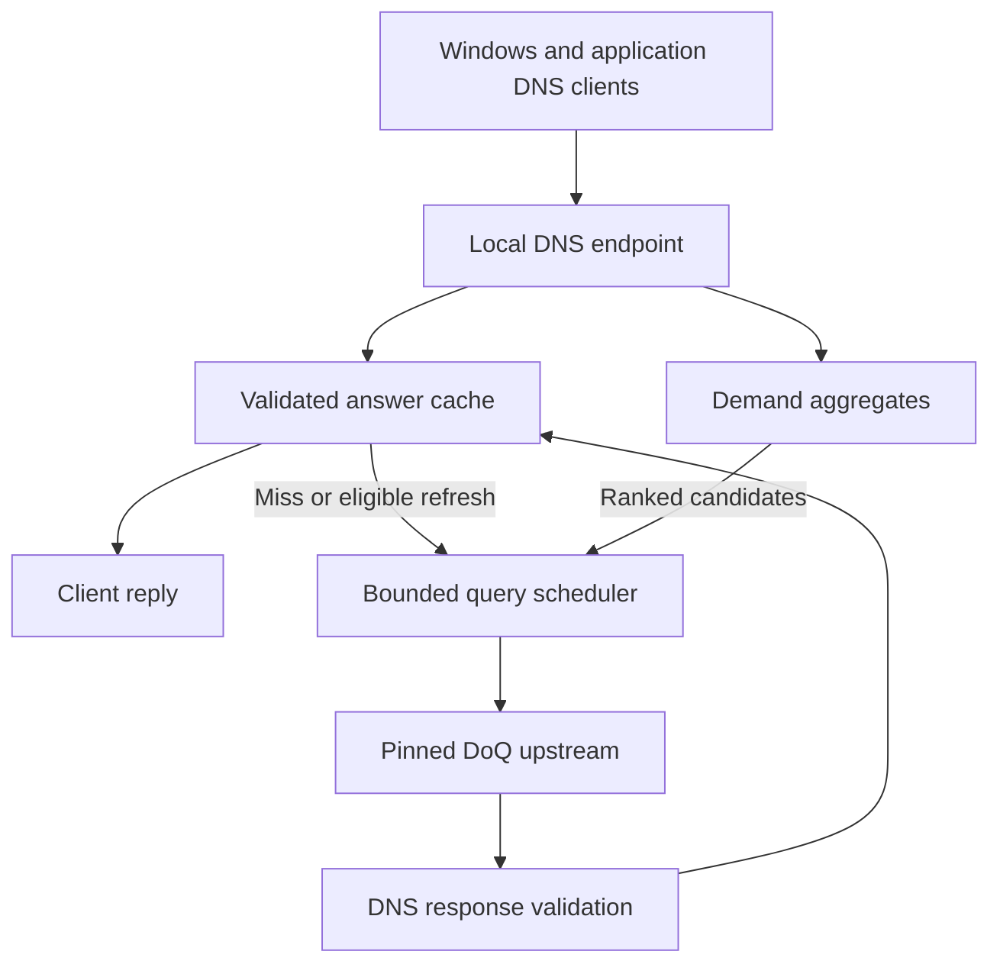

# System-wide Windows DNS service and adaptive cache

**Document:** NV-DNS-PLAN-001, revision 1.2 
**Date:** 2 November 2026 
**Owner:** David Osipov 
**Status:** Future-feature design and evaluation plan. The Windows-wide product scope and DNSSEC optimization requirement are owner instructions; algorithms, integration details and numerical settings below are engineering proposals unless explicitly identified otherwise. 
**Original design baseline:** [`f0579a1ff13d5d4176175566c4e3d75f56eca6c5`](https://github.com/DavidOsipov/NevroTick/tree/f0579a1ff13d5d4176175566c4e3d75f56eca6c5). Source/documentation review establishes no working DNS service, Windows configuration change, benchmark or native qualification.

## 1. Purpose, authority and accepted direction

NevroTick's future DNS feature is intended to answer DNS requests for the **whole Windows computer and its applications**, including applications unrelated to NevroTick. This is an explicit owner clarification from 2 November 2026. A resolver used only by NevroTick's time components would not deliver that product scope.

The owner also requires DNSSEC support using hardware acceleration and multiple CPU cores. The earlier DoQ-only upstream direction and leaf/intermediate certificate-pinning requirement remain in force. These directions are recorded in [OD-08](../nevrotick-owner-decisions.md#12-od-08--system-wide-windows-dns-and-dnssec) and the [DNS roadmap](../../ROADMAP.md#5-planned-dns-over-quic-and-certificate-pinning).

The adaptive-cache proposal comes from the owner's observation that a computer often runs the same applications and repeatedly needs the same domains. Its hypothesis is that a small, device-local demand model can identify records likely to be needed again and refresh selected records before a client experiences a miss. The size and stability of that opportunity must be measured; the hypothesis is not a universal statement about user behavior or an established speedup.

### 1.1 Authority and decision reconciliation

| Item | Status and treatment |
| --- | --- |
| Whole-computer Windows DNS answering service | Accepted owner direction, 2 November 2026; supersedes the Windows lookup-scope ambiguity previously left in the roadmap. |
| DoQ upstream transport with leaf/intermediate pinning | Retained direction. No silent upstream DoH, DoT, DNSCrypt or plaintext fallback. |
| DNSSEC, hardware acceleration and multiple CPU cores | Accepted future capability/performance requirement. Exact provider, operations, dispatch, worker limits and measured benefit require qualification. |
| Demand learning and hot/warm/cold/frozen categories | Requested design/evaluation subject. This document proposes a bounded implementation and measurable adoption criteria. |
| Decay periods, category thresholds, persistence backend, retention and prefetch budgets | Unselected engineering parameters. Examples are not shipped defaults or newly approved numerical limits. |
| Current Windows P0–P7 plan, UI-M0 restrictions and Khronos/Ananke ordering | Preserved. This future work does not become a prerequisite for the current fixtures or reorder the existing execution plan. |
| Android integration | Separate future feasibility question. Windows-wide DNS intent does not establish Android system coverage under no-root/no-continuous-VPN constraints. |

The [documentation guide](../README.md), [current architecture](../windows-time-architecture.md) and [development plan](development-plan.md) retain their authority. This document owns the detailed future DNS proposal and its local acceptance IDs. It does not replace existing REQ/BND/DEC/THR/CHECK contracts. When implementation starts, reconcile applicable canonical contracts and record evidence in one stage task under `tasks/`, linked from the roadmap and this plan.

The present task is documentation. Dependency acquisition, host DNS enrollment, service installation, native experiments and product implementation are later actions with their own stage scope.

## 2. Product boundary and application coverage

### 2.1 Local DNS ingress and remote transport

The recommended architecture exposes a **local DNS answering endpoint** for ordinary Windows clients and sends permitted upstream resolution traffic through **DoQ**. These are different hops:

- **Application/Windows to NevroTick:** proposed loopback DNS over UDP and TCP, with IPv4 and IPv6 behavior qualified. Standard local DNS ingress is an integration choice, not a plaintext upstream fallback.
- **NevroTick to its configured resolver:** authenticated DoQ under the current resolver, certificate and pin policy.

Start with loopback-only exposure. LAN/public recursive service, firewall exposure for remote clients, authoritative hosting and zone-transfer service are separate scope decisions. Bound and validate local requests even though they originate on the same computer.

The diagram proposes ownership, not existing crates, processes or qualified connections. Cache-hit replies do not wait for the learning model, statistics persistence or speculative work.

### 2.2 Intended coverage versus actual routing

All applications are intended consumers. Qualification must distinguish:

1. applications using the Windows resolver;
2. applications sending conventional DNS to configured resolvers directly;
3. applications with their own DoH/DoT/DoQ implementation, hard-coded resolver or independent proxy path;
4. VPN/enterprise namespaces and interface-specific resolution;
5. application/OS cache hits that never reach NevroTick.

Changing OS DNS settings alone is not evidence that every application uses NevroTick. Inventory and qualify supported application-routing/configuration paths; show coverage gaps honestly. Transparent packet interception, mandatory blocking of alternative resolvers and modification of browser policies are distinct enforcement choices, not implicit permission granted by the answering-service scope. Do not silently substitute an internal-only resolver for the accepted whole-computer goal.

The model observes the demand that reaches this endpoint. It must not present DNS counts as complete browser history, site visits, user intent or application identity. RFC 9076 describes application caching, multiple causes of DNS requests and privacy concerns around speculative resolution. [R06]

### 2.3 Windows activation, ownership and restoration

Use the existing narrow administrative lifecycle role for approved machine configuration changes. The future DNS data path has no clock-setting privilege. Whether it receives its own process/service or a separately qualified boundary within a network service remains a design decision; do not put DNS parsing, caching or learning inside the privileged clock broker.

Before enrolling Windows into the local endpoint, the Windows integration stage must:

- identify supported interfaces, IPv4/IPv6 settings, DHCP versus static origins, VPN/NRPT rules, managed policy and existing local DNS software;
- record only the configuration actually owned/changed by this product, including original presence, origin and values; avoid replacing DHCP state with a guessed static list;
- prove the listener, admitted upstream, bootstrap path and required trust state are ready before redirecting ordinary clients;
- detect port conflicts and endpoint impersonation/ownership loss instead of reporting an available service from a configuration flag;
- define service startup, restart, crash, sleep/resume, network-change and upgrade behavior;
- define an authorized recovery action when the selected DoQ path is unavailable; never silently switch upstream protocols;
- restore owned state on disable/uninstall only if it still represents this product's change, preserving later administrator, VPN, DHCP and policy changes;
- qualify both successful restoration and interrupted/partial activation or restoration in a disposable Windows environment.

Microsoft documents that interface DNS server settings can override DHCP settings and that NRPT determines resolution behavior for selected namespaces. These controls must be inspected in the actual supported Windows/VPN configuration. [R14, R15]

The names and address contents returned to applications are not automatically subject to the time engine's NTP destination restrictions. The permitted destination of an upstream DoQ connection and the semantics of a DNS answer are separate policies. Preserve legitimate local/private DNS results where the approved namespace policy requires them.

## 3. Trust, DNSSEC and time dependencies

### 3.1 DoQ and pinning

Retain [roadmap section 5](../../ROADMAP.md#5-planned-dns-over-quic-and-certificate-pinning) and its DOQ-C01 exit. RFC 9250 specifies the dedicated DoQ mapping, including ALPN `doq` and the default service port. DoH over HTTP/3 is not the selected transport. [R01]

Define resolver identity, approved bootstrap addresses, address refresh and rotation before the service becomes the machine's DNS path. A resolver must not depend on resolving its own bootstrap hostname through the same unavailable path. Certificate/revocation retrieval must not introduce an unexamined recursion or arbitrary egress route.

Pins supplement ordinary chain, expected-name and validity checks. Preserve separate leaf and intermediate policies, accepted certification-path matching, rotation/backup behavior, authenticated configuration changes and resumption invalidation. A pin mismatch or unavailable trusted time cannot silently disable verification. Popularity data has no authority to select another resolver or change trust policy.

### 3.2 DNSSEC contract

The recommended implementation performs **local DNSSEC validation** using an admitted implementation and maintained trust anchors. Merely setting the DO bit or copying an upstream AD bit must not be described as local validation. A different trust arrangement needs an explicit reviewed contract and accurately limited product claim.

Define secure, insecure, bogus and indeterminate outcomes; unsupported algorithms, absent trust material and unavailable trustworthy time need explicit treatment. An insecure/unsigned response is not automatically bogus. Specify client DO/CD/AD behavior, negative-answer proofs, DNSKEY/DS acquisition, trust-anchor updates and validation-state cache reuse before implementation. Follow applicable standards and their current updates rather than implementing only positive A-record signatures. [R02, R03]

An authenticated RRset's reusable lifetime is bounded by its applicable received TTL and signature constraints under RFC 4035 section 5.3.3. An assembled answer must also retain eligible components and any question-specific denial or wildcard evidence required for that answer. Keep RRset, CNAME and negative-cache lifetimes explicit. Expiry of a cached DNSKEY or DS limits subsequent reuse of that material; it does not by itself revoke a previously validated RRset whose own validity and trust-policy conditions still hold. Trust changes and relevant time changes require explicit reconsideration of affected evidence. [R02]

Distinguish a cached signature-verification result, an authenticated RRset and an authenticated complete answer. Reuse requires matching content and applicable context; a result for earlier data cannot approve replacement data. Wildcard and denial applicability remain question-specific even when signature work can be reused. The [DNSSEC/cache follow-up](dns-upstream-lessons.md#dns-r11-reuse-verification-results-bound-to-exact-content-and-proof-scope) specifies content publication, eligible ancestor-chain reuse, typed delegation evidence, cycle-safe shared dependencies and active-material custody in DNS-R11–DNS-R14. Physical retention does not extend cache freshness; TTL=0 material retains its permitted current-transaction use. [R04]

Store reusable data and proof results independently of client packet construction. Cache hits, misses and coalesced waiters each require their own ID, flags, EDNS, size/truncation and remaining-TTL handling. Keep local validation, proof availability and ability to render a DO response distinct; unchecked CD results cannot become locally authenticated through cache reuse. [DNS-R15](dns-upstream-lessons.md#dns-r15-share-complete-data-while-constructing-each-client-response-independently) records the source behavior and discriminating cases.

Learning may choose when to ask again; it cannot extend DNS TTLs, relax signature checks, promote unsigned data to authenticated data or authorize a clock change. Persisted demand statistics are optimization hints, never cached proof of DNS authenticity.

### 3.3 Hardware acceleration and multiple cores

Treat both as required workstreams for the future DNSSEC feature, with qualified implementations and measured workload-specific results:

- avoid repeated eligible work through content-bound validation reuse and shared DNSKEY/DS acquisition; count reuse, acquisition and actual cryptographic verification separately;
- select a maintained, license-compatible cryptographic/validation graph for the supported Windows target;
- use accelerated implementations where the relevant operations and exact CPU/OS features support them; check every optional instruction set before dispatch;
- preserve [OD-07](../nevrotick-owner-decisions.md#11-od-07--x64-baseline-and-runtime-optimization), its currently pending baseline migration and compatible fallback behavior; do not infer every cryptographic instruction from an x86-64-v3 label;
- schedule independent validation jobs across a bounded worker set; dependencies in a chain remain dependencies, and a small individual request need not be split across cores;
- bound queue length, active jobs, aggregate work, per-query attempts and hostile-input cost before admitting more work;
- retain resource custody until native/cryptographic work actually finishes: cancelling an awaiting task is not proof the underlying computation stopped;
- compare accelerated and fallback acceptance/rejection results, sustained resource use and latency on actual supported CPU/OS/VM rows.

No provider, number of workers, instruction-level speedup or claim that DNSSEC is normally the dominant latency source is selected here. Measure network, cache, parsing and validation costs separately. Eliminating duplicate work is not evidence of an instruction-level acceleration gain and does not replace the owner's hardware/multicore requirement. The existing time engine's runtime pilot does not automatically qualify the DNS service's runtime or multicore design.

### 3.4 Correct clocks and bootstrap

DNSSEC validity and DoQ certificate checks depend on a usable time basis. Define the startup dependency graph among local time confidence, resolver bootstrap and time-source discovery. Do not solve a circular dependency by silently accepting invalid signatures/certificates, trusting the statistics snapshot or writing the system clock from DNS data.

Use appropriate monotonic/elapsed clocks for deadlines, a trustworthy UTC interpretation for signature validity, and separately defined observation exposure for demand learning. On uncertainty, report the actual unavailable capability and follow the explicit bootstrap policy. This plan adopts no new time-bootstrap authority or additional time protocol.

[DNS-R18](dns-upstream-lessons.md#dns-r18-reconsider-cached-evidence-when-time-or-trust-assumptions-change) supplies concrete transition cases: reconsider affected validation/failure evidence after changed assumptions, avoid resurrection of elapsed TTLs, and retain eligible work when context is unchanged. A routine clock adjustment need not cause an unconditional whole-cache flush.

## 4. Existing cache mechanisms and reusable lessons

The following is a source/documentation comparison of inspected versions, not a new runtime benchmark. BIND was excluded from this comparison at the owner's request.

| Project / inspected version | Relevant trigger | What it contributes to this design |
| --- | --- | --- |
| AdGuard Home v0.107.79 with dnsproxy v0.83.2 | Optimistic mode reacts to a request finding an expired cached answer and starts asynchronous upstream refresh. The inspected code coalesces concurrent refreshes for a key. | Fast cached-response path and duplicate-work suppression. It does not establish an idle timer that refreshes popular fresh records. |
| Pi-hole FTL v6.8 | Its cache optimizer can answer an eligible stale entry when a client asks, then forward a refresh query. | Explicit stale policy and useful operational visibility. A stale-request trigger is different from popularity-selected idle refresh. |
| Unbound release-1.26.2 | With prefetch enabled, a cache hit in the last 10% of TTL triggers refresh. `prefetch-key` starts DNSKEY work at recursive trust-anchor/cached-DS and referral points; the inspected ordinary forwarding branch bypasses the former path. | Demand-triggered prefetch and shared query work. For NevroTick's DoQ forwarder, demand-derived validation-dependency warming is a separate adaptation requiring measurement. Ordinary record prefetch still requires a qualifying client hit. |
| Technitium historical Auto Prefetch | Its old help page describes autonomous maintenance of eligible popular records. | A directly relevant precedent and a reason to measure costs: version 15.5, dated 19 September 2026, removed Auto Prefetch as insufficiently effective for its resource use; basic prefetch remained. |

Primary source locations are listed in [R07–R10]. Stale serving, cache eviction and prefetch are separate mechanisms. Documentation defaults can lag implementation; reuse the exact inspected source/version for implementation decisions. Autonomous trust-anchor maintenance is also distinct from hot-record refresh.

The forwarding qualification comes from Unbound's pinned [iterator state transitions and key-prefetch call sites](https://github.com/NLnetLabs/unbound/blob/f0cd7067d950921427c91ade4ecf060e944f88eb/iterator/iterator.c). It prevents treating a recursive-path optimization as an already demonstrated forwarding benefit.

Technitium's removal is the maintainers' assessment of their implementation, not proof that every bounded adaptive design fails. Conversely, an old feature description is not evidence that the feature remains present. Recheck mutable upstream evidence at the future implementation stage.

Borrow concepts and controls selectively. Copying source code would require the repository's separate provenance, license-compatibility, dependency and verification process; this document grants no such compatibility conclusion.

### 4.1 Source-attributed implementation refinements

The [DNS upstream lessons and adaptation plan](dns-upstream-lessons.md) records the owner's requests to retain useful mechanisms from Unbound, AdGuard Home/dnsproxy, Pi-hole FTL and dnscrypt-proxy, with immutable source revisions, observed behavior, proposed adaptations and future checks. Its initial NevroTick baseline is `f8d47a7ea943de451abf7f7706975c38e827380a`; revision 1.1 adds the deeper DNSSEC/cache findings against `1eaeccfa4c57ae4c9f1695ce27939bf5844d6ed3`, preserving the earlier review's identity.

Prioritize cumulative work accounting across retries/shared jobs, request-owned metadata, DoQ replacement-connection safety and small endpoint-health/recovery state. The supplement also covers logical cache separation, namespace/DS routing, localhost-aware admission, bounded telemetry and privacy consumers. Validated NSEC proof reuse, more elaborate upstream selection and signed resolver catalogs remain conditional later experiments. No imported implementation, dependency, numerical default or performance result is adopted by recording these lessons.

DNS-R11–DNS-R18 add concrete validation/cache contracts: exact-content verdict reuse and delayed-publication guards, eligible ancestor-chain and typed no-DS evidence, shared acyclic prerequisites, ownership independent of reusable freshness, complete data with individual client replies, cause-specific failure caching, a conditional SIEVE/sharding comparison and time/trust transitions. SIEVE is optional residency work after a baseline, not a selected replacement for the demand model or a new DNS-2 gate.

The [qualification map](dns-upstream-lessons.md#4-qualification-map-and-implementation-order) refines the existing DNS-C01–DNS-C18 cases; apply relevant ownership/concurrency/resource scenarios when each component first appears, including the protocol baseline. It does not create a parallel acceptance catalog, change DoQ-only/pinning/TTL authority or reorder current time-client work.

## 5. Demand observation and bounded model state

### 5.1 Query identity and observation seam

Use a canonical query identity containing the full DNS name, QTYPE, QCLASS and an opaque resolution-context identity. Preserve any additional request attributes that affect answer, routing or validation semantics; keying and coalescing must not mix incompatible DO/CD/ECS or policy contexts. The exact admitted EDNS behavior is a protocol-stage decision.

Context includes the applicable resolver/namespace routing and policy generation. It may include a network/VPN epoch where answer applicability changes. A context change invalidates pending publication authority. It need not erase every historical popularity aggregate, but old history must not authorize sending a private name into a new public context.

Group names by a registrable domain only for an explicitly labelled display or bounded heuristic. Such grouping does not make subdomains, record types or resolution contexts interchangeable.

Observe genuine client requests at the ingress seam before choosing hit versus miss. Counting only upstream misses would mix demand with TTL and cache behavior. Each event has internally controlled provenance such as:

- `client_demand`;
- `scheduled_refresh`;
- `retry`;
- `validation_dependency`;
- `maintenance`.

Only `client_demand` increases demand scores. Other events update cost, outcome and dependency information. A client packet cannot choose its internal provenance or bypass resource admission. Retries and refresh completion do not create evidence of user interest.

### 5.2 Proposed aggregate record

| Field | Purpose and retention treatment |
| --- | --- |
| Canonical query identity and opaque context | Locate the correct record; names are sensitive and protected in persistent snapshots. Avoid storing full network-profile identifiers unless needed. |
| Short-horizon decayed score | Detect current demand. |
| Long-horizon decayed score | Retain evidence of repeated use across short gaps. |
| Last real-demand age / coarse persistence marker | Stop maintaining abandoned entries. Do not persist process-local monotonic timestamps as portable absolute time. |
| Distinct active observation windows | Separate sustained demand from one launch burst or retry storm. |
| Observation exposure and sample sufficiency | Distinguish unavailable observation from observed absence; represent insufficient evidence explicitly. |
| Recent fresh-resolution latency/cost aggregate | Estimate potential benefit and actual resource expense without a raw event log. |
| Refresh attempts, genuine lifetime extensions, useful and unused outcomes | Penalize unsuccessful or unnecessary speculative work. |
| Optional bounded seasonal buckets | Add only after evidence that they improve prediction. |
| Schema/model version and expiration metadata | Bound loading, migration and forgetting. |

The answer cache separately owns DNS records, received lifetimes, dependency/validation state and current context. Model data cannot overwrite these properties. Preserve only the minimum outcome metadata needed to evaluate incremental benefit.

Set hard limits on active records, candidate records, total bytes, name lengths, context count and queue sizes. An unlimited collection of unique subdomains must not produce unlimited memory or disk use. Because local DNS does not reliably identify the originating application/user in every path, do not rely on claimed per-process attribution for admission or privacy isolation.

### 5.3 Decay and repeated demand

A proposed explainable score update is:

$$
H(t)=H(t_0)\,2^{-(t-t_0)/\tau}+w.
$$

Here `tau` is a half-life, and `w` is a bounded contribution from genuine client demand. Maintain a short and a long half-life. Illustrative starting hypotheses are a short horizon measured in tens of minutes and a long horizon measured in days; neither is an adopted constant.

Keep total operational request counts separate from the learning contribution. A burst of 200 requests in one short window should not automatically outweigh repeated use in many independent windows. Define burst capping, retry treatment and window boundaries explicitly, while retaining truthful operational counts.

Update scores lazily when a record is touched or evaluated. Do not wake repeatedly to decay every row. Use checked/saturating representations as appropriate, reject invalid loaded values and make ordering/tie behavior deterministic for tests.

TinyLFU is a useful source of ideas for compact recent-frequency estimation and cache admission, but its purpose is admission/eviction rather than DNS refresh scheduling. Its event-window aging must not be silently substituted for elapsed-time inactivity. Start with bounded exact aggregates; add approximate sketches only when measured scale justifies collision/error analysis. [R11]

### 5.4 Time, suspend and restart

Define each clock's meaning before implementation:

- DNS freshness must account for elapsed expiry, including time spent suspended; sleep cannot preserve a short TTL as fresh.
- Opportunity to observe demand can use active/available periods, so a powered-off or disconnected computer is not counted as many observed zero-demand samples.
- Periods without real use still require a retention/cooldown policy; long-lived popularity cannot create endless background traffic.
- Calendar buckets require a sufficiently reliable date/time and an explicit timezone/DST policy.

Windows distinguishes interrupt-time variants; `QueryUnbiasedInterruptTime` excludes sleep/hibernation. It is not a universal clock for all four purposes. [R16]

On restart, age restored aggregates conservatively using available trustworthy information. If their age/context cannot be established, require new real demand before autonomous refresh. Wall-clock rollback, correction or a changed timezone must not increase popularity, resurrect an expired answer or enqueue every missed timer. After resume, revalidate context and schedule only a bounded current candidate set.

## 6. Temperature classes and optional heatmap

Maintain an internal score and evidence state. Expose classes as a readable policy summary:

| Class | Evidence | Proposed behavior |
| --- | --- | --- |
| Hot | Fresh sustained demand and plausible/measured benefit | Eligible for timer-driven refresh within budget; still subject to validity, context, cooldown and utility checks. |
| Warm | Repeated demand with insufficient benefit for continuous maintenance | Ordinary demand-triggered prefetch; later, a limited predicted-use window if qualified. |
| Cold | Sparse or unpredictable demand | Ordinary TTL-respecting caching; no autonomous refresh. |
| Frozen | No recent genuine demand | Stop speculative work and expire detailed aggregates under retention policy. |

Track an independent `insufficient evidence` state. The highest-ranked new record is not necessarily hot. Require an absolute evidence floor as well as ranking within the budget; always selecting the top 10% would produce a hot set even during inactivity.

Use hysteresis: entering a more active class requires stronger evidence than retaining it briefly. Test transitions with a changing workload, not only a steady synthetic stream. Frozen records are a forgetting stage, not a permanent archive.

### 6.1 Seasonal extension

A first seasonal candidate is **24 hourly buckets × weekday/weekend**, with counts and observed opportunity. A 168-hour weekly profile is a later candidate when enough repeated observations exist. Calendar boundaries, shifts, travel and habit changes must not be mistaken for permanent behavior.

The heatmap is a view of aggregates, not a requirement to save an event timeline. Normalize comparisons by observation exposure; do not label an unobserved period as measured low demand. Prefer recent evidence over a historical schedule when they disagree. Display uncertainty rather than a fabricated calibrated probability.

A standalone visual heatmap is optional. The first product UI can show category, recency, evidence sufficiency and why a record is or is not eligible for refresh. Domain-level views require the privacy authorization in section 9; ordinary status can show aggregate totals without names.

## 7. Refresh selection, scheduling and feedback

### 7.1 Separate popularity from incremental utility

The selection objective is approximately:

$$
U(q)=P(\text{real demand in the added useful interval})\times
\text{avoidable client wait}-\text{weighted refresh cost}.
$$

This is an objective, not a qualified estimator. The implementation may initially use an ordered rule set rather than pretending its score is a probability. If costs are combined numerically, define units, normalization and product tradeoffs; do not subtract raw bytes from milliseconds without an explicit conversion.

Examples:

- A frequently requested record with hours of remaining validity has little immediate need for refresh.
- A record with a ten-second TTL and demand every few minutes can be expensive to keep continuously fresh.
- A repeatably needed record with an approaching expiry and expensive fresh resolution is a stronger candidate.
- A large launch burst followed by silence should cool down instead of funding indefinite maintenance.

Do not assume a Poisson arrival model merely because a mean request rate is available. Bursts, application caches, TTL-related recurrence and daily schedules need validation against observed streams.

### 7.2 A bounded refresh lifecycle

1. **Eligibility:** admit a candidate with genuine demand evidence, valid context, an eligible response type and a remaining-use hypothesis. Start the pilot with successful positive answers; treat NXDOMAIN, NODATA, failures, blocked names and validation dependencies as separate policies rather than converting hot errors into continuous traffic.
2. **Deadline:** choose a refresh time from actual expiry, measured completion cost and bounded jitter. Apply minimum spacing, inactivity cutoff and overall budget. Timing examples are tunable experiment inputs.
3. **Admission:** reserve queue, network and validation resources before starting. Actual client demand has priority; independent time acquisition/control must retain its own reserved capacity.
4. **Coalescing:** share one compatible in-flight resolution per full query/context key. Client waiters and background consumers can share work without sharing cancellation authority incorrectly.
5. **Execution:** bypass the local answer-cache hit path for the refresh operation, while retaining normal upstream policy, validation, parser limits and required dependency handling.
6. **Publication:** accept a result only under the current context, configuration, trust and generation; record its actual usable lifetime. A late result from a previous network/policy generation cannot replace current state.
7. **Outcome:** count work, lifetime extension and later genuine demand separately. Penalize unused work and decrease activity when benefit disappears.

An existing still-valid answer need not be discarded merely because a refresh fails. Failure does not extend it. Define negative/error replacement semantics explicitly; a new valid negative result and a transport failure are not the same event.

Cache resolution failures under an explicit cause, compatible context and short local lifetime, following RFC 9520. A DNSSEC validation failure is not authenticated nonexistence or proven insecurity, and untrusted received TTLs do not choose its lifetime. Relevant time/trust/context changes may invalidate a cached cause. Bound failure-cache capacity and retry/backoff work; failure expiry permits a controlled recovery attempt. [R20] See [DNS-R16](dns-upstream-lessons.md#dns-r16-cache-failure-causes-with-bounded-local-lifetimes-and-recovery).

Timeout/cancellation must preserve real resource accounting and eventual cleanup. Releasing a permit while an uncancellable native job continues would allow the nominal limit to be exceeded.

### 7.3 Recursive-upstream remaining-TTL limitation

An early DoQ query can reach an upstream recursive cache that still contains the old record. The response may carry only its remaining TTL. For example, querying at second 270 for a record originally expiring at second 300 may yield a remaining TTL of 30 seconds: the expiry is still second 300. A successful query has not created another full 300-second interval. [R04]

Therefore:

- compare previous and newly admitted end-of-validity, including validation/dependency constraints;
- do not count an identical deadline as successful extension;
- do not artificially reset the TTL to the original advertised duration;
- bound retries around one expiry and back off when repeated attempts add no useful lifetime;
- do not invent a standard force-refresh flag, randomize names or silently contact a different resolver to bypass this constraint.

If the selected upstream cannot make proactive renewal useful, the measured outcome may favor demand-triggered prefetch or ordinary caching. Preserve that result instead of declaring the experiment successful from completed-query counts.

### 7.4 Freshness, stale serving and forgetting

Keep these independent:

- **Cache retention:** whether an item still occupies memory.
- **Freshness:** whether it can be served under ordinary current rules.
- **Stale policy:** a separately reviewed resilience behavior under defined conditions.
- **Demand retention:** whether the learner still remembers past interest.

The first adaptive pilot should compare fresh-answer behavior without adopting a new stale-serving policy. If stale service is later selected, define its failure trigger, client TTL/flags, maximum stale age, DNSSEC constraints and observability independently. RFC 8767 is the standards reference, not permission to treat every expired entry as valid. [R05]

A retained security label does not by itself establish that a stale answer remains eligible for AD. Specify signature-time handling, required proof/component eligibility and per-client DO/CD/AD construction, including clock-correction and trust changes. Retaining an entry or holding it for active work does not extend its freshness. See [DNS-R14](dns-upstream-lessons.md#dns-r14-retain-active-validation-material-without-inflating-cache-freshness) and [DNS-R18](dns-upstream-lessons.md#dns-r18-reconsider-cached-evidence-when-time-or-trust-assumptions-change).

## 8. Persistent storage and recovery

### 8.1 Recommended first implementation

Keep bounded aggregates in RAM and periodically save a **compact encrypted snapshot**. Save frequency is an experiment/configuration choice; losing a small amount of recent learning after a crash is preferable to coupling DNS availability to a write on every query.

The snapshot contains the versioned minimal model, not a raw query log. The first implementation need not persist DNS answers, trust anchors, transport sessions and popularity in one file. Those have different owners and validity rules.

Proposed write path:

1. capture a bounded consistent model view without blocking client DNS on disk I/O;
2. serialize under strict length/count/type limits;
3. encrypt and authenticate before any file write;
4. create a protected temporary file without following an attacker-controlled replacement path;
5. replace the previous snapshot with a qualified atomic/recovery procedure;
6. retain only the intended current/recovery files and bounded diagnostic outcome.

Read errors, corruption, unsupported schema or unavailable keys disable restoration of learning and start a fresh bounded model. They do not disable ordinary DNS, relax validation or load permissive defaults. Old snapshots cannot override current routing/privacy policy. Bound parsing and allocation even for a successfully decrypted snapshot.

### 8.2 Windows protection choices

Use **access controls and encryption together**. Directory placement alone is not an access policy. Windows DACLs determine access to protected objects. [R12]

For a small snapshot, first evaluate DPAPI protection of the complete blob. If future size, key rotation or sharing requirements justify another design, use an admitted authenticated-encryption implementation with an appropriately protected random key; do not invent a cryptographic construction.

DPAPI's ordinary scope is tied to the account, usually also the computer. `CRYPTPROTECT_LOCAL_MACHINE` permits decryption by other users of the same machine if they obtain the blob and any required optional entropy; it is not application-only isolation. User scope also identifies an account rather than one executable. DPAPI provides integrity checking, but the runtime identity and key availability still need native qualification. [R13]

For a machine service, qualify its actual account, profile/key lifetime, restart/upgrade behavior and ACLs. A service SID can restrict resource access without granting LocalSystem, but a service SID and a shared account such as LocalService are different identities for these purposes. Do not assume two services sharing an account receive independent cryptographic isolation. [R17]

The threat model covers accidental disclosure and unauthorized ordinary access within the admitted boundary. Do not promise protection against an administrator or code already executing inside the process that must decrypt the model. Review memory, crash dumps, diagnostics, backups and temporary artifacts as separate disclosure paths.

### 8.3 Hashes, HMAC and recovering names

A plain domain hash can be matched against a dictionary of likely names. A keyed index such as HMAC-SHA-256 can reduce that exposure for someone lacking the local key, but preserves correlation and does not reconstruct the original name. HMAC is a keyed authentication construction; using it as a private index is a design choice, not encryption of the name. [R18]

Autonomous prewarming after restart needs a recoverable name or a new genuine request that supplies it. The first encrypted-snapshot design is simpler than a mandatory HMAC index plus a separate encrypted name table. A counts-only/HMAC variant may intentionally wait for a real request before recovering a record's identity and eligibility.

### 8.4 Database alternative

SQLite is a later candidate if query volume or inspection requirements justify it. Encrypting only the main database at shutdown is insufficient: WAL, rollback journals and temporary files may contain related data. Qualify the chosen backend's treatment of all of them, backups and open indexes, or encrypt sensitive records before they enter storage. [R19]

Logical deletion is not a guarantee that every backup or storage remnant is physically erased. Define what reset removes and avoid an absolute forensic-erasure claim. Statistics are replaceable derived state; they should not require a complex durable transaction log to keep DNS operational.

## 9. Privacy and user-facing controls

Domain names, recency and hourly patterns are sensitive even when aggregated. Minimize detail and retention by design. [R06]

Proposed controls:

- a memory-only learning mode;
- an explicit persistent-learning setting with clear storage scope;
- pause learning and proactive refresh;
- forget learning, including queued speculative candidates and the active stored model;
- exclude configured domains/suffixes and protected namespace contexts;
- expire inactive records and cap the total retained set;
- keep names and heatmaps out of ordinary telemetry, default logs and support exports;
- provide aggregate performance status without requiring a domain-level history view.

Bind learning updates, speculative candidates and snapshot publication to a
privacy-policy generation. Pause, exclusions and forget must invalidate the
relevant queued/in-flight work at its final effect: an older refresh completion
or delayed file write cannot recreate excluded or forgotten history. Define the
completion barrier and behavior of fresh demand under the new policy; requesting
task cancellation alone does not prove this boundary.

Decide machine-wide versus attributable per-user statistics explicitly. A shared loopback DNS endpoint does not automatically know which interactive user originated every query. When attribution is unavailable, do not expose a shared domain history to any ordinary UI session as if it belonged only to that user. Management/read access needs an authenticated policy separate from the public local DNS query surface.

Do not promise automatic incognito detection without a reliable application signal. Do not infer a user/application identity from timing, a localhost source address or a DNS name and use that guess as an authorization boundary.

Autonomous refresh also creates network activity: it may keep sending names to the selected resolver after the user closes an application. DoQ protects the transport, not the name from the resolver processing it. Use real-demand cooldown, context restrictions and a finite budget; local snapshot encryption does not remove this traffic effect. [R01, R06]

## 10. Resource policy and measurable usefulness

### 10.1 Bounded operation

Freeze finite limits before each experiment for model/cache bytes, candidate count, queued jobs, simultaneous upstream work, CPU/native work, requests per unit time, retry attempts and inactivity duration. A percentage-of-demand budget alone is insufficient: synthetic client traffic could inflate it. Pair adaptive budgets with absolute caps.

Use a small deadline queue or another bounded scheduling structure, not a scan or wakeup for every record on a tight interval. Do not wake a sleeping computer solely to maintain the heatmap. On battery, a metered connection, CPU pressure or an unavailable upstream, a policy may reduce or pause speculative work while preserving foreground service.

Bound adversarial cryptographic and negative-proof work as well as ordinary packet sizes. Multicore execution must not turn one hostile request into unbounded parallel verification. New-name floods, repeated failures and repeated context changes must remain within aggregate budgets.

### 10.2 Baselines and experiment design

Compare the same admitted input/workload families under:

1. ordinary TTL-respecting caching;
2. demand-triggered prefetch near expiry;
3. demand-triggered prefetch plus bounded adaptive autonomous refresh.

Keep transport, validation, source data, warm/cold starting conditions and resource limits comparable. Include sustained activity, launch bursts, periodic use, sparse use, short/long TTLs, upstream-cache residual TTL, changing habits, downtime and adversarial streams. Use controlled peers for routine tests; no public DNS service load test is implied.

Measure:

- end-to-end client p50/p95/p99 latency and successful-resolution rate;
- fresh hits separately from stale replies and validation failures;
- additional upstream queries, bytes and validation jobs;
- actual signature-verification operations, reused eligible validation results, DNSKEY/DS acquisitions and shared dependency work, with warm/cold states explicit;
- CPU time, memory, queue pressure, wakeups and relevant energy observations;
- refreshes that extend effective validity;
- refreshes followed by real demand in the added useful interval;
- unused refreshes and cost per estimated prevented miss;
- impact on time acquisition and other reserved work.

Example accounting: if the old answer expires at 12:05 and a refresh creates validity through 12:10, a hit at 12:04 does not establish incremental benefit. A genuine request at 12:07 is a potential benefit, subject to context and the comparison baseline.

A shadow ordinary-cache model over the same genuine demand stream can estimate counterfactual misses. It is not a direct observation of the latency an unexecuted request would have experienced. State that limit and confirm client latency/resource effects with actual controlled comparisons. Account for coalesced waiters and the fact that ordinary misses would themselves refresh subsequent requests; do not credit every later hit to one prefetch.

Predeclare the required improvement and allowed cost for the bounded pilot once a baseline exists. If proactive refresh does not improve the selected user-facing metric enough, retain ordinary/demand-triggered caching and keep the speculative mode disabled or deferred. That is a valid experiment outcome. A higher hit rate by itself is not acceptance.

## 11. Acceptance cases for the future implementation

The following **DNS-Cxx** identifiers are local to this plan. They specify future evidence, not completed tests. Each relevant case needs a valid neighboring control, the actual enforcing consumer and a bounded cleanup/restoration path. Pure model checks and native Windows evidence answer different questions.

| ID | Case / independent expected result | Required evidence layer |
| --- | --- | --- |
| DNS-C01 | Whole-computer enrollment routes the declared Windows/application cases through the local service; bypass/unsupported paths are identified accurately. | Native Windows with observed queries, interface/VPN/app matrix. |
| DNS-C02 | Loopback UDP/TCP and admitted IPv4/IPv6 behavior work; malformed/truncated/oversized inputs and floods remain bounded; no accidental LAN listener. | Protocol fixtures, native socket/exposure observations. |
| DNS-C03 | Bootstrap does not recursively require its own unavailable DNS path; wrong names, invalid chains/pins, stale resumption and blocked DoQ never cause silent fallback. | Controlled DoQ peer, actual selected verifier, bootstrap/recovery cases. |
| DNS-C04 | DNSSEC valid, unsigned, bogus, negative-proof, unsupported/unavailable and wrong-time cases receive the specified distinct treatment. | Independent protocol vectors and admitted validator; trust/update lifecycle cases. |
| DNS-C05 | RRset/signature and required answer-component lifetimes are respected through sleep, clock correction, restart and changed trust; chain-material cache expiry is distinguished from validity of an already validated answer; active custody cannot inflate fresh reuse; no popular entry gains additional authority. | Injected time/context model plus native clock/suspend integration. |
| DNS-C06 | Genuine cache hits and misses affect demand; refreshes, maintenance, validation fetches and retries do not self-heat the model. | Deterministic event sequences through the real observation seam. |
| DNS-C07 | A burst cools down, repeated demand differs from one burst, no-demand periods end refresh, and insufficient evidence is explicit. | Independent trace expectations and valid neighboring workloads. |
| DNS-C08 | Temperature transitions use declared thresholds/hysteresis; exposure-normalized seasonal buckets handle missing observation and calendar changes. | Pure model properties and replay; seasonal part only when selected. |
| DNS-C09 | A returning remaining-TTL response that adds no lifetime earns no extension credit and cannot start a tight refresh loop. | Controlled recursive-upstream fixture and queue/request observations. |
| DNS-C10 | Compatible client and refresh work coalesce; shared validation prerequisites remain acyclic and preserve individual cancellation, custody and response semantics; one consumer cannot incorrectly cancel another, leak custody or multiply work. | Deterministic concurrency schedules plus actual runtime behavior. |
| DNS-C11 | Old network/VPN/configuration generations cannot publish results or send private names under a new incompatible route. | Action-sequence model, controlled network changes and native integration. |
| DNS-C12 | Random-name floods, hostile validation work, failures and repeated invalidations stay within model, queue, worker and traffic caps. | Bounded stress/resource observations at the real entry points. |
| DNS-C13 | Faulty, oversized, old-version or inaccessible snapshots cause safe learning reset while ordinary DNS continues; power loss preserves declared recovery behavior. | Parser/persistence tests and native filesystem/identity cases. |
| DNS-C14 | Snapshot/temp/backup/log behavior matches privacy claims; cross-user access and management IPC obey the selected actual identity policy. | Native Windows accounts, effective ACL/DPAPI checks and artifact inspection. |
| DNS-C15 | Pause, exclusion and forget operations affect model, queued candidates, retained snapshots and later behavior; old in-flight learning or snapshot publication cannot recreate removed history across the privacy-generation barrier. | End-to-end management-to-scheduler/persistence tests with delayed completions/writes, not UI-only checks. |
| DNS-C16 | Accelerated/fallback validation agree on accepted and rejected inputs; optional CPU features are admitted correctly and multicore work remains bounded. | Actual supported CPU/OS/VM rows, independent vectors and resource measurements. |
| DNS-C17 | Enable, failure, restart, update, disable and uninstall preserve owned configuration and later administrator/VPN changes. | Disposable Windows lifecycle and interruption/restoration experiments. |
| DNS-C18 | Adaptive mode meets predeclared latency/usefulness/cost criteria against both baselines without degrading reserved time-service work. | Comparable repeated controlled measurements with complete outcomes. |

Apply existing repository property/model/fuzz/concurrency/mutation tools only where they answer a named gap in this table and are admitted for the selected code. A plan does not establish a new tool requirement. Documentation checks do not count as a DNS-C pass, DOQ-C01, a native security result or release qualification.

## 12. Staged delivery and next action

The current product sequence remains owned by the [development plan](development-plan.md) and [roadmap](../../ROADMAP.md). The following are dependencies within the future DNS workstream, not an instruction to interrupt current Windows time work.

| Stage | Bounded outcome | Exit and next action |
| --- | --- | --- |
| DNS-0: integration and evidence design | Resolve the proposed listener, Windows coverage matrix, ownership/restoration model, bootstrap/time dependencies, runtime identities and finite experiment budgets. Inventory the current source/tooling when this stage starts. | Reviewed contracts, named enforcement owners and a safe controlled-fixture plan. Material dependent choices use OD-04; no repeated request for the already accepted whole-computer scope. |
| DNS-1: protocol/cache baseline | Build and qualify a minimal local DNS/DoQ path and ordinary cache against controlled peers, with explicit response, key/context and failure contracts. | Applicable DNS-C02/C03/C05/C09/C10/C11/C12 cases; no deployment or full DNSSEC claim from a partial fixture. |
| DNS-2: DNSSEC and optimized validation | Admit the validator/crypto graph, content-bound reuse, chain/delegation evidence, shared prerequisite custody, failure/time lifecycle, CPU dispatch and bounded parallel execution. | Applicable DNS-C04/C05/C10/C11/C12/C16 and DOQ-C01 evidence; unresolved backend/native results remain explicit. |
| DNS-3: Windows service integration | Qualify supported machine/application routing, identity, lifecycle, recovery and resource separation in disposable Windows fixtures. | DNS-C01/C02/C03/C11/C14/C17 for the declared matrix. Local query access and management authority remain separate. |
| DNS-4: demand model in shadow mode | Add bounded aggregates, decay, category transitions and persistence/privacy behavior; observe candidates without issuing autonomous requests. | DNS-C06/C07/C08/C13/C15 plus applicable DNS-C12 model-budget checks and DNS-C14 actual snapshot/temp/backup/identity/privacy checks; ordinary-cache baseline and stable accounting. Earlier service-identity evidence does not qualify the newly added storage. Seasonal buckets may remain deferred. |
| DNS-5: bounded autonomous refresh | Add timer admission, coalescing, useful-interval accounting, cooldown and resource caps. | DNS-C09/C10/C11/C12/C18; adopt, revise or defer based on the predeclared comparison. |
| DNS-6: optional refinement | Evaluate seasonal prediction, approximate frequency structures or richer UI only for a measured remaining need. | Added complexity demonstrates incremental benefit and preserves prior acceptance; no mandatory ML service, GPU or remote history collection. |

These stages may reuse already qualified components and allow independent pure work where dependencies permit. Full machine DNS activation requires the relevant integrated protocol, trust, identity and recovery prerequisites; completion of a shadow model alone does not authorize enrollment.

The first implementation-stage task should record candidate identity, source changes, applicable DNS-C/DOQ-C01 and canonical CHECK requirements, admitted environment, budgets, independent expected results, actual observations, restoration, gaps and the next action. Keep later-stage uncertainty visible without creating empty execution receipts now.

## 13. Choices still requiring evidence

| Choice | Resolve before |
| --- | --- |
| Service/process ownership, actual account and management/read authorization | Persistent/shared statistics or Windows enrollment. |
| Supported interface, enterprise/VPN and independent-application routing policy | Claiming whole-machine coverage for a supported configuration. |
| Local protocol compatibility, EDNS flags, query/context keys and coalescing rules | Freezing the resolver/cache contract. |
| Resolver/bootstrap preset, pin representation, combined matching and rotation | Admitting production DoQ connections. |
| DNSSEC implementation, trust-anchor maintenance, time-unavailable behavior and algorithm policy | Claiming local validation. |
| CPU-feature kernels, fallback and bounded worker/runtime graph | Claiming required acceleration/multicore support or performance. |
| Half-lives, evidence floor, hysteresis, inactivity cutoff and exact budgets | Running the adaptive comparison. |
| Persistent-learning default, identity/key scope, retention and exclusions | User-facing persistence or domain-level views. |
| Incremental benefit estimator and success/cost thresholds | Deciding whether autonomous refresh should ship enabled. |
| Stale serving or proactive negative-answer refresh | Expanding beyond the initial fresh positive-answer pilot. |

Use the existing [owner-decision procedure](../nevrotick-owner-decisions.md#6-od-04--decisions-when-evidence-makes-them-concrete) for material policy tradeoffs when a concrete dependent action is ready. Routine implementation choices within accepted contracts do not require another permission round. Windows-wide product intent is already decided; measured coverage, safe integration and benefit remain to be established.

## 14. Primary sources and evidence limits

Reviewed for the design on 2 November 2026, including the preceding cache/source comparison. Versioned code supports the stated mechanism at that version. Mutable documentation and algorithm/provider policy must be rechecked for implementation. No source below proves NevroTick performance, compatibility or successful execution.

- **R01 — DoQ:** [RFC 9250](https://www.rfc-editor.org/rfc/rfc9250.html), dedicated transport, authentication and privacy context.
- **R02 — DNSSEC validation and authenticated TTL:** [RFC 4035](https://www.rfc-editor.org/rfc/rfc4035.html), especially section 5.3.3. Apply its current updates during implementation.
- **R03 — DNSSEC status and purpose:** [RFC 4033](https://www.rfc-editor.org/rfc/rfc4033.html). The implementation stage must separately identify current algorithm and trust-anchor requirements.
- **R04 — DNS TTL semantics:** [RFC 1035](https://www.rfc-editor.org/rfc/rfc1035.html); [Unbound reply TTL handling at release-1.26.2](https://github.com/NLnetLabs/unbound/blob/release-1.26.2/util/data/msgreply.c).
- **R05 — stale-answer resilience:** [RFC 8767](https://www.rfc-editor.org/rfc/rfc8767.html).
- **R06 — DNS privacy and observation limits:** [RFC 9076](https://www.rfc-editor.org/rfc/rfc9076.html).
- **R07 — AdGuard Home/dnsproxy:** [AGH v0.107.79 dependency pin](https://github.com/AdguardTeam/AdGuardHome/blob/05ba17b282da1c4393d6a4ba4db0cf519194a362/go.mod), [dnsproxy v0.83.2 cache reply path](https://github.com/AdguardTeam/dnsproxy/blob/acf2b30e05202e171bbbaf4a3176ea07edb964b3/proxy/proxycache.go) and [refresh coalescing](https://github.com/AdguardTeam/dnsproxy/blob/acf2b30e05202e171bbbaf4a3176ea07edb964b3/proxy/optimisticresolver.go).
- **R08 — Pi-hole:** [official cache explanation](https://docs.pi-hole.net/ftldns/dns-cache/), [FTL v6.8 request/forwarding path](https://github.com/pi-hole/FTL/blob/v6.8/src/dnsmasq/forward.c) and [optimizer configuration mapping](https://github.com/pi-hole/FTL/blob/v6.8/src/config/dnsmasq_config.c).
- **R09 — Unbound:** [configuration manual](https://unbound.docs.nlnetlabs.nl/en/latest/manpages/unbound.conf.html), [release-1.26.2 worker prefetch path](https://github.com/NLnetLabs/unbound/blob/release-1.26.2/daemon/worker.c) and [shared query work](https://github.com/NLnetLabs/unbound/blob/release-1.26.2/services/mesh.c).
- **R10 — Technitium:** [historical help page dated 2 May 2021](https://technitium.com/dns/help.html) and [changelog, version 15.5 removal of Auto Prefetch on 19 September 2026](https://github.com/TechnitiumSoftware/DnsServer/blob/master/CHANGELOG.md). The historical help text is not a current feature inventory.
- **R11 — frequency-based cache admission:** [TinyLFU original paper](https://arxiv.org/abs/1512.00727). It supplies admission-policy ideas, not evidence for this DNS-prefetch design.
- **R12 — Windows access controls:** [Microsoft access-control lists](https://learn.microsoft.com/en-us/windows/win32/secauthz/access-control-lists).
- **R13 — Windows DPAPI:** [CryptProtectData](https://learn.microsoft.com/en-us/windows/win32/api/dpapi/nf-dpapi-cryptprotectdata).
- **R14 — Windows interface DNS settings:** [Set-DnsClientServerAddress](https://learn.microsoft.com/en-us/powershell/module/dnsclient/set-dnsclientserveraddress?view=windowsserver2025-ps).
- **R15 — VPN and namespace routing:** [Microsoft VPN name resolution / NRPT](https://learn.microsoft.com/en-us/windows/security/operating-system-security/network-security/vpn/vpn-name-resolution).
- **R16 — Windows elapsed-time semantics:** [QueryUnbiasedInterruptTime](https://learn.microsoft.com/en-us/windows/win32/api/realtimeapiset/nf-realtimeapiset-queryunbiasedinterrupttime).
- **R17 — service resource identity:** [SERVICE_SID_INFO](https://learn.microsoft.com/en-us/windows/win32/api/winsvc/ns-winsvc-service_sid_info).
- **R18 — keyed hashing:** [RFC 2104](https://www.rfc-editor.org/rfc/rfc2104.html). Its historical algorithm examples are not present-day algorithm selections for NevroTick.
- **R19 — SQLite auxiliary files:** [SQLite temporary files](https://sqlite.org/tempfiles.html) and [write-ahead logging](https://sqlite.org/wal.html).
- **R20 — resolution-failure caching:** [RFC 9520](https://www.rfc-editor.org/rfc/rfc9520.html), especially sections 3.2 and 3.4; updates the earlier optional DNSSEC validation-failure caching requirement. DNS-R16 in the linked supplement distinguishes standards bounds from an unselected project default.
