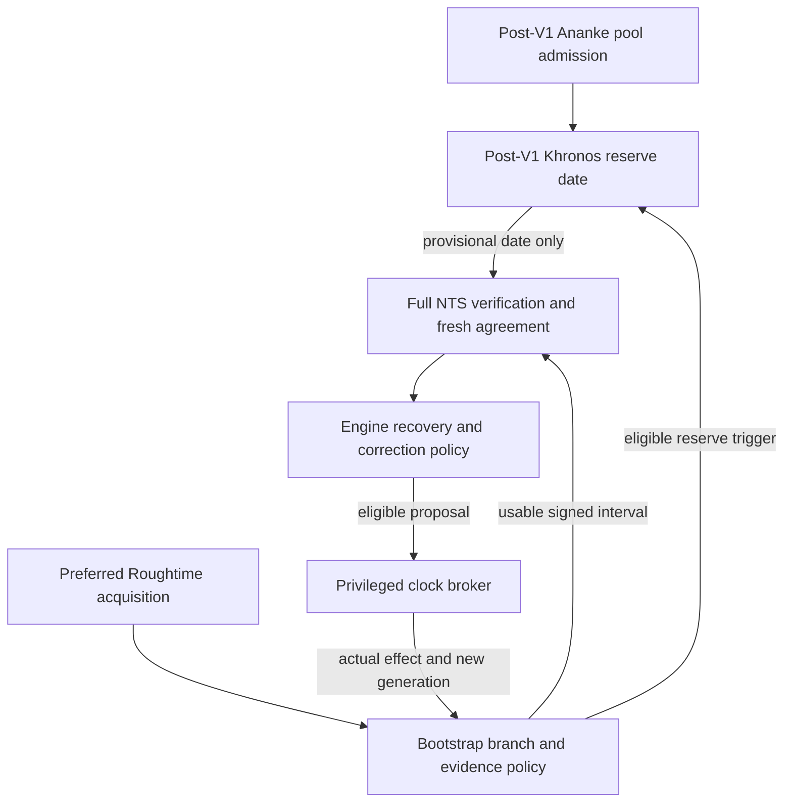

# Roughtime, NTS and Khronos/Ananke coordination

**Document:** NV-TA-001, revision 1.9<br>
**Evidence reviewed:** 3 November 2026, Asia/Tbilisi<br>
**Implementation-source review:** 27 November 2026, Asia/Tbilisi; §8.2<br>
**RFC client-contract reconciliation:** 27 November 2026, Asia/Tbilisi; §§8.3–8.4<br>
**Scope amended:** 27 November 2026<br>
**Project baseline:** [9c6b5ef39b134c844a850deb9126823d668babe7](https://github.com/DavidOsipov/NevroTick/tree/9c6b5ef39b134c844a850deb9126823d668babe7)<br>
**Status:** owner-selected V1 Roughtime bootstrap and post-V1 reserve research; no new runtime mechanism, provider preset, dependency or correction authority is qualified.<br>
**Execution and evidence owner:** [shared task](../../tasks/time-assurance-integration.md).

## 1. Scope, authority and delivery order

David requested that the Roughtime research be recorded and its interaction with
Khronos/Ananke designed. The accepted direction includes V1 Roughtime-assisted
recovery from a severely wrong initial date. Independent replacement of
Chrony-derived implementations remains post-V1 and requires RGT-C01. This document
proposes how the time mechanisms cooperate. It does not turn every brainstorm
alternative into an owner decision.

**Later owner refinement, 3 November 2026:** use Roughtime as the preferred
initial date source, then NTS; invoke Khronos/Ananke with an NTP population only
when Roughtime is unavailable or cannot provide a usable date for NTS. This
revision replaces the earlier proposed periodic-watchdog role with a conditional
bootstrap reserve. Continuous post-bootstrap monitoring remains a deferred
alternative. The concrete implementation interpretation is a bounded provisional
date followed by full NTS recovery before a broker clock change; the instruction
does not itself settle preliminary global stepping or unresolved trust limits.

The [architecture](../windows-time-architecture.md), [OD-02](../nevrotick-owner-decisions.md#4-od-02--distinguish-authenticated-recovery-from-ordinary-correction)
and [R-02/R-05](../nevrotick-research-handoff.md) retain their authority. Relevant
contracts are REQ-3/8/10/12, DEC-2/6/7/8/12, OPEN-8 and the CHECK mappings in the
task. Local TA-W/TA-C identifiers do not replace those requirements.

**Leap-policy integration, 4 November 2026:** [architecture §10.5](../windows-time-architecture.md#105-leap-seconds-and-time-scales)
and [NV-LP-001](leap-second-policy.md) add the selected date/scale/guard contract;
the [S1.4 task](../../tasks/s1.4-leap-policy.md) owns its implementation before
dependent integration. Reviewed compiled leap history, future coverage and the
continuous-UTC rule effective **20 May 2027** remain separate from a bootstrap
date. The rule is evaluated against all admitted true-date/era hypotheses, not
the local clock. This amendment qualifies no new source, native mapping or
clock-write envelope; earlier research/review receipts retain their own scope.

**Post-V1 scheduling amendment, 14 November 2026:** [OD-16 §20.1](../nevrotick-owner-decisions.md#201-mathematics-experiments-first--13-november-2026)
places [MATH-0](../../ROADMAP.md#math-0--post-v1-mathematical-estimation-experiments)
first after actual V1 release; [OD-20](../nevrotick-owner-decisions.md#24-od-20--supplementary-certificate-distrust-after-v1)
places [TRUST-0](post-v1-certificate-distrust.md) second, followed by
[MT-0](post-v1-multithreading.md) and then Khronos (the later 27 November
amendment below inserts CLK-0 between these stages).
MATH-C01 requires experiment evaluation/disposition, not production
adoption. This changes delivery order only; the dated protocol research and review
receipts retain their original scope.

**Current V1 scope, 27 November 2026:**
[OD-02](../nevrotick-owner-decisions.md#v1-protocol-and-hardware-scope--27-november-2026)
selects NTPv4/NTS and Roughtime, with no PPS/GNSS/refclock product inputs.
RGT-0 is finite implementation and qualification work under existing P2/P7 owners,
with RGT-C01 required before V1. This supersedes earlier later-only Roughtime
scheduling and the immediate RGT-0 → CHR-0 timing; it does not advance CHR-0 or
Khronos/Ananke into V1. Protocol, provider/key, interval and Windows-verifier
gates remain open. Unavailable physical-reference equipment does not block
independent protocol work or supply a qualification pass.

**Post-V1 clock-permissions amendment, 27 November 2026:**
[OD-21](../nevrotick-owner-decisions.md#25-od-21--restricted-local-clock-changing-permissions)
places [CLK-0/CLK-C01](windows-clock-permissions.md) after MT-C01 and immediately
before Khronos. CLK-C01 records assessed implementation/qualification and an
explicit disposition; research or blocked work supplies no implemented pass.
This optional host-wide restriction adds no V1 bootstrap or isolation prerequisite
and changes no protocol trust or broker clock authority.

Keep the delivery obligations distinct:

- **RGT-0 → RGT-C01 within P2/P7 → V1 released.**
  [RGT-0](../../ROADMAP.md#rgt-0--roughtime-bootstrap-for-a-badly-wrong-clock)
  retains its implementation and actual Windows-recovery exit.
- **V1 released → MATH-C01 disposition → TRUST-C01 → MT-C01 → CLK-C01 → KHR-C01 disposition → GEO-C01 disposition → Android.**
  [KHR-0](../../ROADMAP.md#khr-0--evaluate-independent-time-cross-checking) and the later
  [GEO-0 experiment](../../ROADMAP.md#geo-0--evaluate-geography-assisted-source-ordering)
  retain `ADOPT_LIMITED`, `DEFER` or `REJECT` outcomes. The existing catalogue task
  owns GEO-C01; geography cannot alter a qualified reserve population or sampler.
- **CHR-0 after V1 and RGT-C01.** Its placement against other post-V1 work remains
  open; RGT-C01 alone does not start the replacement stage.

The reserve adds no V1 delivery prerequisite. KHR-0 evaluates its selected
baseline in its post-V1 phase. RGT-0 must remain testable while Khronos is deferred
or rejected. A later joint profile needs the applicable integration evidence;
neither stage inherits the other's completion.
Claiming the combined automatic-reserve profile requires qualification of its
reserve branch. V1 discloses the absent reserve. In the strict/Roughtime-only
profile, with no separately enabled and admissible plain-helper route, failed cold
bootstrap stays blocked or independently usable cached/strict NTS continues.
[Architecture §8.1](../windows-time-architecture.md#81-recovery-order) retains
the existing explicitly enabled helper policy and all subsequent NTS/broker gates.
Roughtime failure neither enables those helpers nor clears signed conflict.
The current Core work and [execution gates](development-plan.md#7-next-executable-task-for-a-development-agent),
including the admitted Sandbox scope and remaining holds, continue to govern.

## 2. Roles and the primary-source basis

| Mechanism | Proposed NevroTick role | Limit of that role |
| --- | --- | --- |
| NTS acquisition and primary estimator | Fresh authenticated observations for ordinary estimation and the existing recovery/correction policy | Authentication, source agreement, accuracy and permission to change the clock remain separate |
| Roughtime | V1 preferred approximate UTC/date interval for cold bootstrap without an adequate trusted time basis | No NTS vote, direct Windows clock write or claim of fine precision |
| Khronos-inspired recovery | Post-V1 conditional date candidate when the preferred branch cannot supply usable evidence | Unauthenticated Pool input remains provisional; cold-start guarantees need their own population, fault, era and sampling analysis |
| Ananke-inspired admission | Post-V1 candidate policy for constructing and maintaining the reserve population | A pool policy, not another measurement protocol or independent vote; generic Pool answers are not an audited Ananke roster |
| Existing engine policy and clock broker | Admit evidence, prepare eligible proposals, then enforce current authorization and actual-effect accounting | Agreement never expands privilege, replenishes budgets or bypasses the broker |

**Roughtime source facts.** Experimental RFC 10049 uses configured long-term
keys and request-bound signed time intervals; §6 covers NTS certificate-time
bootstrap. §§8–9 require multiple independent operators and address chained
measurements, delay and trust-list maintenance. A valid signature does not prove
correct UTC; an old compromised delegated key remains a concern. [S1]

**Khronos source facts.** Informational RFC 9523 describes randomized sampling,
filtering, bounded resampling and a pool-wide panic calculation. It includes an
initial update and depends on population, attacker, honest-clock and drift
assumptions. §6 addresses corrections during a sampling round. Its original
clock-takeover behavior is not adopted here. [S3]

**Ananke source facts.** The NDSS 2021 paper proposes cautious admission of
audited stratum-1 references and a slower Chronos watchdog alongside ordinary
synchronization. Self-reported stratum and convenient network labels do not
establish the intended independence. The paper does not supply NevroTick with a
qualified production pool. [S4]

The RFC's steady-state watchdog guarantees do not establish the security of a
one-shot cold bootstrap. Its threat model excludes an attacker who can influence
all server communications. Such an attacker can suppress Roughtime and fabricate
consistent unauthenticated Pool replies; more destination addresses alone do not
remove that common-path exposure. [S3] This motivates the separate provisional
date and downstream NTS gates, not a promise that the reserve equals Roughtime.

The following integration rules are engineering proposals grounded in these
sources and the existing project contracts. Published attack-time estimates or
probability bounds are not transferred to NevroTick, multiplied together or
reused after changing the pool, sampler, retries, trust or panic behavior.

## 3. One policy owner and one clock writer

Keep network collection and pure calculations in their existing unprivileged
engine/core owners. Reuse the engine's recovery/correction policy; do not create
a competing service, generic command interface or independent phase/frequency
controller. Suggested evidence types below are planned contracts, not existing
Rust APIs.



Khronos takeover/panic and a Roughtime command-line clock setter must not bypass
that graph. The selected future reserve supplies only a provisional TLS date;
it cannot enter an NTS quorum or acquire a clock controller of its own.

The Windows kernel remains the sole executor of explicit leap events. None of
these mechanisms schedules an extra event or synthesizes a ±1-second broker
request. The leap guard and subsequent fresh-quorum residual correction use the
same engine/broker ownership and actual-outcome rules as ordinary recovery.

**Selected post-V1 reserve role:** conditional bootstrap reserve. Healthy NTS
tracking does not periodically activate Khronos under this profile. A later
continuous observer or correction inhibitor would be a separately selected and
qualified extension. The reserve is intended to activate automatically within
its declared recovery envelope, not to prompt during each ordinary outage.
Until that extension is specified and qualified, the current strict-default and
explicitly enabled plain-helper baseline remains controlling.

## 4. Runtime activation without a bootstrap cycle

Leap-policy ambiguity limits the authority of a dependent time observation or
correction; it does not stop independent bootstrap acquisition, NTS transport or
authenticated complete-release admission. Do not require an already
discipline-eligible sample to obtain the independent date evidence needed for
that admission. Provisional responses retain their limited consumers and cannot
be promoted into a leap vote, ordinary quorum or direct clock write. Unknown
future calendar coverage alone does not activate the reserve or stop qualified
NTS tracking outside the applicable guard.

1. Reuse eligible cached associations or an adequate trusted time basis for
   strict NTS. Preserve key/trust-age limits. A healthy restart need not depend
   on Roughtime availability; an untrusted wall-clock value alone is not such a
   basis. Fresh protected observations establish observation freshness.
2. For cold date bootstrap, try Roughtime first using the reviewed initial
   key/endpoint catalogue and its multi-operator measurement procedure. Apply
   finite deadlines and available qualified transports, including TCP where
   advertised, with §8.4.2's exponential retry and authenticated-reset rules;
   one malformed reply is not a failure of the whole mechanism.
3. If that branch yields usable evidence, pass its interval to isolated NTS
   verification. If it cannot, classify the reason under section 6. Without a
   separately enabled, policy-admissible plain-helper route, V1 reports blocked
   cold bootstrap or retains independently usable cached/strict NTS. An already
   enabled helper route retains architecture §8.1’s complete gates; timeout or
   route change cannot clear signed conflict. After post-V1 reserve qualification,
   an eligible failure may invoke bounded
   Khronos/Ananke recovery. Its output is a provisional date hypothesis with
   lower assurance, not a clock correction.
4. For every admitted route, establish supported date/era interpretation and complete
   identity/trust/revocation policy, fresh protected NTS observations, configured
   source agreement and candidate-time revalidation. Preserve the distinct
   Roughtime or plain-reserve ancestry. Do not lower existing NTS agreement
   requirements merely to make this reserve succeed.
5. Submit only an eligible proposal to the broker, account for the actual
   acknowledged effect and invalidate or explicitly rebase pending results.
   Continue ordinary NTS tracking; the reserve returns to inactive status.

This is NevroTick's proposed activation rule. It is not a claim that Khronos
cannot initialize time: its RFC has an initial/panic path. Neither that fact nor
pool curation supplies the signed date/era basis and Windows verification evidence
required for this project's century-scale recovery.

Do not require a steady-state watchdog verdict before Roughtime can bootstrap
NTS. Bind reserve rounds to a defined comparison epoch and absolute-date/era
interpretation before using their offsets. Earlier observations are not
automatically promoted into that epoch. An untriggered reserve is not an agreeing
monitor. Authentication, agreement, evidence age, interval width and the actual
bootstrap route remain separate in diagnostics and production UI work.

**No date search until TLS accepts.** A certificate-time error may mean a wrong
date or an expired/misconfigured server. Try the other admitted NTS authorities,
retain the failure category and require an independently derived candidate.
Never choose a certificate-valid date solely because it makes that certificate
pass. Separate TLS verification/session state across hypotheses and perform the
required fresh full verification; resumed sessions cannot silently stand in for
new certificate-time evidence.

**Residual reserve risk.** Forged Pool time alone does not forge NTS credentials.
However, a forced old-date candidate together with a stolen expired NTS key may
pass candidate-time verification and return matching signed/authenticated time.
Checking that returned time against the same certificate period does not break
that circularity. Retain authenticated saved bounds, independent configured NTS
support and effective revocation requirements; define what the selected profile
can claim when those constraints are absent. This is a combined-design threat
case, not proof that every fallback can be safely completed. [S2, S3]

## 5. Evidence contracts and dependency accounting

The engine's planned receiving boundary must accept checked, immutable evidence
with these conceptual fields. Exact types and limits are frozen in TA-W02 before
implementation; documentation alone does not enforce the contract.

| Evidence group | Required meaning and consumer rule |
| --- | --- |
| Origin and trust | Mechanism, protocol version, authentication class, peer/key identity, certificate-time basis and bootstrap ancestry; parser success is not authentication |
| Independent support | Operator groups, known upstream-clock/hosting dependencies and original observation IDs; unknown independence stays unknown |
| Selection provenance | Catalogue/pool version, selected/responding/admitted/independently supported sets, admission reasons and RNG/round identity |
| Time context | Complete admitted UTC/era hypotheses, precisely defined interval/uncertainty, qualified monotonic observation and evaluation instants, aging/fault assumptions and valid lifetime; defined protocol scale and unsmeared-UTC provenance for the NTP source population |
| Leap context | Admitted release dataset/effective-rule revisions, historical and future coverage, scale segment, possible-event identity, guard phase and possible exchange span; raw LI remains an authenticated or unauthenticated source claim with its own admission result |
| Current applicability | Boot/clock/mapping epoch, policy and key generations, applied-correction context, eligible consumers and explicit limitations; distinguish bootstrap-usable evidence from discipline eligibility and preserve the minimum post-guard acquisition instant |
| Verdict | `agrees`, `contradicts`, `insufficient evidence` or `stale`, with a bounded reason; disabled/not-yet-initialized monitors remain visibly unassessed |

Compare evidence at one qualified evaluation instant and clock frame. Do not
compare an old Windows-relative offset with a new absolute interval as if they
were simultaneous. A step, unsuitable suspend/resume transition, reboot, restored
snapshot, uncertain acknowledgement or changed key/policy generation requires
invalidation or a qualified explicit transformation. Freshness must not come from
the wall clock being repaired. A newly evaluated predictor cannot refresh the
age of its underlying measurements.

### 5.1 Prevent manufactured corroboration

Do not implement a generic "two of NTS, Roughtime and Khronos agree" rule.

- One operator or clock appearing under different protocols does not become
  multiple independent supporting groups. Two consumers of one observation do
  not create two observations.
- When a Roughtime interval supplied the TLS validation date, record that
  dependency in the resulting NTS association/evidence. Later validation does not
  erase the original bootstrap history.
- Do not admit or retain watchdog sources because they agree with the primary
  estimate they are meant to check. Filtering or repeated resampling until they
  agree with Roughtime changes the selection model and needs its own analysis.
- Date/era rejection may be necessary, but its basis and resulting population
  must be recorded. It cannot silently preserve the original random-sampling
  guarantee after removing inconvenient responses.

**Controlled counterexample to retain:** an incorrect initial interval conditions
NTS certificate-time admission; a watchdog population is then filtered using the
same interval. Three matching outputs can share one faulty premise. The fixture
must expose that ancestry instead of producing three independent credits.

### 5.2 Preserve useful uncertainty

Roughtime is a coarse constraint, not a fine-precision referee. Freeze what
`agrees` means for intervals of different widths; overlap alone may be too weak
to provide useful corroboration. A broad interval containing every candidate
should report insufficient discrimination, not improved precision.

Do not validate certificate dates using only a convenient interval midpoint.
For example, a 1–3 January interval spans both sides of a certificate's 2 January
start date. Define the complete interval-admission rule, units, supported calendar
range and conversion bounds before handing a point to a verifier API. Retain
network-delay and elapsed-time uncertainty; no unqualified symmetric-delay or
perfect-monotonic-clock assumption. Section 8.4.3 separates the raw signed
causal test from projection to the current evaluation instant and supplies
independent delay/aging counterexamples.

Apply the same whole-interval rule to leap history and the effective UTC regime.
An interval straddling 20 May 2027 may proceed when every admitted hypothesis
still yields the same event-free segment and admissible target. If any hypothesis
crosses a possible event or changes interpretation, withhold the dependent
sample's clock authority while bounded independent acquisition continues. Fresh
evidence and qualified monotonic passage can resolve the ambiguity; choosing a
convenient midpoint, era or host-clock regime cannot. The supported true-date
interval is separate from how far Windows is wrong. An unknown TAI−UTC conversion
does not globally disable same-segment NTP UTC tracking.

## 6. Coordination and failure decisions

Here, **qualified NTS** means the complete current identity, admission, freshness,
agreement and policy requirements, not merely an authenticated packet.
This table specifies V1 Roughtime routing and the separately deferred post-V1
reserve guards. It does not replace existing tracking policy with a continuous
watchdog.

| Situation | Required distinction | Proposed result |
| --- | --- | --- |
| Qualified NTS; reserve not triggered or disabled | Not assessed is not agreement | Existing NTS/broker policy continues; no periodic Khronos work or invented protection claim |
| Qualified NTS; Roughtime unavailable, insufficient or stale | Absence is not contradiction | Continue the existing tracking policy; no new mandatory Roughtime dependency or authentication downgrade |
| NTP population has admitted unsmeared-UTC provenance; all eligible peers send LI=0 | Announcement silence is not unknown scale or proof of no event | Ordinary acquisition/tracking remains available under local leap knowledge and every existing source/clock gate; no nonzero-LI quorum is required |
| Future leap coverage unknown; current exchange is outside all applicable ambiguity guards | Historical validity, future coverage and present observation quality are separate | Continue ordinary Tracking with the coverage qualifier; in a leap-capable regime protect every possible month-end and require fresh post-guard quorum. No perpetual Holdover or dynamic LI-vote calendar |
| A supported date/era hypothesis crosses a possible event or changes interpretation | Acquisition evidence may remain useful without discipline authority | Withhold the dependent observation/correction; continue bounded independent bootstrap and NTS transport. No convenient-date selection, quorum reduction or clock write from provisional data |
| LI=1/2 demonstrably contradicts covered local knowledge or continuous UTC | Conflict belongs to that observation, not every configured identity | Reject it from discipline and diagnose; healthy peers retain their votes and fresh consistent observations can re-enter. One peer cannot extend a guard, rewrite history or schedule a leap |
| Fresh comparable evidence agrees | Compatibility is conditional on provenance and uncertainty | Record the bounded corroboration; no new vote, tighter precision claim or expanded correction budget |
| Plain reserve contradicts qualified NTS | Provisional evidence has weaker authentication | Bounded diagnosis; no plain replacement clock or unlimited veto |
| Fresh Roughtime and NTS contradict | No generic majority across mechanisms | Preserve conflict and evidence; reject an inconsistent Roughtime-dependent bootstrap candidate. Outside that dependency, existing NTS policy controls; a new correction inhibitor requires qualification |
| Cold bootstrap; no usable Roughtime result within budget | No replies, too few independent operators, unsupported wire/transport or rejected intervals are different causes | Without a separately enabled and admissible plain-helper route, V1 exposes blocked recovery or retains independently usable cached/strict NTS. Existing explicit helpers retain architecture §8.1’s gates and cannot clear signed conflict. Only a qualified post-V1 profile invokes the Khronos/Ananke reserve; all NTS gates still precede clock effects |
| Invalid Roughtime packet/signature | Could be corruption, interference or protocol grease, not proof of a lying authenticated server | Reject the reply and continue within budget; exhaustion follows the unavailable-evidence outcome above. No new trust or malfeasance accusation from signature failure alone |
| NTS certificate-time failure with the Roughtime-derived candidate | Date incompatibility is a hypothesis, not proof Roughtime is wrong | Try other admitted NTS authorities; bounded alternate-date reserve diagnosis requires the separately qualified post-V1 conflict policy |
| Roughtime succeeds; NTS name, chain, explicit revocation, required revocation evidence or agreement fails | These are not generic date errors | Reject the affected path; preserve the applicable policy and try other admitted authorities. No date search or relaxed checks to force success |
| NTS transport fails | A different date cannot unblock a network path | Bounded endpoint/transport recovery; no false Roughtime-error classification |
| Signed Roughtime conflict persists while reserve suggests another date | Lower-trust agreement cannot erase stronger contradictory evidence | Preserve conflict across branch changes and timeouts; only the qualified resolution rule can admit a final NTS candidate |
| NTS becomes unavailable while the other checks agree | Auxiliary agreement is not renewed NTS evidence | Existing bounded holdover/recovery rules apply; do not refresh NTS observation or full-authentication age |
| Clock, boot, catalogue, pool or policy changes during a round | Old evidence may be incomparable | Invalidate or perform only the qualified rebase; late replies cannot authorize the new generation |
| External evidence conflicts with an intact future saved floor | Integrity does not prove semantic correctness | Preserve records and consumed authority; use only R-02's approved supersession/refusal procedure |
| Khronos is deferred/rejected or no admissible reserve roster exists | The requested reserve is not available in this configuration | Roughtime/NTS qualification remains independently possible; expose the missing reserve. Existing explicitly enabled, admissible helpers retain their policy; otherwise cold recovery stays blocked or independently usable cached/strict NTS continues |

A timeout after a recorded contradiction does not resolve it. Declare how a
conflict is cleared by new comparable evidence or an authorized decision. Keep
transport failure, invalid unauthenticated traffic and contradictory signed
evidence distinct; they do not identify the same cause or justify the same server
removal. Retain the bounded reconstructible transcript under the existing
[DATA-18 owner](server-catalogue-and-statistics-draft.md#data-18--sparse-evidence-and-unresolved-security-conflicts)
and §8.4.4; ordinary diagnostics carry redacted summaries, not packet dumps.
Local proof generation, user alert, bounded remeasurement and export implement
the selected reporting disposition; automatic external upload is not selected.

## 7. Catalogues, keys and aggregate resource limits

### 7.1 Admission and independence

Ananke-inspired review belongs to catalogue admission and maintenance: document
operator responsibility, known clock dependencies, admission/removal evidence,
configuration provenance and change history. A curated label or self-reported
stratum does not establish those facts. No usable public Ananke population is
selected by this document. A random answer from `pool.ntp.org` is not an
Ananke-admitted source. Qualify pool-poisoning and common-path assumptions, the
initial roster and bounded refresh before cold-start use; constructing a large
roster on demand must not become an unbounded startup DNS/probe burst.

Redistributed Pool defaults must use the project's assigned vendor zone under
the Pool's vendor guidance. None is claimed allocated here; OD-03 retains that
delivery prerequisite. A vendor zone controls deployment use, not authentication
or source independence. [S16]

Keep Roughtime root-key maintenance distinct from watchdog-pool admission and
NTS CA policy, while recording overlap across them. Distribute an authenticated
initial catalogue without first requiring time-dependent HTTPS/DoQ. Review key
rotation/removal, stale lists, signed-list rollback and offline recovery. A valid
signature proves origin, not currentness. Do not learn replacement root keys from
unauthenticated DNS responses or treat MSIX signing as source-time correctness.

**Catalogue refinement, 4 November 2026:** the
[binary catalogue design](server-catalogue-binary-format.md) and
[existing catalogue task](../../tasks/server-catalogue-and-statistics.md) now
require Roughtime public-key algorithm/bytes, exact protocol profile,
source/endpoint scope and provenance in the first catalogue schema. Schema
preparation and a future publisher-side collector do not qualify RGT-0 or admit
the documented keys as a shipped roster. RGT-0 now belongs to V1 under the
27 November scope amendment. Ordinary NTP/NTS catalogue work may
proceed independently; this plan retains runtime verification, rotation,
conflict, bootstrap and source-minimum authority.

Resolve the endpoint/DNS bootstrap cycle explicitly. Candidate addresses or a
separately permitted resolution path still need destination admission before
network access. Future DNSSEC/DoQ consumers may use qualified time through their
own contracts; this work neither adopts an updater nor silently relaxes the
DoQ-only upstream policy of the future DNS service.

### 7.2 One aggregate budget

Preserve KHR-0's 16-source active limit and the architecture's resource bounds.
A larger candidate catalogue is not permission for hundreds of active histories.
Account jointly for ordinary acquisition, Roughtime and watchdog work: sockets,
DNS, NTS-KE/native verification jobs, timers, bytes, signature work, retained
evidence, retries and expanded rounds. Do not exempt auxiliary work by moving it
to another task or runtime.

Primary acquisition and stop/cleanup must not be starved by optional checks.
Budget exhaustion yields insufficient evidence; it does not silently lower the
source minimum. Do not implement an unbounded all-pool panic burst or retry until
agreement. Cancellation retains permits until the underlying job actually ends,
as required by CHECK-27. Protocol-mandated sequential work must remain sequential;
parallelizing it merely to reduce latency needs protocol review.

Start with deterministic fixtures and finite per-round/aggregate budgets. Any
later interoperability query is bounded and separately admitted. Public servers
are not stress, fault-injection or adversarial-test targets.

## 8. Roughtime implementation and ecosystem research

The initial observations and §8.1 census retain their 3 November evidence scope.
[Section 8.2](#82-implementation-source-review--27-november-2026) records the
27 November implementation-source disposition. Neither review admits a
dependency or qualifies a live service; recheck the selected source and graph
when TA-W03/TA-W06 starts.

| Candidate | Inspected evidence | Consequence |
| --- | --- | --- |
| Roughenough, `04ca59bf321b46b650574aa9e67900f1a9c216a5` | Workspace version 2.3.0, `Apache-2.0 OR MIT`; RFC v1 support and a separate client library. README lists Unix-like systems. [S6] | Evaluate bounded protocol/validation reuse under §8.2; the full client remains unadmitted. Windows, selected features and the complete dependency/native/licence graph remain unqualified |
| Roughenough validator | `ResponseValidator::new` accepts `Option<PublicKey>`; without a root key it checks response self-consistency rather than the full root-key trust chain. [S6] | NevroTick's production constructor must require the admitted root-key identity. Successful generic validation cannot create authenticated evidence by itself |

The optional root-key API is a documented capability, not a vulnerability claim.
SIDN identifies Tanner's implementation, so operator diversity may still share
implementation failure modes. Neither a permissive manifest nor a clean Rust
build clears the whole product's rights or Windows behavior. Preserve current
Chrony obligations and the separate CHR-0 direction.

Pin exact wire versions, timestamp units, signature contexts and framing in
fixtures. Do not infer compatibility from a project name or adapt a generic
timestamp parser across generations without explicit conversion contracts.
No new cryptographic primitive, standalone clock-setting CLI or production
server dependency is selected here.

### 8.1 Public server inventory — 3 November 2026

This census retains its dated endpoint/operator scope. The later
[4 November public-key inventory](server-catalogue-binary-format.md#52-initial-public-key-evidence-inventory--4-november-2026)
records key bytes for the pinned ecosystem's 13 Ed25519 rows. It is a narrower
documentary check, not a replacement census, an approved roster or new live
availability evidence.

The broader source census found **14 documented candidate hostnames, grouped
into about 10 nominal operators**. This is a lower-bound inventory of published
candidates, not a worldwide total, a live-health result or 14 compatible servers.
No time-server queries were performed.

Tanner Ryan's catalogue at `09ffa30abfb8c9ea22b81858edf393f6c5a7ddef`
(30 October 2026), blob `cd9eb5043fd7ff77845333ffe97b8318303ff94e`, contains
14 records: two Ed25519 entries with integer `version: 1`, eleven with only the
ambiguous `IETF-Roughtime` label, and one experimental ML-DSA-44 mode of the same
Tanner host. That yields 13 hostnames/ordinary Ed25519 keys and nine nominal
operator groups. Adding int08h's maintainer-documented endpoint gives the totals
above. Neither alternate transport/port, address family, anycast site nor that
PQ mode adds an independent operator. [S6, S10]

| Nominal operator/group | Published candidate endpoints | Current documentary evidence; deployment still unverified |
| --- | --- | --- |
| Tanner Ryan | `time.txryan.com:5319` | Explicit RFC 10049, UDP/TCP; `:2002` compatibility endpoint. No uptime/accuracy guarantee. [S8] |
| SIDN Labs / TimeNL | `rough.time.nl:5319` | Explicit RFC 10049, UDP/TCP; experimental. Uses Tanner's server implementation. [S7] |
| int08h | `roughtime.int08h.com:5319` | Maintainer README's RFC-v1 client endpoint; UDP server. A third candidate, with weaker deployment evidence than the two operator service pages. [S6] |
| Cloudflare | `roughtime.cloudflare.com:2003` | UDP anycast, beta; published implementation advertises drafts 08/11. Current RFC-v1 service support is not established. [S9] |
| roughtime.se / STUPI-hosted | `roughtime.se:2002` | Operator advertises draft-19 and direct atomic-clock references. [S12] |
| Netnod | `sth1.roughtime.netnod.se:2002`, `sth2.roughtime.netnod.se:2002` | Two catalogue hosts under one nominal operator; `IETF-Roughtime` alone establishes no exact current wire version. [S10] |
| teax.dev | `time.teax.dev:2002` | Catalogue version unresolved; operator page source says upstream time is Cloudflare NTP over NTS. Do not count it as independent upstream corroboration of Cloudflare. [S10, S15] |
| Sturdy Statistics | `roughtime.sturdystatistics.com:2002` | Operator advertises draft revision 15 / `0x8000000c`, UDP. [S13] |
| Inutile | `fr.ntp.inutile.pro:2002`, `es.ntp.inutile.pro:2002`, `uk.ntp.inutile.pro:2002`, `us.ntp.inutile.pro:2002` | Four catalogue hosts/keys under one nominal operator; exact current wire support unresolved. [S10] |
| Alastyr | `roughtime.alastyr.com:2002` | Operator advertises draft-19 / `0x8000000c`, UDP. [S14] |

For a strict RFC 10049 client, the evidence supports **two explicit operator
advertisements plus a third maintainer-documented candidate**. It does not prove
that the other eleven hostnames are incompatible; their RFC-v1 compatibility is
unestablished. Tanner and SIDN also share an implementation, so operator count
alone overstates diversity of software failure modes.

**Targeted compatibility option:** the pinned Roughenough README documents a
client mode offering RFC-v1 together with draft `0x8000000c`, and a draft-only
mode, using different signature contexts. Assess that existing bounded adapter
option in TA-W03/06 before assuming every older endpoint requires a new parser.
This may expand the usable roster, but still needs exact server interoperability,
unit/context/chain checks and a reviewed multi-version measurement policy.
Draft support is not RFC-v1 service support; no compatibility mode is adopted by
this census. [S6]

Cloudflare's ecosystem record places Chainpoint, Google Sandbox and Mixmin in an
inactive section with observations dated 1 July 2024. Its older `:2002` endpoint
was deprecated. Do not inflate the useful census with these historical entries,
laboratory falsetickers or duplicate protocol modes. The ecosystem maintainers
do not claim a definitive global list. [S9, S11]

**Availability consequence:** the selected RFC measurement needs at least three
operational independently run servers. If only three admitted groups are usable,
one loss can prevent that branch from completing. Catalogue size cannot yield an
outage probability without longitudinal, network-specific observations; DNS,
port filtering, software and upstream failures can be correlated. Prefer
qualified UDP/TCP alternatives before invoking the reserve, but TCP on 5319
does not guarantee passage through a restrictive network. Never silently reduce
the source minimum or add draft parsers merely to improve the count. [S1, S7, S8]

### 8.2 Implementation-source review — 27 November 2026

This source review used NevroTick at
[`3e3536d808789dabb1b6577b069140ca13ad6e31`](https://github.com/DavidOsipov/NevroTick/tree/3e3536d808789dabb1b6577b069140ca13ad6e31).
It refines TA-W02/TA-W03's implementation basis without replacing the historical
baseline or census. No package code, builds, dependency resolution, public
time-server probes or Windows tests were run. The findings establish source fit,
not an exploitable CVE, release qualification or dependency adoption.

#### 8.2.1 Published roughtime 0.2.1 disposition

**Do not adopt `roughtime` 0.2.1 or its verifier/client unchanged.** The inspected
published representation declares 0BSD and VCS revision
`b37ce906f0d679e5bc29d2f6f913f4b94747112f`; its registry publication is
24 August 2026. The working docs.rs source route displayed 0.2.1 throughout;
independent archive/checksum and VCS parity were not established. Access to its
declared upstream repository returned 404, leaving maintenance continuity
unresolved rather than proving abandonment. [S17]

| Boundary | Source finding and disposition |
| --- | --- |
| Wire profile | Unframed 1024-byte request with a 64-byte nonce and padding, without `VER` or `TYPE`; verifier uses microseconds, legacy `RoughTime` contexts including delegation `--`, and a nonce-derived Merkle leaf with 32-byte truncated SHA-512 hashes. RFC 10049 uses ROUGHTIM framing, a 32-byte nonce, its version/type schema, seconds, final contexts and the full framed request in the leaf. This requires a coherent profile replacement, not a nonce-length patch. Compatibility with a particular legacy service was not proved. [S1, S17] |
| Crypto graph | `aws-lc-rs` is mandatory; disabling default DNSCrypt does not replace it. `ed25519-dalek` is only a test dependency. The package's 0BSD grant does not clear the existing AWS-LC/native graph hold in [architecture §18.7.1](../windows-time-architecture.md#1871-license-gate-and-finite-provider-choice). [S17] |
| Evidence and aggregation | The client accepts one success, returns a median with spread as a warning, and loses per-source signed evidence and monotonic exchange bounds. Its even-count midpoint averaging with the maximum input radius does not preserve the contributing intervals. It supplies no admitted operator-independence policy. [S17] |
| Lifecycle and bounds | One task per supplied entry, reused retry nonce, no received-endpoint check, and plain join handles whose drop detaches tasks require separate aggregate-work, freshness and cancellation ownership. A fixed receive buffer does not bound every public parser/verifier entry point. These observations are source-review limits, not reproduced attacks. [S17, S23] |

The source floor is a fixed lower date, not persisted authenticated freshness.
Neither that floor nor synthetic/loopback fixtures establishes current-RFC
interoperability. Keep this crate as comparison material; NevroTick must retain
the evidence the generic client discards. [S17]

#### 8.2.2 Recommended implementation basis

**Use RFC 10049 as authority, selected Roughenough protocol/validation source as
the primary Rust reuse candidate, separately admitted cryptography, and
NevroTick Engine orchestration.** This recommendation selects no Cargo package,
feature graph, copied source or production root list. [S1, S6, S18]

The pinned Roughenough commit remained upstream HEAD on this review date and
declares workspace 2.3.0. Published client/protocol versions remain **2.2.0**,
with registry publication on **12 October 2026**; those are distinct candidates.
The protocol crate's normal dependencies are `thiserror` and `pastey`. Client,
common and merkle instead require AWS-LC, so disabling client defaults cannot
clear the graph hold. Reporting and server test fixtures are optional: do not
attribute the complete server/cloud graph to a client-only selection. The MIT
option applies to Roughenough's own code, not automatically to its dependencies.
[S18, S19]

The client library forbids unsafe code and uses standard UDP APIs; Unix
`clock_settime` is confined to the CLI. A Windows library route is therefore
plausible from source, but upstream's Unix-oriented documentation and Ubuntu CI
do not qualify it. Use no standalone clock-setting CLI. The supplied transport
is UDP-only; NevroTick owns bounded UDP/TCP handling, monotonic send/receive
capture, total RTT/deadlines, cancellation and actual completion. [S18]

The optional-root validator remains a diagnostic capability, not a vulnerability
claim. Production construction must require an admitted root-key identity and
bind the exact request/response bytes. Preserve offered-version, delegation,
Merkle and signature checks plus the separate `VERS` membership check. The
Engine policy must enforce independent operator groups, the complete RFC §8.2
chained measurement with its repeated server order, causal consistency and
interval admission; the generic sequence API does not establish those obligations
merely by returning measurements. Section 8.4.2 now fixes the documentary
three-traversal schedule; TA-W02 still owns its checked representation,
resource limits and enforcing consumers.
[S6, S18]

`ed25519-dalek` **3.0.0** is a possible primitive backend, not an
admitted dependency. Its BSD-3-Clause package and **6 July 2026** registry
publication support further review; exact archive/source parity, features,
complete graph/licences/advisories, verification semantics and Windows behavior
remain open. The current CNG integration supplies no admitted Ed25519 verifier;
that is a finding about the checked-in provider, not a claim that every Windows
crypto API lacks Ed25519. Do not implement a replacement primitive locally.
[S20, S22]

The direct published versions above exceed
[OD-19's 14-day minimum](../nevrotick-owner-decisions.md#23-od-19--14-day-registry-dependency-cooldown)
on the review date. Every newly selected transitive, build and proc-macro version
still needs the ordinary whole-delta age and source review; a git revision or imported lock
is no substitute. The strongest counterargument to narrow reuse is maintenance
and semantic drift from a partial fork. Keep the selection small, preserve
provenance and upstream changes, and qualify the adapted verifier independently.
Full-client reuse can be reconsidered only after its dependent gates are met.

#### 8.2.3 Fixture provenance and remaining qualification

**RFC Appendix B is not an unquestioned positive strict-v1 fixture.** Technical
erratum **9238**, reported 27 October, concerns example signatures retaining
draft contexts. The RFC Editor still listed it as **Reported** on 27 November.
An independent offline check found that both signatures in each original
exchange fail the final RFC contexts. Both signatures in each proposed exchange
verify with the final contexts, as do the request commitments and both nonce
links. The third signed interval ends 86,394 seconds before either of the first
two begins. The [TA-W02/03 fixture checkpoint](../../tasks/time-assurance-integration.md#321-ta-w06-select-one-retry-ready-independent-roughtime-round)
uses the original exchanges for wrong-context rejection and the proposal for
authenticated disagreement. Independent signed loopback peers provide healthy
agreement. Retain the final RFC contexts. [S21]

TA-W02/TA-W03 must freeze framing, units, signature contexts, full-request Merkle
binding and bounded decoding before TA-W06 interoperability. Include unknown
tags, malformed lengths, version/context confusion, missing/wrong roots, delayed
or replayed responses, incomplete chains, signed contradictions and healthy
controls. Evidence must survive through the actual NTS date-basis consumer;
neither a median nor successful parsing is authenticated interval admission.
The [shared task](../../tasks/time-assurance-integration.md) owns finite portable,
controlled-peer and native exits.

All existing routing and limits remain: V1 Roughtime bootstrap, post-V1 reserve,
independently usable strict/cached NTS priority, the explicitly enabled helper
policy, leap/era policy, one broker clock writer, OPEN-8, CHECK-26/27 and the
scoped native/CI execution holds. This research neither advances the current
Core queue nor admits network experiments, resets budgets or enables clock writes.

### 8.3 RFC audit disposition — 27 November 2026

The client-contract audit compared revision 1.8 at
[`2583f8b80c106bad410466bafd5cf4416ca60eab`](https://github.com/DavidOsipov/NevroTick/tree/2583f8b80c106bad410466bafd5cf4416ca60eab)
with the supplied RFC 10049 text (SHA-256
`4932fb066c9681860b81aeacbe1a263729339e553c14056243ec721feae14fc4`).
Three independent specialists examined wire/cryptography, measurement/math and
integration; a fresh-context judge reconciled the findings against the sources.
The result supported the architecture and initiation of TA-W02, not completion
of that engineering freeze or correctness of a future implementation. [S1]

Revision 1.9 records the RFC semantics and independent expected results below.
It closes the documentary retry mapping **RFC-W01** (also reported as RFC-I01)
and refines existing DATA-18 proof/reporting ownership under **RFC-M01** (also
RFC-I02). RFC-W02–W06 and RFC-M02–M04 elaborate already pending contract work;
they are not eight observed runtime bugs. The existing catalogue already states
the SRV hash and v1 time widths, and DATA-18 already owns retained conflict
evidence. Those owners are refined rather than replaced.

TA-W02 remains open for checked types/private construction, numerical and resource
constants, source-fault/aggregation policy, complete lifetime/restart rules and
independent fixture provenance. Each dependent slice must freeze its applicable
contract before implementation. Crypto graph admission, controlled interoperability,
admitted server/key availability, OPEN-8 and RGT-C01 remain separate unfinished
work; unavailable later prerequisites block only dependent actions. The
[existing task](../../tasks/time-assurance-integration.md) carries the finding
dispositions, review and check results. No new dependency, runtime, automatic
report sender, public-peer probe or Windows experiment follows from this revision.

### 8.4 RFC 10049 client contract and acceptance mapping — 27 November 2026

This is the shared documentary baseline for TA-W02/03/04/06/08. RFC definitions
and uppercase MUST/SHOULD requirements retain their strength; the explicitly
identified NevroTick choices below are product policy. RFC 10049 is Experimental.
A conforming signed response, a complete causally consistent measurement and an
interval admitted for NTS are three different results. The
[task's acceptance cases](../../tasks/time-assurance-integration.md#4-independent-acceptance-cases)
must observe the real parser, scheduler and evidence consumers with independent
healthy and rejected controls; this table records expectations, not executed
tests. [S1, §§4–8]

#### 8.4.1 Packet, signature and Merkle contract

| Boundary / audit identity | RFC rule and selected profile | Independent accepted/refused result and owner |
| --- | --- | --- |
| Map representation — RFC-W02; §§4.1–4.2 | Integers are little-endian. Tags contain 1–4 uppercase ASCII letters followed by zero padding to four bytes and sort by numeric uint32 value. Require `N >= 1`, checked `8*N` header size, `N-1` explicit offsets plus implicit zero, nondecreasing four-byte-aligned offsets within the containing values section, and sorted unique tags at every defined nested map. Equal offsets and zero-length values are allowed. | Accept the smallest well-formed map and an allowed empty value; reject zero/overflowing counts, truncated headers, descending/unaligned/out-of-range offsets and duplicate/unsorted tags before allocation or expensive work. `VER` is `0x00524556`, `NONC` is `0x434e4f4e`; lexical sorting is not the oracle. TA-W02/03; TA-C06/17/19. |
| Unknown tags — RFC-W02; §7 | Accept and ignore well-formed undefined tags semantically, including in SREP; retain their original bytes inside signed values. The offset-alignment rule is not a general requirement that every final value or message length be divisible by four. Apply finite packet/tag/depth/work caps before slicing, allocating or verifying. | A correctly signed unknown SREP field succeeds; changing its bytes without resigning fails. Malformed framing or missing mandatory fields still fails. Do not reject all extensions, parse an opaque field recursively, or silently discard its signed bytes. TA-W02/03; TA-C06/17/19. |
| Framing and transport — RFC-W03; §§5, 5.1 | Packet = eight ASCII bytes `ROUGHTIM`, uint32 little-endian **message** length, then that exact message. UDP carries the whole packet in one datagram; TCP uses bounded stream framing across split/coalesced reads. Version 1 uses the same framing on both. Qualified TCP should be attempted after unanswered UDP when advertised and within the aggregate budget. | Wrong magic, truncated/oversized declaration, incomplete datagram or unexplained UDP trailing bytes fails; the next framed TCP packet is not trailing garbage. Bound actual retained bytes and datagram truncation. No TCP pipelining is required for the selected serial measurement. Close an idle completed connection and handle stream format/synchronization/timeouts with bounded cleanup. TA-W02/03/06; TA-C06/14/17/19. |
| Generated request — RFC-W03; §§5.1–5.1.5 | `VER`: 1–32 compatible ascending, nonrepeated uint32 versions; the selected initial profile offers only `1`. `NONC`: exactly 32 random-looking bytes, generated under §8.4.2. `TYPE`: uint32 zero. NevroTick emits recommended `SRV = first32(SHA-512(0xff \|\| admitted_root_key32))`. `ZZZZ`, when used, contains only zero bytes. Default UDP message size is at least 1024 bytes, yielding at least 1036 framed bytes. | Check emitted bytes against independent vectors, not the production serializer. Reject invalid generated shapes. SRV identifies the expected root and never replaces signature verification. A documented smaller-message path-MTU exception is an RFC SHOULD disposition with possible server refusal, not an automatically malformed packet; none is silently enabled by timeout. 1024 is not a universal receive-buffer maximum. TA-W02/03/06; TA-C06/17/19. |
| Response schema — RFC-W03; §§5.2–5.2.7 | Root contains `SIG/NONC/TYPE/PATH/SREP/CERT/INDX`. SREP contains `VER/RADI/MIDP/VERS/ROOT`; CERT contains `SIG/DELE`; DELE contains `PUBK/MINT/MAXT`. `TYPE` is uint32 one and NONC equals the actual request nonce. SREP `VER` is one uint32 matching the packet profile. `VERS` is ascending, at most 32 uint32 values, and contains the selected VER. | Each missing/duplicate mandatory tag or wrong width fails. Response VER is in SREP; do not require a second top-level VER. NevroTick additionally requires offered/supported version membership; RFC's offered-version language is SHOULD, not an unconditional client MUST. Request VER has an explicit no-duplicate rule; do not invent identical normative wording for VERS. No unauthenticated error packet can change trust or downgrade policy. TA-W02/03; TA-C06/17/19. |
| Signatures — RFC-W04; §§5.2.1, 5.2.6, 5.4 | Both 64-byte Ed25519 signatures must verify: configured admitted 32-byte long-term root over DELE, then delegated 32-byte PUBK over SREP. Use plain Ed25519 on the exact prefix-plus-original-value concatenations below, including the terminal NUL. Do not reserialize, omit extensions, substitute Ed25519ctx/ph or use legacy `RoughTime`/`--` prefixes. | Independent final-v1 positive vector; separate bad-root, bad-delegated-key, missing-NUL, wrong-case/context and each-signature negative. Altering an original signed byte fails; outer NONC/TYPE and proof metadata still need their own checks. Appendix B provenance remains subject to §8.2.3. TA-W02/03; TA-C06/19. |
| Request commitment — RFC-W05; §§5.3–5.3.1 | `H(x) = first32(SHA-512(x))`, not SHA-512/256. Leaf = `H(0x00 \|\| original_complete_framed_request)`; parent = `H(0x01 \|\| left32 \|\| right32)`. Include the header, length, all tags, unknown fields and padding exactly as transmitted. PATH has 0–32 hashes of 32 bytes; ROOT is 32 bytes; INDX is uint32. Consume index bits least-significant first and reject any nonzero unused bits. | Empty PATH with INDX=0 and ROOT=leaf succeeds; the same packet with INDX=1 fails. Exercise both child orientations, malformed/33-hash paths and depth 32 without shifting a uint32 by 32. Changed framing/padding with the same nonce fails. A depth-32 controlled response needs a sufficiently large request to respect server amplification limits. TA-W02/03; TA-C06/17/19. |
| Time and delegation — RFC-W06; §§4.1.4, 5.2.5–5.2.6, 5.4 | MIDP/MINT/MAXT are uint64 Unix seconds; RADI is nonzero uint32 seconds. Validate `MINT <= MIDP <= MAXT` inclusively, independently of the unreliable host date. The signed processing interval is open `(MIDP-RADI, MIDP+RADI)`; a documented conservative closed enclosure may support checked consumers. Use wider checked arithmetic for endpoints. | `MINT=MIDP=MAXT` with RADI>0 passes that delegation check. RADI=1/2 healthy controls remain possible; ≥3 is a server SHOULD when leap information is absent, not a universal client threshold. Reject zero radius, reversed/violated delegation, wraparound or unsupported conversion. Whole-radius containment inside the delegation period would be a separate stronger product rule, not RFC validity. TA-W02/03/04; TA-C06/07/09. |

```text
delegation_message = b"Roughtime v1 delegation signature\x00" || raw_DELE_value
response_message   = b"Roughtime v1 response signature\x00"   || raw_SREP_value
```

RFC wire range, NevroTick's supported calendar, leap/era interpretation and
Windows-verifier range remain separate. A wire-valid value can be refused by a
documented consumer limit without being called an invalid signature. Port 5319
is registered for UDP/TCP; an explicitly admitted alternate port is not itself
a wire-version violation. Server-list JSON is optional; the binary catalogue's
existing root/profile and trust-update owners remain controlling. Server-only
key-generation, amplification and NTP-serving rules apply to controlled fixtures
where relevant, not a new production server deliverable. [S1, §§8.3, 9, 11]

#### 8.4.2 Acquisition retries and the complete measurement

**RFC-W01 — retry behavior.** RFC §5 requires exponential backoff for UDP
requests and TCP connection establishment and prohibits resetting the retry
interval before a properly signed response. NevroTick selects the recommended
profile: after `n >= 1` failures, wait at least
`min(1.5^(n-1), 86400)` seconds before retrying (initial 1 second, cap 24 hours).
Use checked/saturating delay computation, qualified monotonic deadlines and
only nonnegative additional jitter; no early retry due to rounding or jitter.
The per-round deadline may terminate work before the next eligible attempt;
it never shortens this wait. The exact recommended constants are selected
product values, while exponential growth and authenticated reset are RFC MUSTs.

The Engine owns a bounded retry record for the admitted logical peer/root
binding, shared by its endpoint aliases and UDP/TCP attempts. A round, route,
transport or policy-generation change cannot manufacture a fresh retry budget.
NevroTick's stronger reset event is a fully validated, request-correlated,
current-generation response from that admitted root; a TCP connect, some bytes,
malformed packet, invalid signature, stale response or discarded chain does not
reset it. Updating interval state after a valid peer response does not clear an
existing signed conflict. TA-W02 freezes storage/restart and binding-retirement
details before the network slice; missing state cannot silently become an
authenticated-success event. TA-W06/08 observe actual sends/connects and job
completion under TA-C14/19, including waits 1, 1.5, 2.25 and 3.375 seconds,
invalid-traffic nonreset and progress of independent healthy work.

**RFC-M02 — selected v1 sequence.** Randomly select `N >= 3` admitted operational
servers from separately operated groups, within the existing active-source and
aggregate-work limits. Let their chosen order be `S`. Query serially in the
fixed order **`S || S || S`**, three total traversals and `3*N` accepted responses.
This is the conservative literal interpretation of RFC §8.2's initial sequence
followed by two repetitions. The source wording also admits an informal
two-total-traversal reading; no author-confirmed clarification is claimed.
The explicit three-traversal profile avoids silently inheriting a library's
default. A future count change requires a documented interpretation and updated
independent sequence expectations; it is not a retry-time availability fallback.

The first NONC is a fresh random 32-byte value. Every subsequent query, including
the first query of a repeated traversal, uses:

```text
NONC_i = first32(SHA-512(original_framed_response_(i-1) || rand_i))
```

Every `rand_i` is a different random 32-byte value from the admitted OS randomness
owner. Retain the original framed response and linking value. RNG failure refuses
the affected measurement; no counter, timestamp or weak fallback creates a nonce.
Do not parallelize the chain, reshuffle between traversals, splice completed
fragments or count aliases, keys, transports or repeat visits as new operators.
Every accepted response must satisfy §8.4.1, request correlation, current
generations, the configured maximum RTT and the total measurement budget.

Within one outstanding chain position, a retransmission retains the exact request
bytes and original first-send time; it neither advances the chain nor refreshes
age. Only its first admitted reply advances the sequence. Invalid/duplicate/late
traffic cannot fill another position. An expired position or cancelled/invalidated
round yields incomplete evidence, not a successful shorter measurement. Any new
round starts a new first nonce and complete selection/schedule within the same
aggregate and retry-state limits; preserve prior conflict and evidence. This is
the selected bounded retry/partial-round policy, not an extra RFC wire field.
TA-W02/06/08 freeze concrete caps and transition types; TA-C01/06/08/17/19 retain
complete-order, chain-boundary, RNG-failure, replay and incomplete-round controls.

#### 8.4.3 Causal consistency and current-time intervals

**RFC-M03 — exact proof predicate.** For every earlier/later accepted response
pair `i < j`, apply RFC §8.2 to the original signed values using checked wider
endpoint arithmetic:

```text
MIDP_i - RADI_i <= MIDP_j + RADI_j
```

All pairs are required; a prefix maximum of earlier lower bounds is an equivalent
bounded implementation, not a requirement for quadratic allocation. Equality
passes. Neither adjacent-only comparisons, increasing centers nor common raw
interval overlap implements this test. Keep these raw bounds separate from
delay-enlarged/evaluation-time intervals; enlarging a later bound first can hide
a signed causal contradiction. A failed pair proves at least one signed time is
wrong when the chain and signatures validate, not which operator was at fault.

Independent controls for TA-W02/04 and TA-C06/07/13/21:

| Ordered `(MIDP,RADI)` input | Expected result |
| --- | --- |
| `(20,1), (15,10), (10,1)` | Adjacent comparisons pass, but the first/third pair fails (`19 > 11`); preserve the signed contradiction. |
| `(11,1), (9,1)` | The specified equality boundary passes (`10 <= 10`); do not substitute a strict comparison. |
| `(100,1), (110,1)` | Disjoint chronological intervals can pass; overlap is not the causal predicate. |

**RFC-M04 — processing, receipt and evaluation frames.** A signed interval
describes the server's processing instant. Capture original monotonic send
`m_s`, receipt `m_r` and evaluation `m_e`, along with capture/conversion error,
clock/boot/mapping generations, scale segment, RTT and absolute lifetime. A
signature or unpredictable nonce does not remove asymmetric network delay.
Unknown suspend/restore continuity or changed generations requires refusal or a
separately justified transformation; late crypto completion never renews age.

The consumer must have an independently justified conservative enclosure. For
example, given a truthful signed interval with `L = MIDP-RADI`, `U = MIDP+RADI`,
`m_e >= m_r >= m_s`, a compatible UTC scale segment, and the explicit rate model
`1-phi <= dm/dUTC <= 1+phi` with `0 <= phi < 1`, a sufficient enclosure before
capture error and outward rounding is:

```text
[ L + (m_e-m_r)/(1+phi), U + (m_e-m_s)/(1-phi) ]
```

At receipt this retains `[L, U + RTT/(1-phi)]`. Enlarge for qualified timestamp
and conversion errors, and round lower bounds down and upper bounds up. This is
a conditional derivation, not an RFC-mandated estimator or a selected production
drift constant. TA-W02/04 must instantiate an equivalent or more conservative
model and its supported dates/rates/errors before the dependent consumer. Retain
the source-fault and aggregation assumptions: several consistent signatures do
not independently prove UTC, and median-plus-maximum-radius is not a generally
valid enclosure of the contributing intervals.

RFC §6's aged-interval notation must not freeze the measurement center while
only widening it. With `t0=1000`, `delta=0`, `sigma=1`, `phi=0` and 60 elapsed
seconds, the enclosure must advance from `(999,1001)` to `(1059,1061)`. Interpret
`t` as the advancing evaluation reading or explicitly advance the original center;
this is a documented interpretation hazard, not a verified erratum. If elapsed
`d` is measured by the rate-bounded monotonic clock, its UTC duration lies between
`d/(1+phi)` and `d/(1-phi)`; a `d +/- d*phi` approximation needs its own conservative
justification. RFC delta is client-minus-reference; NevroTick's positive offset
means the client is behind, so the signs differ. TA-C04/05/07/09/14/22 exercise
zero-drift advancement, asymmetric delay, stale frames, outward rounding and a
certificate boundary inside the full interval at the actual NTS consumer.

#### 8.4.4 Reconstructible conflict evidence and reporting

**RFC-M01.** DATA-18 remains the bounded evidence owner. For an RFC §8.4.1 proof,
retain responses in their original chain order and these exact fields:

| Report field | Required content |
| --- | --- |
| `publicKey` | Expected admitted long-term Ed25519 root for that response. |
| `request` | Exact transmitted packet, including `ROUGHTIM`, length, all fields and padding. |
| `response` | Exact received packet, including its complete framing and unknown fields. |
| `rand` | The 32-byte linking random value for every entry after the first; it may be omitted for the first entry. |

The export format is an object with ordered `responses`; each field is a
base64-encoded string. A later independent verifier must reconstruct the nonce
links, request commitments, both signatures, delegation and causal contradiction
from those bytes. Reencoded maps, retained signatures alone or receive-order logs
cannot substitute. Preserve the chain needed between conflicting entries, not
just the endpoints. Missing/altered linking values or packets yields an explicit
incomplete/invalid-proof result; bounded-storage exhaustion never fabricates a
complete proof or silently clears conflict. TA-W02/04/08 and DATA-18 freeze
concrete caps, custody and mandatory-state persistence/clearance under OPEN-DATA-05;
this does not select indefinite raw-packet retention or a new quarantine store.

RFC §§8.1–8.2 recommend a reporting means and, where technically possible,
generation of proof, user alert and another measurement. NevroTick's selected
disposition is bounded local proof generation, a truthful user alert, a bounded
new measurement under §8.4.2, and user-controlled export from the dedicated
evidence owner. A later successful measurement does not itself clear retained
conflict. Ordinary logs contain only approved summaries/identifiers; packet proof
material uses its separate bounded custody/export path.

RFC §8.4.2's recommendation to send is conditional on an associated reporting
endpoint and technical feasibility. The existing no-default-upload privacy policy
is an explicit disposition of that SHOULD, not a claim that the RFC prohibits
sending. No automatic report sender is selected. If one is later adopted, bind
the recipient to the admitted list/policy and user authorization, use HTTPS POST
with `application/roughtime-malfeasance+json`, and require exponential reporting
backoff with finite work/disclosure budgets (RFC recommended initial 10 seconds,
factor 1.5, cap 24 hours). A conditional sender gate does not block pure protocol
or interval implementation.

Invalid signatures and other protocol errors **must never** produce malfeasance
submissions. Grease, timeout, a product-policy refusal or NTS/Roughtime disagreement
is not by itself the RFC's signed causal proof. TA-C06/13/19/21 require an
independently reconstructed contradictory transcript beside a consistent healthy
chain and missing-`rand`/altered-packet/invalid-signature controls; report generation
or export cannot designate a particular server as the liar without further evidence.

## 9. Windows gate and explicit decision alternatives

Microsoft documents that a supplied `CertGetCertificateChain` validation time
does not move all trust/revocation checks; a CRL itself must be valid at current
system time. [S5] Therefore a correct Roughtime result does not close OPEN-8 or
qualify the current platform-verifier candidate.

The selected RGT-0 plan still requires isolated verification, protected NTS
observations and the existing broker gate before a clock change. TA-W07 must
exercise the full path under the actual service identity, trust stores,
revocation/offline/retrieval policy and supported true-date range. A real Windows
experiment needs its admitted disposable environment, independent observer,
bounded effects and restoration; a cross-build is insufficient.

Resolve the applicable V1 verifier/key choices before their dependent RGT work;
reserve choices remain post-V1. These alternatives are not automatic fallback:

| Open choice | Evidence needed before dependent implementation |
| --- | --- |
| Windows-aware isolated verifier versus a separately specified bootstrap trust path | Actual chain/revocation behavior, enterprise distrust/root semantics, cancellation and supported-date evidence; no hidden weakening after failure |
| Preliminary global correction directly from Roughtime | A new owner decision on authenticated source policy, interval quality, broker authority and effects on running applications. Currently not permitted by RGT-0 |
| Exact automatic-reserve envelope and conflict clearance | Bounded causes, deadlines, provisional-date limits, downgrade/expired-key threat cases and truthful assurance when stronger anchors are absent; the owner has selected the future priority, not those constants |
| Any later continuous observer or correction-inhibiting watchdog | Separately selected purpose, fault/availability model and qualified behavior; not part of the selected reserve-only role |
| Reserve population and Pool deployment | Admitted operator/clock diversity, initial roster, vendor zone, exact sampler and cold-start/era evidence; ordinary NTS-only tracking remains intact |
| Catalogue roots, key update/rollback policy and exceptional quorum | Concrete operators, compromised-key cases, semantic-floor conflicts and approved recovery remedies |

Do not implement the direct-correction alternative merely because isolated
verification is difficult. Reversing a preliminary clock step cannot undo every
action another application performed while that date was visible.

## 10. Qualification and next action

The [task](../../tasks/time-assurance-integration.md) owns TA-W01–TA-W09,
TA-C01–TA-C22, valid/hostile controls, candidate identity and actual results. It
separates portable policy/protocol models, controlled interoperability, native
Windows evidence and the two roadmap exits. No planned case is marked passed.

The [reviewed TA-W02 contract](../../tasks/time-assurance-integration.md#31-v1-roughtime-admission-contract--27-november-2026)
defines the boundary for the [implemented TA-W03 inert response decoder](../../tasks/time-assurance-integration.md#32-ta-w03-inert-response-decoder).
The inert decoder passed its focused development checks and GNU line coverage.
Mutation qualification remains open. The exact CHECK-26 graph passed
ordinary cooldown resolution and configured GNU/MSVC dependency checks.
The mandatory-root verifier, ordered loopback round, common-instant interval
admission, [controlled whole-date interpretation](../../tasks/time-assurance-integration.md#38-ta-w04-controlled-whole-date-interpretation),
[cross-round conflict retention](../../tasks/time-assurance-integration.md#39-ta-w04-retain-signed-conflict-across-controlled-rounds),
[invocation withdrawal](../../tasks/time-assurance-integration.md#310-ta-w04-guard-the-controlled-recovery-invocation),
and the [controlled TCP counterpart](../../tasks/time-assurance-integration.md#311-ta-w06-controlled-tcp-counterpart)
passed their selected GNU and MSVC development checks. Live issuers,
date-basis admission, per-file qualification and native Windows execution
remain open.

The [controlled three-traversal round](../../tasks/time-assurance-integration.md#312-rfc-m02-controlled-three-traversal-measurement)
passed the fixed three-operator loopback checks, including incomplete-round
refusal and original chain custody. The [controlled randomized selector](../../tasks/time-assurance-integration.md#321-ta-w06-select-one-retry-ready-independent-roughtime-round)
selects a feasible independent trio once and preserves the exact order and retry
bindings through all three traversals and controlled fallback. The prior two-pass
receipts retain their original scope. Production integration still needs admitted
live operators and native and provider qualification.

The [controlled retry binding](../../tasks/time-assurance-integration.md#314-rfc-w01-controlled-tcp-connect-and-shared-retry-floor)
shares the original floor across actual UDP send and TCP connect and resets at
current signed single-exchange publication. The [controlled ordered round](../../tasks/time-assurance-integration.md#315-rfc-w01-controlled-complete-chain-retry-reset)
retains debt on provisional UDP legs and resets only on complete-date admission.
The [bound recovery invocation](../../tasks/time-assurance-integration.md#316-rfc-w01-bound-recovery-and-retained-conflict)
uses the same states across both rounds and gives retained conflict priority
over a later otherwise usable date. The [controlled UDP-to-TCP fallback](../../tasks/time-assurance-integration.md#317-rfc-w01-controlled-udp-to-tcp-fallback-and-fresh-chain)
starts a fresh chain when a UDP read finds the socket empty after the response
wait, and changes only the unanswered peer's route. The [controlled scheduler wait](../../tasks/time-assurance-integration.md#318-rfc-w01-schedule-controlled-fallback-at-the-original-retry-floor)
rechecks the same cutoff and floor after timer or parent withdrawal. The
[controlled TCP worker](../../tasks/time-assurance-integration.md#319-ta-w06-scheduled-tcp-connect-with-shared-worker-custody)
retains the original retry binding through actual join and guarded stream
adoption. The [transport-qualified retry binding](../../tasks/time-assurance-integration.md#320-ta-w06-bind-retry-admission-to-the-selected-transport)
checks each selected numeric endpoint with its transport and supports the same
port for UDP and TCP. Production integration still needs live catalogue-owned identity,
qualified Windows retirement and restart continuity.

Continue instantiating §8.4's documented RFC baseline in TA-W02's checked
Roughtime/NTS types, limits, aggregation and independent fixtures at the existing
P2 entry. Review each engineering exit before dependent implementation.
RGT-C01 is required by P7 before V1. Current product ordering stays with
development-plan §7 and does not retry the blocked physical-reference trial.
Reserve-only TA work remains post-V1. KHR-C01
can close with a documented deferral/rejection, then hand off to GEO-0 before
Android; GEO-C01 does not require GeoIP implementation. RGT-C01 still requires
functioning qualified bootstrap, including truthful refusal. Khronos is not a
hidden prerequisite; CHR-0 requires RGT-C01 but remains post-V1.

## 11. Primary sources

- **S1:** [RFC 10049, Roughtime](https://www.rfc-editor.org/rfc/rfc10049.html), October 2026, Experimental; §§4–9, 11. The 27 November client-contract audit used the supplied text fingerprint recorded in §8.3; §8.4 distinguishes normative rules, product choices and unresolved engineering qualification.
- **S2:** [RFC 8915, Network Time Security](https://www.rfc-editor.org/rfc/rfc8915.html), especially §§8.3, 8.5–8.7. The project's existing NTS contracts remain controlling.
- **S3:** [RFC 9523, Khronos](https://www.rfc-editor.org/rfc/rfc9523.html), Informational; §§3, 5–6.
- **S4:** Perry, Rozen-Schiff and Schapira, [A Devil of a Time: How Vulnerable is NTP to Malicious Timeservers?](https://www.ndss-symposium.org/wp-content/uploads/ndss2021_1A-2_24302_paper.pdf), NDSS 2021, §VI-B–F, pp. 11–15.
- **S5:** Microsoft Learn, [CertGetCertificateChain](https://learn.microsoft.com/en-us/windows/win32/api/wincrypt/nf-wincrypt-certgetcertificatechain), `pTime` and revocation behavior; checked through Microsoft Learn MCP during the preceding Roughtime research.
- **S6:** Roughenough at `04ca59bf321b46b650574aa9e67900f1a9c216a5`: [README](https://github.com/int08h/roughenough/blob/04ca59bf321b46b650574aa9e67900f1a9c216a5/README.md), [workspace manifest](https://github.com/int08h/roughenough/blob/04ca59bf321b46b650574aa9e67900f1a9c216a5/Cargo.toml), [validator](https://github.com/int08h/roughenough/blob/04ca59bf321b46b650574aa9e67900f1a9c216a5/crates/roughenough-client/src/validation.rs), [wire versions](https://github.com/int08h/roughenough/blob/04ca59bf321b46b650574aa9e67900f1a9c216a5/crates/roughenough-protocol/src/protocol_ver.rs).
- **S7:** SIDN Labs, [TimeNL service information](https://nts.time.nl/).
- **S8:** Tanner Ryan, [public time service information](https://time.txryan.com/).
- **S9:** Cloudflare [usage and beta notice](https://developers.cloudflare.com/time-services/roughtime/usage/), and [source README](https://github.com/cloudflare/roughtime/blob/75645289794cfbd71a08f0e7ecf9bc4f3f87d133/README.md) at `75645289794cfbd71a08f0e7ecf9bc4f3f87d133`.
- **S10:** Tanner Ryan [server catalogue](https://github.com/tannerryan/roughtime/blob/09ffa30abfb8c9ea22b81858edf393f6c5a7ddef/ecosystem.json), pinned 30 October 2026 revision; counts recomputed from its actual JSON.
- **S11:** Cloudflare [ecosystem history/inactive entries](https://github.com/cloudflare/roughtime/blob/75645289794cfbd71a08f0e7ecf9bc4f3f87d133/ecosystem.md).
- **S12:** [roughtime.se operator information](https://roughtime.se/).
- **S13:** [Sturdy Statistics operator information](https://roughtime.sturdystatistics.com/).
- **S14:** [Alastyr operator information](https://ntp.alastyr.com/en/roughtime.html).
- **S15:** teaishealthy's [source for the teax.dev service page](https://gist.github.com/teaishealthy/b214d95f6fc0a001278478dc9c37e806).
- **S16:** NTP Pool [vendor requirements](https://www.ntppool.org/vendors.html); use of assigned vendor zones, traffic and DNS behavior.
- **S17:** Published [`roughtime` 0.2.1 source](https://docs.rs/crate/roughtime/0.2.1/source/), including [`Cargo.toml.orig`](https://docs.rs/crate/roughtime/0.2.1/source/Cargo.toml.orig), [VCS record](https://docs.rs/crate/roughtime/0.2.1/source/.cargo_vcs_info.json), [`request.rs`](https://docs.rs/crate/roughtime/0.2.1/source/src/request.rs), [`verify.rs`](https://docs.rs/crate/roughtime/0.2.1/source/src/verify.rs), [`client.rs`](https://docs.rs/crate/roughtime/0.2.1/source/src/client.rs), [`wire.rs`](https://docs.rs/crate/roughtime/0.2.1/source/src/wire.rs) and [`floor.rs`](https://docs.rs/crate/roughtime/0.2.1/source/src/floor.rs). Source-route limitations and VCS identity are recorded in §8.2.1; registry [blob `aa59fbefe9cb87af2d1db1a71fc90043b794d52b`](https://api.github.com/repos/rust-lang/crates.io-index/git/blobs/aa59fbefe9cb87af2d1db1a71fc90043b794d52b) records publication `2026-08-24T07:40:29Z` and checksum `9b7ef4a4bf763598f5c3deb1e72d37277ccade20e70d17f6a1e7d9707d94f412`. No archive checksum was independently recomputed.
- **S18:** Roughenough source at S6: [protocol manifest](https://github.com/int08h/roughenough/blob/04ca59bf321b46b650574aa9e67900f1a9c216a5/crates/roughenough-protocol/Cargo.toml), [client manifest](https://github.com/int08h/roughenough/blob/04ca59bf321b46b650574aa9e67900f1a9c216a5/crates/roughenough-client/Cargo.toml), [crypto boundary](https://github.com/int08h/roughenough/blob/04ca59bf321b46b650574aa9e67900f1a9c216a5/crates/roughenough-common/src/crypto.rs), [Merkle manifest](https://github.com/int08h/roughenough/blob/04ca59bf321b46b650574aa9e67900f1a9c216a5/crates/roughenough-merkle/Cargo.toml), [client library](https://github.com/int08h/roughenough/blob/04ca59bf321b46b650574aa9e67900f1a9c216a5/crates/roughenough-client/src/lib.rs), [transport](https://github.com/int08h/roughenough/blob/04ca59bf321b46b650574aa9e67900f1a9c216a5/crates/roughenough-client/src/transport.rs), [client exchange](https://github.com/int08h/roughenough/blob/04ca59bf321b46b650574aa9e67900f1a9c216a5/crates/roughenough-client/src/client.rs), [measurement sequence](https://github.com/int08h/roughenough/blob/04ca59bf321b46b650574aa9e67900f1a9c216a5/crates/roughenough-client/src/sequence.rs), [MIT grant](https://github.com/int08h/roughenough/blob/04ca59bf321b46b650574aa9e67900f1a9c216a5/LICENSE-MIT) and [CI](https://github.com/int08h/roughenough/blob/04ca59bf321b46b650574aa9e67900f1a9c216a5/.github/workflows/rust.yml).
- **S19:** Roughenough [published 2.2.0 release](https://github.com/int08h/roughenough/releases/tag/2.2.0) and [protocol 2.2.0 package](https://docs.rs/crate/roughenough-protocol/2.2.0). Registry entries for [client, blob `c505e22eeffaf0102e3ea09470134d806659eb05`](https://api.github.com/repos/rust-lang/crates.io-index/git/blobs/c505e22eeffaf0102e3ea09470134d806659eb05) and [protocol, blob `aa419e863b703b86eaf7e8c94bcdb5a25617cf30`](https://api.github.com/repos/rust-lang/crates.io-index/git/blobs/aa419e863b703b86eaf7e8c94bcdb5a25617cf30), checked 27 November, record `2026-10-12T02:03:22Z` and `2026-10-12T02:03:10Z` respectively, with no 2.3.0 entry. These publication records do not establish a resolved graph or archive parity.
- **S20:** [`ed25519-dalek` 3.0.0 package](https://docs.rs/crate/ed25519-dalek/3.0.0) and [published manifest](https://docs.rs/crate/ed25519-dalek/3.0.0/source/Cargo.toml); registry [blob `19810c3a54c9c5bb24d2ae646c323a5935a034eb`](https://api.github.com/repos/rust-lang/crates.io-index/git/blobs/19810c3a54c9c5bb24d2ae646c323a5935a034eb) records publication `2026-07-06T16:23:09Z`, not yanked, checksum `6ebaa1a2bf1290ab3bfe5a7b771d050ebffab2711c19a81691c683a5144a25de`. Candidate evidence only; archive/source and complete graph review pending.
- **S21:** RFC 10049 erratum 9238, [RFC Editor status and correction text](https://errata.rfc-editor.org/search/?rfc_number=10049), [report, 27 October 2026](https://mailarchive.ietf.org/arch/msg/ntp/6Flv19F-d52veYryjOxM_iy9MJ8/) and [coauthor response, 9 November](https://mailarchive.ietf.org/arch/msg/ntp/QxQI3jhZds_af4uiBTz2YZRNRE8/).
- **S22:** NevroTick's checked-in [CNG verification mapping](https://github.com/DavidOsipov/NevroTick/blob/3e3536d808789dabb1b6577b069140ca13ad6e31/tools/crypto-cng-lifecycle/vendor/rustls-cng-crypto/src/verify.rs) and [provider signer](https://github.com/DavidOsipov/NevroTick/blob/3e3536d808789dabb1b6577b069140ca13ad6e31/tools/crypto-cng-lifecycle/vendor/rustls-cng-crypto/src/signer/ec.rs); the mapping comments Ed25519 out and the checked-in provider supplies no admitted Roughtime verifier. Architecture §18.7.1 remains the graph/licence authority.
- **S23:** Tokio 1.54.1 [`JoinHandle` contract](https://docs.rs/tokio/1.54.1/tokio/task/struct.JoinHandle.html): dropping a handle detaches its task. This documents the lifecycle obligation; it is not execution or graph qualification for `roughtime` 0.2.1.
