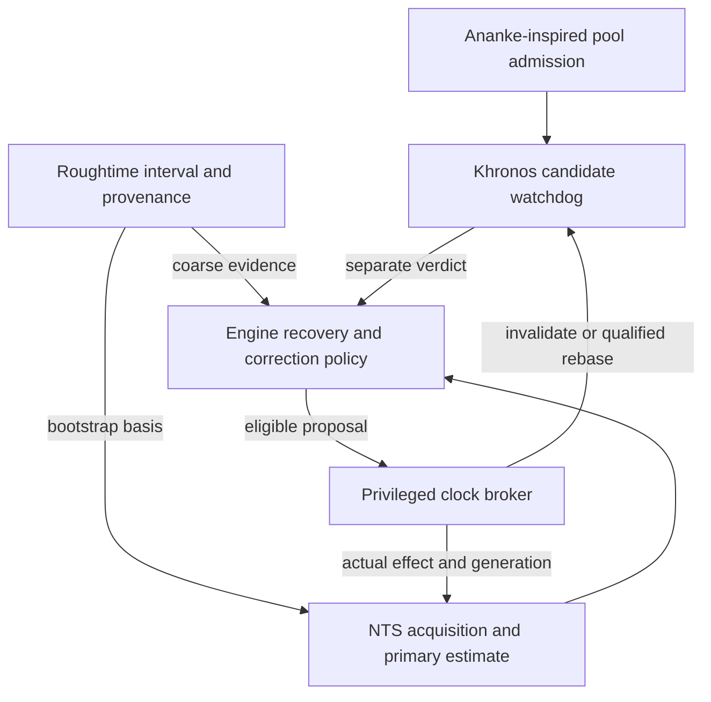

# Roughtime, NTS and Khronos/Ananke coordination

**Document:** NV-TA-001, revision 1.0 
**Evidence reviewed:** 3 November 2026, Asia/Tbilisi 
**Project baseline:** [d868da58ee98f0d66f0b41cc74627a5c47a6cf8d](https://github.com/DavidOsipov/NevroTick/tree/d868da58ee98f0d66f0b41cc74627a5c47a6cf8d) 
**Status:** owner-requested future design and retained research; no new runtime mechanism, provider preset, dependency or correction authority is qualified. 
**Execution and evidence owner:** [shared future task](../../tasks/time-assurance-integration.md).

## 1. Scope, authority and delivery order

David requested that the Roughtime research be recorded and its interaction with
Khronos/Ananke designed. The accepted direction is Roughtime-assisted recovery
from a severely wrong initial date, followed by the independent replacement of
Chrony-derived implementations. This document proposes how the time mechanisms
cooperate. It does not turn every brainstorm alternative into an owner decision.

The [architecture](../windows-time-architecture.md), [OD-02](../nevrotick-owner-decisions.md#4-od-02--distinguish-authenticated-recovery-from-ordinary-correction)
and [R-02/R-05](../nevrotick-research-handoff.md) retain their authority. Relevant
contracts are REQ-3/8/10/12, DEC-2/6/7/8/12, OPEN-8 and the CHECK mappings in the
task. Local TA-W/TA-C identifiers do not replace those requirements.

Keep the two roadmap sequences distinct:

- **Windows P0–P7 → KHR-C01 disposition → Android.** [KHR-0](../../ROADMAP.md#khr-0--evaluate-independent-time-cross-checking)
  remains an evaluation with `ADOPT_LIMITED`, `DEFER` or `REJECT` outcomes.
- **RGT-0 → CHR-0.** [RGT-0](../../ROADMAP.md#rgt-0--roughtime-bootstrap-for-a-badly-wrong-clock)
  retains its own implementation and Windows-recovery exit. Its placement against
  later Android/DNS work remains open.

Runtime cooperation does not create a new delivery prerequisite. KHR-0 can
evaluate the existing acquisition path without Roughtime. RGT-0 must remain
testable if Khronos is deferred or rejected. A later joint profile needs the
applicable integration evidence; neither stage inherits the other's completion.
The current Core work and [execution gates](development-plan.md#7-next-executable-task-for-a-development-agent),
including the admitted Sandbox scope and remaining holds, continue to govern.

## 2. Roles and the primary-source basis

| Mechanism | Proposed NevroTick role | Limit of that role |
| --- | --- | --- |
| NTS acquisition and primary estimator | Fresh authenticated observations for ordinary estimation and the existing recovery/correction policy | Authentication, source agreement, accuracy and permission to change the clock remain separate |
| Roughtime | Initial approximate UTC/date interval; optional later coarse comparison | No NTS vote, direct Windows clock write or claim of fine precision |
| Khronos | Candidate separately sampled watchdog calculation | No second clock controller; its verdict needs a declared population, fault model and comparison frame |
| Ananke-inspired admission | Candidate policy for constructing and maintaining a more independent watchdog population | A pool policy, not another measurement protocol or another independent vote |
| Existing engine policy and clock broker | Admit evidence, prepare eligible proposals, then enforce current authorization and actual-effect accounting | Agreement never expands privilege, replenishes budgets or bypasses the broker |

**Roughtime source facts.** Experimental RFC 10049 uses configured long-term
keys and request-bound signed time intervals; §6 covers NTS certificate-time
bootstrap. §§8–9 require multiple independent operators and address chained
measurements, delay and trust-list maintenance. A valid signature does not prove
correct UTC; an old compromised delegated key remains a concern. [S1]

**Khronos source facts.** Informational RFC 9523 describes randomized sampling,
filtering, bounded resampling and a pool-wide panic calculation. It includes an
initial update and depends on population, attacker, honest-clock and drift
assumptions. §6 addresses corrections during a sampling round. Its original
clock-takeover behavior is not adopted here. [S3]

**Ananke source facts.** The NDSS 2021 paper proposes cautious admission of
audited stratum-1 references and a slower Chronos watchdog alongside ordinary
synchronization. Self-reported stratum and convenient network labels do not
establish the intended independence. The paper does not supply NevroTick with a
qualified production pool. [S4]

The following integration rules are engineering proposals grounded in these
sources and the existing project contracts. Published attack-time estimates or
probability bounds are not transferred to NevroTick, multiplied together or
reused after changing the pool, sampler, retries, trust or panic behavior.

## 3. One policy owner and one clock writer

Keep network collection and pure calculations in their existing unprivileged
engine/core owners. Reuse the engine's recovery/correction policy; do not create
a competing service, generic command interface or independent phase/frequency
controller. Suggested evidence types below are future contracts, not existing
Rust APIs.

Khronos takeover/panic and a Roughtime command-line clock setter must not bypass
that graph. Plain-NTP watchdog data retains the diagnostic role permitted by
KHR-0; it cannot enter an NTS quorum or acquire an unlimited veto over valid NTS.

**Proposed first post-bootstrap mode:** observation only. The additional checks
produce separately attributed status and bounded reacquisition requests. A future
mode that inhibits ordinary or exceptional corrections needs an explicit policy
decision, fault model, availability analysis and qualification. Bootstrap checks
already required by the selected recovery path still gate that dependent path.

## 4. Runtime activation without a bootstrap cycle

1. Prefer eligible cached associations and ordinary strict NTS. Preserve current
   key/trust-age limits; fresh protected observations, not a successful handshake
   or cookie renewal, establish observation freshness.
2. If an unreliable date prevents certificate-time validation, enter only the
   permitted recovery branch. When RGT-0 is implemented and qualified, obtain its
   approximate interval using a reviewed initial key/endpoint catalogue.
3. Establish supported date/era interpretation and complete the actual NTS
   verifier, authenticated-source agreement and candidate-time revalidation
   gates. Retain the Roughtime-conditioned bootstrap basis.
4. Establish a comparison epoch with known units, clock mapping and uncertainty.
   Eligible watchdog rounds may then make meaningful comparative assertions.
   Earlier inert observations are not automatically promoted into that epoch.
5. Submit only proposals allowed by the existing policy to the broker. Account
   for the actual acknowledged effect and invalidate or explicitly rebase pending
   results before their next consumption.

This is NevroTick's proposed activation rule. It is not a claim that Khronos
cannot initialize time: its RFC has an initial/panic path. Neither that fact nor
pool curation supplies the signed date/era basis and Windows verification evidence
required for this project's century-scale recovery.

Do not require a completed steady-state watchdog verdict before Roughtime can
bootstrap NTS. Conversely, a good initial interval must not make an uninitialized
watchdog appear to agree. Authentication, agreement, evidence age, interval width
and enabled-monitor status remain separate in diagnostics and future UI work.

## 5. Evidence contracts and dependency accounting

The engine's future receiving boundary must accept checked, immutable evidence
with these conceptual fields. Exact types and limits are frozen in TA-W02 before
implementation; documentation alone does not enforce the contract.

| Evidence group | Required meaning and consumer rule |
| --- | --- |
| Origin and trust | Mechanism, protocol version, authentication class, peer/key identity, certificate-time basis and bootstrap ancestry; parser success is not authentication |
| Independent support | Operator groups, known upstream-clock/hosting dependencies and original observation IDs; unknown independence stays unknown |
| Selection provenance | Catalogue/pool version, selected/responding/admitted/independently supported sets, admission reasons and RNG/round identity |
| Time context | UTC/era range, precisely defined interval/uncertainty, qualified monotonic observation and evaluation instants, aging/fault assumptions and valid lifetime |
| Current applicability | Boot/clock epoch, policy and key generations, applied-correction context, eligible consumers and explicit limitations |
| Verdict | `agrees`, `contradicts`, `insufficient evidence` or `stale`, with a bounded reason; disabled/not-yet-initialized monitors remain visibly unassessed |

Compare evidence at one qualified evaluation instant and clock frame. Do not
compare an old Windows-relative offset with a new absolute interval as if they
were simultaneous. A step, unsuitable suspend/resume transition, reboot, restored
snapshot, uncertain acknowledgement or changed key/policy generation requires
invalidation or a qualified explicit transformation. Freshness must not come from
the wall clock being repaired. A newly evaluated predictor cannot refresh the
age of its underlying measurements.

### 5.1 Prevent manufactured corroboration

Do not implement a generic "two of NTS, Roughtime and Khronos agree" rule.

- One operator or clock appearing under different protocols does not become
  multiple independent supporting groups. Two consumers of one observation do
  not create two observations.
- When a Roughtime interval supplied the TLS validation date, record that
  dependency in the resulting NTS association/evidence. Later validation does not
  erase the original bootstrap history.
- Do not admit or retain watchdog sources because they agree with the primary
  estimate they are meant to check. Filtering or repeated resampling until they
  agree with Roughtime changes the selection model and needs its own analysis.
- Date/era rejection may be necessary, but its basis and resulting population
  must be recorded. It cannot silently preserve the original random-sampling
  guarantee after removing inconvenient responses.

**Controlled counterexample to retain:** an incorrect initial interval conditions
NTS certificate-time admission; a watchdog population is then filtered using the
same interval. Three matching outputs can share one faulty premise. The fixture
must expose that ancestry instead of producing three independent credits.

### 5.2 Preserve useful uncertainty

Roughtime is a coarse constraint, not a fine-precision referee. Freeze what
`agrees` means for intervals of different widths; overlap alone may be too weak
to provide useful corroboration. A broad interval containing every candidate
should report insufficient discrimination, not improved precision.

Do not validate certificate dates using only a convenient interval midpoint.
For example, a 1–3 January interval spans both sides of a certificate's 2 January
start date. Define the complete interval-admission rule, units, supported calendar
range and conversion bounds before handing a point to a verifier API. Retain
network-delay and elapsed-time uncertainty; no unqualified symmetric-delay or
perfect-monotonic-clock assumption.

## 6. Coordination and failure decisions

Here, **qualified NTS** means the complete current identity, admission, freshness,
agreement and policy requirements, not merely an authenticated packet.
This table specifies proposed observation-mode behavior. Any stronger blocking
mode remains a separate decision under OD-04.

| Situation | Required distinction | Proposed result |
| --- | --- | --- |
| Qualified NTS; additional monitors disabled | Not assessed is not agreement | Existing NTS/broker policy continues; expose enabled coverage honestly |
| Qualified NTS; optional monitor unavailable, insufficient or stale | Absence is not contradiction | Record missing auxiliary assurance; do not silently block ordinary tracking or downgrade authentication |
| Fresh comparable evidence agrees | Compatibility is conditional on provenance and uncertainty | Record the bounded corroboration; no new vote, tighter precision claim or expanded correction budget |
| Plain-NTP watchdog contradicts qualified NTS | Diagnostic disagreement has weaker authentication | Bounded remeasurement/diagnosis; no plain replacement clock or unlimited veto |
| Fresh Roughtime and NTS contradict | No generic majority across mechanisms | Preserve conflict and evidence; reject an inconsistent Roughtime-dependent bootstrap candidate. Outside that dependency, existing NTS policy controls; a new correction inhibitor requires qualification |
| Roughtime succeeds; NTS identity, revocation or fresh agreement fails | Bootstrap remains incomplete | No global clock correction or TLS bypass; retain explicit failure reason |
| Date prevents NTS; Roughtime unavailable | Requested recovery cannot establish its basis | Recovery/Blocked or an already authorized distinct helper/manual path; no automatic substitution by watchdog/plain-NTP data |
| NTS becomes unavailable while the other checks agree | Auxiliary agreement is not renewed NTS evidence | Existing bounded holdover/recovery rules apply; do not refresh NTS observation or full-authentication age |
| Clock, boot, catalogue, pool or policy changes during a round | Old evidence may be incomparable | Invalidate or perform only the qualified rebase; late replies cannot authorize the new generation |
| External evidence conflicts with an intact future saved floor | Integrity does not prove semantic correctness | Preserve records and consumed authority; use only R-02's approved supersession/refusal procedure |
| Khronos is deferred/rejected | Optional mechanism is absent | Roughtime/NTS qualification remains independently possible; no watchdog protection claim |

A timeout after a recorded contradiction does not resolve it. Declare how a
conflict is cleared by new comparable evidence or an authorized decision. Keep
transport failure, invalid unauthenticated traffic and contradictory signed
evidence distinct; they do not identify the same cause or justify the same server
removal. Store bounded diagnostic evidence locally; automatic external reporting
is a separate privacy/product choice.

## 7. Catalogues, keys and aggregate resource limits

### 7.1 Admission and independence

Ananke-inspired review belongs to catalogue admission and maintenance: document
operator responsibility, known clock dependencies, admission/removal evidence,
configuration provenance and change history. A curated label or self-reported
stratum does not establish those facts. No usable public Ananke population is
selected by this document.

Keep Roughtime root-key maintenance distinct from watchdog-pool admission and
NTS CA policy, while recording overlap across them. Distribute an authenticated
initial catalogue without first requiring time-dependent HTTPS/DoQ. Review key
rotation/removal, stale lists, signed-list rollback and offline recovery. A valid
signature proves origin, not currentness. Do not learn replacement root keys from
unauthenticated DNS responses or treat MSIX signing as source-time correctness.

Resolve the endpoint/DNS bootstrap cycle explicitly. Candidate addresses or a
separately permitted resolution path still need destination admission before
network access. Future DNSSEC/DoQ consumers may use qualified time through their
own contracts; this work neither adopts an updater nor silently relaxes the
DoQ-only upstream policy of the future DNS service.

### 7.2 One aggregate budget

Preserve KHR-0's 16-source active limit and the architecture's resource bounds.
A larger candidate catalogue is not permission for hundreds of active histories.
Account jointly for ordinary acquisition, Roughtime and watchdog work: sockets,
DNS, NTS-KE/native verification jobs, timers, bytes, signature work, retained
evidence, retries and expanded rounds. Do not exempt auxiliary work by moving it
to another task or runtime.

Primary acquisition and stop/cleanup must not be starved by optional checks.
Budget exhaustion yields insufficient evidence; it does not silently lower the
source minimum. Do not implement an unbounded all-pool panic burst or retry until
agreement. Cancellation retains permits until the underlying job actually ends,
as required by CHECK-27. Protocol-mandated sequential work must remain sequential;
parallelizing it merely to reduce latency needs protocol review.

Start with deterministic fixtures and finite per-round/aggregate budgets. Any
later interoperability query is bounded and separately admitted. Public servers
are not stress, fault-injection or adversarial-test targets.

## 8. Roughtime implementation and ecosystem research

These are dated source observations, not dependency adoption or live-service
qualification. Recheck them when TA-W03/TA-W06 starts.

| Candidate | Inspected evidence | Consequence |
| --- | --- | --- |
| Roughenough, `04ca59bf321b46b650574aa9e67900f1a9c216a5` | Workspace version 2.3.0, `Apache-2.0 OR MIT`; RFC v1 support and a separate client library. README lists Unix-like systems. [S6] | Evaluate the library behind a bounded adapter. Windows, selected features and the complete dependency/native/licence graph remain unqualified |
| Roughenough validator | `ResponseValidator::new` accepts `Option<PublicKey>`; without a root key it checks response self-consistency rather than the full root-key trust chain. [S6] | NevroTick's production constructor must require the admitted root-key identity. Successful generic validation cannot create authenticated evidence by itself |
| SIDN Labs, `rough.time.nl:5319` | Operator advertises RFC 10049 over UDP/TCP and labels the service experimental. [S7] | Candidate interoperability source, not a qualified default |
| Tanner Ryan, `time.txryan.com:5319` | Operator advertises RFC 10049; no uptime/accuracy guarantee. [S8] | Separate operator candidate; record service terms and actual evidence |
| int08h, `roughtime.int08h.com:5319` | Maintainer's README uses this endpoint with the RFC-v1 client. [S6] | Third candidate to investigate, not established availability |
| Older Cloudflare examples/list | Inspected source supports drafts 08/11, warns against production use; service docs call it beta and allow root-key changes. [S9] | Do not assume generic “IETF-Roughtime” labels establish RFC-v1 interoperability or current keys |

The optional root-key API is a documented capability, not a vulnerability claim.
SIDN identifies Tanner's implementation, so operator diversity may still share
implementation failure modes. Neither a permissive manifest nor a clean Rust
build clears the whole product's rights or Windows behavior. Preserve current
Chrony obligations and the separate CHR-0 direction.

Pin exact wire versions, timestamp units, signature contexts and framing in
fixtures. Do not infer compatibility from a project name or adapt a generic
timestamp parser across generations without explicit conversion contracts.
No new cryptographic primitive, standalone clock-setting CLI or production
server dependency is selected here.

## 9. Windows gate and explicit decision alternatives

Microsoft documents that a supplied `CertGetCertificateChain` validation time
does not move all trust/revocation checks; a CRL itself must be valid at current
system time. [S5] Therefore a correct Roughtime result does not close OPEN-8 or
qualify the current platform-verifier candidate.

The selected RGT-0 plan still requires isolated verification, protected NTS
observations and the existing broker gate before a clock change. TA-W07 must
exercise the full path under the actual service identity, trust stores,
revocation/offline/retrieval policy and supported true-date range. A real Windows
experiment needs its admitted disposable environment, independent observer,
bounded effects and restoration; a cross-build is insufficient.

Retain these alternatives for a concrete future decision, not automatic fallback:

| Open choice | Evidence needed before dependent implementation |
| --- | --- |
| Windows-aware isolated verifier versus a separately specified bootstrap trust path | Actual chain/revocation behavior, enterprise distrust/root semantics, cancellation and supported-date evidence; no hidden weakening after failure |
| Preliminary global correction directly from Roughtime | A new owner decision on authenticated source policy, interval quality, broker authority and effects on running applications. Currently not permitted by RGT-0 |
| Observation-only versus correction-inhibiting watchdog | Threat/fault model, false positives, availability cost, exactly affected actions and a bounded conflict-clearance rule |
| Mandatory versus optional later Roughtime checks | Which actions depend on current rough evidence, freshness envelope, outage and stale-catalogue behavior |
| NTS-only watchdog population versus diagnostic plain NTP | Qualified population/diversity and changed sampling guarantees; current NTS-only tracking remains intact |
| Catalogue roots, key update/rollback policy and exceptional quorum | Concrete operators, compromised-key cases, semantic-floor conflicts and approved recovery remedies |

Do not implement the direct-correction alternative merely because isolated
verification is difficult. Reversing a preliminary clock step cannot undo every
action another application performed while that date was visible.

## 10. Qualification and next action

The [task](../../tasks/time-assurance-integration.md) owns TA-W01–TA-W09,
TA-C01–TA-C16, valid/hostile controls, candidate identity and actual results. It
separates portable policy/protocol models, controlled interoperability, native
Windows evidence and the two roadmap exits. No planned case is marked passed.

The next step for this workstream is the source/contract freeze in TA-W02 when its
phase is selected. Current product work stays with development-plan §7. KHR-C01
can close with a documented deferral/rejection; RGT-C01 still requires functioning
qualified bootstrap. The optional watchdog cannot become a hidden prerequisite
for the RGT-0 → CHR-0 sequence.

## 11. Primary sources

- **S1:** [RFC 10049, Roughtime](https://www.rfc-editor.org/rfc/rfc10049.html), October 2026, Experimental; §§5.4, 6, 8–9.
- **S2:** [RFC 8915, Network Time Security](https://www.rfc-editor.org/rfc/rfc8915.html), especially §§8.3, 8.5–8.7. The project's existing NTS contracts remain controlling.
- **S3:** [RFC 9523, Khronos](https://www.rfc-editor.org/rfc/rfc9523.html), Informational; §§3, 5–6.
- **S4:** Perry, Rozen-Schiff and Schapira, [A Devil of a Time: How Vulnerable is NTP to Malicious Timeservers?](https://www.ndss-symposium.org/wp-content/uploads/ndss2021_1A-2_24302_paper.pdf), NDSS 2021, §VI-B–F, pp. 11–15.
- **S5:** Microsoft Learn, [CertGetCertificateChain](https://learn.microsoft.com/en-us/windows/win32/api/wincrypt/nf-wincrypt-certgetcertificatechain), `pTime` and revocation behavior; checked through Microsoft Learn MCP during the preceding Roughtime research.
- **S6:** Roughenough at `04ca59bf321b46b650574aa9e67900f1a9c216a5`: [README](https://github.com/int08h/roughenough/blob/04ca59bf321b46b650574aa9e67900f1a9c216a5/README.md), [workspace manifest](https://github.com/int08h/roughenough/blob/04ca59bf321b46b650574aa9e67900f1a9c216a5/Cargo.toml), [validator](https://github.com/int08h/roughenough/blob/04ca59bf321b46b650574aa9e67900f1a9c216a5/crates/roughenough-client/src/validation.rs), [wire versions](https://github.com/int08h/roughenough/blob/04ca59bf321b46b650574aa9e67900f1a9c216a5/crates/roughenough-protocol/src/protocol_ver.rs).
- **S7:** SIDN Labs, [TimeNL service information](https://nts.time.nl/).
- **S8:** Tanner Ryan, [public time service information](https://time.txryan.com/).
- **S9:** Cloudflare [usage and beta notice](https://developers.cloudflare.com/time-services/roughtime/usage/), and [source README](https://github.com/cloudflare/roughtime/blob/75645289794cfbd71a08f0e7ecf9bc4f3f87d133/README.md) at `75645289794cfbd71a08f0e7ecf9bc4f3f87d133`.
