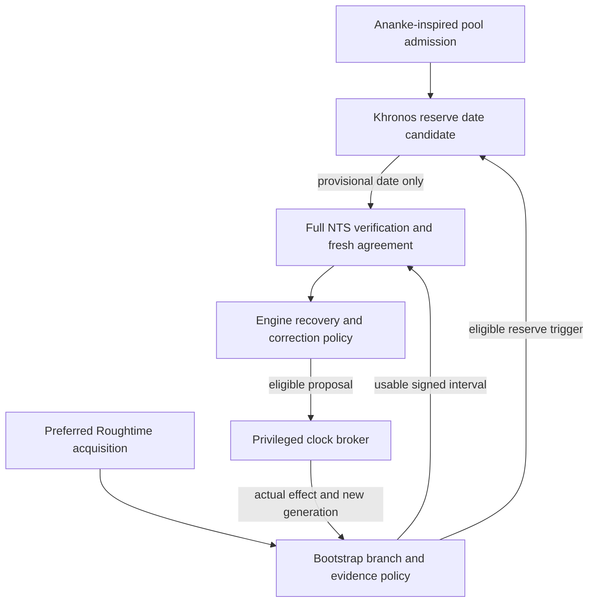

# Roughtime, NTS and Khronos/Ananke coordination

**Document:** NV-TA-001, revision 1.2 
**Evidence reviewed:** 3 November 2026, Asia/Tbilisi 
**Project baseline:** [9c6b5ef39b134c844a850deb9126823d668babe7](https://github.com/DavidOsipov/NevroTick/tree/9c6b5ef39b134c844a850deb9126823d668babe7) 
**Status:** owner-selected future bootstrap priority and retained research; no new runtime mechanism, provider preset, dependency or correction authority is qualified. 
**Execution and evidence owner:** [shared future task](../../tasks/time-assurance-integration.md).

## 1. Scope, authority and delivery order

David requested that the Roughtime research be recorded and its interaction with
Khronos/Ananke designed. The accepted direction is Roughtime-assisted recovery
from a severely wrong initial date, followed by the independent replacement of
Chrony-derived implementations. This document proposes how the time mechanisms
cooperate. It does not turn every brainstorm alternative into an owner decision.

**Later owner refinement, 3 November 2026:** use Roughtime as the preferred
initial date source, then NTS; invoke Khronos/Ananke with an NTP population only
when Roughtime is unavailable or cannot provide a usable date for NTS. This
revision replaces the earlier proposed periodic-watchdog role with a conditional
bootstrap reserve. Continuous post-bootstrap monitoring remains a deferred
alternative. The concrete implementation interpretation is a bounded provisional
date followed by full NTS recovery before a broker clock change; the instruction
does not itself settle preliminary global stepping or unresolved trust limits.

The [architecture](../windows-time-architecture.md), [OD-02](../nevrotick-owner-decisions.md#4-od-02--distinguish-authenticated-recovery-from-ordinary-correction)
and [R-02/R-05](../nevrotick-research-handoff.md) retain their authority. Relevant
contracts are REQ-3/8/10/12, DEC-2/6/7/8/12, OPEN-8 and the CHECK mappings in the
task. Local TA-W/TA-C identifiers do not replace those requirements.

**Leap-policy integration, 4 November 2026:** [architecture §10.5](../windows-time-architecture.md#105-leap-seconds-and-time-scales)
and [NV-LP-001](leap-second-policy.md) add the selected date/scale/guard contract;
the [S1.4 task](../../tasks/s1.4-leap-policy.md) owns its implementation before
dependent integration. Reviewed compiled leap history, future coverage and the
continuous-UTC rule effective **20 May 2027** remain separate from a bootstrap
date. The rule is evaluated against all admitted true-date/era hypotheses, not
the local clock. This amendment qualifies no new source, native mapping or
clock-write envelope; earlier research/review receipts retain their own scope.

Keep the two roadmap sequences distinct:

- **Windows P0–P7 → KHR-C01 disposition → GEO-C01 disposition → Android.**
  [KHR-0](../../ROADMAP.md#khr-0--evaluate-independent-time-cross-checking) and the later
  [GEO-0 experiment](../../ROADMAP.md#geo-0--evaluate-geography-assisted-source-ordering)
  retain `ADOPT_LIMITED`, `DEFER` or `REJECT` outcomes. The existing catalogue task
  owns GEO-C01; geography cannot alter a qualified reserve population or sampler.
- **RGT-0 → CHR-0.** [RGT-0](../../ROADMAP.md#rgt-0--roughtime-bootstrap-for-a-badly-wrong-clock)
  retains its own implementation and Windows-recovery exit. Its placement against
  later Android/DNS work remains open.

Runtime cooperation does not create a new delivery prerequisite. KHR-0 can
evaluate the existing acquisition path without Roughtime. RGT-0 must remain
testable if Khronos is deferred or rejected. A later joint profile needs the
applicable integration evidence; neither stage inherits the other's completion.
Claiming the combined automatic-reserve profile requires qualification of its
reserve branch; a Roughtime-only configuration must disclose the absent reserve.
The current Core work and [execution gates](development-plan.md#7-next-executable-task-for-a-development-agent),
including the admitted Sandbox scope and remaining holds, continue to govern.

## 2. Roles and the primary-source basis

| Mechanism | Proposed NevroTick role | Limit of that role |
| --- | --- | --- |
| NTS acquisition and primary estimator | Fresh authenticated observations for ordinary estimation and the existing recovery/correction policy | Authentication, source agreement, accuracy and permission to change the clock remain separate |
| Roughtime | Preferred approximate UTC/date interval for cold bootstrap without an adequate trusted time basis | No NTS vote, direct Windows clock write or claim of fine precision |
| Khronos-inspired recovery | Conditional robust date candidate when the preferred branch cannot supply usable evidence | Unauthenticated Pool input remains provisional; cold-start guarantees need their own population, fault, era and sampling analysis |
| Ananke-inspired admission | Candidate policy for constructing and maintaining the reserve population | A pool policy, not another measurement protocol or independent vote; generic Pool answers are not an audited Ananke roster |
| Existing engine policy and clock broker | Admit evidence, prepare eligible proposals, then enforce current authorization and actual-effect accounting | Agreement never expands privilege, replenishes budgets or bypasses the broker |

**Roughtime source facts.** Experimental RFC 10049 uses configured long-term
keys and request-bound signed time intervals; §6 covers NTS certificate-time
bootstrap. §§8–9 require multiple independent operators and address chained
measurements, delay and trust-list maintenance. A valid signature does not prove
correct UTC; an old compromised delegated key remains a concern. [S1]

**Khronos source facts.** Informational RFC 9523 describes randomized sampling,
filtering, bounded resampling and a pool-wide panic calculation. It includes an
initial update and depends on population, attacker, honest-clock and drift
assumptions. §6 addresses corrections during a sampling round. Its original
clock-takeover behavior is not adopted here. [S3]

**Ananke source facts.** The NDSS 2021 paper proposes cautious admission of
audited stratum-1 references and a slower Chronos watchdog alongside ordinary
synchronization. Self-reported stratum and convenient network labels do not
establish the intended independence. The paper does not supply NevroTick with a
qualified production pool. [S4]

The RFC's steady-state watchdog guarantees do not establish the security of a
one-shot cold bootstrap. Its threat model excludes an attacker who can influence
all server communications. Such an attacker can suppress Roughtime and fabricate
consistent unauthenticated Pool replies; more destination addresses alone do not
remove that common-path exposure. [S3] This motivates the separate provisional
date and downstream NTS gates, not a promise that the reserve equals Roughtime.

The following integration rules are engineering proposals grounded in these
sources and the existing project contracts. Published attack-time estimates or
probability bounds are not transferred to NevroTick, multiplied together or
reused after changing the pool, sampler, retries, trust or panic behavior.

## 3. One policy owner and one clock writer

Keep network collection and pure calculations in their existing unprivileged
engine/core owners. Reuse the engine's recovery/correction policy; do not create
a competing service, generic command interface or independent phase/frequency
controller. Suggested evidence types below are future contracts, not existing
Rust APIs.

Khronos takeover/panic and a Roughtime command-line clock setter must not bypass
that graph. The selected future reserve supplies only a provisional TLS date;
it cannot enter an NTS quorum or acquire a clock controller of its own.

The Windows kernel remains the sole executor of explicit leap events. None of
these mechanisms schedules an extra event or synthesizes a ±1-second broker
request. The leap guard and subsequent fresh-quorum residual correction use the
same engine/broker ownership and actual-outcome rules as ordinary recovery.

**Selected future operating role:** conditional bootstrap reserve. Healthy NTS
tracking does not periodically activate Khronos under this profile. A later
continuous observer or correction inhibitor would be a separately selected and
qualified extension. The reserve is intended to activate automatically within
its declared recovery envelope, not to prompt during each ordinary outage.
Until that extension is specified and qualified, the current strict-default and
explicitly enabled plain-helper baseline remains controlling.

## 4. Runtime activation without a bootstrap cycle

Leap-policy ambiguity limits the authority of a dependent time observation or
correction; it does not stop independent bootstrap acquisition, NTS transport or
authenticated complete-release admission. Do not require an already
discipline-eligible sample to obtain the independent date evidence needed for
that admission. Provisional responses retain their limited consumers and cannot
be promoted into a leap vote, ordinary quorum or direct clock write. Unknown
future calendar coverage alone does not activate the reserve or stop qualified
NTS tracking outside the applicable guard.

1. Reuse eligible cached associations or an adequate trusted time basis for
   strict NTS. Preserve key/trust-age limits. A healthy restart need not depend
   on Roughtime availability; an untrusted wall-clock value alone is not such a
   basis. Fresh protected observations establish observation freshness.
2. For cold date bootstrap, try Roughtime first using the reviewed initial
   key/endpoint catalogue and its multi-operator measurement procedure. Apply
   finite deadlines and available qualified transports, including TCP where
   advertised; one malformed reply is not a failure of the whole mechanism.
3. If that branch yields usable evidence, pass its interval to isolated NTS
   verification. If it cannot, classify the reason under section 6 and, when
   eligible, invoke the bounded Khronos/Ananke-inspired reserve. Its output is a
   provisional date hypothesis with lower assurance, not a clock correction.
4. For either route, establish supported date/era interpretation and complete
   identity/trust/revocation policy, fresh protected NTS observations, configured
   source agreement and candidate-time revalidation. Preserve the distinct
   Roughtime or plain-reserve ancestry. Do not lower existing NTS agreement
   requirements merely to make this reserve succeed.
5. Submit only an eligible proposal to the broker, account for the actual
   acknowledged effect and invalidate or explicitly rebase pending results.
   Continue ordinary NTS tracking; the reserve returns to inactive status.

This is NevroTick's proposed activation rule. It is not a claim that Khronos
cannot initialize time: its RFC has an initial/panic path. Neither that fact nor
pool curation supplies the signed date/era basis and Windows verification evidence
required for this project's century-scale recovery.

Do not require a steady-state watchdog verdict before Roughtime can bootstrap
NTS. Bind reserve rounds to a defined comparison epoch and absolute-date/era
interpretation before using their offsets. Earlier observations are not
automatically promoted into that epoch. An untriggered reserve is not an agreeing
monitor. Authentication, agreement, evidence age, interval width and the actual
bootstrap route remain separate in diagnostics and future UI work.

**No date search until TLS accepts.** A certificate-time error may mean a wrong
date or an expired/misconfigured server. Try the other admitted NTS authorities,
retain the failure category and require an independently derived candidate.
Never choose a certificate-valid date solely because it makes that certificate
pass. Separate TLS verification/session state across hypotheses and perform the
required fresh full verification; resumed sessions cannot silently stand in for
new certificate-time evidence.

**Residual reserve risk.** Forged Pool time alone does not forge NTS credentials.
However, a forced old-date candidate together with a stolen expired NTS key may
pass candidate-time verification and return matching signed/authenticated time.
Checking that returned time against the same certificate period does not break
that circularity. Retain authenticated saved bounds, independent configured NTS
support and effective revocation requirements; define what the selected profile
can claim when those constraints are absent. This is a combined-design threat
case, not proof that every fallback can be safely completed. [S2, S3]

## 5. Evidence contracts and dependency accounting

The engine's future receiving boundary must accept checked, immutable evidence
with these conceptual fields. Exact types and limits are frozen in TA-W02 before
implementation; documentation alone does not enforce the contract.

| Evidence group | Required meaning and consumer rule |
| --- | --- |
| Origin and trust | Mechanism, protocol version, authentication class, peer/key identity, certificate-time basis and bootstrap ancestry; parser success is not authentication |
| Independent support | Operator groups, known upstream-clock/hosting dependencies and original observation IDs; unknown independence stays unknown |
| Selection provenance | Catalogue/pool version, selected/responding/admitted/independently supported sets, admission reasons and RNG/round identity |
| Time context | Complete admitted UTC/era hypotheses, precisely defined interval/uncertainty, qualified monotonic observation and evaluation instants, aging/fault assumptions and valid lifetime; defined protocol scale and unsmeared-UTC provenance for the NTP source population |
| Leap context | Admitted release dataset/effective-rule revisions, historical and future coverage, scale segment, possible-event identity, guard phase and possible exchange span; raw LI remains an authenticated or unauthenticated source claim with its own admission result |
| Current applicability | Boot/clock/mapping epoch, policy and key generations, applied-correction context, eligible consumers and explicit limitations; distinguish bootstrap-usable evidence from discipline eligibility and preserve the minimum post-guard acquisition instant |
| Verdict | `agrees`, `contradicts`, `insufficient evidence` or `stale`, with a bounded reason; disabled/not-yet-initialized monitors remain visibly unassessed |

Compare evidence at one qualified evaluation instant and clock frame. Do not
compare an old Windows-relative offset with a new absolute interval as if they
were simultaneous. A step, unsuitable suspend/resume transition, reboot, restored
snapshot, uncertain acknowledgement or changed key/policy generation requires
invalidation or a qualified explicit transformation. Freshness must not come from
the wall clock being repaired. A newly evaluated predictor cannot refresh the
age of its underlying measurements.

### 5.1 Prevent manufactured corroboration

Do not implement a generic "two of NTS, Roughtime and Khronos agree" rule.

- One operator or clock appearing under different protocols does not become
  multiple independent supporting groups. Two consumers of one observation do
  not create two observations.
- When a Roughtime interval supplied the TLS validation date, record that
  dependency in the resulting NTS association/evidence. Later validation does not
  erase the original bootstrap history.
- Do not admit or retain watchdog sources because they agree with the primary
  estimate they are meant to check. Filtering or repeated resampling until they
  agree with Roughtime changes the selection model and needs its own analysis.
- Date/era rejection may be necessary, but its basis and resulting population
  must be recorded. It cannot silently preserve the original random-sampling
  guarantee after removing inconvenient responses.

**Controlled counterexample to retain:** an incorrect initial interval conditions
NTS certificate-time admission; a watchdog population is then filtered using the
same interval. Three matching outputs can share one faulty premise. The fixture
must expose that ancestry instead of producing three independent credits.

### 5.2 Preserve useful uncertainty

Roughtime is a coarse constraint, not a fine-precision referee. Freeze what
`agrees` means for intervals of different widths; overlap alone may be too weak
to provide useful corroboration. A broad interval containing every candidate
should report insufficient discrimination, not improved precision.

Do not validate certificate dates using only a convenient interval midpoint.
For example, a 1–3 January interval spans both sides of a certificate's 2 January
start date. Define the complete interval-admission rule, units, supported calendar
range and conversion bounds before handing a point to a verifier API. Retain
network-delay and elapsed-time uncertainty; no unqualified symmetric-delay or
perfect-monotonic-clock assumption.

Apply the same whole-interval rule to leap history and the effective UTC regime.
An interval straddling 20 May 2027 may proceed when every admitted hypothesis
still yields the same event-free segment and admissible target. If any hypothesis
crosses a possible event or changes interpretation, withhold the dependent
sample's clock authority while bounded independent acquisition continues. Fresh
evidence and qualified monotonic passage can resolve the ambiguity; choosing a
convenient midpoint, era or host-clock regime cannot. The supported true-date
interval is separate from how far Windows is wrong. An unknown TAI−UTC conversion
does not globally disable same-segment NTP UTC tracking.

## 6. Coordination and failure decisions

Here, **qualified NTS** means the complete current identity, admission, freshness,
agreement and policy requirements, not merely an authenticated packet.
This table specifies the selected future bootstrap routing and its proposed
guards. It does not replace existing tracking policy with a continuous watchdog.

| Situation | Required distinction | Proposed result |
| --- | --- | --- |
| Qualified NTS; reserve not triggered or disabled | Not assessed is not agreement | Existing NTS/broker policy continues; no periodic Khronos work or invented protection claim |
| Qualified NTS; Roughtime unavailable, insufficient or stale | Absence is not contradiction | Continue the existing tracking policy; no new mandatory Roughtime dependency or authentication downgrade |
| NTP population has admitted unsmeared-UTC provenance; all eligible peers send LI=0 | Announcement silence is not unknown scale or proof of no event | Ordinary acquisition/tracking remains available under local leap knowledge and every existing source/clock gate; no nonzero-LI quorum is required |
| Future leap coverage unknown; current exchange is outside all applicable ambiguity guards | Historical validity, future coverage and present observation quality are separate | Continue ordinary Tracking with the coverage qualifier; in a leap-capable regime protect every possible month-end and require fresh post-guard quorum. No perpetual Holdover or dynamic LI-vote calendar |
| A supported date/era hypothesis crosses a possible event or changes interpretation | Acquisition evidence may remain useful without discipline authority | Withhold the dependent observation/correction; continue bounded independent bootstrap and NTS transport. No convenient-date selection, quorum reduction or clock write from provisional data |
| LI=1/2 demonstrably contradicts covered local knowledge or continuous UTC | Conflict belongs to that observation, not every configured identity | Reject it from discipline and diagnose; healthy peers retain their votes and fresh consistent observations can re-enter. One peer cannot extend a guard, rewrite history or schedule a leap |
| Fresh comparable evidence agrees | Compatibility is conditional on provenance and uncertainty | Record the bounded corroboration; no new vote, tighter precision claim or expanded correction budget |
| Plain reserve contradicts qualified NTS | Provisional evidence has weaker authentication | Bounded diagnosis; no plain replacement clock or unlimited veto |
| Fresh Roughtime and NTS contradict | No generic majority across mechanisms | Preserve conflict and evidence; reject an inconsistent Roughtime-dependent bootstrap candidate. Outside that dependency, existing NTS policy controls; a new correction inhibitor requires qualification |
| Cold bootstrap; no usable Roughtime result within budget | No replies, too few independent operators, unsupported wire/transport or rejected intervals are different causes | The qualified future profile invokes the labelled provisional-date reserve; it still completes every applicable NTS gate before clock effects |
| Invalid Roughtime packet/signature | Could be corruption, interference or protocol grease, not proof of a lying authenticated server | Reject the reply, continue within budget; exhaustion can trigger reserve, never new trust or a malfeasance accusation from signature failure alone |
| NTS certificate-time failure with the Roughtime-derived candidate | Date incompatibility is a hypothesis, not proof Roughtime is wrong | Try other admitted NTS authorities; allow bounded alternate-date diagnosis through the reserve under the declared conflict policy |
| Roughtime succeeds; NTS name, chain, explicit revocation, required revocation evidence or agreement fails | These are not generic date errors | Reject the affected path; preserve the applicable policy and try other admitted authorities. No date search or relaxed checks to force success |
| NTS transport fails | A different date cannot unblock a network path | Bounded endpoint/transport recovery; no false Roughtime-error classification |
| Signed Roughtime conflict persists while reserve suggests another date | Lower-trust agreement cannot erase stronger contradictory evidence | Preserve conflict across branch changes and timeouts; only the qualified resolution rule can admit a final NTS candidate |
| NTS becomes unavailable while the other checks agree | Auxiliary agreement is not renewed NTS evidence | Existing bounded holdover/recovery rules apply; do not refresh NTS observation or full-authentication age |
| Clock, boot, catalogue, pool or policy changes during a round | Old evidence may be incomparable | Invalidate or perform only the qualified rebase; late replies cannot authorize the new generation |
| External evidence conflicts with an intact future saved floor | Integrity does not prove semantic correctness | Preserve records and consumed authority; use only R-02's approved supersession/refusal procedure |
| Khronos is deferred/rejected or no admissible reserve roster exists | The requested reserve is not available in this configuration | Roughtime/NTS qualification remains independently possible; expose the missing reserve and retain the existing blocked/manual recovery path |

A timeout after a recorded contradiction does not resolve it. Declare how a
conflict is cleared by new comparable evidence or an authorized decision. Keep
transport failure, invalid unauthenticated traffic and contradictory signed
evidence distinct; they do not identify the same cause or justify the same server
removal. Store bounded diagnostic evidence locally; automatic external reporting
is a separate privacy/product choice.

## 7. Catalogues, keys and aggregate resource limits

### 7.1 Admission and independence

Ananke-inspired review belongs to catalogue admission and maintenance: document
operator responsibility, known clock dependencies, admission/removal evidence,
configuration provenance and change history. A curated label or self-reported
stratum does not establish those facts. No usable public Ananke population is
selected by this document. A random answer from `pool.ntp.org` is not an
Ananke-admitted source. Qualify pool-poisoning and common-path assumptions, the
initial roster and bounded refresh before cold-start use; constructing a large
roster on demand must not become an unbounded startup DNS/probe burst.

Redistributed Pool defaults must use the project's assigned vendor zone under
the Pool's vendor guidance. None is claimed allocated here; OD-03 retains that
delivery prerequisite. A vendor zone controls deployment use, not authentication
or source independence. [S16]

Keep Roughtime root-key maintenance distinct from watchdog-pool admission and
NTS CA policy, while recording overlap across them. Distribute an authenticated
initial catalogue without first requiring time-dependent HTTPS/DoQ. Review key
rotation/removal, stale lists, signed-list rollback and offline recovery. A valid
signature proves origin, not currentness. Do not learn replacement root keys from
unauthenticated DNS responses or treat MSIX signing as source-time correctness.

**Catalogue refinement, 4 November 2026:** the
[binary catalogue design](server-catalogue-binary-format.md) and
[existing catalogue task](../../tasks/server-catalogue-and-statistics.md) now
require Roughtime public-key algorithm/bytes, exact protocol profile,
source/endpoint scope and provenance in the first catalogue schema. Schema
preparation and a future publisher-side collector do not activate RGT-0 or admit
the documented keys as a shipped roster. Ordinary NTP/NTS catalogue work may
proceed independently; this plan retains runtime verification, rotation,
conflict, bootstrap and source-minimum authority.

Resolve the endpoint/DNS bootstrap cycle explicitly. Candidate addresses or a
separately permitted resolution path still need destination admission before
network access. Future DNSSEC/DoQ consumers may use qualified time through their
own contracts; this work neither adopts an updater nor silently relaxes the
DoQ-only upstream policy of the future DNS service.

### 7.2 One aggregate budget

Preserve KHR-0's 16-source active limit and the architecture's resource bounds.
A larger candidate catalogue is not permission for hundreds of active histories.
Account jointly for ordinary acquisition, Roughtime and watchdog work: sockets,
DNS, NTS-KE/native verification jobs, timers, bytes, signature work, retained
evidence, retries and expanded rounds. Do not exempt auxiliary work by moving it
to another task or runtime.

Primary acquisition and stop/cleanup must not be starved by optional checks.
Budget exhaustion yields insufficient evidence; it does not silently lower the
source minimum. Do not implement an unbounded all-pool panic burst or retry until
agreement. Cancellation retains permits until the underlying job actually ends,
as required by CHECK-27. Protocol-mandated sequential work must remain sequential;
parallelizing it merely to reduce latency needs protocol review.

Start with deterministic fixtures and finite per-round/aggregate budgets. Any
later interoperability query is bounded and separately admitted. Public servers
are not stress, fault-injection or adversarial-test targets.

## 8. Roughtime implementation and ecosystem research

These are dated source observations, not dependency adoption or live-service
qualification. Recheck them when TA-W03/TA-W06 starts.

| Candidate | Inspected evidence | Consequence |
| --- | --- | --- |
| Roughenough, `04ca59bf321b46b650574aa9e67900f1a9c216a5` | Workspace version 2.3.0, `Apache-2.0 OR MIT`; RFC v1 support and a separate client library. README lists Unix-like systems. [S6] | Evaluate the library behind a bounded adapter. Windows, selected features and the complete dependency/native/licence graph remain unqualified |
| Roughenough validator | `ResponseValidator::new` accepts `Option<PublicKey>`; without a root key it checks response self-consistency rather than the full root-key trust chain. [S6] | NevroTick's production constructor must require the admitted root-key identity. Successful generic validation cannot create authenticated evidence by itself |

The optional root-key API is a documented capability, not a vulnerability claim.
SIDN identifies Tanner's implementation, so operator diversity may still share
implementation failure modes. Neither a permissive manifest nor a clean Rust
build clears the whole product's rights or Windows behavior. Preserve current
Chrony obligations and the separate CHR-0 direction.

Pin exact wire versions, timestamp units, signature contexts and framing in
fixtures. Do not infer compatibility from a project name or adapt a generic
timestamp parser across generations without explicit conversion contracts.
No new cryptographic primitive, standalone clock-setting CLI or production
server dependency is selected here.

### 8.1 Public server inventory — 3 November 2026

This census retains its dated endpoint/operator scope. The later
[4 November public-key inventory](server-catalogue-binary-format.md#52-initial-public-key-evidence-inventory--4-november-2026)
records key bytes for the pinned ecosystem's 13 Ed25519 rows. It is a narrower
documentary check, not a replacement census, an approved roster or new live
availability evidence.

The broader source census found **14 documented candidate hostnames, grouped
into about 10 nominal operators**. This is a lower-bound inventory of published
candidates, not a worldwide total, a live-health result or 14 compatible servers.
No time-server queries were performed.

Tanner Ryan's catalogue at `09ffa30abfb8c9ea22b81858edf393f6c5a7ddef`
(30 October 2026), blob `cd9eb5043fd7ff77845333ffe97b8318303ff94e`, contains
14 records: two Ed25519 entries with integer `version: 1`, eleven with only the
ambiguous `IETF-Roughtime` label, and one experimental ML-DSA-44 mode of the same
Tanner host. That yields 13 hostnames/ordinary Ed25519 keys and nine nominal
operator groups. Adding int08h's maintainer-documented endpoint gives the totals
above. Neither alternate transport/port, address family, anycast site nor that
PQ mode adds an independent operator. [S6, S10]

| Nominal operator/group | Published candidate endpoints | Current documentary evidence; deployment still unverified |
| --- | --- | --- |
| Tanner Ryan | `time.txryan.com:5319` | Explicit RFC 10049, UDP/TCP; `:2002` compatibility endpoint. No uptime/accuracy guarantee. [S8] |
| SIDN Labs / TimeNL | `rough.time.nl:5319` | Explicit RFC 10049, UDP/TCP; experimental. Uses Tanner's server implementation. [S7] |
| int08h | `roughtime.int08h.com:5319` | Maintainer README's RFC-v1 client endpoint; UDP server. A third candidate, with weaker deployment evidence than the two operator service pages. [S6] |
| Cloudflare | `roughtime.cloudflare.com:2003` | UDP anycast, beta; published implementation advertises drafts 08/11. Current RFC-v1 service support is not established. [S9] |
| roughtime.se / STUPI-hosted | `roughtime.se:2002` | Operator advertises draft-19 and direct atomic-clock references. [S12] |
| Netnod | `sth1.roughtime.netnod.se:2002`, `sth2.roughtime.netnod.se:2002` | Two catalogue hosts under one nominal operator; `IETF-Roughtime` alone establishes no exact current wire version. [S10] |
| teax.dev | `time.teax.dev:2002` | Catalogue version unresolved; operator page source says upstream time is Cloudflare NTP over NTS. Do not count it as independent upstream corroboration of Cloudflare. [S10, S15] |
| Sturdy Statistics | `roughtime.sturdystatistics.com:2002` | Operator advertises draft revision 15 / `0x8000000c`, UDP. [S13] |
| Inutile | `fr.ntp.inutile.pro:2002`, `es.ntp.inutile.pro:2002`, `uk.ntp.inutile.pro:2002`, `us.ntp.inutile.pro:2002` | Four catalogue hosts/keys under one nominal operator; exact current wire support unresolved. [S10] |
| Alastyr | `roughtime.alastyr.com:2002` | Operator advertises draft-19 / `0x8000000c`, UDP. [S14] |

For a strict RFC 10049 client, the evidence supports **two explicit operator
advertisements plus a third maintainer-documented candidate**. It does not prove
that the other eleven hostnames are incompatible; their RFC-v1 compatibility is
unestablished. Tanner and SIDN also share an implementation, so operator count
alone overstates diversity of software failure modes.

**Targeted compatibility option:** the pinned Roughenough README documents a
client mode offering RFC-v1 together with draft `0x8000000c`, and a draft-only
mode, using different signature contexts. Assess that existing bounded adapter
option in TA-W03/06 before assuming every older endpoint requires a new parser.
This may expand the usable roster, but still needs exact server interoperability,
unit/context/chain checks and a reviewed multi-version measurement policy.
Draft support is not RFC-v1 service support; no compatibility mode is adopted by
this census. [S6]

Cloudflare's ecosystem record places Chainpoint, Google Sandbox and Mixmin in an
inactive section with observations dated 1 July 2024. Its older `:2002` endpoint
was deprecated. Do not inflate the useful census with these historical entries,
laboratory falsetickers or duplicate protocol modes. The ecosystem maintainers
do not claim a definitive global list. [S9, S11]

**Availability consequence:** the selected RFC measurement needs at least three
operational independently run servers. If only three admitted groups are usable,
one loss can prevent that branch from completing. Catalogue size cannot yield an
outage probability without longitudinal, network-specific observations; DNS,
port filtering, software and upstream failures can be correlated. Prefer
qualified UDP/TCP alternatives before invoking the reserve, but TCP on 5319
does not guarantee passage through a restrictive network. Never silently reduce
the source minimum or add draft parsers merely to improve the count. [S1, S7, S8]

## 9. Windows gate and explicit decision alternatives

Microsoft documents that a supplied `CertGetCertificateChain` validation time
does not move all trust/revocation checks; a CRL itself must be valid at current
system time. [S5] Therefore a correct Roughtime result does not close OPEN-8 or
qualify the current platform-verifier candidate.

The selected RGT-0 plan still requires isolated verification, protected NTS
observations and the existing broker gate before a clock change. TA-W07 must
exercise the full path under the actual service identity, trust stores,
revocation/offline/retrieval policy and supported true-date range. A real Windows
experiment needs its admitted disposable environment, independent observer,
bounded effects and restoration; a cross-build is insufficient.

Retain these alternatives for a concrete future decision, not automatic fallback:

| Open choice | Evidence needed before dependent implementation |
| --- | --- |
| Windows-aware isolated verifier versus a separately specified bootstrap trust path | Actual chain/revocation behavior, enterprise distrust/root semantics, cancellation and supported-date evidence; no hidden weakening after failure |
| Preliminary global correction directly from Roughtime | A new owner decision on authenticated source policy, interval quality, broker authority and effects on running applications. Currently not permitted by RGT-0 |
| Exact automatic-reserve envelope and conflict clearance | Bounded causes, deadlines, provisional-date limits, downgrade/expired-key threat cases and truthful assurance when stronger anchors are absent; the owner has selected the future priority, not those constants |
| Any later continuous observer or correction-inhibiting watchdog | Separately selected purpose, fault/availability model and qualified behavior; not part of the selected reserve-only role |
| Reserve population and Pool deployment | Admitted operator/clock diversity, initial roster, vendor zone, exact sampler and cold-start/era evidence; ordinary NTS-only tracking remains intact |
| Catalogue roots, key update/rollback policy and exceptional quorum | Concrete operators, compromised-key cases, semantic-floor conflicts and approved recovery remedies |

Do not implement the direct-correction alternative merely because isolated
verification is difficult. Reversing a preliminary clock step cannot undo every
action another application performed while that date was visible.

## 10. Qualification and next action

The [task](../../tasks/time-assurance-integration.md) owns TA-W01–TA-W09,
TA-C01–TA-C22, valid/hostile controls, candidate identity and actual results. It
separates portable policy/protocol models, controlled interoperability, native
Windows evidence and the two roadmap exits. No planned case is marked passed.

The next step for this workstream is the source/contract freeze in TA-W02 when its
phase is selected. Current product work stays with development-plan §7. KHR-C01
can close with a documented deferral/rejection, then hand off to GEO-0 before
Android; GEO-C01 does not require GeoIP implementation. RGT-C01 still requires functioning
qualified bootstrap. The optional watchdog cannot become a hidden prerequisite
for the RGT-0 → CHR-0 sequence.

## 11. Primary sources

- **S1:** [RFC 10049, Roughtime](https://www.rfc-editor.org/rfc/rfc10049.html), October 2026, Experimental; §§5.4, 6, 8–9.
- **S2:** [RFC 8915, Network Time Security](https://www.rfc-editor.org/rfc/rfc8915.html), especially §§8.3, 8.5–8.7. The project's existing NTS contracts remain controlling.
- **S3:** [RFC 9523, Khronos](https://www.rfc-editor.org/rfc/rfc9523.html), Informational; §§3, 5–6.
- **S4:** Perry, Rozen-Schiff and Schapira, [A Devil of a Time: How Vulnerable is NTP to Malicious Timeservers?](https://www.ndss-symposium.org/wp-content/uploads/ndss2021_1A-2_24302_paper.pdf), NDSS 2021, §VI-B–F, pp. 11–15.
- **S5:** Microsoft Learn, [CertGetCertificateChain](https://learn.microsoft.com/en-us/windows/win32/api/wincrypt/nf-wincrypt-certgetcertificatechain), `pTime` and revocation behavior; checked through Microsoft Learn MCP during the preceding Roughtime research.
- **S6:** Roughenough at `04ca59bf321b46b650574aa9e67900f1a9c216a5`: [README](https://github.com/int08h/roughenough/blob/04ca59bf321b46b650574aa9e67900f1a9c216a5/README.md), [workspace manifest](https://github.com/int08h/roughenough/blob/04ca59bf321b46b650574aa9e67900f1a9c216a5/Cargo.toml), [validator](https://github.com/int08h/roughenough/blob/04ca59bf321b46b650574aa9e67900f1a9c216a5/crates/roughenough-client/src/validation.rs), [wire versions](https://github.com/int08h/roughenough/blob/04ca59bf321b46b650574aa9e67900f1a9c216a5/crates/roughenough-protocol/src/protocol_ver.rs).
- **S7:** SIDN Labs, [TimeNL service information](https://nts.time.nl/).
- **S8:** Tanner Ryan, [public time service information](https://time.txryan.com/).
- **S9:** Cloudflare [usage and beta notice](https://developers.cloudflare.com/time-services/roughtime/usage/), and [source README](https://github.com/cloudflare/roughtime/blob/75645289794cfbd71a08f0e7ecf9bc4f3f87d133/README.md) at `75645289794cfbd71a08f0e7ecf9bc4f3f87d133`.
- **S10:** Tanner Ryan [server catalogue](https://github.com/tannerryan/roughtime/blob/09ffa30abfb8c9ea22b81858edf393f6c5a7ddef/ecosystem.json), pinned 30 October 2026 revision; counts recomputed from its actual JSON.
- **S11:** Cloudflare [ecosystem history/inactive entries](https://github.com/cloudflare/roughtime/blob/75645289794cfbd71a08f0e7ecf9bc4f3f87d133/ecosystem.md).
- **S12:** [roughtime.se operator information](https://roughtime.se/).
- **S13:** [Sturdy Statistics operator information](https://roughtime.sturdystatistics.com/).
- **S14:** [Alastyr operator information](https://ntp.alastyr.com/en/roughtime.html).
- **S15:** teaishealthy's [source for the teax.dev service page](https://gist.github.com/teaishealthy/b214d95f6fc0a001278478dc9c37e806).
- **S16:** NTP Pool [vendor requirements](https://www.ntppool.org/vendors.html); use of assigned vendor zones, traffic and DNS behavior.
