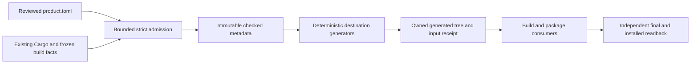

# Windows product and package metadata

**Owner requirement and research:** 5 November 2026, Asia/Tbilisi.<br>
**Status:** accepted objective; the [owner-authorized pipeline](#13-metadata-pipeline-implementation--7-november-2026)
implements source-tool preparation. Actual linked/installed metadata, release
identity and complete package qualification remain open.<br>
**Owners:** OD-05, P6, W11-W10 with build/release, branding/localization and the
existing CHECK-18/20/23/26/27 owners. Service descriptions also involve W11-W05.

## 1. Objective and scope

David requires correct, extensive metadata regardless of whether delivery uses
MSIX or a later selected MSI route. The objective is to populate every useful,
applicable, supported descriptive field and explain deliberate omissions. It is
not to maximize text length, invent release facts, or activate optional package
behavior merely because an XML element or installer property exists.

The selected delivery remains one complete hardened MSIX under
[OD-05](../nevrotick-owner-decisions.md#7-od-05--signing-and-release-ownership).
MSI mappings are retained for possible later owner reconsideration, not a second
deliverable or a reason to defer shared executable metadata. This contract
supplements the [MSIX field profile](windows-msix-store.md#71-concrete-source-inventory-and-manifest-profile),
the [P6 plan](development-plan.md#p6--complete-installation-hardening-and-release-artifacts)
and [W11-W10](../../tasks/windows11-integration.md#w11-w10-re-enter-conditional-mechanisms-only-for-a-concrete-need).
Existing execution holds, Core priority, actual licensing admission and optional
enhanced-provenance policy remain unchanged.

At the inspected NevroTick baseline
`21726b2db44f225da0aaed82f03255c2f2c81023`, Cargo records project license,
repository and crate descriptions; the UI crate is version `0.0.0` and explicitly
describes a fixture prototype. The searched product/build paths contain no
maintained `VERSIONINFO`, `.rc`, package manifest or MSI authoring source. This
is a source inventory observation, not inspection of every historical executable.
Cargo metadata does not by itself populate Windows Explorer or installer fields.
The existing [package-artifact skill](../../.agents/skills/testing/qa-package-artifacts/SKILL.md)
already requires inspecting emitted versions/resources/manifests; this plan adds
the missing comprehensive field map and consistency rules.

## 2. Separate the metadata surfaces

| Surface | Authoritative contents and consumers |
| --- | --- |
| Shared product/release record | Product name, publisher display name, public URLs, rights, localized descriptions, release/channel mapping and component inventory |
| Every first-party shipped PE | `VERSIONINFO`, icon resources, and a separate reviewed application manifest; Explorer Details, diagnostics and process identification |
| MSIX manifest/resources | Package identity, package/application display fields, resources and supported platform declarations; deployment, Start and Settings |
| MSI database | Product/upgrade/package identity, Property table, Summary Information stream, icon and localized installer resources; Windows Installer and installed-app information |
| Installed integration | Actual package or MSI registration, shortcut display/icon/AppUserModelID where applicable, service display names and descriptions |
| Store submission | Localized descriptions, features, screenshots, search terms, category, support/privacy/license information; a separate submission surface |
| Release and component evidence | Source revision, dependency/native payload inventory, hashes, license notices and existing provenance records; support, audit and release custody |

No single field supplies all of these. The display publisher, certificate subject,
Store-assigned identity, Cargo author and original upstream copyright holders
are distinct facts. Descriptive strings cannot authorize a helper or prove the
trustworthiness of a binary. [PE] [MSIX-PROPERTIES] [MSI-ARP] [STORE-IDENTITY]

## 3. Where windows-rs helps

The review checked release-associated `windows` **0.62.2** source at
`32c3144490c016fe496a0aed769bce60987a2e9d`; its Cargo manifest declares the
features below. The symbols were found in the named source modules. This proves
binding presence, not a new dependency admission, target build or native pass.
NevroTick currently uses `windows-sys` 0.61.2 for its UI; retain that graph until
the existing dependency owner admits any additional validation-tool bindings.

| Need | Verified `windows` module / feature and API examples |
| --- | --- |
| Read emitted EXE/DLL version information | `Win32::Storage::FileSystem` / `Win32_Storage_FileSystem`: `GetFileVersionInfoSizeW`, `GetFileVersionInfoW`, `VerQueryValueW` |
| Inspect MSIX package/manifest | `Win32::Storage::Packaging::Appx` / `Win32_Storage_Packaging_Appx`: `IAppxFactory::CreatePackageReader`, `IAppxManifestReader`, `GetPackageId`, `GetProperties`; enumerate actual applications/resources/payload through the appropriate interfaces |
| Inspect MSI without installing it | `Win32::System::ApplicationInstallationAndServicing` / corresponding feature: `MsiOpenDatabaseW`, `MsiDatabaseOpenViewW`, `MsiGetSummaryInformationW`, `MsiSummaryInfoGetPropertyW` |
| Compare installed MSI registration | Same MSI module: `MsiGetProductInfoExW`, using the actual product, user and installation context |
| Read current installed MSIX identity/display data | `ApplicationModel` / `ApplicationModel`: `Package::Current`, `Id`, `DisplayName`, `PublisherDisplayName`, `Description`; an unpackaged process must handle absence of package identity |

Sources: [BINDINGS-MANIFEST], [BINDINGS-PE], [BINDINGS-MSIX], [BINDINGS-MSI],
[BINDINGS-PACKAGE]. Use selected Windows bindings rather than handwritten FFI or
a new home-grown PE/MSI binary parser. COM initialization, allocations, handle
ownership, encoding, buffer lengths, error distinctions and target support still
belong to the adapter. This is an API-surface map, not a complete Cargo feature
stanza: COM stream/initialization and other method dependencies must also be
included in the admitted validation-tool graph. For an MSI inspection tool use read-only database access
and zero requested summary updates; querying metadata must not install a package
or run its custom actions. [MSI-SUMMARY-API]

Bindings also expose writer operations such as `CreatePackageWriter`; windows-rs
is not limited to reading. Nevertheless, the recommended split is **declarative
authoring with admitted build/package tools, independent readback with Windows
APIs**. Resource compilation/linking, MakeAppx, selected MSI authoring and actual
signing remain build/release responsibilities. A projection does not invent the
manifest, compile `.rc` files, maintain versions or operate Partner Center.

Two tempting crate names have different purposes. At inspected upstream master
`db9801679bac964b6367b1d1d1bf8472ab001065`, `windows-metadata` reads/writes
ECMA-335 API metadata such as `.winmd`; it is not a product-description editor.
`windows-version` reports operating-system version information; it is not a
writer for our executable's `ProductVersion`. [WINDOWS-METADATA] [WINDOWS-VERSION]

## 4. Shared maintained record and provenance of values

**Selected implementation location, 7 November 2026:** the versioned
[metadata/product.toml](../../metadata/product.toml) is the single human-edited
source, with code-owned component/locale extensions when needed. This supersedes
the earlier illustrative `packaging/product.toml` path. Do not create a second
independent version authority. Existing Cargo/release versions remain inputs until
a reviewed release-version policy establishes their relationship. Section 13
defines the implementation stages and actual consumer/qualification boundaries.
The [metadata workflow skill](../../.agents/skills/implementation/maintain-windows-metadata/SKILL.md)
and [section 11](#11-harvesting-storage-and-use-workflow--5-november-2026)
provide the reusable collection, authority, storage and use procedure; this
document remains the canonical field map.

| Group | Information to maintain | Value origin |
| --- | --- | --- |
| Product | `NevroTick`, short/long descriptions, intended component roles | Owner-approved product definitions; shipping descriptions reflect implemented capabilities |
| Publisher | Public display name `David Osipov`; developer/manufacturer labels | Owner identity; Store display spelling must match Partner Center when submitted |
| Public destinations | Repository, homepage, documentation, support, update/release notes, privacy and license URLs; optional public support email/phone | Actual maintained endpoints. The repository URL is established; dedicated support/privacy pages and contact availability need validation |
| Rights | Current code license, copyright notices, third-party notices, brand/asset rights | Exact admitted source and license inventory; preserve upstream notices and pending license questions |
| Versioning | Logical product version, release channel, numeric Windows versions, MSI upgrade family/product/package identifiers if selected | Explicit mapping and release process, not guessed GUIDs or independent edits |
| Platform | Actual architectures, minimum OS, tested OS, installer engine floor if relevant, CPU prerequisites | Admitted target/build/runtime policy. `x64` alone does not express the required x86-64-v3 CPU/OS-state prerequisite |
| Components | Filename, internal name, role description, file type, numeric/file display version, icon, language resource mapping | Actual frozen build outputs; UI, engine, broker, helper and shipped diagnostics are distinct |
| Assets/locales | Source asset attribution, generated PNG/ICO variants, supported UI/installer languages, translated strings, fallback | Existing branding sources plus actual generated resources; Store listing languages tracked separately |
| Build/release evidence | Commit, dependency lock/inventory, toolchain/profile, release timestamp if defined, final hashes and stage identity | Measured/generated release records; source, submitted and delivered bytes remain distinguishable |

For every field the register records its output surface, schema/type/length,
localization rule, owner, source/derivation, applicability and status:
**populated**, **derived**, **not applicable with reason**, or **pending with
owner**. Validation aims for complete disposition and full population of the
approved applicable fields. A fake support number, invented Store ID or empty
placeholder does not count as completeness. Optional fields with no meaningful
value are deliberately absent.

Use field-specific descriptions rather than one huge paragraph everywhere. Do
not emit planned NTS/Roughtime/DNS functionality as an implemented release
capability. Do not publish build-machine paths, usernames or local contact data
as a side effect of populating author/build fields. Keep enhanced public
attestations/rebuild proofs optional under OD-05 §7.5; rich descriptive metadata
does not turn them into new release blockers.

## 5. Executable and DLL metadata, independent of installer format

Populate a version resource for every first-party executable/DLL that actually
ships, including headless services. Preserve third-party file identities rather
than replacing their authorship with NevroTick's. Resource compilation is a build
step before final signing and hashing. [PE]

| Resource field | NevroTick rule |
| --- | --- |
| `CompanyName` | Actual publisher/developer display name; `David Osipov` is the current intended value, not a fabricated company |
| `ProductName` | `NevroTick`, consistent across product-owned components |
| `FileDescription` | Role-specific: e.g. UI, synchronization engine, clock broker or administration helper; prototype builds remain labeled as prototypes |
| String `FileVersion` / `ProductVersion` | Readable component/product versions; may preserve channel/prerelease text under the version policy |
| Numeric `FILEVERSION` / `PRODUCTVERSION` | Four 16-bit components with defined mapping; validate against the corresponding readable strings and release inventory |
| `InternalName` | Stable component/module name; when no separate internal name exists, original filename without extension |
| `OriginalFilename` | Actual shipped basename including extension, never a build path |
| `LegalCopyright` | Accurate applicable notices, including retained third-party rights where required |
| `LegalTrademarks` | Only an accurate applicable trademark statement; no invented registration claim |
| `Comments` | Concise useful component/release context; not the only home for support, licensing or provenance |
| `PrivateBuild` / `SpecialBuild` | Only when their corresponding `VS_FF_PRIVATEBUILD` / `VS_FF_SPECIALBUILD` flags truthfully apply |
| `FILEFLAGSMASK`, `FILEFLAGS`, `FILEOS`, `FILETYPE`, `FILESUBTYPE` | Derive from actual binary/build classification; app versus DLL, release/debug/prerelease semantics and valid flags; no unsupported capability claims |
| `StringFileInfo` language/codepage blocks and `VarFileInfo/Translation` | Matching actual Unicode/localized resources; enumerate available translations when reading back |

Microsoft documents the standard string names and fixed fields in [PE] and
[PE-STRINGS]. Custom strings can carry additional project context, but they are
not guaranteed to appear in Explorer. Put detailed source/license/build
information in the release inventory and About/diagnostics surfaces rather than
relying on arbitrary resource keys. A `Cargo.toml` `authors`/`description` value
or an embedded application manifest is not a substitute for `VERSIONINFO`.

Give each shipped application its appropriate icon and reviewed application
manifest. Execution level, DPI/compatibility declarations and mitigations are
behavioral contracts under existing owners, not decorative metadata to enable
en masse. Services' display names and SCM descriptions should explain the
engine/broker distinction without changing their stable service identities,
accounts, privileges or startup policy merely to improve labels.

## 6. MSIX manifest, resources and installed identity

| Surface / fields | Rule |
| --- | --- |
| `Identity/Name`, `Publisher` | Exact assigned Store values for that route, or admitted certificate-matching identity for another authorized route; not user-facing marketing strings |
| `Identity/Version`, `ProcessorArchitecture`, conditional `ResourceId` | Version mapping, actual code architecture and actual resource-package semantics; no invented resource identity |
| `Properties/DisplayName`, `PublisherDisplayName`, `Description`, `Logo` | Fully populate applicable descriptive fields, including the optional useful package description; follow current schema and channel identity requirements |
| Application `Id`, `Executable` and existing activation declarations | Stable per-application identity and actual payload; preserve the selected ordinary-user UI and separate service/helper contract |
| `uap:VisualElements` | Actual display name, description, background and square 44/150 image resources; conditional short name/tile/splash assets only where used |
| `Resources/Resource` and PRI resources | Real supported resource languages and qualified assets; localized manifest strings use resolvable `ms-resource:` references |
| `Dependencies/TargetDeviceFamily` | Qualified device-family/schema and actual `MinVersion` and `MaxVersionTested`; resolve the candidate `Windows.Desktop` for both [OD-14 OS rows](../../tasks/windows11-integration.md#432-two-family-windows-qualification-matrix--5-november-2026) through the MSIX profile. Tested-version metadata is not an upper support bound or evidence of OS qualification |
| Other dependencies/extensions | Exact dependencies and implemented integration; no protocol/file association/COM/startup declarations solely to increase metadata count |
| Derived installed identifiers | Read and retain PFN, full name, actual installed version and application identity; do not maintain a hand-invented duplicate of derived identifiers |

`DisplayName`/`PublisherDisplayName` are display strings; `Identity/Publisher`
must satisfy the signing identity requirements. Store product identity supplies
`Name`, `Publisher` and publisher display information. The package family name
and package SID are derived values, not extra identity elements to add to the
manifest. [STORE-IDENTITY] [MSIX-IDENTITY]

Package properties and application visual properties are different surfaces.
The inspected VisualElements schema permits display names of 1–256 characters
and descriptions of 1–2,048; validate each actual field against its own schema.
Its logo paths accept PNG/JPG/JPEG, not the project's AVIF masters. Generate
appropriate package PNG assets and executable/installer ICO resources from the
approved branding sources, with asset-size and localization checks. [MSIX-VISUAL]

Maintain translated descriptions and resource references, build the PRI as
needed, and check fallback resolution. A translated Store listing is not proof
that the installed application supports that UI language. [MSIX-LOCALIZE]
[STORE-LISTING]

Many children under `Properties` change behavior: framework/resource-package
classification, execution, virtualization, external content, multi-user scope,
integrity and Trusted Launch. They stay under the selected
[MSIX protection profile](windows-msix-store.md#3-package-trust-and-the-privileged-helper).
Likewise, no extra capability is justified by the desire for more metadata.
Unknown attributes or elements must not be inserted as a custom data store.
Keep additional project information in a schema-defined bundled release record
or the proper Store field. [MSIX-PROPERTIES]

## 7. MSI metadata if that delivery route is selected later

### 7.1 Product and installed-app information

| Property or field | Rule |
| --- | --- |
| `ProductName`, `Manufacturer` | Product and actual publisher, consistent with summary and binary display fields |
| `ProductVersion`, `ProductLanguage` | MSI numeric version and actual installer language; product-language metadata is not a list of every UI language |
| `ProductCode` | Product identity governed by Windows Installer update rules; major upgrades require the appropriate new product identity |
| `UpgradeCode` | Maintained identity for the related product family under the selected upgrade design |
| Package code | Unique identity for the actual installer package, stored in Summary Information `Revision Number`; different MSI bytes must not reuse a package code |
| `ARPCOMMENTS`, `ARPCONTACT` | Useful description and real public support contact |
| `ARPHELPLINK`, `ARPURLINFOABOUT`, `ARPURLUPDATEINFO` | Maintained support, product and update-information URLs |
| `ARPHELPTELEPHONE` | Only an actual supported public contact number; absence is preferable to a private or fictitious number |
| `ARPREADME` | Real installed readme or documented destination |
| `ARPPRODUCTICON` | Valid reference to an actual Icon table entry |
| `ARPINSTALLLOCATION` | Resolved installed path, not a hard-coded developer machine path |
| `ARPSIZE` | Only if the authoring design needs a supported explicit estimate, derived from the actual payload; preserve Windows Installer's size calculation when appropriate |

These fields are mapped by Windows Installer to installed-app registration.
Author them through the installer rather than writing a competing Uninstall
registry entry manually. Windows Installer derives values such as
`DisplayVersion`, `UninstallString`, `ModifyPath` and `EstimatedSize`.
Its `InstallDate` may change after servicing and is not an immutable original
installation timestamp. [MSI-ARP] [MSI-UNINSTALL] [MSI-IDENTITY]

`ARPNOMODIFY`, `ARPNOREPAIR`, `ARPNOREMOVE`, `ARPSYSTEMCOMPONENT`, installation
scope and update-channel properties such as `ARPAUTHORIZEDCDFPREFIX` affect
behavior or discoverability. They
must follow the selected lifecycle, not be filled simply because optional.
Avoid hiding this ordinary product or suppressing maintenance controls as a
metadata-completeness exercise. [MSI-ARP]

### 7.2 The separate Summary Information stream

| Summary field | Correct treatment for a shipping MSI installation database |
| --- | --- |
| Title | Meaningful installation-database title |
| Subject / Author | Product name / manufacturer consistent with Property table |
| Keywords / Comments | Relevant installer/product search terms and an accurate package description |
| Template | Correct platform and installer language, e.g. `x64;1033` for an actually English x64 installer; `Intel64` means Itanium |
| Revision Number | Package-code GUID, not product version, source commit or changelog revision |
| Creating Application | Actual MSI authoring software |
| Codepage | Correct representation for strings, set according to the authoring API/tool's requirements before strings |
| Create Time/Date / Last Save Time/Date | Actual authored-package timestamps under the reproducibility policy; distinct from signing timestamp and installed servicing date |
| Page Count | Minimum Windows Installer engine version encoding, not document pages |
| Word Count | Source-image and relevant installer flags, not the description's word count |
| Security | Summary recommendation semantics; Microsoft's installation-database guidance says 2, recommended read-only; this is not cryptographic integrity |
| Last Saved By | Null in a final shipping installation database, as Microsoft specifies |
| Character Count | Null for an installation package |
| Last Printed | Administrative-image semantics; not a field to fill with a fabricated date |

The same summary names have different meanings for MSI installation databases,
MST transforms and MSP patches. Validate against the actual container type.
The Template schema has specific architecture/language restrictions; do not
claim x86 and x64 together just to advertise broad compatibility.
[MSI-SUMMARY] [MSI-SUMMARY-SET] [MSI-TEMPLATE]

## 8. Version and localization rules that prevent silent errors

| Surface | Representation and constraint |
| --- | --- |
| Logical/Cargo release version | May include semantic-version prerelease/build information; current `0.0.0` prototype versions are not a selected Store numbering policy |
| PE fixed version | Four unsigned 16-bit values; human-readable version strings can retain extra display context |
| MSIX identity version | Numeric quad. For the documented Windows 10/11 Store package route, leave the fourth component zero for Store use and use a nonzero major component |
| MSI `ProductVersion` | Three significant components: major ≤255, minor ≤255, build ≤65535. Windows Installer ignores a fourth component for product-version comparison |

A simple stable example is logical `1.2.3`, PE `1.2.3.0`, MSIX `1.2.3.0`, MSI
`1.2.3`; this is illustrative, not selection of NevroTick's next release.
Previews and multiple releases from one logical version need a defined monotonic
numeric mapping that cannot collide. Preserve the logical/channel identifier
separately rather than forcing a semantic version such as `0.1.0-alpha.2` into
an incompatible installer field. Check downgrade/update behavior using the
selected channel rules. Store-delivered revision changes need an allowed mapping
and distinct receipts, not a false byte-for-byte equality requirement.
[PE] [MSIX-VERSION] [MSI-VERSION]

Package identity, MSI upgrade identity and display branding have different
lifetimes. Routine renaming must not accidentally create another product family;
routine regeneration must not break upgrade detection. Keep authored
descriptive translations separate from invariant identifiers. PE language/code
page pairs, MSI LANGIDs and MSIX resource language tags require explicit mapping.

## 9. Store metadata and other distribution descriptions

Maintain Store input alongside the shared record, with channel-specific fields.
It is not embedded into MSIX merely by adding XML, and an MSI distributed through
the Store also has a separate listing/submission. Populate the meaningful
optional fields in addition to mandatory ones. [STORE-LISTING] [STORE-MSI]

- Reserved product name; primary/secondary category and applicable subcategory.
- Clear localized long and short descriptions, implemented feature list and
  release notes for updates; leave first-submission “What's new” appropriately
  empty rather than inventing an earlier release.
- Genuine screenshots of the shipped application; appropriate Store logos,
  supplementary artwork and a trailer only if one exists.
- Relevant keywords, short/sort/voice title where useful, and accurate minimum
  and recommended hardware requirements. Distinguish CPU prerequisites from
  memory observations on a private fixture.
- Public website, support and privacy URLs; actual developer attribution;
  copyright/trademark information and applicable license terms.
- Truthful age/content/privacy/capability declarations and distribution details
  required by the actual submission. These declarations are not marketing filler.

Checked MSIX listing limits include 10,000 characters for the description,
1,500 for update notes, up to 20 feature entries of at most 200 characters,
50 for short title, 255 for sort/voice title and 1,000 for short description
(Microsoft recommends less than 270 for common views). Additional information
allows seven search terms, each at most 40 characters and no more than 21 words
overall; copyright/trademark information is 200 characters and developer
attribution 255. Additional license terms accept a URL or up to 10,000 text
characters. Recheck these mutable channel limits at submission; they are not
targets to fill with repetitive text. [STORE-LISTING] [STORE-ADDITIONAL]

The Store's Published by label comes from the account's publisher display name;
the optional Developed by field is separate. Listing languages can exceed
package languages, but must not misrepresent actual UI translation. Privacy,
support, licenses and website belong in their designated fields. Cargo metadata,
WinGet descriptions and an SBOM have their own schemas and consumers.
[OD-17](../nevrotick-owner-decisions.md#21-od-17--winget-capability-before-v1) now
places [WinGet capability](winget-distribution.md) before V1. Reuse appropriate
values through the existing authority; a conditional Community projection remains
distinct from Store-source identity and from every PE custom string.
[STORE-ADDITIONAL] [STORE-PROPERTIES]

### 9.1 WinGet projection and identity — 7 November 2026

W11-W10/P6 owns the [source/field map](winget-distribution.md#4-metadata-and-artifact-contract).
Keep Store ProductId, MSIX PackageFamilyName and any Community PackageIdentifier
separate. Derive display descriptions/rights from the existing record and release
facts, artifact URLs/hashes from final approved distributables, and detection/
scope/dependency behavior from actual package and installed observations.
No pending Store identity, support/privacy URL, license mapping or release version
may be invented to make a manifest valid.

The current source generator has no qualified WinGet output. Add a bounded
projection only when the corresponding route and inputs are admitted; extend its
code-owned schema/readback and public allowlist instead of creating a competing
product record. WinGetCreate may infer fields, but independent reconciliation
must catch wrong identity, unsupported field loss and version normalization.
The WinGet client/tool/schema combination must be tested together.

Use only supported icon formats and truthful locales. `Architecture: x64` cannot
express x86-64-v3, and a numeric OS minimum cannot encode the complete two-family
policy; [the actual admission owner](../../tasks/windows11-integration.md#432-two-family-windows-qualification-matrix--5-november-2026)
retains those checks. Signing/Store processing precedes hashes for the distributed
form. Source projection, native package qualification and live catalog availability
remain separate evidence. See [NV-WGT-001](winget-distribution.md) for primary sources.

## 10. Generation, verification and existing task handoff

1. **Inventory and assign.** Under W11-W10/P6, complete the field register from
   actual product/component/rights records. Identify pending Partner Center
   identity, public support/privacy endpoints, release numbering, translations
   and authoring-tool inputs. Existing schemas determine valid absence.
2. **Generate deterministically.** From reviewed data and frozen release inputs,
   produce per-binary resources, selected package inputs, localization resources,
   About/diagnostic version data and the relevant Store listing export. XML/RC/
   MSI/CSV escaping and field limits are explicit generator responsibilities.
3. **Inspect emitted artifacts independently.** Compare expected values with
   actual PE resources, MSIX reader results or read-only MSI database and summary
   queries. Resolve resources, inventory all shipped first-party components and
   check genuine role-specific filenames/descriptions, icons and translations.
   A generator unit test alone cannot prove embedded resource presence.
4. **Bind final bytes.** Finish resources before signing. Freeze and inspect the
   signed/submitted artifacts and their hashes; post-signing metadata edits
   require a newly built/signed candidate. Keep Store-delivered transformation
   and signing evidence distinct under the existing release profile.
5. **Observe the installed surfaces at the existing native gate.** Check Explorer
   Details, Start, Settings/installed-app information, service descriptions and
   About/diagnostics for the admitted package and locales. Windows surfaces may
   expose different subsets; preserve optional useful metadata even if one view
   does not display it. Compare installed identity with the actual artifact.
6. **Prevent regressions.** At the affected build/release gate, challenge missing
   required strings, placeholder URLs/identities, unresolvable resources,
   inconsistent versions, invalid Unicode/lengths, wrong architecture, unsupported
   language claims and unintended identity churn. Pair rejection with a valid
   neighboring example. Source schema success is distinct from native behavior.

This is a proposed build/release workflow through existing owners, not a new
always-running application service. It requires no installer-inspection engine
inside the clock broker. Keep the validator's bindings/features scoped to its
actual readback needs; do not add a new general Windows manager or duplicate
the existing signing/SBOM/package validation infrastructure.

**Exit for this research:** the correct surfaces, fields, API coverage and traps
are documented. **Implementation exit remains open:** section 13 now supplies
the bounded source generator; actual build/linked artifacts and selected installed
observations must still substantiate complete metadata. No installer, registry,
service, certificate or Store account was
modified in this research; no package build or installation was run. Delegated
research attempts returned no usable review, so this is coordinator research,
not independently reviewed implementation evidence.

## 11. Harvesting, storage and use workflow — 5 November 2026

This dated research describes the method. The [7 November implementation](#13-metadata-pipeline-implementation--7-november-2026)
now owns the source-tool record and generator in `metadata/`; actual consumers
and artifact/native qualification remain the later existing stages.

The follow-up research used Microsoft Learn, GitHub, Context7, Firecrawl developer
search/page extraction and web retrieval. The new
[maintain-windows-metadata skill](../../.agents/skills/implementation/maintain-windows-metadata/SKILL.md)
contains the operational procedure, four conditional references, primary-source
pins and two clearly marked example records. The recommended architecture is
**reviewed authored data plus immutable observations, deterministic projections
and independent artifact readback**. This is an engineering recommendation
within OD-05 §7.6; no collector or production metadata source is implemented here.

| Stage | Recommended method | Required distinction |
| --- | --- | --- |
| Harvest | Repository/Cargo/license/brand records first; admitted frozen Cargo/SBOM tooling; read-only PE/MSIX/MSI interfaces; existing authorized Store exports | Tool-observed or imported values remain candidates until reconciled with the correct field authority |
| Store intent | Selected `metadata/product.toml` under section 13, with owned component/locale extensions; reference existing Cargo/release/license owners | One authority per fact; no duplicate manually edited release versions or implicit Cargo custom-metadata inheritance |
| Store observations | Versioned JSON in existing candidate evidence, bound to input hashes, collector, time, stage, locale/context, raw value and outcome | Intended, generated, embedded, Windows-resolved, installed, submitted and delivered values are different evidence |
| Use | Generate per-component RC resources, selected package inputs, localization, About/diagnostics and Store CSV projections | Explicit schemas, destination escaping and version/locale mapping; no invented identities or added capabilities |
| Verify | Compare independent readers against reviewed expectations, then observe native installed surfaces at their existing gate | Generated inputs, parser success, native display, signature trust and actual Store delivery prove different properties |

Use a small Git-reviewed source instead of introducing a database/service. Keep
large raw evidence and final artifacts in the existing owned artifact locations,
with hashes and task pointers. Retain the admitted CycloneDX 1.5 Rust inventory
and native/asset reconciliation; a product TOML is not a replacement SBOM. Every
field carries its destination, owner, source/derivation, type/limits, locale,
required stage and populated/derived/pending/justified-absence disposition.
Promote harvested changes through a semantic diff; never silently replace a
reviewed desired value with an erroneous binary's output. Preserve collection
time separately from stable release/build inputs.

The additional research establishes several concrete failure cases:

- Cargo metadata is a resolution/discovery surface. Its target filtering and
  package declarations do not prove a complete build-unit feature graph or
  shipped native/generated payload; its implementation also obtains compiler
  target information. Use frozen admitted tooling and the existing SBOM owner.
- Cargo custom metadata tables have tool-defined semantics. Set validation and
  fallback rules explicitly; arbitrary keys do not populate Windows resources.
- Windows version APIs can merge fixed data and MUI strings. Even the neutral
  flag can return MUI text; preserve raw-file and resolved-locale observations.
- An MSIX package reader validates structure/footprint data, not its digital
  signature. PRI dumps and actual localized presentation also remain distinct.
- MSI Property/Summary reads need read-only access and zero summary updates.
  Installed queries need correct user/context. Avoid Win32_Product: its queries
  can trigger consistency checks and repairs of installed applications.
- Resource helpers need explicit value review. At the pinned winresource source,
  FileDescription's constructor default differs from its documentation table.
  Explicit RC inputs or setters plus actual emitted-resource checks avoid relying
  on those defaults; no new helper dependency is selected by this observation.

The skill's [source register](../../.agents/skills/implementation/maintain-windows-metadata/references/sources.md)
links the official contracts and immutable Cargo/helper code supporting these
findings. Its [generation reference](../../.agents/skills/implementation/maintain-windows-metadata/references/generation-and-verification.md)
maps independent controls for version bounds, placeholders, wrong publishers,
Unicode, unresolved resources, omitted linked resources, denied/truncated reads
and stale candidates. Example records are illustrative contracts, not an adopted
schema implementation or passing release evidence. W11-W10/P6 and existing
CHECK-18/20/23/26/27 retain implementation and verification ownership; all current
execution holds and optional enhanced-provenance policy remain.

## 12. Service and diagnostics metadata refinement — 7 November 2026

The [bounded field catalogue](../supporting-reviews/windows-service-metadata-catalogue.md)
retains the reviewed SCM, artifact/distribution and diagnostics inventories once.
This contract remains the authority for applicability and the shared field map;
the catalogue supplies conditional schema detail, source links and exclusions.
Its 88 SCM/package-service rows and 196 diagnostics rows include representation,
behavior, security and runtime members. Artifact counts overlap across surfaces.
None is a target number of product fields to populate or features to enable.
Refresh the admitted SDK/schema/compiler at the implementation stage.

### 12.1 Field coverage and useful values

Retain each scoped field's semantic meaning and kind: descriptive, technical
identity, behavior/security, compiler/format data or runtime observation. Extend
the section 4 register with its exact `field_path`, source locator, applicability,
type/limits, derivation, locale/fallback, target projection, owner, required stage
and independent reader. Catalogue recommendation labels do not substitute for a
product-specific populated/derived/pending/justified-absence disposition. Reserved
members, pointers, counts, unsupported options and preview attributes need their
appropriate treatment rather than plausible invented values.

`NevroTick` and publisher display name `David Osipov` remain established facts.
Use role-accurate descriptions for actual shipped components. The catalogue's
engine/broker labels and descriptions are proposals; freeze them against actual
release behavior without implying that prototypes already implement that behavior.
Technical SCM names, release numbering, Store/certificate identity, provider GUIDs,
supported locales and maintained support/privacy/help URLs remain with their
existing authorities. Do not create convincing placeholders or a second version
source. All mandatory pending inputs remain visible before their dependent gate.

### 12.2 SCM labels, localization and installed propagation

Technical service name, display name and `SERVICE_DESCRIPTIONW.lpDescription`
are separate fields. Preserve their own limits and update rules: display name
has a 256-character limit; description uses the documented REG_SZ capacity, not
that display-name limit. For a description update, null means unchanged and an
empty string deletes it. Query failure, missing value, valid empty value and
unresolved localization are different observations. Configuration readback needs
the actual query rights; metadata inspection does not grant change rights.

SCM indirect resources such as `@<protected-PE-path>,-<stringID>` and package
`ms-resource:` references are different mechanisms. Record the stored reference,
resource candidate/path/hash, requested/resolved locale and text separately.
Qualify ordinary install and legitimate update/rollback: a valid old reference
can become dangling after resource replacement. Do not assume a UI locale,
package PRI or PE language block automatically supplies every other surface.

The documented `desktop6:Service` and direct `desktop7:Service` definitions lack
display-name/description attributes, while the Packaging Tool conversion report
exposes these values. Trace the selected supported authoring/provisioning route
and inspect actual installed SCM values; neither impossibility nor a setter-only
implementation follows. This does not grant runtime configuration authority or
resolve the held service-account/provisioning bridge. [The SCM catalogue](../supporting-reviews/windows-service-metadata-catalogue.md#appendix-a-scm-and-packaged-services)
retains the primary sources and per-field domains.

Keep intended configuration, queried next-run configuration and actual runtime
status separate. Status/PID is a state-dependent snapshot, not stable product
identity, executable authentication, service readiness or clock-effect authority.
Behavior/security settings retain W11-W05 ownership. In particular, when no
required-privilege list is configured SCM uses token defaults; omitting an update
preserves existing configuration. Do not reset privileges to fill metadata.

### 12.3 Artifact and diagnostic projections

An ordinary user-mode service EXE is `VFT_APP` with subtype zero; driver subtype
`VFT2_DRV_SYSTEM` is inapplicable. Keep compiler-owned version-resource layout
separate from authored strings. A native application-manifest description is
optional under its actual schema; SCM, VERSIONINFO, native manifest, MSIX and
signature descriptions are different projections. Where the selected signing
route supports them, Authenticode content description and information URL are
useful conditional fields. Verify their retention in the final artifact; a label
does not prove signer trust. [Artifact catalogue](../supporting-reviews/windows-service-metadata-catalogue.md#appendix-b-pe-manifests-packages-signing-and-distribution).

For the already-selected diagnostic surface, record stable provider/decoding
identity, event ID/version and payload layout, localized provider/channel/event
labels, resource/message/parameter paths and applicable help link. Validate both
schema and native/compiler domains; for example, the published event XML value
type is wider than native `EVENT_DESCRIPTOR.Id`. Product version is not event
schema version. Preserve the catalogue's documented type/prose discrepancies
for selected-compiler/readback qualification rather than inventing corrections.
Resolve actual installed publisher metadata and render known owned events under
admitted locales, beside missing-resource/schema-mismatch controls. TraceLogging
does not automatically install a durable Event Log catalogue; PerfLib V2 remains
optional. No new provider, channel, counter set or telemetry follows. [Diagnostics catalogue](../supporting-reviews/windows-service-metadata-catalogue.md#appendix-c-diagnostics-and-performance-counters).

A public build-information projection is conditional on an existing About or
support need. Allowlist truthful component/version, revision/source-state,
target/CPU floor, actual toolchain/profile/features and owned schema versions.
Unknown source state is not clean. Keep source/build/publication/observation times
distinct and dynamic PID/readiness/time quality in bounded runtime diagnostics.
Final signed/delivered hashes belong in an external receipt; self-reported hashes
do not independently authenticate a binary and cannot solve a self-hash cycle.
Reuse existing SBOM/notice/custody owners; optional public provenance stays optional.

### 12.4 Existing owners and exits

W11-W10/P6 owns field-register resolution and admitted generation/readback through
CHECK-18/20/23/26/27. W11-W05 owns service configuration, rights, localization
servicing and lifecycle effects. W11-W08 owns diagnostic schema/resource/rendering
semantics with the existing privacy/retention owners and CHECK-17/21/27; ST-W07
retains reached sensitive-output cases. These refine existing assignments before
dependent work, adding no acceptance IDs or prerequisite to the current Core queue.

This research update completed documentation integration, not the full product
field register. Section 13 now implements a bounded source record and generator;
complete release records, resources, signing and native installed/delivered
verification remain open under their existing gates. Source review and valid
schemas prove none of those stages. Current execution holds, complete MSIX scope,
conditional MSI reference status and OD-10's post-V1 formal deferral remain.

## 13. Metadata pipeline implementation — 7 November 2026

David authorized planning and implementation of the shared metadata pipeline,
then selected an easily discoverable high-level directory. The implementation
owner is **`metadata/`**: [editable product record](../../metadata/product.toml),
[pipeline and usage](../../metadata/README.md), generator/validator and tests.
This replaces the illustrative `packaging/product.toml` location above; the
existing Cargo/release/license authorities continue to own their actual facts.
The authored format is TOML, with strict bounded validation before projection.
No runtime metadata service or product runtime parser is introduced.
The current no-follow filesystem adapter requires a POSIX build host with the
necessary directory-descriptor operations. Linux is the exercised host; native
Windows Python custody is not qualified and unsupported hosts fail closed.
Generated files can later enter the existing Windows build/package owners.

### 13.1 Complete data path and trust boundaries



The source model rejects unknown keys/types, duplicates, unsupported values,
invalid paths/identities, resource-budget violations and inconsistent component
facts. Derive versions, repository and licenses from bounded reads of actual Cargo
sources without executing Cargo, dependencies, build scripts or proc macros.
Review the semantic public values once; generated output is never another edited
authority. Keep prototype/experiment and future service roles explicit.
For this source-only prototype mapping, numeric file versions use checked Cargo
major/minor/patch plus an authored fourth-word revision in `0..=65535` (default
zero). Reject booleans, negatives and overflow; preserve readable SemVer. This
does not select the held production release/package version mapping.

Treat metadata as hostile data even when committed or previously accepted. Read
only bounded regular inputs through a no-follow custody check; retain exact bytes
and their digests. Decode into immutable checked values and preserve the contract
at public generation entry points, including direct-construction bypass cases.
Project explicit allowed fields through destination-specific Rust/RC/XML/CSV/JSON
encoders. Never interpret metadata as code, commands, templates or callbacks.
File paths/identifiers and output names do not come from arbitrary interpolation.

Freeze all consumed source identities, including the applicable Cargo manifests
and generator/contract source. Declare the approved fact derivations and actual
destination limits. Generated public metadata excludes machine-local paths,
usernames, secrets, runtime authority and fabricated source/build timestamps.
An external output receipt hashes generated files; no final self-hash is embedded.

Generate into a separately owned output directory with bounded fixed contents.
Reject source-tree overlap, foreign/existing output adoption and link/special-file
traversal. Publish a complete new tree atomically; failure preserves prior valid
output. `check` is read-only and rejects missing, changed, additional or unsafe
entries. A local digest or isolated Python import mode alone does not authenticate
inputs or contain a malicious dependency. Enforced build isolation, independently
protected expectations/checkers and final artifact custody retain their existing
build/release owners; this portable tool does not qualify that entire environment.

### 13.2 Execution stages and observable exits

The labels below are task-local implementation stages, not new acceptance IDs.
Use CHECK-18/20/23/26/27 and the service/diagnostics owners already mapped above.

| Stage | Owner and implementation | Independent exit and retained limit |
| --- | --- | --- |
| MD-P1: authored record and admission | Metadata owner implements the single TOML record, strict bounded schema/checked construction, inert Cargo fact adapters and explicit pending dispositions. | Real current component facts resolve; unknown/duplicate/wrong-type/oversized/unsafe inputs are refused beside valid neighbors. Pending values carry owner/next action. Source mode may report pending future release fields; release mode fails closed on them. |
| MD-P2: deterministic projections and check | Build metadata owner implements generated Rust constants, per-current-component VERSIONINFO RC, public descriptors and applicable package/service/event/Store authoring projections. | Same inputs produce identical content; source edits change affected projections; check detects corruption, extras and stale source/generator identities without writing. Literal hostile text stays data. No fake complete MSIX, registered event catalogue or service resource is emitted for unresolved identities. |
| MD-P3: configured entry points and regression checks | Coordinator integrates the portable CLI, focused tests, CI source checks, skill usage and current task. | Real CLI entry points operate on owned temporary fixtures, both success and failure paths execute, failed publication preserves prior state, and the CI job is already part of the required gate. Rust/RC files are generated source, not linked/native qualification. |
| MD-P4: actual consumer/build adoption | Existing S0.5/build/P3/W11-W05/W11-W08/W11-W10 owners adopt reached generated inputs before their dependent component/package slice. | Actual compile/link/package consumers use the frozen tree, reject stale/missing metadata and independently inspect emitted resources. No new dependency or unrelated Cargo graph change is admitted by this plan. Missing component source and pending native execution remain explicit. |
| MD-P5: native, signing and delivered readback | Existing W11-W10/P6 and W11-W05/W11-W08 owners, followed by David's release authority. | Inspect installed labels/resources/locales and lifecycle, finalize before signing, then separately verify signed/submitted and Store-delivered bytes. Existing identity/provisioning, native/security/package gates and execution holds remain. |

Implement MD-P1–MD-P3 now in the portable source-tool scope. Plan MD-P4–MD-P5
through the existing phases as real consumers and authoritative release inputs
become available. Do not call generated authoring data a completed integration,
use a pending marker as a shipping value, or label prototype output as a release.
MSI and PerfLib stay conditional. The ordinary Core/N3 queue, x86-64-v3 baseline,
maximum-compatible hardening and post-V1 formal deferral remain unchanged.

### 13.3 Verification and coordinator handoff

Separate workers own admission/source, projection/CLI and independent tests;
the coordinator owns cross-worker interfaces, configured integration and final
candidate reconciliation. Preserve shared staged/concurrent work. Before handoff,
freeze the exact integrated sources, run focused raw-admission and CLI controls,
inspect generated outputs independently and obtain a source/security review.
Challenge direct API bypasses, source replacement/growth, unsafe paths, output
tampering, stale source/contract/generator identity and useful neighboring text.

Record actual results and remaining stage owners in the existing
[W11-W10 assignment](../../tasks/windows11-integration.md#w11-w10-re-enter-conditional-mechanisms-only-for-a-concrete-need).
No formal, Cargo, Windows, service, clock, signing or publication operation is
required to qualify this portable source-tool slice. Such later gates remain
open until their real consumers and authorized environments execute them.

### 13.4 Complete field register and source text policy — 7 November 2026

David requested extending the prototype record to the full reviewed metadata
scope, researching unknowns and leaving unanswered values empty. The earlier
MD-P1–MD-P3 receipt qualifies the initial subset, not complete field coverage.
Extend the existing `metadata/` implementation and W11-W10 assignment; no second
authoritative value file or parallel package plan is introduced.

The code-owned registry must enumerate the declared SCM, artifact/distribution
and diagnostic catalogue field scopes, plus the shared project/author/rights,
public destinations, asset/localization, platform and build/release fields in
section 4. Each registry key has a type, surface, applicability/authority owner
and permitted derivation. The authored TOML supplies exactly that field set, with
value, populated/derived/pending/not-applicable status, source locator and reason.
The registry owns the contract, not a second copy of editable product values.
Reject omitted/unknown keys, incompatible status/value pairs and forged typed
models. A populated value must meet its destination's constraints; blank is not
a populated value and never counts as production readiness.

Populate facts established by current repository/owner authorities. Research
uncertain API/schema rules against primary sources; do not infer project-specific
Store assignments, provider GUIDs, signer identity or service names from generic
Windows documentation. When evidence cannot establish a value, retain `value = ""`
with its pending owner/source/reason. Derived facts reference their existing
authority instead of another manual copy. Runtime, compiler/layout/reserved and
unselected MSI/PerfLib members retain explicit non-authorable/conditional
dispositions. Catalogue completeness remains bounded by its named types and
schemas; unexpanded extension trees and all Windows APIs are not new scope.

Generate a complete internal field register and a coverage/pending report. Use
explicit public/destination allowlists for actual Rust/RC/XML/JSON/CSV projections;
do not ship regulatory/private contacts, operational policy or the entire authoring
record automatically. Filled descriptive fields must reach their supported
projection. Empty unresolved values remain visibly unresolved and must not become
package/service/provider identities. Fields coupled to behavior, privileges,
classification flags or optional facilities retain their original owners and
must not activate those features through decorative metadata.

The `product.toml` text contract is strict UTF-8 without a BOM. Check raw text,
including comments, and all decoded keys/string values so TOML escapes cannot
bypass it. Pin the Unicode property data and its provenance in the build tool;
perform no runtime download. Reject Extended_Pictographic/Emoji_Presentation,
regional-indicator/keycap emoji and their variation/tag/joiner components, default
ignorables, controls/format characters, surrogates, private-use/unassigned code
points, noncharacters and Unicode line/paragraph separators. ASCII tab/LF/CR
remain syntax whitespace; decoded fields retain their own single/multiline rules.
Ordinary assigned international letters, combining marks, numbers and allowed
punctuation remain valid. This is a text policy, not ASCII-only input, Unicode
normalization, confusable detection or authentication of a publisher's identity.
The broad pictographic exclusion also rejects text-style copyright/trademark
symbols; use plain words such as `Copyright` instead.

Separate workers own the registry/record/checked schema, Unicode policy/data/tests
and projection/regression integration. The coordinator researches outstanding
facts, reconciles interfaces and scopes, and obtains final independent review.
Acceptance requires independent catalogue-to-register reconciliation, raw/escaped
emoji and malformed UTF-8 rejection with valid international neighbors, empty
unknown preservation, complete field omission/unknown/status rejection, selective
destination propagation, source/data receipt coverage and the existing custody
regressions. Reuse the current required CI job and the existing CHECK owners.
Native consumers, full MSIX/event authoring, signing/installed/delivered checks,
the current Core queue and all execution holds retain MD-P4–MD-P5's boundaries.

### 13.5 Adopted metadata delivery controls — 7 November 2026

David authorized adopting the useful mechanisms from the reviewed sibling
website pipeline. Extend this same source-tool and W11-W10/P6 chain; do not add
a parallel metadata authority, website build dependency or runtime validator.
The comparison used the dirty `personal-website-templated-1` working tree at
`6530d3a8d44cbe4f829b1e09edd3a1c90cffc087`, especially its person-data admission,
citation release requirements/output checks, image-representation reader and
cold/warm build controls. Source inspection and those historical tests do not
establish current NevroTick build or native qualification. Transfer the designs,
not unreviewed source code or website-specific biography, licence or support facts.

**Source admission and delivery, MD-P1–MD-P3:** validate ORCID and ISNI check
characters as well as their exact admitted spelling. Preserve empty pending
values and the existing text policy; reject invalid identifiers rather than
normalizing them. A valid checksum establishes transcription consistency, not
registration, ownership or publisher authentication. [ORCID's primary contract](https://support.orcid.org/hc/en-us/articles/360006897674-Structure-of-the-ORCID-Identifier)
defines its MOD 11-2 check character and separately reserves assignment to its
registry. Keep public-constructor and real-CLI bad-check-character controls beside
known valid numeric and `X` examples.

Derive source-delivery obligations from the admitted semantic record and the
code-owned destination contract. Each reached obligation identifies its source,
component, artifact, locator, required representation and intended absence rules.
Check independently parsed JSON/XML/CSV and the supported Rust/RC source literals
against those obligations before accepting a generated tree. Keep exact byte and
custody checks too: semantic agreement does not establish unchanged bytes, and
regenerating the same formatter alone can repeat a mapping defect. Record the
bounded source-delivery result separately from the 731 field dispositions;
catalogue-reference, pending and intentionally excluded fields are not missing
public payloads. Missing, extra, duplicated, wrong-component or wrong-value
bindings must fail even when counts agree. The source observer is not a compiler
or a PE/MSIX/installed resource reader.

The existing MD-P4–MD-P5 owners adopt these concrete exits before dependent work:

| Stage and existing owner | Required observable exit |
| --- | --- |
| MD-P4, component/build owner | Select required component/field/locale/resource bindings from the admitted contract and inspect the actual linked PE and other reached compiled/package resources with independent readers. Include absent resources, equal-count wrong-component/version/locale and mutually consistent declarations that disagree with emitted bytes. A successful compiler or generated summary cannot replace readback. |
| MD-P4, Cargo/resource build owner | Exercise a cold build, change a consumed metadata/Cargo/generator input without an unrelated source edit, run a warm build, then compare the affected decoded metadata with a clean-build control. Verify every consumed-file and approved environment rerun rule, including additions/removals where applicable. A separate selected-tool/configuration change checks that producer identity and admission invalidate the previous result; no stale output can pass merely because source hashes were recorded. |
| MD-P4, build/package owner | Bind observations to the actual selected resource compiler, linker, SDK, target, profile, generator and relevant configuration identities. Use admitted tool records and exact consumed bytes where applicable; version strings and ambient environment discovery alone are not executable custody. Keep the existing source receipt and later artifact observation distinct, with one frozen generation per build. |
| MD-P4–MD-P5, package/export owner | Use an exact approved payload allowlist. Internal field/coverage registers, authoring records, private contact/regulatory values and unselected source inputs are not automatically shipped. Challenge accidental whole-directory copying and a private sentinel beside a healthy package/export. Inspect actual final payload paths and contents, not only the public source projection. |
| MD-P4–MD-P5, W11-W05/W11-W08/W11-W10 identity owners | When actual SCM names, package/application identities, resource keys or provider GUIDs are selected, validate references and collisions using each namespace's real comparison rules. A display-name match cannot select another role; intended shared identities need an explicit contract. Do not impose global uniqueness across unrelated namespaces or invent values to exercise the check. |
| MD-P5, package/native/release owner | Finalize generated resources, compile/link and package before signing; any later mutation produces a new candidate. Independently inspect the exact signed/submitted and Store-delivered artifacts, then installed/resolved values in their actual contexts. Keep local, submitted, delivered and installed observations distinct. Existing signing, trust, lifecycle and release-authority checks remain. |

The independent controls must distinguish a healthy complete result from missing
or empty output, wrong ownership with unchanged counts, stale generations and
unintended private exports. Never auto-update expected facts from the producer
to make a failed comparison pass. Producer-generated golden files and same-helper
parity may support regression/delivery evidence, but independent literal
requirements and actual artifact readers establish the claimed semantics.
Website warning-only missing-output paths, permissive/autofix modes and mutable
cache/database machinery are not adopted. The current pipeline already publishes
a fresh complete tree with source/code receipts; no caching or new hashing
algorithm is needed for this extension.

The coordinator records actual source-tool results in the existing W11-W10
receipt. MD-P4–MD-P5 stay open until their real consumers and authorized
environments execute these exits. This amendment adds no prerequisite to the
current Core/N3 queue, no stronger public attestation requirement, no package
route change and no exception to Windows, fuzz, storage, UI or formal-work holds.

### 13.6 Source-tool finalization and failure outcomes — 7 November 2026

David authorized closing the source-pipeline audit findings within the existing
MD-P1–MD-P3 owner. This is portable metadata-tool work, not an expansion into
the held compiled/native/package stages or another product plan.

Admission must enforce the selected ASCII email grammar, including local-part
dot placement, without rewriting accepted values or claiming mailbox ownership.
Retain permanent just-below/exact/just-above cases for reached decoded resource
limits and Store/service/resource-reference rules, with valid neighboring inputs.
The XML observer must interpret the actual bytes and their declared encoding;
decoding to Unicode first must not conceal an incompatible declaration. Preserve
the declared generated subset, literal text, rejection of extra content and
independent critical component/field/representation expectations.

During generation, recheck consumed source and generator identities before
publication. During read-only `check`, recheck those identities and the binding
between the selected output pathname and the held candidate directory before
success. Retain bounded no-follow reads and caller-owned isolation. These checks
detect the tested in-flight changes; they neither contain arbitrary same-user
code execution nor promise that a pathname cannot change after return.

Distinguish publication phases instead of equating every error with no effect:

| Phase/outcome | Required behavior |
| --- | --- |
| Admission or precommit write/flush/rename failure | Refuse success, remove only owned unpublished staging, preserve any existing candidate and foreign state. Retain independent healthy controls. |
| Acknowledged publication | Write/flush files and their containing directories, flush the complete staging directory, rename the new tree and obtain the final parent-directory flush acknowledgement. Report only host-filesystem acknowledgement, not hardware or crash-durability proof. |
| Rename succeeded, final flush acknowledgement failed | Preserve the committed complete tree and raise `PublicationUncertainError`, a `MetadataError` subtype. The CLI returns exit `3` with the bounded JSON outcome below, distinct from ordinary rejection exit `1`. Never delete, overwrite or automatically retry the committed tree. |

```json
{"schema_version":1,"status":"publication-uncertain","durability":"unconfirmed","action":"check-existing-output-before-retry"}
```

After an uncertain result, `check` may reconcile the visible bytes against the
frozen source; it cannot retroactively establish the missing flush acknowledgement.
Repeated `generate` still refuses an existing destination. Keep invalid source,
unsafe output, precommit failure, uncertain publication and successful readback
distinct in logs and task evidence, without exposing raw values or private paths.

Acceptance retains the prior audit counterexamples: an isolated omission of the
final generator-identity comparison must be caught through actual publication
behavior; a rebound-parent control must require refusal as well as unchanged
foreign bytes. Add byte/declaration XML faults, invalid email neighbors, decoded
and field-limit boundaries, independently specified delivery bindings, bounded
literal/field-interaction properties and pre/postcommit failure cases. Preserve
the first RED and a useful healthy control; faults that only break an observation
hook or fail an import do not establish semantic test sensitivity.

The coordinator records the integrated candidate, actual test and selected
fault-sensitivity outcomes in the existing W11-W10 task. A bounded seeded trial
is not a per-file mutation score or a full release coverage result. MD-P4–MD-P5,
the current Core queue, required v3/hardening policy and all execution holds remain.

### 13.7 Full portable source-tool qualification — 7 November 2026

David requested the remaining full qualification after the bounded source-tool
audit. The existing MD-P1–MD-P3/W11-W10 owner now adopts
[the explicit Python scope](../../metadata/qualification/manifest.json) and
[repeatable qualification commands](../../metadata/qualification/README.md).
This adds no runtime dependency or compiled/native execution authority.

Strict checking covers all eight production modules and their immediate typed
consumer, preserving mandatory runtime construction and postcondition checks.
The legal consumer and intended wrong-field/value, incompatible-interface,
unhandled-outcome and frozen-model controls must discriminate through the
admitted checker. An annotation or a wrong import alone supplies no pass.

The metadata-specific manifest classifies admission, delivery, publication,
text policy and CLI outcomes as security modules; each requires at least 90%
executable-line coverage. These five modules and the field registry are six
critical files, each with the retained 95% adjusted viable-mutation threshold.
Line coverage includes actual isolated CLI interpreters; branch counts remain
separate evidence. Package markers have no invented nonempty denominator.
Registry/Unicode data and requirement-bearing functions remain explicitly
reconciled with generated mutants and independent alternative evidence.

The coordinator records exact integrated identity, all outcomes and unresolved
findings in the existing W11-W10 task. Per-module line evidence, per-file
mutation evidence, source field dispositions and native/package readback are
different claims. Failed, skipped, timed-out, partial or stale required checks
remain incomplete. Qualification-helper controls must reject missing scope,
weakened thresholds, wrong identities and absent subprocess observations.
Retain the existing MD-P4–MD-P5 owners, current Core queue and all execution holds.

## Primary sources

Microsoft Learn schemas and Windows Installer references were retrieved using
the Microsoft Learn MCP and checked against primary web documentation on
5 November 2026. Binding locations were verified by reading pinned Git source;
no upstream code was executed.

[PE]: https://learn.microsoft.com/windows/win32/menurc/versioninfo-resource
[PE-STRINGS]: https://learn.microsoft.com/windows/win32/menurc/stringfileinfo-block
[MSIX-PROPERTIES]: https://learn.microsoft.com/uwp/schemas/appxpackage/uapmanifestschema/element-f-properties
[MSIX-IDENTITY]: https://learn.microsoft.com/uwp/schemas/appxpackage/uapmanifestschema/element-f-identity
[MSIX-VISUAL]: https://learn.microsoft.com/uwp/schemas/appxpackage/uapmanifestschema/element-uap-visualelements
[MSIX-LOCALIZE]: https://learn.microsoft.com/windows/uwp/app-resources/localize-strings-ui-manifest
[MSIX-VERSION]: https://learn.microsoft.com/windows/apps/publish/publish-your-app/app-package-requirements?pivots=store-installer-msix
[MSI-ARP]: https://learn.microsoft.com/windows/win32/msi/configuring-add-remove-programs-with-windows-installer
[MSI-UNINSTALL]: https://learn.microsoft.com/windows/win32/msi/uninstall-registry-key
[MSI-SUMMARY]: https://learn.microsoft.com/windows/win32/msi/summary-property-descriptions
[MSI-SUMMARY-SET]: https://learn.microsoft.com/windows/win32/msi/summary-information-stream-property-set
[MSI-SUMMARY-API]: https://learn.microsoft.com/windows/win32/api/msiquery/nf-msiquery-msigetsummaryinformationw
[MSI-TEMPLATE]: https://learn.microsoft.com/windows/win32/msi/template-summary
[MSI-VERSION]: https://learn.microsoft.com/windows/win32/msi/productversion
[MSI-IDENTITY]: https://learn.microsoft.com/windows/win32/msi/windows-installer-best-practices#keep-package-names-and-package-codes-consistent
[STORE-IDENTITY]: https://learn.microsoft.com/windows/apps/publish/view-app-identity-details
[STORE-LISTING]: https://learn.microsoft.com/windows/apps/publish/publish-your-app/msix/add-and-edit-store-listing-info
[STORE-ADDITIONAL]: https://learn.microsoft.com/windows/apps/publish/publish-your-app/msix/add-additional-information
[STORE-PROPERTIES]: https://learn.microsoft.com/windows/apps/publish/publish-your-app/msix/enter-app-properties
[STORE-MSI]: https://learn.microsoft.com/windows/apps/publish/publish-your-app/msi/enter-app-properties
[BINDINGS-MANIFEST]: https://github.com/microsoft/windows-rs/blob/32c3144490c016fe496a0aed769bce60987a2e9d/crates/libs/windows/Cargo.toml
[BINDINGS-PE]: https://github.com/microsoft/windows-rs/blob/32c3144490c016fe496a0aed769bce60987a2e9d/crates/libs/windows/src/Windows/Win32/Storage/FileSystem/mod.rs
[BINDINGS-MSIX]: https://github.com/microsoft/windows-rs/blob/32c3144490c016fe496a0aed769bce60987a2e9d/crates/libs/windows/src/Windows/Win32/Storage/Packaging/Appx/mod.rs
[BINDINGS-MSI]: https://github.com/microsoft/windows-rs/blob/32c3144490c016fe496a0aed769bce60987a2e9d/crates/libs/windows/src/Windows/Win32/System/ApplicationInstallationAndServicing/mod.rs
[BINDINGS-PACKAGE]: https://github.com/microsoft/windows-rs/blob/32c3144490c016fe496a0aed769bce60987a2e9d/crates/libs/windows/src/Windows/ApplicationModel/mod.rs
[WINDOWS-METADATA]: https://github.com/microsoft/windows-rs/blob/db9801679bac964b6367b1d1d1bf8472ab001065/crates/libs/metadata/readme.md
[WINDOWS-VERSION]: https://github.com/microsoft/windows-rs/blob/db9801679bac964b6367b1d1d1bf8472ab001065/crates/libs/version/src/lib.rs
