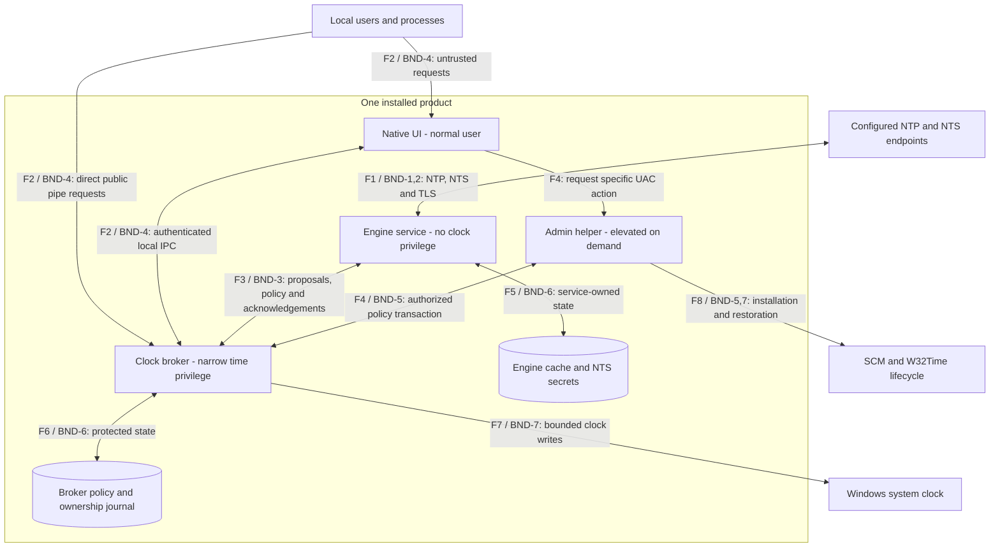
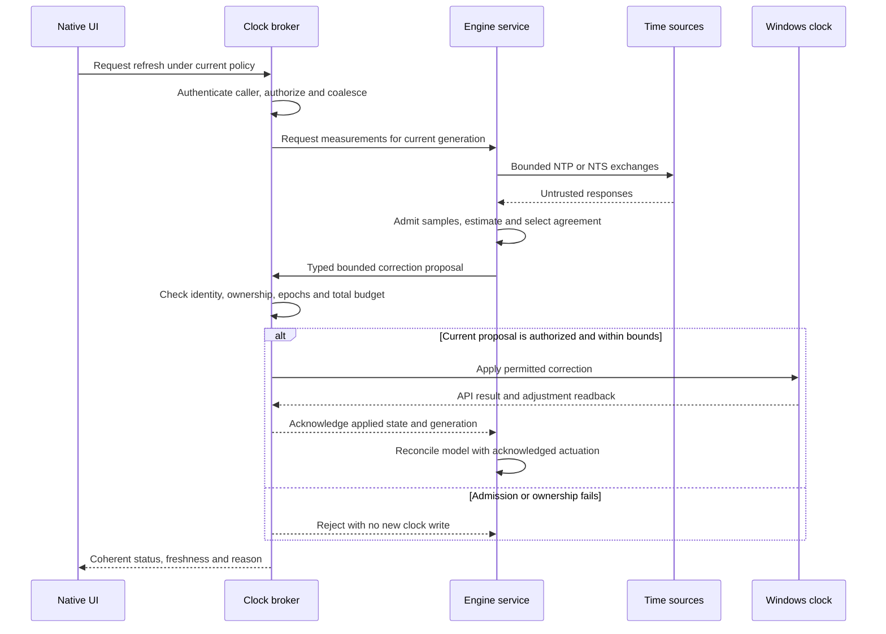
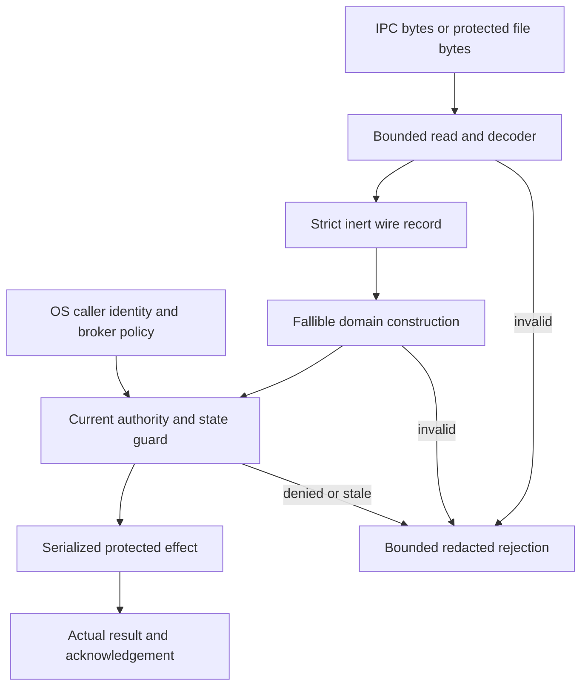
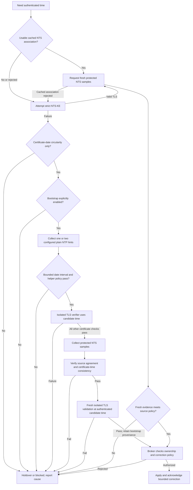
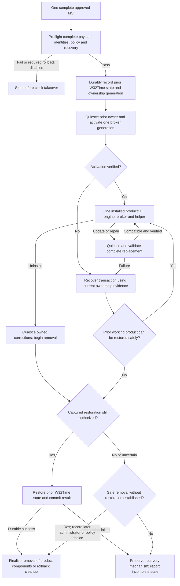

# Rust Windows Time Client

## Architecture and creation specification

**Prepared for:** David Osipov  
**Plan ID:** RWTC-ARCH-001  
**Revision:** 1.4 - full independent document review and applicability reconciliation, 28 October 2026  
**Product name:** NevroTick  
**Scope:** a chrony-derived Rust NTP/NTS client for Windows, with a small native UI

**Documentation amendments:** 29 October 2026 - explicit upstream-code verification/stress testing and [owner decisions NV-DEC-001](nevrotick-owner-decisions.md). The latter records derived reuse, large authenticated recovery as a qualification goal, the Pool/default-profile question, case-by-case risk decisions and an initial OpenPGP release alternative. No new runtime evidence.

This specification defines the proposed product, its security boundaries, failure behavior, implementation sequence and evidence required for release. It is a design deliverable. No application has been implemented or qualified by this work. Words such as **must** state requirements for the future implementation; they do not describe controls already deployed.

The selected v1 design is **one complete per-machine MSI** under the Authenticode or initial OpenPGP release profile in section 19.5 containing a normal-user native UI, a network-facing synchronization engine without clock-setting privilege, a small privileged clock broker, and the administration helper. The user installs, updates, repairs and removes one product. The installer owns service installation and reversible Windows Time Service handover. A future MSIX, if qualified, must contain the same complete product with an equivalent lifecycle; separate UI and service distributions are excluded.

**Revision 1.4 changes:** reconciles a fresh independent review of all maintained Markdown documents and all 345 ASVS clauses. It corrects 16 worksheet records, including seven draft classification changes; makes conditional native HTTP retrieval and legacy NTP entropy decisions explicit; aligns JSON/status wording; and adds a source-derived extreme-date verifier qualification case. Original verification text and prior additions remain traceable. All controls remain unimplemented/unexecuted. See the [full review report](windows-time-review.md).

**Prior revision 1.3 changes:** adds a component-owned dependency register, a concrete TLS-provider license gate and Windows certificate-policy qualification, bounded native-work lifetime rules, Windows security/diagnostic integration, development tools and exact-graph release evidence. It adds DEC-19, THR-26 and CHECK-26/27, and extends planned ASVS verification. Revision 1.2's strict Serde/domain contract and revision 1.1's complete single-package distribution remain the baseline. No crate was installed, dependency graph resolved or application tested for this revision. The maintained deliverables are Markdown.

The numerical core will port selected chrony client algorithms, preserving their source provenance and GPL-2.0-only obligations. The product will retain filtering, statistical estimation, source agreement, principal/supporting-source selection, oscillator discipline and holdover. It will omit chrony's server and specialist reference-clock features.

## Reading guide

1. Current state, source authority and requirements
2. Decisions and component architecture
3. Windows identities, IPC and data contracts
4. Time engine and NTS recovery
5. Clock ownership, persistence and lifecycle
6. Security baseline, threat model and exploit protection
7. Accessible UI, resource budgets and engineering standards
8. Verification, delivery phases and release readiness
9. Sources, guidance adaptation and review record

The companion [asvs-5.0.0-applicability.md](asvs-5.0.0-applicability.md) preserves all 345 requirements in the selected ASVS release. It distinguishes direct applicability, native adaptations, scoped exclusions and unresolved policy decisions. It is a planning worksheet, not a certificate or a completed assessment. [windows-time-diagrams.md](windows-time-diagrams.md) collects the plan's Mermaid views for convenient editing and review; this specification owns the authoritative diagrams and threat model.

Quick navigation: [architecture](#3-component-architecture-and-authority), [NTS recovery](#8-recovery-when-the-system-date-breaks-tls), [threat model](#14-threat-model), [Windows integration](#153-integration-with-windows-security-and-management), [dependency choices](#186-runtime-dependency-register), [TLS/provider gates](#187-tls-nts-and-windows-trust-decisions), [one-package distribution](#19-single-package-distribution-and-signing), [acceptance checks](#20-verification-strategy-and-acceptance-checks), [open decisions](#22-open-decisions-and-release-blockers).

---

## 1. Current-state capsule

| Field | Baseline |
| --- | --- |
| Authorized result | Research and documentation amendments; this record provides no application deployment or public-release authority |
| Product repository | [DavidOsipov/NevroTick](https://github.com/DavidOsipov/NevroTick), inspected at `77ad8c416db32d5edfdc9e6a538d76637eaf44f0`; application workspace/source absent in the inspected tree |
| User guidance inspected | DavidOsipov/personal-website-templated at commit 6530d3a8d44cbe4f829b1e09edd3a1c90cffc087 |
| Skill coverage | All 52 skill main files in the inspected guidance tree, relevant planning/implementation/security/testing contracts, and selected references; not every reference file in the directory |
| Chrony baseline | Version 4.9, commit 8df4f1263e206585e6c4e61352d042c2dd12916a |
| ASVS baseline | OWASP ASVS 5.0.0, commit 5cf9b032440be53ce345ab3c130fda46ba1ce7a2; all L1, L2 and L3 clauses considered |
| Current phase | Revision 1.4 full-document review and narrow corrections; bounded P0 investigation remains the next stage. Exact review scope, findings and recheck evidence are recorded in section 24 and the review report |
| Next executable work | UI-M0 under section 16.5 and authorized bounded P0 research in the existing project; native clock experiments require a disposable Windows environment |
| Evidence available | Primary-document research, pinned upstream source inspection and planning review |
| Evidence unavailable | Windows runtime tests, binaries, benchmark measurements, accessibility results, package qualification, signing approval or ASVS implementation evidence |

Research findings and proposed product decisions are kept distinct. A successful source inspection is evidence of what the source says; it does not qualify a new Rust implementation. The website's JavaScript commands and browser controls do not become Windows product requirements merely because the source guidance names them. [S01, S02, S03]

### 1.1 Interpretation of the nine requested properties

| ID | Required observable result | Important constraint | Acceptance checks |
| --- | --- | --- | --- |
| REQ-1 | Synchronization continues before login and after the UI closes; everyday UI use needs no elevation | Only the broker has clock-setting privilege; machine policy changes require elevation or explicit delegation | CHECK-1, 2, 3, 12 |
| REQ-2 | Security is designed against applicable ASVS 5.0.0 L1-L3 clauses plus native Windows/time controls | Applicability, implementation and verification are separate; unresolved literal L3 gaps remain visible | CHECK-4, 16, 17, 24 |
| REQ-3 | Exactly one cooperating product controller writes the clock; W32Time handover and restoration are reversible | Interpret the user's “turn on” as **turn off W32Time during takeover**, then restore its previous state; do not fight Group Policy | CHECK-5, 12, 13 |
| REQ-4 | Releases have verified artifact provenance under their declared profile; loading untrusted DLLs is prevented by design | Prefer Authenticode. OD-05 permits an initial OpenPGP-signed MSI without project Authenticode if a free route is unavailable; it supplies no Windows publisher trust. Qualify installed-file trust and disclose restrictions | CHECK-16, 18, 23 |
| REQ-5 | Strict, justified Rust and supply-chain checks block unsafe releases | Do not blindly enable contradictory lints; exceptions are narrow, documented and tested | CHECK-19, 20, 24 |
| REQ-6 | The service is quiet, small and efficient in steady state | Budgets below are proposed targets; publish measurements on named hardware and OS builds | CHECK-21 |
| REQ-7 | Minimal native UI works with keyboard, Narrator, UI Automation, contrast themes and scaling | Accessibility gates toolkit adoption and release; a toolkit feature flag is insufficient | CHECK-22 |
| REQ-8 | NTP and NTS operate correctly; one or two explicit plain NTP sources can assist recovery from a badly wrong date | Plain bootstrap hints never directly set Windows time and never silently replace NTS tracking | CHECK-6, 7, 8, 9, 10, 11 |
| REQ-9 | One complete package installs the UI, both services and helper as one product, with one version/update/repair/uninstall lifecycle | V1 is one per-machine MSI under section 19.5; any future MSIX must also be complete and prove equivalent authority/restoration. No separately installed service prerequisite or UI-only package | CHECK-13, 18, 23 |
| REQ-10 | Source selection rejects inconsistent sources and uses a principal plus compatible supporters | Lowest latency alone is insufficient; failure to find agreement cannot silently select a single peer | CHECK-7, 8 |
| REQ-11 | Sleep, network changes, outages and crashes have explicit safe recovery | Windows rate changes have no documented process-lifetime expiry | CHECK-10, 11, 12, 13 |
| REQ-12 | UI status explains authentication, agreement, freshness and estimated uncertainty separately | An alive service or recent UDP reply is not proof of correct UTC | CHECK-14, 22 |
| REQ-13 | Configuration, secrets and logs have explicit owners, bounded storage and safe migration | Neither a valid message nor a code signature grants permission to perform an operation | CHECK-2, 3, 15, 17 |
| REQ-14 | The port has reproducible provenance and a legally compatible dependency set | Source translation preserves upstream licensing obligations; process separation is not a blanket license exemption | CHECK-20, 24 |
| REQ-15 | Every security/correctness claim is tied to reproducible evidence | Mocked clocks cannot qualify the real Windows clock adapter; planned tests are never reported as passes | CHECK-24 |

### 1.2 Scope and non-goals

Version 1 is a workstation NTPv4 client with NTS, an automatic background service, secure local administration, clear diagnostics and packaging verified under its declared release profile. Start with currently supported Windows 11 x64 releases, using the MSVC Rust target. Add ARM64 only after its own runtime, mitigation and package gates pass. The exact minimum Windows build and supported update channels must be frozen in P0; the historical API/MSIX minimum is not a promise to support every old Windows release.

The initial product is not an NTP server, PTP client, GPS/PPS/refclock host, domain-controller time service, kernel driver, chronyc-compatible remote management endpoint or general clock laboratory. It does not need symmetric peers, broadcast/multicast operation, interleaved mode, hardware timestamping, RTC temperature compensation or a plugin/script system. Time zones and daylight-saving settings remain Windows settings; the service disciplines UTC.

Managed domain machines default to observation until an administrator explicitly authorizes takeover. The product does not promise defense against an already malicious administrator, kernel compromise, hostile firmware or a VM host that controls guest time. It still must avoid creating new privilege-escalation paths for ordinary users or network attackers.

---

## 2. Decision register

The following choices form the implementation baseline. A gated choice is selected for a prototype, with the named proof required before production adoption.

| ID | Decision | Reason and tradeoff | Reconsideration trigger |
| --- | --- | --- | --- |
| DEC-1 | Port chrony's selected client algorithms into a deterministic Rust core; independently test, fix and optimize with recorded evidence and provenance (OD-01) | Preserves the behavior the user values while replacing Unix integration; more fidelity work than a one-shot SNTP utility | License review or differential tests show the chosen translation strategy is unsuitable |
| DEC-2 | Use two own-process services: engine and clock broker | Network parsing has no clock privilege; SCM launches both without broker child-launch authority | P0 proves unacceptable resource cost or isolation cannot be enforced |
| DEC-3 | Use a normal-user native Win32 UI through a narrow Rust Windows adapter | Small dependency/runtime footprint, familiar controls and built-in accessibility foundations | Representative accessibility prototype fails or FFI complexity becomes excessive |
| DEC-4 | Use secured named pipes as the initial local transport | Simple local deployment and explicit Windows authorization | Mutual server identity cannot be proven without races; then evaluate authenticated local RPC |
| DEC-5 | Retain the existing NTS-only selectable baseline while resolving OD-03's Pool/default-profile interaction; do not ship an unqualified preset | Prevents silent weakening of an authenticated configuration | An explicitly selected NTP-only profile is needed; it stays visibly unauthenticated |
| DEC-6 | Prefer cached NTS associations before any bootstrap hint | Fresh authenticated UDP replies can avoid certificate-time circularity | State is absent, rejected, expired under policy or cryptographically invalid |
| DEC-7 | Plain NTP bootstrap is opt-in and affects only a provisional TLS verification clock | Repairs gross date errors without writing globally untrusted time | An independent trusted time anchor becomes available; do not add accept-all TLS |
| DEC-8 | Preserve majority selection and configured minimum agreement | No single-peer fallback after disagreement; availability is traded for correct trust reporting | A deliberate single-source profile is approved and labelled |
| DEC-9 | One per-machine MSI contains the entire product and owns its lifecycle; use a qualified section 19.5 release profile | Meets least surprise while supporting service accounts, privileges and reversible W32Time handover | A complete MSIX passes equivalent lifecycle/authority gates; split distribution remains excluded |
| DEC-10 | Native, bounded local protocols and files; no embedded web server/WebView | Removes unnecessary network/browser surfaces and runtime overhead | A concrete user need justifies a new threat model and applicability review |
| DEC-11 | Only broker-acknowledged applied corrections update the engine model | Avoids assuming requested frequency/phase equals actual Windows behavior | Never relaxed; a changed backend must meet the same contract |
| DEC-12 | Fail to visible holdover/conflict/blocked states when trust is lost | Avoids reporting false synchronization or invoking W32Time as an implicit downgrade | An administrator selects a different explicit profile |
| DEC-13 | Prefer SignPath Foundation; Foundation publisher display accepted; David Osipov is human approver. OD-05 permits initial OpenPGP releases if free Authenticode is unavailable | Provider eligibility remains external; OpenPGP does not supply Windows publisher trust, and its full installed-artifact trust path must be qualified | Reassess provider/key policy or migrate explicitly to a qualified Authenticode/complete MSIX route; no UI-only workaround |
| DEC-14 | Use ASVS L3 as a clause-by-clause design target with native supplements | Provides traceability without pretending a desktop daemon is a web application | A new surface, stricter deployment profile or ASVS version changes applicability |
| DEC-15 | Pin compiler, SDK, dependencies and checked feature combinations | Makes lint/build/evidence reproducible | Planned update review qualifies a replacement baseline |
| DEC-16 | Enforce a small portable unsafe-free core and isolate Windows FFI | Shrinks the manually reviewed memory-safety surface | An unavoidable low-level optimization has measured benefit and a reviewed proof |
| DEC-17 | Start with English UI and a typed localization catalog | Keeps initial scope explicit; supports later Russian without embedding text in protocols | Product owner adopts additional locales and translation QA capacity |
| DEC-18 | Use bounded direct Serde decoding into strict wire records, then fallible construction of private domain types and separate current authorization/effect guards | Fits fixed native IPC/configuration, preserves exact integers and avoids two competing schemas; Serde is a prototype selection, not a qualified dependency graph | A measured settings-validation need may justify garde; a real TypeScript client or dynamic-schema requirement may reopen code generation. Section 18.5 gates every adoption |
| DEC-19 | Admit a small dependency set per component, use Windows security facilities through owned adapters, and qualify the explicit TLS provider separately from Rustls | Dependencies should remove a specific bug class or integration burden; library defaults, native work and bundled code can introduce authority, resource and licensing problems | Failed exact-graph/license/Windows qualification or a measured unmet requirement. Sections 15.3, 17.1 and 18.6-18.10 govern changes; no library receives blanket security approval |

---

## 3. Component architecture and authority

**Owner-decision integration:** [NV-DEC-001](nevrotick-owner-decisions.md) records accepted instructions separately from proposed defaults. [NV-RESEARCH-001](nevrotick-research-handoff.md) supplies the remaining evidence assignments. These amendments preserve the component authority split and existing identifiers.

The process split exists to restrict authority. It does not prove the truth of time reported by the engine. A compromised authorized engine can still request incorrect corrections within broker policy. Limiting rates, steps and request freshness reduces damage but does not independently authenticate UTC.

### Runtime architecture

The outer box is an **installation boundary**, not a shared privilege boundary. UI, engine, broker and helper run under different effective authorities. The numbered crossings map to the flow inventory in section 14. Other local processes can call the public pipe directly; the official UI is not an authorization boundary. F1 also covers conditional certificate AIA/root/revocation retrieval, potentially performed by delegated Windows services; the held verifier route and actual egress owner must qualify under section 18.7.2. The time-endpoint node is not proof that all retrieval is engine-only or limited to those endpoints. The installer also creates protected files and service configuration, as detailed in section 19.

The engine publishes bounded redacted status/support snapshots through the broker for authorized consumers. Each process writes its own diagnostic sinks; the broker does not relay the full engine log stream. Authoritative snapshots and acknowledgements determine UI status, independently of log delivery. The broker cannot establish that a compromised engine's claimed UTC is true merely by checking its service identity. SCM starts the two services; the UI is optional at runtime, and the helper is not a permanent daemon. Closing the UI has no effect on synchronization. The broker has no Internet data path.

### Correction request and acknowledgement

An API success/readback acknowledges what the backend applied or accepted; it does not itself measure end-to-end UTC accuracy. An unknown acknowledgement is reconciled against broker state before retry. The UI request carries no target timestamp or destination. Both diagrams describe required future behavior, not tested implementation.

### 3.1 Component responsibilities

| Component | Owns | Must not own |
| --- | --- | --- |
| Pure time core | Packet-independent domain types, source histories, selection/combination, model and state transitions | Sockets, filesystem, Windows handles, ambient wall-clock reads, process privileges |
| Engine service | DNS/UDP/TLS, NTS secrets, bounded timers, sample admission, core event loop, correction proposals | Clock-setting privilege, machine-policy mutation, installation, arbitrary process launch |
| Clock broker | Final operation authorization, immutable active policy, correction limits, clock writes, generation/lease accounting, safe cancellation | Internet networking, TLS parsing, public NTP parsing, general-purpose privileged commands |
| UI | Presentation, local preferences, accessible interactions, permitted requests and redacted diagnostic export | Direct system clock changes, service binary replacement, hidden security-policy changes |
| Elevated helper/installer | Service registration/account rights, ACLs, installation, upgrades, W32Time takeover and policy changes | Long-lived network parsing or a general command execution API |

### 3.2 Suggested project boundaries

Proposed workspace members are `time-domain`, `time-core`, `ntp-wire`, `nts-client`, `ipc-contract`, `windows-platform`, `engine-service`, `clock-broker`, `desktop-ui` and `admin-helper`. These are ownership boundaries, not a requirement to create ten crates immediately. P0 may combine adjacent small modules while preserving dependency direction. The shared `diagnostics` module and role-specific Windows adapters are specified in section 3.4; they need no additional daemon or mandatory crate split.

`time-domain`, `time-core`, protocol parsing and IPC data types must forbid unsafe code. `windows-platform` contains reviewed Windows FFI and RAII ownership for handles/tokens/registrations. TLS and AEAD come from maintained libraries, with selected providers and licenses recorded. Do not rewrite cryptographic primitives to reduce dependency count.

The core takes typed events and returns decisions plus deadlines. OS shells obtain observations and perform effects. There is one event owner for each source/clock model and one writer for each persistent state class. No global service locator, event bus framework, reflection-based command router or speculative extension system is needed.

### 3.3 Trust boundaries

| ID | Crossing | Admission and authority | Failure result |
| --- | --- | --- | --- |
| BND-1 | UDP network to NTP/NTS parser | Bounded bytes, association correlation, authenticated protected data before mutation | Drop bounded packet; preserve good source state; count reason without log flooding |
| BND-2 | DNS/TLS/NTS-KE to association state | Endpoint policy, certificate checks, bounded KE records, exporter context, provenance | No new association or clock actuation; backoff with explicit cause |
| BND-3 | Engine to broker | Exact allowed service identity, current generation/configuration, typed bounded proposal, broker limits | Reject; no clock effect; cancel stale transient lease where required |
| BND-4 | UI/other local process to status/operator endpoint | Windows token and operation-specific rights; mutually authenticated endpoint | Deny operation; no elevation through UI assertions |
| BND-5 | Elevated helper to policy/lifecycle owner | Elevated administrator or explicit delegated role, revision check, narrow transaction | Reject stale/unauthorized change; preserve last accepted configuration |
| BND-6 | Files/registry to services | Protected ACLs, versioned bounded parse, integrity/provenance and atomic replacement | Distinguish corrupt optional cache from invalid mandatory policy; never default to weaker trust |
| BND-7 | Broker to global Windows clock/SCM | Exclusive product ownership, actual capabilities, finite correction contract | Stop unsafe actuation and expose blocked state; recover through explicit lifecycle |
| BND-8 | Source/dependencies/build to approved installation | Pinned origins, review, license/SBOM, isolated build, profile-specific artifact authentication, David's release approval and protected deployment | Block unqualified release/install; an OpenPGP sidecar alone establishes neither installed helper identity nor Windows publisher trust |

### 3.4 Shared Windows adapters and diagnostics

Use the existing `windows-platform` boundary for reusable Windows integration. Add a small platform-neutral `diagnostics` module for the contract in section 12.3. Shared code is linked into the relevant processes and runs under each process's effective token; it neither shares the broker's authority nor creates another resident service. Logical modules may become separate crates when their dependency boundary warrants it.

| Boundary | Responsibility | Authority and dependency limit |
| --- | --- | --- |
| `windows-platform` | Reviewed native resource ownership, error capture, service hosting, clock observations, pipe/identity mechanics, notifications, protected storage and Windows diagnostic sinks | Narrow role-specific adapters; no source selection, generic command executor or global `WindowsManager` |
| `ipc-contract` | Portable versioned message types, bounded framing/strict decoding and checked conversions | No Windows handles, ambient OS access or claim that decoded identity/approval fields authorize an operation |
| `diagnostics` | Event IDs/fields, privacy rules, finite verbosity profiles, bounds and sink interfaces | Platform-neutral; no clock policy, service lifecycle control, log upload or subscriber installation by a library |
| Executable composition | Select its adapters, install its diagnostic subscriber/sinks and own their shutdown | Engine owns networking; broker owns current authorization and clock writes; helper/installer owns elevated lifecycle; UI owns native controls and UI-thread rules |

Separate clock observation from actuation: only the broker composition exposes the clock-write adapter, after its serialized current-state guard. Keep SCM service-host callbacks distinct from installer/helper service-registration and W32Time lifecycle operations. Common persistence mechanics preserve the separate engine-secret, broker-policy and journal writers/ACLs in section 12.1. Common pipe mechanics preserve the three independently authorized command surfaces in section 5. Native GUI bindings stay UI-owned so headless services do not acquire GUI dependencies.

Each adapter documents exact rights, owned/borrowed resources, native destructor, error semantics, thread affinity, cancellation and callback lifetime. Use the correct resource-specific RAII owner, not a universal handle destructor. Capture native errors at the failed call and return bounded typed outcomes; uncertain effects require owner-led reconciliation. Dropping a future does not prove native work stopped, and process termination does not promise destructor-based clock restoration. Preserve section 17.1's native-job admission and completion rules.

Module visibility, private constructors and selected features reduce accidental misuse; actual tokens, object ACLs, peer authentication and current broker guards enforce authority. Check each emitted binary's resolved dependency/feature closure so shared code does not pull TLS/networking, GUI or an unnecessary runtime into unrelated roles. Do not expose arbitrary commands, paths, service names, raw Win32 dispatch or caller-selected privilege escalation through a shared API.

Keep dependency direction acyclic: portable domain/contracts and the diagnostic facade do not depend on Windows adapters; Windows sinks implement the narrow diagnostic interfaces; executables assemble them. Platform failures return to their owner for one useful event rather than recursively logging inside a failing sink. Narrow traits are justified by a real effect seam or test substitute; a speculative cross-platform framework is unnecessary. CHECK-1/2/3/14/15/17/26/27 supply the relevant evidence; mock adapters prove logic only, not Windows enforcement.

---

## 4. Windows identities and privileges

### 4.1 Selected account topology

The initial MSI prototype uses a broker under its own virtual service account, such as `NT SERVICE\RustTimeBroker`, and an engine under LocalService with its own restricted service SID. Both are own-process services. The installer grants only the broker the required change-system-time right and configures a required-privilege allowlist for each service. Final service names and SIDs are installer-owned constants.

LocalService is not sufficient isolation by itself. Windows policy can grant it change-system-time privilege, and its ordinary token includes other powerful rights. SCM's required-privileges setting removes unneeded privileges at process startup; services sharing a process receive the union, which is another reason to avoid shared-process hosting. `SetSystemTime` can enable a present clock privilege, so merely leaving it disabled is not a defense. [S04, S05, S06, S07]

The engine's effective token must lack `SeSystemtimePrivilege`, `SeDebugPrivilege`, `SeImpersonatePrivilege` and unnecessary process/token-management rights. The broker retains only `SeSystemtimePrivilege` and rights demonstrably needed for its implementation; `SeChangeNotifyPrivilege` is an OS-retained exception. Identity-level pipe authorization must be proven without retaining broad impersonation authority. Inspect actual tokens at startup and in qualification tests. Unexpected dangerous rights are a configuration error, not an informational warning.

Use service SID restrictions, explicit process/token object security and non-inheritable handles. The engine must not open the broker for injection, token duplication or writable memory. ACLs must not grant broad LocalService access merely for convenience. The broker's virtual account can present machine credentials on a network, so installer-owned service network restrictions must deny its external networking. [S08, S09]

The exact token/ACL configuration is a P0 proof gate. If the LocalService/service-SID combination cannot meet isolation tests, use a distinct engine virtual account with restricted privileges and a reviewed outbound policy. This is a constrained fallback, not permission to run both services as LocalSystem.

### 4.2 Operation authorization

| Operation | Default authority | Required protection |
| --- | --- | --- |
| Read redacted status and source quality | Local interactive users allowed by installation policy | Local-only endpoint; bounded snapshots; do not expose NTS keys or private diagnostics |
| Request refresh of existing configuration | Same users, subject to broker policy | Rate limiting, coalescing and no server/address arguments |
| Change UI theme, window size, display preferences | Current user | Per-user storage, no effect on machine policy |
| Change own UI diagnostic profile | Current user | Bounded process-local collection, no service effect |
| Start/stop scoped service diagnostic collection | Elevated administrator through the helper/broker path | Current authorization and diagnostic revision; finite profile/scope/duration, local expiry, no arbitrary filters or paths (section 12.3.3) |
| Change sources, minimum agreement, bootstrap profile, step/rate bounds | Elevated administrator | Broker rechecks token and expected policy revision |
| Approve a large exceptional correction | Elevated administrator or explicitly delegated operator | Single-use, current-generation action bound to the proposed correction and policy |
| Install, update, remove, alter service identity or take over W32Time | Elevated installer/helper | Signed protected binaries, transaction journal and rollback |

A future delegated operator group may receive a documented subset of product operations. It must not receive `SERVICE_CHANGE_CONFIG`, general filesystem/registry write authority or `SeSystemtimePrivilege`. Other processes under an authorized user's identity can exercise that identity's allowed rights. Signing the official UI does not make it the only authorized process. [S10]

The UI runs `asInvoker`. It may invoke the approved installed elevated helper through a standard UAC flow for a specific operation. The preferred profile verifies Authenticode; the initial OpenPGP profile must qualify the protected installed-file identity/integrity path in section 19.5 and cannot treat missing signatures as successful verification. The helper re-reads authoritative service state and validates a bounded request; it must not trust a user-writable temporary command file or accept arbitrary executable paths, registry keys, shell commands or Windows service names. UAC cancellation leaves policy unchanged.

---

## 5. Secure local IPC

### 5.1 Transport requirements

Use separate logical interfaces for public status/refresh, administrative policy and private engine corrections. They share bounded transport/identity mechanics through section 3.4's Windows adapters and portable types through `ipc-contract`; permissions, handlers and command sets remain independently testable.

The initial transport is Windows named pipes with an explicit protected DACL, local-client restriction and first-instance creation. Use `PIPE_REJECT_REMOTE_CLIENTS` on service instances and `FILE_FLAG_FIRST_PIPE_INSTANCE` for initial endpoint acquisition; failure to acquire the genuine endpoint is a blocked service state. Section 5.4.1 defines subsequent instances and continuous name ownership. Grant clients specific data rights. Do not grant `FILE_GENERIC_WRITE`, which also grants pipe-instance creation. Keep server-instance ownership under the intended service SID. [S11, S12]

Clients request identification-level security QoS. The broker obtains the OS client token, authorizes the requested operation, and rejects failures without substituting its own identity. Token acquisition errors deny the request; failed reversion triggers the fatal-process rule in section 5.4.2. Recheck authorization on sensitive requests and invalidate sessions after relevant policy changes; do not trust a serialized `is_admin` field. [S13]

Application delegation has a broker-owned authorization revision. A revoked product grant invalidates outstanding approvals and existing sessions before another protected effect; reconnection does not revive that grant. Existing Windows tokens can retain old OS group/account information. P0 must define a bounded authorization lifetime and fail behavior when current OS/directory status cannot be established; simply rechecking the same token cannot promise immediate Windows account revocation. Keep that ASVS gap explicit. Any exceptional step approval is single-use and bound to the exact correction, authorizing identity, policy revision, clock generation and short broker-measured validity interval.

Authentication is bidirectional. Before sending a policy request or trusting status, the client verifies the connected server against trusted SCM/service/process identity. A PID returned by the pipe API is only a building block: the design must hold appropriate handles and address PID reuse and service restart races. First-instance creation alone does not stop a client connecting to a squatter before the real service starts. If this proof cannot be completed, P0 evaluates local `ncalrpc` with expected server SID and per-method authorization. No release may proceed with server authentication merely assumed. [S14, S15]

### 5.2 Message contract

Use a small versioned protocol with explicit message types, a fixed bounded header and a length-delimited body. Start with a human-inspectable UTF-8 JSON body using strict typed deserialization, duplicate/unknown-field rejection, integer time units and frame limits before body allocation. Section 6.1 defines the bounded decoder and its additional schema, field and work limits. A binary encoding is an alternative only if it measurably improves the product without weakening independent inspection/fuzzing.

Proposed initial bounds: 64 KiB per IPC frame, 16 clients, 4 in-flight requests per client, 256 queued service events, a 5-second ordinary request deadline and coalesced status notifications. Large diagnostic exports are generated by the UI from paged redacted data, not by granting the service arbitrary file-write paths. These are test-profile values to finalize in P0, not protocol standards.

Every request carries protocol major/minor, request ID and expected configuration revision where relevant. A correction also carries broker-issued engine generation, clock generation, sequence number, active-time freshness, source snapshot ID and policy revision. The broker uses its own time readings for expiry; it does not trust the worker's claim that a request is fresh. Duplicate IDs cannot repeat a step or policy transaction. Future major versions fail with an actionable compatibility error.

Authorization and schema admission are separate operations. Each handler identifies the protected effect, caller rights, bounds, idempotence behavior, deadline, cancellation path and error code. A valid schema never authorizes an operation. Partial reads, client disconnection, shutdown and cancellation must release handles and memory before test teardown. Section 5.4 specifies request identity, partial-frame progress, finite deadlines and actual native-completion custody.

### 5.3 Broker command surface

The private engine protocol may request capability/status reads, a bounded stable frequency estimate, a finite phase-slew budget, cancellation of a transient correction, and a specifically policy-authorized step. It must not expose raw Win32 APIs.

The broker clamps or rejects proposals against hard product ceilings and active administrator policy. Prefer rejecting semantically invalid proposals over silently changing their meaning. Any permissible quantization/clamping returns the actual applied result. The engine commits its model only after acknowledgement; a timeout requires reconciliation with broker state, not blind retry of a non-idempotent step.

The broker also enforces **cumulative correction accounting**, not just a per-message ceiling. Repeated individually valid phase requests must consume a rolling budget measured by the broker's monotonic clocks. Account for the actual integrated rate contribution, including a malicious proposal relabelled as stable frequency; cancelling, reconnecting, restarting the engine, or flipping sign must not refund consumed authority. Separate instantaneous rate, absolute accumulated phase movement, signed net displacement, authorized steps and changes to the retained base estimate. Counting only net displacement permits alternating-sign abuse. Conservative restart recovery must not clear consumed budgets, and an unknown ledger blocks new corrections until safely reconciled.

These bounds limit how quickly damage can accumulate; they do **not** prove UTC or impose a permanent absolute-error limit against an engine that paces its lies below the limits. Legitimate oscillator correction also consumes relevant rate/phase allowances. S0.7 must define defensible windows, units, hard ceilings, restart/boot semantics and a constrained recovery procedure using measured oscillator behavior. No invented permissive defaults are authorized by the requirement. See THR-19 and CHECK-3/10/12.

The administrative interface also admits the finite start/stop diagnostic-session operations in section 12.3.3. Only current administrative authority can change service collection; ordinary status readers may inspect its redacted effective state. These operations accept no filter expressions, sink paths or service-control commands and grant no time-setting authority.

The UI's “Sync now” requests earlier measurement under existing policy. It does not mean “set the clock to this supplied value.” Responses distinguish queued measurement, waiting for agreement, slewing, completed correction, holdover and blocked authorization.

### 5.4 Native IPC implementation and qualification

The 29 October 2026 comparison with Microsoft documentation and pinned upstream implementations supports the existing named-pipe, strict-contract and per-operation authorization design. The following refinements make native failure/lifetime rules explicit. They admit no transport library, new privilege, cryptographic overlay or application implementation. The existing `security-local-ipc` skill already directs agents to sections 4–6; this section is its canonical implementation detail.

#### 5.4.1 Endpoint lifetime and genuine-server proof

Use first-instance protection when initially acquiring a pipe name. Subsequent service-owned instances use the established protected descriptor without repeating the first-instance-only flag. Never retry a failed initial acquisition by silently omitting that protection. Keep continuous service ownership of the name while the endpoint is advertised ready: retain an owned anchor/pending instance or a qualified equivalent across idle periods, connection handoff, disconnect churn and recoverable accept errors. Reserve this listener capacity within the finite handle/connection budget. If the last owned instance is lost, stop admission, invalidate the endpoint incarnation and reacquire through the full initial checks. Kestrel's pinned listener illustrates maintaining a pending stream; it is evidence for the invariant, not adopted code or proof of our error paths. [S107, S110]

A pipe name, owner SID, first-instance result, executable name or bare PID alone does not authenticate the connected server. Microsoft documents that multiple instances share the first security descriptor, so an attacker-created instance can report the same owner. The selected SCM/service/process proof must bind the connected handle to the current intended service with stable process/token handles and account for status lag, invalid start/stop-pending PIDs and restart/reuse races. No sensitive request or trusted status is admitted while that proof is incomplete. Preserve section 5.1's local-RPC fallback gate; these examples do not select TLS, gRPC or a shared-secret scheme. [S107]

#### 5.4.2 Caller identity, impersonation and reversion

Freeze the request-to-token binding procedure for the selected native byte/message mode, framing and security-context tracking before P3. `ImpersonateNamedPipeClient` applies to the calling thread and the last message read. Bound any initial read needed for identification; capture and bind identity before another read can replace the context attributed to that request. Fragmentation, read-ahead, pipelining and changing thread security contexts must not mix principals within an admitted request. Reject ambiguous/changing attribution and qualify the exact adapter behavior. [S106]

Keep impersonation, token acquisition and reversion in one short synchronous thread-bound scope. Do not await, yield, dispatch application work, invoke callbacks or perform unrelated privileged I/O while impersonating. After successful reversion, dispatch only the explicit captured token/identity and immutable request context; the serialized effect owner still rechecks current rights, revisions and budgets. Unknown/anonymous identity or failed token acquisition rejects the request without substituting the broker's identity. Qualify identification-level token opening, including `OpenThreadToken`'s `OpenAsSelf` semantics, without adding broad impersonation privilege. [S106]

Authorize against effective token semantics: enabled versus deny-only groups, restrictions, the required service identity and any operation-specific elevation requirement. Finding an Administrators SID in raw token groups is insufficient. Where a token-check helper permits an ambient/null-token fallback, pass the captured client token explicitly. These rules do not remove section 5.1's OS-account/group revocation limits. [S106]

**Failed reversion is a fatal process fault.** If `RevertToSelf` fails, do not return the thread to an executor, handle another request, or attempt privileged clock cleanup under the uncertain context. Trigger the qualified fatal-process/SCM recovery path; no logging success, unwinding or destructor is a prerequisite for stopping request execution. Qualification must include the retained-rate and ownership limits in section 10.4/CHECK-12. The existing broker-crash envelope must cover this path before production actuation; no new watchdog or unconditional clock reset is implied. Microsoft explicitly recommends shutting down the process after failed reversion. [S106]

#### 5.4.3 API selection must preserve the security policy

Before admitting a pipe wrapper, prove it can express the protected descriptor, non-inheritable handles, precise requested client rights, identification-level QoS and local-only behavior on every connection/reconnection. Distinguish a client's requested access mask from the DACL's granted rights; test the actual combination. Do not broaden client ACEs or permit server-instance creation just to satisfy a convenience API. Use a narrow native handle constructor and documented ownership transfer where necessary, with explicit cleanup on failed transfer. No generic raw-handle escape belongs in `ipc-contract`.

The inspected Tokio 1.54.1 source passes null security attributes from `ServerOptions::create`; its client convenience options request generic read/write rights. Helpful defaults do not supply NevroTick's full security policy. Its raw security-attribute/handle routes need reviewed ownership and feature admission if selected. This comparison does not add Tokio to the broker or UI; the engine-only initial runtime decision in section 18.6 remains. [S108]

Map native outcomes to typed states before application dispatch. For example, `ERROR_PIPE_CONNECTED` can mean a valid connection won a creation/connect race; `ERROR_IO_PENDING` indicates unfinished native work, and a message-mode `ERROR_MORE_DATA` result contains only part of a message. Qualify the selected mode and actual wrapper mapping. None of these outcomes by itself admits an application frame or authorizes its effect. [S107, S109]

#### 5.4.4 Framing, cancellation and native completion

Give each connection one bounded frame-reading owner and a serialized frame writer. Preserve header/body progress and response write offsets across resumable cancellation, or discard the connection when progress is uncertain. Never reinterpret a partial body's remainder as a new header, interleave response bytes, or restart a partially written frame from byte zero. Tokio documents partial progress on cancelled `read_exact`/`write_all`; a cancellation-safe individual I/O primitive alone does not prove that the surrounding frame protocol is safe. Keep request/response correlation and existing ambiguous-effect reconciliation. [S109]

Set finite absolute elapsed deadlines for connection establishment, identity admission, header/body assembly and response delivery; a byte trickle cannot renew them indefinitely. Bound pending accepts, unauthenticated clients, partial buffers, reply queues and retries in the aggregate. Public-client floods and slow/nonreading clients must not starve private correction/control capacity or necessary broker cleanup. Qualify fairness/reserved capacity within existing limits instead of inventing larger queues. No unbounded flush waits on the clock-control path.

Native operation state, handles, buffers, overlapped structures and admission permits remain owned until actual completion. `CancelIoEx` requests cancellation without waiting; completion can still report success, cancellation or another error. Dropping a future or pipe wrapper proves neither completed writes nor bounded shutdown. The inspected Mio 1.2.0 pipe destructor cancels reads/connects but deliberately leaves writes to flush. It is the inspected lower-bound release of Tokio's declared dependency, not a resolved NevroTick graph. Qualify the actual locked adapter with stalled peers and stop/disconnect races; apply section 17.1's bounded work and recovery rules without releasing capacity early. [S108, S109]

#### 5.4.5 Evidence and threat coverage

Use the matrix in [development hardening section 9.9](windows-time-development-hardening.md#99-ipc-identity-framing-and-native-lifetime-verification), under existing CHECK-1/2/3/12/25/27. These refinements address THR-6/7/8/22/23/26 across BND-3/4/5, without changing the accepted command authority or adding an identifier family. Pure framing/token-substitute tests support narrower claims; actual identities, DACLs, remote rejection, instance races and native completion require isolated Windows evidence.

Retain adversarial tests for a caller with the actual authorized engine identity. OpenVPN's historical fixes provide concrete examples: CVE-2024-24974 added local-only pipe enforcement; CVE-2024-27459 checked message length before reading data from a compromised authorized process. Those C implementation defects do not establish a NevroTick vulnerability; they reinforce independent size/authority checks after identity authentication. No upstream code is copied by this amendment. [S111]

---

## 6. Domain types and state authority

Represent UTC, monotonic time, active-awake time, NTP wire timestamps, durations, phase offsets, frequency and uncertainty as distinct types. Never pass unlabelled floating-point timestamps across a privilege boundary.

**Public sign convention:** a positive offset means Windows is behind the estimated reference and needs to advance. The four-timestamp offset is `((T2 - T1) + (T3 - T4)) / 2`. Chrony's internal layers use differing conventions in places; the port must translate at a named boundary and test the complete sign through actual Windows actuation. Keep timestamp differences in checked integer/fixed-point form before converting small deltas for regression. [S16, S17]

| Record | Canonical owner | Essential fields and invariants |
| --- | --- | --- |
| LogicalSource | Administrator-approved configuration | Stable ID, intended NTS identity, endpoints, independence group, time scale, trust profile; several IPs do not create several votes |
| Exchange | Engine association | Request token/UID, endpoint, send/receive timestamp pairs, association and clock generations, deadline; one accepted response |
| ValidatedSample | Protocol admission | Offset/delay/dispersion, stratum/leap, time of observation, authentication and certificate-time provenance |
| SourceEstimate | Pure core | Offset at a stated common instant, frequency/skew, uncertainty interval, aged statistics and reason for eligibility/rejection |
| SelectionSnapshot | Pure core | Eligible set, interval majority, principal, supporters, rejected set, configured minimum and generation |
| CorrectionProposal | Engine; authorized by broker | Finite phase/rate request, expected revision/generation, deadline, source evidence reference and step permission |
| AppliedCorrection | Broker | Actual applied rate/phase, quantization, application instant, remaining budget, new generation or explicit error |
| StatusSnapshot | Broker publication owner | Coherent versioned view with freshness, authentication, agreement, uncertainty, next action and last failure |
| TrustState | Protected persistence | Authenticated-time floor/model, drift prior, NTS association provenance, version and validation bounds |

Network samples, administrator policy and measured actuation are different authorities. Status is a projection, not an alternative controller state. A cached observation has its own age/provenance and does not become fresh when the UI reloads.

Configuration changes and lifecycle discontinuities create generations. Replies from a previous configuration, resumed connection or pre-suspend clock mapping cannot publish current status or alter the clock. Cancellation is cooperative: late completions still check generation at the final publication/effect boundary.

### 6.1 Validation architecture and enforcement order

**Selected approach:** `serde` plus `serde_json` for the fixed JSON boundaries; ordinary Rust fallible constructors for domain invariants; explicit trusted-service checks for current authority and state. A small diagnostic adapter, `serde_path_to_error`, is a gated convenience. No Zod-related crate, garde or validator is required by the initial runtime design. The reviewed versions and adoption gates are in section 18.5. Rust's compile-time type checks do not establish that incoming bytes, a deserialized integer, or a claimed time source are trustworthy. [S62, S64, S65]

The decoder produces inert wire records with no network, filesystem, clock, service-control or logging side effects. `ipc-contract` owns versioned wire types and decoding; `time-domain` owns private invariants and pure checked conversions; each receiving service owns operation authorization and current state. Keep JSON and UI dependencies out of `time-core`. These may begin as modules rather than separate crates.

#### 6.1.1 Input-to-effect validation flow

The guard uses trusted caller identity, current policy/ownership and broker-maintained budgets; none is supplied by the wire record as proof. Transport authentication and coarse endpoint access checks already occur before a client is allowed expensive work. Decode and construction failures have no protected effect. A successful clock operation updates the model only through the actual acknowledgement. A file read has a file/schema-specific authority context, not a fabricated IPC caller.

Apply these layers in order:

1. **Admit and bound the input.** Verify the genuine endpoint and permitted connection; cap frame/file bytes, concurrent work, deadlines and queues. Decode only the stated protocol version/record kind. Read a file through the already-authorized fixed-path/handle procedure in section 12.
2. **Decode the complete representation.** Require the specified JSON shape, fields, primitive types and one complete message. Reject duplicate/unknown keys and invalid encodings before a domain object exists. Do not first normalize the payload into a generic `Value` tree.
3. **Construct a domain value.** Use checked conversion, exact units, field bounds, canonical identity and cross-field/profile rules. Consumers receive this checked output; the raw record must not later become the execution input.
4. **Authorize against current state.** At the trusted effect owner, check operation rights, revision, generation, request reuse, monotonic freshness, ownership and remaining cumulative authority. Tie validation and effect to the same serialized state transition or stable handle. Do not cache a blanket authorization in a long-lived `Validated<T>` marker.
5. **Apply and reconcile.** Recheck representability at the Windows adapter, record the actual result and publish only a coherent current-generation state. An ambiguous outcome follows reconciliation, not an automatic duplicate effect.

Pure invariants need not be reparsed between internal functions that preserve the same immutable validated type. A process boundary, deserialization, unchecked transformation, mutable escape or change to relevant policy/state creates a new validation obligation. Syntactic validation never establishes UTC accuracy, source independence, freshness, certificate trust or permission to set time.

### 6.2 Exact JSON and resource contract

The following is the default for security-relevant IPC, machine policy and broker journals. UI-only preferences may have a separately documented compatibility schema; they cannot supply authority-bearing defaults to these boundaries.

| Concern | Required behavior and qualification fixture |
| --- | --- |
| Object shape | Require objects for named records at every level. A derived Serde struct with serde_json can also accept a positional array; use reviewed map-only DTO handling and prove array substitution fails. `deny_unknown_fields` alone does not impose object shape |
| Unknown and duplicate keys | Reject unknown keys in every security-relevant nested record. Direct named-struct deserialization rejects duplicate recognized fields; test duplicate optional fields, discriminator fields and escaped spellings of the same decoded key. Avoid dynamic maps; if one is required, use a bounded visitor that detects all duplicate keys before insertion |
| Representation preservation | Do not validate after `serde_json::Value`/map normalization: repeated keys can already have been replaced. No generic JSON patch, `flatten`, `untagged` fallback, arbitrary extension map, or raw-value bypass on an authority-bearing record without a new reviewed contract |
| Complete consumption | Accept exactly one JSON document followed only by permitted JSON whitespace within its frame. When using a raw `Deserializer` or path adapter, explicitly call `end()` after the record parses. Test a second object, trailing scalar, garbage and partial frame |
| Required, optional and null | Each field documents presence separately from value. Security policy fields are explicit; missing or null is rejected unless the versioned contract permits it. Ordinary `Option<T>` commonly treats both as `None`; use an explicit presence representation or custom field decoder where they differ. Reject invalid supplied values rather than substituting a default |
| Integer spelling and range | Exact wire times, durations, revisions and counters use documented fixed-width signed/unsigned integers with named units. Reject strings, fractions, exponent forms and out-of-range values in these fields; reject `-0` under the chosen integer syntax. Never route exact integers through f64, `usize`, unchecked `as`, or a float-based schema |
| Floating-point computation | Regression/estimation may use f64 for deliberate numerical reasons. Reject NaN/infinity and out-of-envelope results at construction and after arithmetic/conversion; ordinary comparisons alone do not reject NaN. This is distinct from JSON syntax, which has no NaN/Infinity literal |
| Enum and version rules | Known string discriminators and explicit supported versions only; no catch-all success variant. Freeze each version's meanings, conversions and limits. A future version is rejected or handled by an explicit reviewed migration, never guessed |
| Identity and normalization | Decode escaped text once, canonicalize only as required by the field's domain, validate that canonical form and use it for comparison and effects. Keep an optional display label separate. Host identities are not arbitrary URLs or filesystem paths; DNS/IDNA/IP and endpoint admission follow the selected network policy |
| Limits | Preserve 64 KiB maximum IPC frames, 16 clients and 4 in-flight requests/client. Initial schema budget: no recursive records and at most 16 container levels; maximum 16 logical sources and 2 bootstrap helpers; explicit bounded strings, collections, cookies and per-file bytes. P1 freezes the field/file limit table before those inputs are enabled |
| Decoder work | Bound reads before body allocation, retain the JSON parser's recursion protection, and count collections during decoding. Never reserve directly from an untrusted length/size hint or read an unbounded file into memory. Decoder scratch space, escaped strings, error paths and queued responses belong to the budget; a post-parse `len()` check alone is not an allocation defense |
| Failure atomicity | Reject without partial policy activation, network work, secret-store replacement or clock mutation. Failed policy updates keep the prior valid revision; invalid mandatory startup policy/journal blocks effects. Invalid optional statistical cache is discarded as an explicitly documented recovery case |

Serde's unknown-field, conversion and default attributes are building blocks, not a complete strict-input policy. The source review confirmed direct-struct duplicate detection, Value-map replacement, the JSON struct array path, and explicit `Deserializer::end()` behavior. All must be qualified through the selected parser version, adapters and features. A bounded visitor does not mean every intermediate allocation is zero: the whole-frame cap limits parser scratch allocation, while narrower field/collection limits govern accepted state and further construction. [S62, S63, S64]

### 6.3 Domain construction and invariant preservation

Domain types have private fields and fallible construction through `TryFrom` or named constructors. Examples are `ServerIdentity`, `PollInterval`, `PhaseOffsetNs`, `FrequencyPpb`, `PolicyRevision`, `SelectionSnapshot` and `CorrectionProposal`. Positive offset retains the sign defined above; conversions to Windows units use checked arithmetic and validated post-conversion bounds. Immutable policy construction checks combinations such as poll minimum versus maximum, source caps, NTS-only selection versus bootstrap-only helpers, and configured agreement versus the actual deduplicated logical source set.

Evidence-bearing types have stricter construction rights than ordinary scalar newtypes. Only the protocol-verification path may construct an authenticated sample; only the broker's actual authorization path may create an internal approved operation. A sender-controlled `authenticated`, `admin` or `validated` field is not a construction proof. Recovered markers must regain their required provenance/freshness checks before use.

**Do not derive unrestricted `Deserialize` on an invariant-bearing newtype.** A constructor is ineffective if generated deserialization or another public path can create an invalid inner value. Prefer a separate DTO plus explicit fallible conversion; where direct domain deserialization is justified, route it through `#[serde(try_from = "WireType")]` or an audited equivalent. No public tuple field, unchecked `From`, mutable inner accessor, permissive `Default` or builder bypass may defeat the invariant. Restrict any test-only bypass to test code. [S62]

Share pure field and cross-field validators between the UI and the receiving service so a rule has one maintained definition. The UI uses them for immediate accessible feedback, then serializes an ordinary request. The receiver still decodes, constructs and authorizes it independently. An attacker need not use the UI. In-process callers must use the same constructors, and mutation/migration must produce a new validated value before publication.

Some invariants are inherently contextual: a syntactically valid generation can be stale; a finite correction can exceed the remaining budget; a valid server name can resolve to a prohibited destination. Those checks belong to the authoritative owner at the point of use, including after asynchronous work. Typestate may represent an internal transition, but cannot freeze mutable Windows or network reality. Broker bounds constrain a malicious engine's proposals; schema success cannot prove its time estimate truthful.

### 6.4 Boundary ownership and failures

| Boundary / owner | Validation responsibility | Failure and preserved authority |
| --- | --- | --- |
| UI/helper to broker / `ipc-contract` and broker | Strict wire DTO; shared policy rules; real caller/verb rights; current revision and replay controls | Bounded error; no policy or clock effect. UI displays a field-level error or elevation/action requirement |
| Engine to broker / broker | Strict correction DTO; exact units; finite envelope; current generations, freshness, ownership and cumulative budget | Reject/reconcile and preserve prior coherent state; no raw set-time command or constructor grants new rights |
| Broker to UI/engine / receiving client | Genuine server identity; supported snapshot schema; consistent revision, age, bounds and trust labels | Show unavailable/stale/incompatible, never synthesize a synchronized state from a malformed snapshot |
| Policy and journal / broker or installer | Bounded file read, strict versioned schema, validated migration, integrity/provenance and ownership procedures | Preserve prior valid policy on update; block unsafe startup/recovery when mandatory authority state is invalid |
| Drift/cache/secrets / engine | Size/version/source binding; range and age checks; secret integrity and permitted association use | Discard invalid optional state and reacquire; corruption never authorizes plain-NTP fallback or resets broker budgets |
| NTP and NTS / `ntp-wire`, `nts-client`, engine | Explicit bounded binary/TLS parsers, length arithmetic, record/authentication/replay/association checks, then domain sample admission | Packet or association rejection with bounded retry. No JSON-schema library validates these protocols |
| Installer maintenance / installer and broker | Fixed allowed operation, bounded properties/journal, effective caller rights, safe paths/handles and version transitions | No privileged file/service/process effect from a valid-looking but unauthorized request; retain recovery machinery |

### 6.5 Errors, diagnostics and proof obligations

Use stable error codes and allowlisted field paths, for example `sources[2].poll_min` plus `invalid_range`. Do not return parser `Debug`, raw offending values, full requests, NTS cookies/keys or detailed authorization internals. Map unknown/attacker-chosen field names to a generic bounded location. Proposal: at most 16 reported field errors and 4 KiB total validation-error payload, within the ordinary frame and rate limits. Truncate safely at a text boundary and signal omitted details without hiding the rejection.

`serde_path_to_error` can locate a parse failure; it neither validates domain rules nor makes a raw error safe to display. Its adapter also does not replace the complete-consumption check. If an attribute validator is later adopted, convert its reports to the same bounded redacted product errors; never serialize arbitrary library errors directly. User-facing field errors associate with native controls and preserve keyboard focus. Secret-bearing types avoid derived broad `Debug`. [S65, S67]

CHECK-25 qualifies the whole admitted-input-to-effect path, not just a library's `.validate()` result. Tests require valid neighboring inputs, exact integer round trips and independent expected results, bounded resource behavior, constructors that cannot be bypassed, and no effects for invalid input. Checks of actual pipe authorization and Windows actuation stay in CHECK-2/3/10. This separation improves reliability without treating a validation library as a security boundary by itself.

The depth budget is a product schema/adapter requirement, not a claimed serde_json setter. The inspected parser has a built-in recursion guard but no public arbitrary depth-limit setter. Keep records nonrecursive, reject unexpected nesting through the actual DTO path, and qualify a bounded adapter if the desired lower bound cannot otherwise be enforced. Never disable recursion protection to make an input pass. [S64]

---

## 7. Chrony-derived numerical and protocol core

### 7.1 Port map and retained behavior

| Proposed Rust responsibility | Chrony 4.9 reference | Retain |
| --- | --- | --- |
| Exchange validation | ntp_core.c, ntp.h, ntp_ext.c, ntp_auth.c | Request correlation, sample admission, delay/outlier checks, reachability and polling |
| NTS client | nts_ke_client.c, nts_ke_session.c, nts_ntp_client.c, nts_ntp_auth.c | KE framing, exporter keys, cookie management, authenticated requests/responses |
| Source regression | sourcestats.c, regress.c | Weighted offset/frequency estimates, skew, sample aging and history pruning |
| Selection and combination | sources.c | Interval majority, eligibility gates, principal hysteresis and supporting-source combination |
| Reference discipline | reference.c, local.c, sys_generic.c | Drift learning, correction accounting, step/slew decisions, holdover and leap state |
| Source lifecycle | ntp_sources.c plus scheduler/resolver behavior | Source identity, endpoint replacement, retry and generation ownership |

Key reference functions include `SRC_SelectSource`, `combine_sources`, `SST_DoNewRegression`, `SST_GetSelectionData`, `REF_SetReference` and `update_slew`. Use exact pinned upstream source and fixtures. Maintain a deviation register whenever the Rust implementation intentionally differs. This is a behavior port with a new Windows shell, not a declaration of compatibility with every chrony option. [S17]

Chrony is a fallible reference. Do not preserve a confirmed upstream defect merely to achieve behavioral parity. Establish the correct result from an independent requirement, protocol contract or numerical oracle; add a regression test and record the correction, affected upstream revision and upstream fix/report disposition in the port ledger and deviation register. Apply the verification policy in sections 20.1 and 20.3 to retained algorithms and their Windows integration.

### 7.2 Sample-to-clock pipeline

1. **Admit the response.** Check bounds, association, endpoint, request correlation, authentication and clock continuity before any time-bearing state mutation.
2. **Estimate each source.** Accumulate a bounded history; estimate offset, oscillator frequency and uncertainty using chrony's regression behavior. Do not confuse the controller's own applied slew with oscillator drift: transform old samples for acknowledged corrections or keep them in a stable coordinate system.
3. **Age to one instant.** Extrapolate candidate estimates to a common reference instant and grow their uncertainty with elapsed time and frequency uncertainty.
4. **Reject inconsistent sources.** Apply eligibility gates and interval-majority selection. Enforce the configured minimum as an additional rule. No majority means no new disputed phase correction.
5. **Choose a principal.** Preserve chrony's distance/stratum scoring and reselection hysteresis so nearly equal peers do not cause rapid switching.
6. **Combine supporters.** Use compatible survivors within the relevant distance/frequency limits. Offset weights and frequency weights are different: chrony's checked code uses inverse root distance for offsets and inverse squared frequency standard deviation for frequency. Retain uncertainty rather than promising independent-sample averaging gains.
7. **Propose discipline.** Separate long-term oscillator correction from a finite phase correction. Account for actual backend results, limits and quantization; prevent integrator wind-up.
8. **Publish honest state.** Report the principal, supporters, rejection reasons, fresh agreement and uncertainty. Tracking requires more than socket reachability.

A strict default targets four independently operated NTS identities, with a configured minimum of two agreeing eligible identities and the majority rule still required. Four hostnames or IPs do not prove independence; allow explicit operator grouping and deduplicate identities/endpoints. A deliberate single-source profile is possible but must be labelled, never entered automatically after agreement fails. RFC 8633 motivates diverse sources; the selected minimum is a product proposal. [S17, S18]

### 7.3 NTP client behavior

Version 1 sends NTPv4 client-mode requests and accepts server-mode replies for current configured associations. Use ephemeral randomized client ports; do not open an NTP server listener. Associate a response with the saved real transmit timestamp even if the wire token uses anti-spoofing randomization. Validate era interpretation, essential timestamps, synchronized leap state, valid time stratum, root properties, local clock continuity and one-response-per-request behavior. A stratum-zero Kiss-o'-Death response is control information, never a time sample. [S16, S19]

Cap datagram size, extension count, source history, outstanding requests and allocation work. Check lengths/alignment and numeric conversions before slicing or allocation. Distinguish parser rejection from statistical rejection. A malformed unauthenticated packet must not flush healthy source history or alter clock state.

Inventory the unpredictability and actual entropy of every anti-spoofing value. Plain-NTP origin/correlation fields and source ports are protocol-constrained; they do not individually meet ASVS V11.5.1's 128-bit entropy floor merely because they are not bearer credentials. Retaining legacy compatibility requires an explicit scoped exception/risk decision under OPEN-9/S0.7. Do not sum timestamp and port widths to claim per-value conformity. An optional standalone UID extension is a separate interoperability decision, not an assumption about every legacy server. [S03, S19, S20]

The ordinary four-timestamp delay expression is `(T4 - T1) - (T3 - T2)`, but the port must preserve chrony's treatment of precision and frequency error rather than adding an unjustified “negative delay always invalid” shortcut. Delay checks, root distance, jitter and chronology checks have different purposes. Advertised source uncertainty is a source claim, not independent proof against a malicious server. [S16, S17]

Define an explicit NTP-era pivot and plausible date range. The 32-bit seconds field wraps in 2036; a grossly wrong OS date cannot safely serve as the only era anchor. A persisted authenticated floor, operator date anchor and release policy can constrain interpretation. If interpretation remains ambiguous, block automatic stepping and explain the required remedy.

### 7.4 NTS implementation contract

NTS requires a TLS 1.3-or-later KE channel with `ntske/1`, verified server identity, bounded record parsing and exporter-derived direction-specific keys. Implement the interoperable AES-SIV-CMAC-256 profile using a maintained compatible library. Each protected request uses a fresh UID containing at least 32 CSPRNG-generated octets, cookie handling and authenticated response validation. NTS authenticates time data; it does not make an inaccurate server correct or remove network delay attacks. [S20]

The KE parser has explicit cardinality/length/end-of-message rules, rejects unknown critical records, and accepts only an offered supported protocol/AEAD. Support authenticated NTP endpoint/port delegation within the configured destination policy. Do not concatenate unchecked hostnames, file paths or shell commands. Bounded DNS re-resolution revalidates destinations; broadcast/multicast and unintended local/private destinations are rejected unless a managed local-source policy explicitly permits them.

Proposed KE qualification limits are an overall 128 KiB response budget, acceptance of at least 65,536 bytes, a 20-second connection/handshake budget and at most two simultaneous KE operations. These values require interoperability testing and cannot override mandatory protocol acceptance. UDP receive buffers remain bounded; outbound requests target a path-MTU-friendly size and reduce cookie requests instead of depending on fragmentation.

Stage all cookie and association changes until the complete protected response validates. Never disclose keys/cookies in status, logs, debug formatting or crash uploads. Correlate NTS NAK with an outstanding request, back off re-establishment, and never interpret it as authorization for plain NTP tracking.

One deliberate protocol difference from the inspected chrony version is proposed: RFC-permitted trailing unauthenticated extension data may be skipped after the authenticator, with no semantic effect. Chrony 4.9 rejects an authenticator that is not last. Test both the accepted protected prefix and the forbidden influence of trailing fields; a stricter compatibility profile may instead preserve chrony's rejection, but it must be documented. [S17, S20]

Endpoint admission distinguishes the authenticated TLS server identity from any negotiated NTP hostname/address and port. A valid NTS-KE message is not permission for unrestricted outbound access. Validate the actual resolved destination against an administrator-approved network scope on initial connection, reconnect and DNS changes. Explicitly configured private/LAN servers remain supported; unsolicited loopback/private/out-of-scope redirection and unapproved ports are rejected. P0/P2 must choose an interoperable policy for legitimate provider delegation. Record the endpoint identity and policy reason without exposing secrets. See THR-21, OPEN-8 and CHECK-6/8/9/21. [S20]

### 7.5 Operating profiles

**NTS profile:** only authenticated eligible NTS sources contribute to normal selection. Optional bootstrap helpers have zero selection weight. TLS/authentication failure is never converted to plain time acceptance.

**NTP profile:** explicitly configured plain NTP sources use the same quality/selection machinery, but all status and diagnostics identify the result as unauthenticated. This profile does not meet the NTS trust claim or the encrypted-communications interpretation of ASVS.

**Observe-only profile:** query and estimate time without clock actuation. Use it on managed machines, during initial comparison and for diagnosis. “Observe only” must be enforced at the broker, not by disabling a UI control.

Do not add mixed authenticated/unauthenticated voting in version 1. It complicates trust ordering and permits an unauthenticated majority to undermine the intended NTS policy. OD-03 records the NTP Pool provider preference; the public Pool cannot populate an NTS preset and redistributed Pool defaults require an assigned vendor zone. The supplied NTS directory is candidate discovery, not a qualified preset. Resolve the default-profile interaction explicitly; see NV-DEC-001 section 5 and research R-04.

---

## 8. Recovery when the system date breaks TLS

### 8.1 Recovery order

The requested one or two NTP backup servers are supported as **bootstrap-only time hints**. This is an explicit administrator-enabled recovery policy, disabled in the strict default profile. They are not fallback members of the normal NTS source set.

1. Load protected state and assess whether there is a usable authenticated time model or floor. Derive the saved floor conservatively from an accepted estimate minus its stated uncertainty, not from an arbitrary OS timestamp or an estimate's center. It is a lower-bound hint under the model's assumptions across an unknown powered-off interval, not proof of the current date.
2. Try cached NTS cookies and keys with fresh request UIDs. Packet authentication can work without a new certificate-time check. A server may reject old cookies; that causes bounded re-establishment, not plain tracking.
3. Try normal NTS-KE with ordinary validation. Successful strict or cached NTS acquisition takes precedence over the hint branch.
4. Only if an unreliable date and certificate-time validity are the blocker, and bootstrap policy is enabled, collect bounded samples from the configured one or two plain servers.
5. Build a provisional time interval. Check its configured absolute date range, NTP-era interpretation, persisted authenticated floor, delay limits and agreement rule. Never compare solely against a narrow range around an OS clock already assumed to be years wrong.
6. Use that provisional time only in a separate TLS verifier/time provider. Keep hostname, trust-anchor, signature, algorithm and configured revocation checks. The Windows clock is unchanged.
7. Obtain protected NTS observations and enforce the configured authenticated-source agreement. Require the resulting candidate time to be consistent with the certificate validity used, the stored floor and policy bounds.
8. Perform a fresh, isolated validation/handshake using the resulting authenticated candidate time. Do not share relaxed resumption state with ordinary sessions. Only after the complete gate may the engine propose a correction to the broker.
9. Preserve the bootstrap provenance. A later fresh handshake does not retroactively prove that the original unauthenticated time hint was trustworthy.

RFC 8915 discusses certificate-time bootstrapping, saved-time floors, delay threats and downgrade avoidance. This design narrows that recovery into an explicit state transition. One or two unauthenticated sources cannot establish cryptographic time authenticity. In particular, an attacker with an expired compromised certificate key and influence over the hinted date remains a threat. [S20]

rustls exposes a configurable time provider, making process-local provisional verification feasible without setting global UTC first. The implementation must pin and test the exact library version, crypto provider, certificate verifier and session-resumption behavior. A time provider changes the time used for checks; it is not permission to disable certificate verification. [S21]

**Windows verifier qualification:** a supplied date does not shift every Windows trust/revocation check. Microsoft documents that CRL validity itself depends on current system time; the inspected platform-verifier also soft-fails unknown revocation and can perform blocking retrieval. Section 18.7.2 makes the exact trust/revocation/offline/egress policy an OPEN-8 gate. The flow below is conditional on that gate; it is not evidence that arbitrary-date recovery already works with normal Windows chain semantics. If required checks cannot be satisfied, remain in holdover/Blocked and explain the cause. [S80, S81]

### Recovery decision flow

The operating-system clock is unchanged throughout candidate-time TLS work. Plain hints never enter the ordinary source population or authorize a clock write. Two-helper mode requires both helpers and does not silently become one-helper mode. Agreement and a subsequent fresh handshake improve consistency; they cannot erase the residual expired-compromised-key attack or manufacture trusted UTC from unauthenticated hints. The detailed admission rules in sections 8.1-8.4 remain authoritative.

### 8.2 One-server and two-server policies

In two-server mode, both configured sources must produce compatible bounded intervals. One timeout, disagreement or duplicate endpoint cannot silently reduce the policy to one. Repeated samples from one endpoint are not independent sources.

One-server mode is allowed only as an explicitly selected weaker bootstrap policy. Its UI explanation must say that an unauthenticated source is providing the date used to check certificates. Neither mode is described as Byzantine consensus, a secure quorum or a substitute for NTS.

A starting test profile uses three accepted replies per server, at most eight probes per server, a 60-second overall window, a one-second RTT ceiling and a two-second coarse disagreement ceiling. These are proposed test parameters, not an authenticity proof or a promise to work on every network. Respect server rate limits and apply jittered backoff between attempts. The absolute earliest/latest acceptable date is a separate release/admin policy; do not hide it inside a generic timeout.

If bootstrap fails, retain holdover where available and display the exact remedy: conflicting helper dates, no usable date anchor, wrong certificate identity, blocked network, exhausted attempt budget or administrator approval required. A manual approximate date entered by an administrator is another explicitly labelled hint, not a silently trusted time source.

### 8.3 Trust data shown to users and diagnostics

Keep separate fields for packet authentication (`none`/`NTS`), certificate-time basis (`trusted-local`, `saved-authenticated-model`, `plain-bootstrap`, `operator-approximate`), current time quality, source agreement and retained bootstrap history.

During recovery, use wording such as: “Checking secure time servers using an unauthenticated time estimate. The system clock has not changed.” After acquisition, show “NTS synchronized” with the surviving source count and a discoverable bootstrap-history note. Do not claim that NTS or two helper servers guarantee absolute UTC against every attacker.

### 8.4 Required negative behavior

DNS failure, packet loss, NTS server outage, a wrong-name certificate, an unknown trust anchor, invalid signature, prohibited algorithm, forged NTS NAK or AEAD failure must never enable ordinary plain-NTP discipline. Bootstrap samples cannot alter regular source statistics, persisted drift, leap scheduling or the Windows clock. Every gate requires a valid neighboring case so an implementation that rejects all recovery cannot pass.

---

## 9. Runtime state machine

Service health and clock trust are independent. Retry deadlines use a monotonic domain and do not depend on the UI or on a correct calendar date.

| State | Permitted clock behavior | Entry/exit rules and user meaning |
| --- | --- | --- |
| Initializing | Verify active product ownership before any base-rate/reset write; no network-derived correction | Observe-only or conflicting/ambiguous ownership means read-only initialization; invalid critical policy goes to Blocked |
| Acquiring | Retain only a policy-valid prior model | Gather fresh current-generation samples using cached NTS and/or strict KE; agreement leads to Tracking |
| BootstrapHints | No OS change based on hints | Enabled narrow branch for certificate-time circularity; accepted interval leads to BootstrapNts; failure remains visible |
| BootstrapNts | Provisional authenticated measurements only | Isolated TLS time and session state; complete certificate/time/agreement gate before proposing correction |
| Tracking | Acknowledged base frequency plus one finite phase plan | Continuous age/uncertainty/consensus checks; no indefinite green status after source loss |
| Holdover | Learned stable frequency; bounded residual only if policy explicitly permits | No new phase correction from missing sources; uncertainty increases; fresh agreement leads through Acquiring |
| Conflict | No new correction from disputed sources | Retain a valid prior model while it remains within budget; plain helpers cannot arbitrate an NTS disagreement |
| Reacquiring | Cancel transient slew; preserve a bounded drift prior | Increment generation, invalidate old exchanges, rebuild clock mapping after resume/external step/backend mismatch |
| Expired | Conservative base-rate policy; clearly unsynchronized | Age/error budget exhausted; automatic bounded retries continue |
| Blocked | No unauthorized or unsafe actuation | Concrete policy, ownership, privilege or trust problem; specify the action needed to recover |
| Stopping | Cancel transient correction and finalize protected state | SCM stopped acknowledgement follows cleanup, or cleanup failure is durably reported |

Events may arrive more than once or after cancellation. Stop, power, network and service-restart transitions must be idempotent. A fresh valid request after the fault is removed must succeed; permanent self-disablement is not acceptable recovery unless required by an unresolved security condition.

---

## 10. Windows clock backend

### 10.1 Read and correction contracts

**Ownership precedes every clock write.** This includes startup normalization, crash recovery, cancellation and restoring a base/default rate, not only ordinary engine proposals. A saved journal records prior intent; it does not grant current ownership. Observe-only initialization never resets the global adjustment. Before a write, verify the current product ownership generation and absence of a known successor/competing controller. If ownership is ambiguous, enter Blocked and report the condition without overwriting a potentially foreign adjustment.

Where a competing controller may have replaced the rate during an outage, matching an old numeric rate alone is not proof of ownership. Cancellation of a known active product correction occurs before an orderly handover. Once ownership is lost or uncertain, cancel pending internal work but do not blindly issue a global rate reset. Windows exposes no ownership-aware compare-and-swap for this adjustment; administrator/host races remain outside the cooperating-controller guarantee and need an explicit recovery procedure.

Use precise UTC reads paired with high-resolution monotonic readings, accounting for read uncertainty. The broker exposes capabilities, observed adjustment state, applied corrections and generation. It never assumes a requested rate is precisely representable. Conversion, sign, quantization, API success and actual clock trajectory are separate checks. [S22, S23]

Keep stable oscillator compensation separate from transient phase correction. A phase plan has a finite budget, deadline and maximum rate. On new source evidence, cancellation or generation change, account for the actual correction delivered before replacing it. Prevent multiple controllers from integrating the same phase error twice.

The intended backend uses `GetSystemTimePreciseAsFileTime`, `QueryPerformanceCounter`, `GetSystemTimeAdjustmentPrecise`, `SetSystemTimeAdjustmentPrecise` and policy-authorized `SetSystemTime`. The exact semantics and achievable rate resolution must be qualified on supported Windows builds and hardware. Do not reuse Linux `adjtimex` constants or assume chrony's Linux slew limits transfer. [S07, S22, S23]

### 10.2 Steps and large errors

Normal operation should prefer bounded slewing. An initial or exceptional step is governed by explicit fields: threshold, maximum magnitude or accepted target-date interval, direction permissions, count budget, boot/acquisition window and required evidence. After normal tracking, a surprising large offset first triggers reacquisition and conflict checks.

The bootstrap feature can recover a usable NTS association even when a subsequent global step exceeds policy. These are separate decisions. OD-02 adopts very large authenticated recovery, including a local error near 100 years, as a behavior goal requiring qualification. Define supported true-date/era bounds separately from local error; retain authenticated agreement and all section 8 checks. The default safety profile requires administrator approval outside its tested automatic limits until a wider preauthorized recovery policy is qualified. Twelve hours is only a tentative plain-NTP research candidate, not an approved constant. An unattended-recovery profile can preauthorize a wider target-date range at installation; its consequences must be visible. Do not claim that a narrow step bound both repairs arbitrary multi-year errors automatically and tightly limits global clock changes.

Persist step-budget consumption across SCM restarts within the same Windows boot. A crash loop must not reopen unlimited “first three updates” opportunities. Bind a one-time approval to a generation, evidence snapshot, target interval and expiry, not a reusable “allow all future steps” flag.

### 10.3 Sleep, resume and external steps

QPC includes standby/hibernation time, while `QueryUnbiasedInterruptTimePrecise` excludes sleep. Consequently, elapsed QPC alone is not proof that a temporary frequency correction was actively delivered throughout an interval. Use explicit power events, an active-time domain and measured backend behavior; qualify Modern Standby as well as ordinary sleep. [S22, S24]

On suspend notification, promptly cancel transient slew; do not perform slow network or storage operations inside the short notification deadline. On resume, increment clock generation, discard exchanges crossing sleep, rebuild the UTC/monotonic mapping, retain only a bounded drift prior and collect fresh samples. Windows time-change events and sampled discontinuity detection cover manual adjustments, VM restoration and external controllers. Self-induced changes are correlated with broker operations so they are not misclassified as attacks. [S25]

### 10.4 Crash semantics and residual error

The Windows precise-adjustment API has no finite lease argument and does not document automatic reset when the caller exits. The broker can cancel a dead engine's transient plan while it still owns the clock, but it cannot run cleanup after its own abrupt death. Configure SCM recovery and make recovery startup query adjustment state and re-establish current ownership first. Only then may it clear attributable stale transient work and establish a known safe base before accepting proposals. A successor/ambiguous owner means read-only Blocked recovery, not an automatic reset. [S23]

The remaining failure is quantified, not hidden: additional phase error from a retained rate is approximately `abs(transient_ppm) * recovery_seconds / 1,000,000`, plus quantization, scheduling and model uncertainty. For illustration, 500 ppm retained for 10 seconds contributes about 5 ms; this arithmetic is not a measured recovery promise. Set the maximum allowed rate and service-recovery envelope only after kill/restart tests.

Orderly stop, update and uninstall must restore the policy-approved base/default-owner behavior. Do not restore an arbitrary stale rate from a previous controller. If SCM recovery repeatedly fails, diagnostics must explain that adjustment cleanup is uncertain; an independent kernel-expiring slew guarantee is outside this API's documented contract.

### 10.5 Leap seconds and time scales

Retain positive and negative leap state in the model and tests. Only accepted sources may influence leap handling. Avoid mixing unsmeared UTC and differently smeared providers in one voting population. A provider's time-scale policy is configuration/provenance, not something inferred reliably from one packet.

The Windows backend must choose and prove one leap owner so the OS and service do not both apply a leap. A bounded slew-based correction is a possible product policy, but the residual phase must remain visible while it completes. Exact Windows leap integration is a P0/P4 qualification item; absence of an internet leap event during development is not evidence that the path works.

---

## 11. W32Time ownership and installation lifecycle

### 11.1 Transactional takeover

The product must disable W32Time while it controls the clock, rather than run two competing controllers. Preserve the existing service's configuration. Do not unregister/re-register W32Time or overwrite its peer/domain settings merely to acquire ownership.

The elevated installer creates a protected transaction journal before mutation. Record the installation/ownership generation, original W32Time start configuration and running state, applicable policy observations, installed service identities, applied product changes and rollback progress. Preserve any service setting that the installer actually changes; do not invent a universal “restore Automatic” state.

Preflight artifact authentication under the declared section 19.5 profile, protected binaries, service account rights, data ACLs, IPC and backend readiness before handing over. A staged observation mode can validate the new engine without clock writes. Stop/disable W32Time only within the handover transaction, then enable broker ownership. If activation fails, stop the new controller and restore the prior state from the journal.

Group Policy can overwrite ordinary W32Time configuration. Detect managed policy and avoid repeatedly fighting it. If W32Time or another detected controller becomes active, cancel transient work safely, stop new actuation and display an ownership conflict. A private mutex coordinates this product's instances; it cannot prohibit other administrators or VM host integration from changing the clock. [S26]

### 11.2 Upgrade, rollback and uninstall

| Operation | Required sequence | Failure behavior |
| --- | --- | --- |
| Upgrade | Quiesce engine; broker cancels transient slew; persist versioned state; replace protected binaries; start one broker generation; verify version/capability compatibility | Roll back to the compatible previous version/state; do not briefly enable W32Time during a major upgrade's uninstall phase |
| Failed activation | Keep journal authoritative; stop partially started new services; restore previous clock owner | Report restoration result and preserve diagnostic evidence |
| Uninstall | Stop engine; cancel broker corrections; remove product-owned changes; restore original W32Time state if ownership still matches | Respect later administrator/GPO changes; explain divergence rather than overwriting it |
| Repair | Verify files, account rights, ACLs, effective mitigations and journal | Do not reset trust policy or resurrect a consumed step allowance |
| Interrupted transaction | Resume or roll back using explicit durable stages | Never infer completion solely from the presence of an executable |

The complete MSI owns UI, helper and both services as one installation. Custom actions must be narrowly scoped, correctly conditioned for install/upgrade/uninstall and paired with rollback actions. They receive validated installer state, not arbitrary user-controlled script paths. Required rollback being disabled blocks takeover before mutation. Repair invoked by an ordinary user is still a privileged input surface. The major-upgrade old-product removal path is not an ordinary uninstall and must respect successor ownership. Test failure after every stage and after reboot interruption. Retain recovery code and the protected journal until restoration has a durable outcome; secrets are removed according to uninstall policy. See section 19 for the single-product contract and CHECK-13/23. [S27, S57, S59, S60]

Automatic fallback to W32Time on NTS outage is excluded. That would change authentication policy and could create simultaneous control. Use holdover and clear failure reporting. A future explicit “release ownership to Windows” action is an elevated transaction with the same cancellation/restoration guarantees.

---

## 12. Configuration, persistence and diagnostics

### 12.1 State separation

| State class | Writer | Protection and recovery |
| --- | --- | --- |
| Installed executables/libraries | Elevated installer only | Protected Program Files or MSIX package location; ordinary users/services cannot replace code |
| Machine security/source policy | Broker after authorized helper request | Protected ProgramData path, strict schema, revision compare-and-swap, atomic durable replacement |
| Broker journal and boot/step state | Broker/installer with explicit ownership | Separate ACL and schema; corruption blocks unsafe writes, not a reset to permissive defaults |
| Drift/statistical prior | Engine | Bounded validated values; corruption discards optional prior and enters acquisition |
| NTS keys/cookies | Engine association owner | Service-SID ACL plus Windows-protected encryption; version/source/provenance binding; never UI-readable |
| UI preferences | Current user | Per-user storage; cannot affect time policy or authorize operations |
| Diagnostic logs | Each component to its bounded sink | Structured codes, redaction, retention limits, no secret payload dumps |

Use atomic replace with validated staging, appropriate flush behavior and tested crash semantics on the selected filesystem. Guard against reparse points, symlinks/hardlinks, path traversal and time-of-check/time-of-use replacement when privileged code opens files. Prefer fixed installer-owned paths and already-open validated handles over accepting paths from IPC.

DPAPI under the engine identity is a candidate for protecting cached association secrets, combined with narrow file ACLs. It is not a substitute for authorization, hardware-backed key custody or full-memory encryption. Machine-wide DPAPI alone does not establish per-service secrecy. Test service-account profile availability, reboot, upgrade and recovery; if using shared LocalService identity, never assume encryption alone isolates every process with that identity. [S28]

A protected file MAC/encryption detects corruption or tampering within its threat model; it does not make an old valid state impossible to restore. VM snapshots, offline disk rollback and a malicious administrator can roll back the authenticated floor. Record that residual risk. Hardware-backed monotonic/rollback protection is a separate scope decision, not a claim supplied by ACLs.

### 12.2 Configuration semantics

Use a versioned strict schema with explicit defaults and validation before activation. Reject duplicate/unknown security-critical keys, invalid integers, NaN/infinite values, ambiguous units, excessive source counts and conflicting profiles. Display-only preferences may use separately defined compatibility behavior.

Validate source identity, endpoint and independence-group references. Preserve order only where it has meaning; do not accidentally make list order a security priority. A policy update publishes one immutable revision to broker and engine; late requests under the old revision cannot change the current clock. Failed validation or persistence leaves the prior policy active and reports why the change failed.

No external config `include`, environment-variable expansion, command substitution, arbitrary executable hooks or dynamically loaded plugins are needed. Import/export, if added, uses the same bounded schema and authority path; importing a file does not grant its author administrator rights.

### 12.3 Logging and support

This is the canonical shared diagnostics contract, approved for planning on 29 October 2026. It specifies future behavior; no logger, service control or application Cargo workspace is implemented by this document. Keep implementation in the existing component plan, with `tracing` as the candidate facade and a qualified minimal subscriber/sink composition from section 18.6. [S74]

#### 12.3.1 Ownership, records and status

The shared `diagnostics` module owns stable event IDs, versioned field meanings, typed allowlisted fields, privacy policy, finite verbosity profiles, limits and sink interfaces. Each executable initializes one process-owned subscriber/composition and its bounded sinks. Libraries emit events or return typed errors; they do not replace the process subscriber. There is no logger daemon and no forwarding of complete engine logs through the privileged broker. Windows sinks belong in the platform adapters described in section 3.4. [S74]

Record service lifecycle, policy revision changes, authorization denials, source state transitions, bootstrap entry/exit, step/slew decisions, ownership conflicts, recovery outcomes and diagnostic-session changes. Coalesce routine repeated decisions instead of recording every packet/poll. Include event code/version, component and process-instance discriminator, sequence within that instance, relevant policy/clock generation, operation/request correlation and UTC with its time-quality label. Monotonic ordering remains meaningful across wall-clock repair; separate process sequences do not imply a global total order or correct UTC.

Log a failure at its decision owner with the useful outcome; lower layers propagate typed errors rather than repeatedly logging and returning the same failure. UI synchronization/authorization state comes from coherent authoritative snapshots and acknowledgements, never parsing log text. Diagnostic events and session state are neither the durable correction journal nor proof of caller identity, clock ownership or UTC.

#### 12.3.2 Levels and required events

| Level/profile | Intended use | Production rule |
| --- | --- | --- |
| `ERROR` | A requested operation failed or a component cannot perform required work | Bounded actionable code and permitted context; no raw error-chain dump |
| `WARN` | Degradation, suspicious rejection or repeated recoverable trouble | Coalesce repetition with first cause and counters |
| `INFO` | Lifecycle and meaningful state/policy/correction transitions | Normal application threshold; no routine packet-by-packet output |
| `DEBUG` | Additional bounded decision context for troubleshooting | Temporary scoped session with finite elapsed duration and resource caps |
| `TRACE` | Detailed controlled developer/qualification observations | No unrestricted production UI switch; same secret prohibition and finite test budget |

Admitted dependency messages default to `WARN` or a stricter threshold. Admission reviews their actual fields and error paths; a high severity does not make arbitrary dependency output safe. Map unsafe library errors to product codes. Production profiles are typed finite choices, not user-supplied filter strings, regular expressions, module targets or `RUST_LOG`/other environment directives.

Required security/operational records have a separate routing policy, independent of optional diagnostic verbosity. Lowering an optional sink's threshold cannot suppress a required lifecycle, authorization or policy event, even when its honest severity is `INFO`. With `tracing-subscriber`, qualify per-sink filters and the complete callsite/global-filter path; a global filter must not discard a record before its required sink can see it. Compile-time maximum-level features must retain required events and the promised production `DEBUG` capability: runtime reload cannot restore removed instrumentation. Inspect any `log` compatibility bridge for duplicate or unreviewed output. [S105]

Required routing means an attempt under the specified bounded policy, not guaranteed delivery through full disks, unavailable channels or a compromised producer. Qualify loss/retention and producer identity separately; do not relabel every required event as `ERROR` or claim an immutable audit trail.

#### 12.3.3 Authorized temporary troubleshooting

An ordinary user may change diagnostics for that user's own UI process. Service collection is machine-wide: starting, changing or stopping a service diagnostic session uses the existing administrative helper/broker authorization path, with current authorization and independently checked command rights. Status-read or ordinary refresh permission grants no service-verbosity rights. This refinement adds no generic service-control operation.

The broker owns ephemeral service-session control. Admit only a predefined profile, allowlisted component scope, requested finite duration, request ID and expected diagnostic revision; choose sink paths and hard ceilings locally. Bind activation/stop to a unique session, exact target process instance and authorization revision. Each target enforces its own finite limits and acknowledges the effective profile/session. Publish per-component pending/active/failed/expired outcomes; partial activation must not appear as global success. Duplicate requests do not extend collection, and a late stop/reply for an earlier session cannot alter its successor. After acknowledged admission, normal UI/helper disconnection neither ends nor renews the finite broker-owned session; the elevated helper exits normally.

Expire collection on manual stop, duration/size limit, observed product-authorization revocation, loss of the authenticated broker-to-target service control connection or target restart; default startup is the normal profile. The broker's own collection follows its process lifetime; broker restart invalidates all earlier service diagnostic sessions. This is independent of the short-lived helper/UI request connection. Windows account/group revocation retains section 5.1/THR-22's limits. Measure duration on a qualified elapsed-time basis that includes suspend, never corrected UTC. On resume or elapsed-clock discontinuity, expire conservatively if continuity cannot be established. Each target enforces expiry locally without relying on a broker stop message; check admission against the deadline, not just timer delivery. Previously admitted records may drain within the bounded flush policy with their original session provenance. No automatic renewal, indefinite setting or restart-persistent debug session is permitted. The exact maximum duration, record/queue/rate/session-byte caps and component allocations must be finite and measured in P0, then frozen before P3; this amendment invents no accepted number.

Change only the optional filter/profile in process, without restarting clock services. `tracing-subscriber::reload` is a candidate; qualify its errors/overhead and prefer reloading only the filter. Failed activation retains the previous effective profile and reports failure. An independent session guard must stop accepting verbose records when expiry/revocation/cancellation applies even if filter reload fails, so a failed reset cannot leave troubleshooting active. [S105]

Diagnostic revisions are separate from clock/source-policy generations: changing verbosity alone must not reset the estimator, cancel a valid correction or consume/refund clock authority. It does not change persistent security/source policy. Required session-change and denial events use bounded redacted fields and remain subject to the required-event route.

#### 12.3.4 Privacy, sinks and resource limits

Apply field policy at emission, before formatting and buffering. For every field record purpose, sensitivity, owner, recipients and retention. Never emit NTS keys/cookies, TLS key material, credentials, approval tokens, full IPC/packet objects or arbitrary memory, at any level. Avoid broad derived `Debug`, automatic argument capture, free-form dependency error chains and attacker-chosen field names. Central formatting cannot reliably remove a secret already embedded in an arbitrary string. Bound/escape allowed text so control characters cannot forge records. [S74]

The proposed **10 MiB rotating local diagnostic budget is aggregate per installation**, divided into fixed component allocations; it is not multiplied by processes, sessions or users. Use bounded per-process queues/recent-event memory and fixed protected service sink paths. The normal UI may retain bounded memory instead of creating a persistent file at every launch. Explicit user-saved support exports have their own size cap; Windows Event Log retention is separately configured and qualified under section 15.3. Choose actual allocations, overflow counters and writer lifetimes before service integration.

Keep expensive formatting and sink I/O off the time-control critical path with bounded admission and writer work. Guard optional expensive work before evaluation; bound encoded bytes after escaping, rate-limit keys/cardinality and counter arithmetic. Prioritize required records within a finite allocation, coalesce floods and retain first relevant cause/counters. Expose queue loss, unavailable sinks and incomplete export through bounded diagnostic health/status; never recursively log a sink failure into itself. A failed logger must not turn rejection into success, corrupt mandatory state or block necessary clock cleanup. Shutdown flush is finite; loss after the deadline or abrupt termination is reported as a limitation, not a durability guarantee.

Required security/operational events use the installed Windows event channel contract in section 15.3; optional ETW needs its own admission and does not replace that durable channel. Keep provider/channel rights, registration resources, retention and unavailable-sink behavior explicit. Crash dumps, raw EVTX and externally collected OS traces have separate access/content risks; they are not automatically redacted support exports.

The UI obtains bounded redacted support data, previews it and writes the user-selected export. Redact private endpoints, usernames and private paths by default; caller filenames never become arbitrary privileged writes. No telemetry or remote crash upload is enabled by default. A local file alone does not satisfy ASVS's logically separate analysis/alerting requirement. Assess the actual Windows/managed-forwarding boundary and retain any desktop-profile gap without silently enabling telemetry.

#### 12.3.5 Qualification

Extend CHECK-17 with the matrix in [development hardening section 9.8](windows-time-development-hardening.md#98-diagnostics-and-shared-adapter-verification). CHECK-2 covers actual diagnostic-control authorization; CHECK-14 covers partial/stale status; CHECK-27 covers cancellation and native lifetimes; CHECK-21 measures normal/debug overhead; CHECK-26 verifies the selected feature/dependency closure. P0 freezes limits and filter/sink design, P3 proves service control and required events, and P5 implements preview/export. UI-M0 remains fixture-only and gains no live diagnostic control, production IPC or persistence.

This refinement treats diagnostic control as an instance of THR-6/22 (unprivileged or stale authority), output flooding as THR-8, secret exposure as THR-10 and misleading partial collection/status as THR-18. The broker, per-process diagnostic owner and UI retain the corresponding controls across BND-3/4/5/6; shared source changes no Windows privilege boundary. Sink loss and compromised-process records remain explicit residuals. It supplies no additional ASVS conformance or native-evidence claim.

---

## 13. ASVS L3 scope and native supplements

ASVS 5.0.0 is primarily an application-security verification standard for web applications/services. Its useful generic controls apply to this product, but its browser/login/HTTP assumptions must be examined individually. “L3 target” includes applicable L1 and L2 requirements as well as L3-specific clauses. [S03]

The companion Markdown applicability worksheet retains every one of the 345 versioned requirement IDs. Each row identifies a short summary, disposition, rationale, native mapping, owner and planned evidence. **All implementation and execution fields remain unimplemented/unexecuted.** A native analogue is not automatically literal ASVS conformity. A missing test is not a reason to mark a requirement N/A. The source assigns 70 rows to L1, 183 to L2 and 92 to L3; some L1/L2 text adds stronger L3 conditions, so reviewing only the 92 L3-labelled rows would miss obligations.

The revised planning classifications are **109 directly applicable, 28 native adaptations, 181 proposed N/A and 27 needing an explicit decision**. These counts describe scope proposals, not passed controls. **Thirty-nine rows** contain an open question, including conditional questions within otherwise applicable/adapted rows. Revision 1.4 explicitly reconciles seven classifications after full independent review; all 345 records retain their canonical IDs/levels and unimplemented/unexecuted status. Every row remains subject to owner review against the eventual implementation.

### 13.1 Material interpretation and conformity gaps

| ASVS clause | Why it matters here | Proposed disposition before implementation/release |
| --- | --- | --- |
| V6.3.3 | L3 authentication expects a hardware-based phishing-resistant factor and user intent | Windows token/UAC checks alone do not demonstrate this; document OS-authentication assumptions and a scoped exception or qualify an appropriate managed profile |
| V7.4.2, V7.5.2, V8.3.2 and V8.4.2 | Existing Windows tokens, reusable connections and device posture affect authorization assurance | Per-operation checks of the same cached token do not guarantee immediate account/group revocation; define authority lifetime and managed/offline limitations |
| V11.5.1 | All values intended to be non-guessable require a CSPRNG and at least 128 bits of entropy | The NTS UID follows its stronger 32-octet requirement. Protocol-constrained plain-NTP origin/correlation fields and ports require a scoped exception and risk decision under OPEN-9; non-bearer semantics do not establish compliance |
| V4.2.1–V4.2.3, V4.2.5, V12.2.1 and V15.3.2 | Conditional native/delegated certificate retrieval may introduce client HTTP framing, length, transport and redirect duties | Resolve exact component/OS scope, HTTP versions, evidence and any exceptions under OPEN-8; no HTTP server is inferred and no unconditional absence is assumed |
| V11.7.1 | Requires full memory encryption for sensitive in-use data | Ordinary Rust process isolation and zeroization do not satisfy it; hardware/platform dependency remains unresolved |
| V13.3.1 and V13.3.3 | L3 secret custody and all cryptographic operations expect hardware-backed/isolated protection | DPAPI plus in-process rustls/AEAD is not equivalent to an HSM; do not mark these satisfied |
| V12.1.4 and V12.1.5 | Revocation and Encrypted Client Hello require real client/provider support | Test the selected TLS verifier and NTS endpoints; rustls defaults are not proof of either capability |
| V12.3.1 | Calls for encrypted connections without insecure fallback | Ordinary NTP and parts of NTS packets are not fully encrypted; explicit protocol/profile exception is necessary for the requested functionality |
| V12.3.2 | Requires certificate validation before communicating with a TLS peer | Ordinary mode performs full validation; hinted verification time needs documented policy, tests and residual risk, not accept-all verification |
| V12.3.5 | Contains a literal PKI requirement for mutual authentication | Windows SID/pipe authorization is a native adaptation; it must not be described as satisfying the specified PKI mechanism |
| V4.1.5 | Sensitive multi-system messages may require digital signatures beyond transport protection | NTS AEAD and local Windows ACLs are not per-message digital signatures; determine applicability and record any alternative assurance |
| V2.3.5 | High-impact flows may require multiple-user approval | Assess exceptional time/policy changes and release signing separately; do not silently impose a second administrator on every home workstation |
| V16.4.3 | Logs should reach a logically separate analysis/alerting system | Assess the chosen Windows event subsystem or managed collector; local file rotation alone is insufficient; record any remaining gap |
| V16.5.4 | Last-resort handling aims to preserve process availability | Rust abort/SCM restart can be safer than continuing a corrupted privileged controller; document the native fault-containment interpretation and prove recovery |

Owner instruction OD-04 requires individual evidence-backed exception decisions by David, recorded with the exact affected clauses, compensating controls, residual risk and revisit trigger. An agent must investigate and present concrete options before asking; routine work within accepted contracts continues. No blanket ASVS exception is accepted.

These are not reasons to abandon the standard. They prevent a false promise. A lightweight desktop baseline can be described as **designed and assessed against an ASVS 5.0.0 L3 applicability profile with disclosed exceptions** after the work is actually assessed. Do not advertise unqualified “ASVS L3 compliant” while these gaps or unexecuted checks remain.

Adopting exceptions is a future product-policy decision, not something inferred from this document's existence. It blocks the corresponding conformity claim and dependent release gate, while allowing bounded P0 research to proceed. The requested NTP/NTS feature set must not be silently replaced to make a checklist appear green.

### 13.2 Supplemental native controls

| Control family | Mandatory product requirement | Main checks |
| --- | --- | --- |
| WIN-1 | Service privilege allowlists and identity/object isolation | CHECK-1, 2 |
| WIN-2 | Bidirectional local IPC authentication, per-operation authorization and bounded messages | CHECK-2, 3 |
| WIN-3 | Protected binary/data locations and deterministic DLL loading | CHECK-15, 16 |
| WIN-4 | Effective build/runtime exploit mitigations verified per binary/OS | CHECK-16 |
| TIME-1 | No unauthenticated input directly actuates an NTS-profile clock | CHECK-6, 9 |
| TIME-2 | Majority/minimum agreement, separate trust and uncertainty, no hidden single-source fallback | CHECK-7, 8, 14 |
| TIME-3 | Generation-safe correction, finite phase budget, actual actuation accounting | CHECK-10, 11 |
| TIME-4 | Transactional ownership and bounded crash/resume recovery | CHECK-5, 12, 13 |
| SUPPLY-1 | Compatible provenance, pinned dependencies, reviewed isolated build and signing | CHECK-18, 19, 20, 23 |
| A11Y-1 | Actual UIA/Narrator/keyboard/contrast/scaling qualification | CHECK-22 |

---

## 14. Threat model

**Model:** RWTC-TM-001, revision 1.4, 28 October 2026. **Status:** design analysis; all controls are proposed, implementation is absent and tests are not executed. This section is the canonical threat model within RWTC-ARCH-001; it does not create a separate audit or conflicting plan.

This model examines how network data, local callers, persisted state and installation inputs could cross into privileged clock changes or misleading time-trust claims. It is not a penetration test, a vulnerability finding against an existing application, or evidence of ASVS conformity. All controls and checks below are requirements for future implementation. Existing identifiers retain their meaning: revision 1.1 added `THR-19`–`THR-24`; revision 1.2 added `THR-25` for differences between validated and consumed representations and bypassed construction paths. Revision 1.3 adds `THR-26` for library/native work that survives cancellation and escapes resource or current-generation admission.

### 14.1 Method, scope and evidence

The method follows OWASP's decomposition, threat, response and review approach and the inspected repository's `plan-threat-model` skill [S01, S56]: trace attacker-controlled input to a protected effect; identify the trusted decision point; place the control before the effect; define a hostile test and a legitimate neighboring test; name the remaining risk and its decision owner. STRIDE is a coverage prompt, not a requirement to invent one threat per category. Risk statements describe reachability and consequence rather than unsupported numerical probabilities.

The source basis is the architecture specification, chrony 4.9 source pin `8df4f1263e206585e6c4e61352d042c2dd12916a`, ASVS 5.0.0 release pin `5cf9b032440be53ce345ab3c130fda46ba1ce7a2`, and the Windows/RFC primary sources listed in the architecture's Appendix A. These establish upstream behavior and platform contracts. They do not establish that a future Rust port enforces them.

In scope: native UI; public status/refresh IPC; administrative and engine IPC; DNS, NTP and NTS-KE; selected numerical algorithms; Windows clock adapter; service accounts and process isolation; files, registry, cookies, logs and exports; signing/build/release; one-package install, upgrade, repair, rollback and uninstall; sleep/resume and other clock owners. There is no remote administration server, NTP server, plugin system, embedded browser, general script runner or bespoke privileged auto-updater in version 1.

The operating system, kernel, SCM and cryptographic platform are trusted components. A malicious administrator, compromised kernel, offline disk owner, hostile firmware or controlling VM host is outside the prevention boundary. Their accidental actions, policy changes and time discontinuities still require safe detection/recovery. An attacker who begins without administrative privileges and gains them through this product is fully in scope.

#### Evidence terminology

| Label | Meaning in this model |
| --- | --- |
| Established platform fact | Supported by the primary source cited in the architecture; implementation still needs qualification |
| Selected design | An intended component, authority or behavior defined by the current architecture |
| Proposed mitigation | A concrete implementation requirement that has not been built or demonstrated |
| Open proof/decision | A platform experiment, policy limit or authorized risk decision is required before the dependent stage |
| Residual risk | Harm the proposed controls do not eliminate; description is not acceptance |

### 14.2 Protected assets and security invariants

| Asset | Why it matters | Required invariant |
| --- | --- | --- |
| A-1: Global UTC and clock rate | Other software uses time for authentication, certificate validity, audit order, schedules and expiration | Only the current broker owner performs policy-authorized, accounted clock writes; unsafe or untrusted inputs do not acquire clock authority |
| A-2: Privileged Windows authority | Clock privilege, service configuration and file-write authority could amplify an input bug into machine compromise | Engine/UI lack clock privilege and cannot inject into, impersonate or replace privileged components |
| A-3: Machine trust policy | Sources, identities, agreement thresholds and bootstrap/step limits determine whose time is accepted | Only an authorized elevated or delegated operation changes policy; revision checks prevent lost updates |
| A-4: Ownership, generation and step state | Stale state can repeat a step, revive a transient slew or overwrite another controller | Ownership precedes every write; duplicates/restarts do not replenish consumed authority |
| A-5: NTS secrets and trust history | Keys/cookies and saved time provenance support authenticated recovery | Secrets remain confined to the engine's protected state; history is not silently relabelled as stronger trust |
| A-6: Software and release provenance | A signed malicious payload receives substantial local trust | Only reviewed, pinned, reproducible-source artifacts enter signing; installed code is not writable by ordinary users/services |
| A-7: Status, diagnostics and availability | A false green state conceals an unsynchronized or insecure clock | Authentication, agreement, freshness and uncertainty remain separate; failures remain visible and ordinary valid use can recover |

The principal invariants are:

1. **No direct plain-bootstrap clock write.** A bootstrap hint can affect a private certificate-verification time only; it cannot become a normal source, leap vote or drift observation.
2. **No silent authentication downgrade.** NTS failure does not enable plain NTP discipline or W32Time fallback.
3. **No authority from well-formed data.** Deserialization and authorization are separate gates; a source snapshot is not proof that the engine is honest.
4. **No freshness from the wall clock being corrected.** IPC deadlines, correction budgets and retry expiry use broker-owned suitable monotonic/active-time observations and generations.
5. **No automatic reset without ownership.** Startup, cancellation and crash cleanup are clock writes too. A matching old rate or saved journal is not sufficient evidence of current ownership.
6. **One product lifecycle.** One installed product/version owns all payloads and service state. Upgrade, repair and removal do not leave a UI-only or engine-only installation silently functioning under another version.
7. **No security claim stronger than the evidence.** NTS proves authenticated exchange under the selected trust model, not absolute UTC; a signature is not DLL isolation; MSIX is not automatically AppContainer; proposed tests are not passes.

### 14.3 Actors and capabilities

| Actor | Assumed capabilities | Boundary to defend |
| --- | --- | --- |
| Remote unauthenticated sender | Send arbitrary UDP and connection responses; exploit any accidental listener; flood bounded ingress | Parser/state admission and service resource budget |
| On-path adversary or hostile network | Observe, delay, drop, replay or redirect traffic; influence DNS; block secure acquisition | NTS validation, association correlation, time uncertainty and downgrade prevention |
| Malicious or faulty configured time source | Return valid authenticated but false or misleading time/quality; control advertised NTS endpoints | Source selection, independence assumptions, endpoint admission and honest residual reporting |
| Ordinary local user/process | Invoke accessible IPC repeatedly, create user-writable files and pipe names, launch copied binaries, alter its own UI preferences | Operation authorization, genuine server identity, quotas and privileged path safety |
| Another low-privilege service | May share a base Windows account, but has a different intended service SID | Effective token/process/file/pipe isolation; do not grant broad base-account access |
| Compromised engine | Exercise all legitimate engine credentials, secrets and protocol authority; submit malicious yet syntactically valid proposals | Broker's independent limits and general OS privilege boundary |
| Compromised UI | Present false local text and exercise that user's allowed operations | Broker must independently authorize all effects; no official-UI-only trust assumption |
| Malicious dependency/build contributor | Influence code/build scripts in an untrusted contribution or upstream package | Review, hermetic/restricted execution, protected signing workflow and exact-artifact release approval |
| Authorized administrator/operator | Change permitted policy and explicitly approve exceptional corrections | Correctly bounded operations, consent clarity, auditability and transaction safety; malicious admin prevention is out of scope |

All processes running under an authorized user's identity can exercise that identity's granted product rights. Signing the official UI does not create a separate Windows user identity. A compromised engine is deliberately included: otherwise the process split would be assessed only while every component was honest.

### 14.4 Data flow and trust boundaries

Normal operation uses three separately authorized process roles: UI, engine and broker. The elevated helper runs only for lifecycle or administration work. Pure numerical modules run inside the engine and do not gain separate OS authority merely because they are separate crates.

The authoritative runtime data-flow and correction-sequence diagrams are in section 3. They show the same flow IDs used below.

This flow is not an independent correctness proof. The broker checks authority, lifecycle and limits; it does not repeat NTS authentication or infer true UTC from an engine claim. Runtime/network and privileged install boundaries stay distinct even though one MSI ships all components.

| Flow | Boundary | Input and trusted decision point | Failure behavior |
| --- | --- | --- | --- |
| F1: Network exchange and association | BND-1/2 | Packet bytes, DNS, TLS, KE records and optional hints → engine parsing/correlation/AEAD/trust/endpoint/bootstrap gates → admitted observation or association. Conditional AIA/root/revocation retrieval may involve delegated Windows services; qualify its actual owner, destinations and policy under section 18.7.2 | Invalid data changes neither source/cookie/time state nor trust profile; bounded backoff and reasons. A verifier unable to satisfy required direct/delegated retrieval policy is not admitted |
| F2: User operation | BND-4 | Local UI/other process IPC message → broker OS-token and per-operation authorization → refresh/status | Deny disallowed effect; bound and coalesce allowed refresh |
| F3: Correction and acknowledgement | BND-3 | Engine request → broker identity/revision/generation/limits → clock operation; broker policy/actual result → engine | Reject stale, unauthorized or out-of-budget action; reconcile actual outcome |
| F4: Administration | BND-5 | UI requests a specific UAC helper operation → helper and broker fresh authorization/revision → policy transaction | Cancellation or denial leaves policy unchanged |
| F5: Engine persistence | BND-6 | Engine cache/key/cookie bytes → bounded schema/provenance/ACL checks → engine state | Invalid optional cache discarded; no permissive trust fallback |
| F6: Broker persistence | BND-6 | Policy/journal bytes → broker bounded schema/provenance/ownership checks → authoritative state | Invalid mandatory policy/ownership state blocks effects |
| F7: Actuation | BND-7 | Broker plan plus actual Windows observations → ownership and actuation contract → global clock | Conflicting or ambiguous owner blocks every write, including resets |
| F8: Lifecycle | BND-5/7 | Elevated installer/helper → SCM/service/W32Time state → durable handover or restoration | No arbitrary service mutation; rollback/recovery preserves one current owner |
| F9: Distribution | BND-8 | Source/dependencies → build/review/signing → one complete protected MSI installation | Reject unqualified payloads/versions; durable install rollback |

### 14.5 Risk treatment and priority

**P0 gates** must be proven before production clock actuation or adopting a platform design: effective service privilege isolation, mutual IPC identity, clock API semantics/ownership/crash behavior, and reversible complete-package installation. Tiny disposable-VM experiment writes need their own explicit bounded experiment card before execution; production limits are decided from those experiments.

**Implementation/release gates** cover network/core behavior, storage, presentation, hardening, supply chain and exact-package lifecycle. A security-sensitive branch is not ready because its happy path works.

**Owner decisions** remain necessary for acceptable step/rate/cumulative limits, source independence, plain bootstrap, revocation policy, administrator delegation and literal ASVS gaps. Reviewers can recommend a choice but cannot silently accept the remaining risk.

The following are design threat scenarios, not confirmed application vulnerabilities.

### 14.6 Threat register

#### THR-1 — Forged, malformed or replayed packet becomes accepted time

**Links:** REQ-8/10/15; BND-1. **STRIDE:** spoofing, tampering, denial of service. **Reachability/impact:** any network response parser is exposed; a bad admission decision can corrupt time models or consume unbounded resources.

**Path and preconditions:** Attacker-supplied UDP bytes, replayed response, wrong origin/UID, truncated length, malicious extension count or unauthenticated fields → protocol parser/admission → source statistics, cookie cache or correction evidence.

**Control and failure:** Protocol owner checks packet size before allocation, parses without unsafe code, validates exchange/endpoint/generation/one-response correlation, authenticates NTS protected fields before mutation, and separates syntax from semantic validity. Accepted trailing unauthenticated extension policy must have no effect on authenticated state. Failure drops the packet with bounded counters rather than logging every byte.

**Residual and owner:** An on-path adversary can still drop/delay traffic. Protocol/core owners must document the measured effect on uncertainty and availability. **Verification:** CHECK-6, P1/P2: malformed/replayed packet causes no time/cookie/statistics mutation; a valid neighboring packet is admitted once. CHECK-21 confirms bounded sustained bad-input costs.

#### THR-2 — Authenticated sources agree on incorrect time

**Links:** REQ-8/10/12; BND-1/2. **STRIDE:** tampering, spoofing of truth. **Reachability/impact:** a source's real operator or compromised key can legitimately authenticate false time; correlated providers/path bias can defeat naïve majority assumptions.

**Path:** Plausible offset/quality or false stratum/dispersion/leap data → source estimates/selection → accepted principal and supporting sources → correction.

**Control and failure:** Core retains bounded source histories, uncertainty aging, interval-majority selection, configured minimum, one vote per logical identity and configured independence groups, principal hysteresis and compatible-supporter combination. No fastest-server rule or automatic one-peer fallback after disagreement. Source provenance identifies operator/time-scale assumptions; NTS alone does not justify a zero-uncertainty estimate.

**Residual and owner:** Colluding sources or a common asymmetric path can still bias time. Independence groups are administrator-supplied policy, not a proven absence of shared infrastructure. Product/security owner selects the default population and acceptable risk. **Verification:** CHECK-7/8, P1/P2: independent known-truth simulations with conflicting/faulty sources, duplicate identities and asymmetric delay; valid coherent populations still select expected principal/supporters.

#### THR-3 — NTS failure causes silent plain-NTP tracking

**Links:** REQ-8/12; BND-2/3. **STRIDE:** tampering, elevation of data trust. **Reachability/impact:** ordinary packet loss or a network attacker can trigger a downgrade branch if implementation uses generic fallback logic.

**Path:** DNS error, NTS NAK, failed TLS/AEAD or timeout → retry/fallback code → unauthenticated observations enter the normal model.

**Control and failure:** Engine uses explicit separate NTS-only, NTP-only and observe-only profiles. Bootstrap hint types cannot convert into normal samples. Broker policy identifies the active profile and cannot accept a worker-selected downgrade; any explicit mode change requires administrative policy revision. Failed NTS remains acquiring/holdover/conflict/blocked with truthful status.

**Residual and owner:** Explicit NTP-only mode remains unauthenticated. Product owner owns its availability and labeling. **Verification:** CHECK-9/14, P2/P5: every listed failure keeps plain samples from actuation/model/leap history; explicitly selected NTP-only mode works and is labelled unauthenticated.

#### THR-4 — Forged bootstrap date enables an expired compromised certificate

**Links:** REQ-8/12; BND-2. **STRIDE:** spoofing, tampering. **Reachability/impact:** an on-path attacker controlling the plain date and possessing a suitable expired compromised key may make that key appear valid.

**Path:** Plain helper replies → provisional certificate-validation date → apparently acceptable certificate/NTS session → false secure-time conclusion.

**Control and failure:** Plain-hint bootstrap is disabled by default; ordinary certificate validation remains strict. Try protected saved state and cached NTS associations first. Explicit enabled recovery uses absolute date/era/floor bounds, bounded sample/RTT/attempt rules, both helpers in two-helper mode, a separate TLS time provider, unchanged hostname/chain/signature/algorithm checks, protected NTS observations, and fresh isolated validation at the resulting candidate date. Hints never write the OS clock. Wrong-name/bad-chain/invalid-signature errors never qualify as certificate-time recovery. No shared relaxed resumption state or accept-all verifier.

**Residual and owner:** One or two unauthenticated helpers cannot create an authenticated date. The subsequent handshake does not erase the weak bootstrap basis, and compromised expired-key risk remains. Product/security owner must explicitly decide acceptable use, range and UI wording. **Verification:** CHECK-9, P2: independent expired-key adversarial fixture, one/two-helper disagreement/timeout, grossly wrong OS date, successful cached-cookie path and valid new NTS path. Expected result distinguishes blocked attack from documented unavoidable residual.

#### THR-5 — Compromised engine abuses clock proposals

**Links:** REQ-1/11/13; BND-3/7. **STRIDE:** elevation of privilege, tampering. **Reachability/impact:** after engine compromise the attacker has a legitimate engine identity; schema and service-SID authentication alone do not constrain its proposed time.

**Path:** Validly authenticated malicious engine → bounded but false correction or replayed approval → broker → global clock change.

**Control and failure:** Broker owns hard ceilings, active policy, boot/engine/clock generations, sequence/revision/freshness checks, single-use step approval, actual applied state and reconciliation. No raw Win32 call, arbitrary path, process command or caller-supplied clock authority is exposed. The engine lacks clock/debug/impersonation and broker process/token access.

**Residual and owner:** Broker cannot independently know true UTC or prove a claimed NTS snapshot; harmful corrections within the permitted envelope remain possible. THR-19 covers accumulation. Security/product owner must evaluate this residual before selecting automatic limits. **Verification:** CHECK-1/3/10/12, P0/P3/P4: a test engine with its real service identity submits arbitrary extreme/stale/replayed requests; prohibited effects fail while current bounded legitimate corrections work.

#### THR-6 — Ordinary user changes privileged policy or tricks the elevated helper

**Links:** REQ-1/13; BND-4/5. **STRIDE:** elevation of privilege, tampering. **Reachability/impact:** every local user can attempt accessible IPC; helper arguments and temporary files can accidentally become a privileged command channel.

**Path:** Caller-supplied role flag, service name, path, registry key or alternate policy representation → UI/helper/broker → privileged machine effect.

**Control and failure:** Broker authorizes the OS caller token per operation, independently of UI assertions. Helper has fixed verbs and product-owned identities/paths; it rereads authoritative state and binds changes to a revision. UI preferences never control machine policy. UAC cancellation changes nothing. No delegated `SERVICE_CHANGE_CONFIG`, generic file-write or process-launch permission.

**Residual and owner:** Processes under an already authorized identity share that identity's permitted rights. Product/security owner defines any future delegation. **Verification:** CHECK-2/3/15, P0/P3: standard user, filtered admin, elevated admin, service and delegated identities; unauthorized current/fresh valid-schema requests fail; legitimate elevated operation succeeds and stale revisions fail.

#### THR-7 — Fake pipe endpoint impersonates the service

**Links:** REQ-1/12/13; BND-4/5. **STRIDE:** spoofing, information disclosure. **Reachability/impact:** a local unprivileged process can create a known pipe name before the real service starts unless both endpoints are authenticated.

**Path:** Pipe squatter or PID-reuse/service-restart race → client connection → false status or stolen administrative command.

**Control and failure:** Protected pipe DACL, local-only restriction, first-instance creation, exact data rights, identification-level QoS and OS-token authorization. Client verifies the connected service identity using race-safe trusted service/process evidence before sending sensitive data or trusting status. Named pipes remain a P0 candidate; authenticated local RPC is the fallback if a safe proof cannot be completed.

**Residual and owner:** Same-identity UI malware can draw deceptive windows; genuine IPC authentication does not repair a compromised UI. Platform/security owner must establish the complete server-authentication mechanism. **Verification:** CHECK-2, P0/P3: squatter before service launch, fake service under wrong SID, PID turnover, restart during handshake, valid genuine reconnection; no sensitive request is sent to the impostor.

#### THR-8 — IPC/network abuse exhausts resources or triggers excessive polling

**Links:** REQ-6/13; BND-1/2/4. **STRIDE:** denial of service. **Reachability/impact:** repeated ordinary refresh commands or malformed replies can consume resources even when authorization is correct.

**Path:** Oversized length, stalled frame/KE, many clients, duplicate refresh, rejection-log flood → allocations/tasks/timers/server probes → service unavailability or abuse of configured servers.

**Control and failure:** Limits before allocation/expensive parsing; bounded queues, clients, in-flight work and timers; per-operation deadlines; global and per-caller quotas; refresh coalescing and server backoff. Separate lifecycle/clock cancellation work from exhaustible user-request queues. Emit aggregated rejection reasons rather than packet logs. A denied request does not trigger new network work.

**Residual and owner:** Machine-wide CPU/disk/handle exhaustion cannot be prevented by this process. Platform/performance owner sets and measures limits. **Verification:** CHECK-3/6/17/21, P2–P5: hostile sustained load plus legitimate control traffic; bounded resources and shutdown/cancellation remain operable; a valid request succeeds after load subsides.

#### THR-9 — Privileged file access follows an attacker-controlled path

**Links:** REQ-4/13; BND-6/8. **STRIDE:** elevation of privilege, tampering. **Reachability/impact:** a writable ancestor, reparse point, hardlink or time-of-check/time-of-use replacement can redirect elevated file effects outside product state.

**Path:** Attacker-prepared filesystem object or request path → broker/installer open → overwrite, disclosure or execution in a protected location.

**Control and failure:** Fixed protected roots and leaf names, narrowly owned ACLs, handle-based identity/path checks, no arbitrary IPC export path and atomic bounded state writes. Validate staging and final objects under the intended directory identity. UI writes exported diagnostics itself using its own user authority. Installer repairs do not reuse attacker-writable payload paths.

**Residual and owner:** Malicious administrator/offline disk modification is outside scope; severe filesystem corruption may require manual recovery. Platform/installer owner proves actual Windows behavior. **Verification:** CHECK-15/23, P3/P6: reparse/hardlink/parent-swap fixtures and valid existing-directory case; protected unrelated file remains unchanged and ordinary valid state update succeeds.

#### THR-10 — Secrets escape through diagnostics or state

**Links:** REQ-13; BND-6. **STRIDE:** information disclosure. **Reachability/impact:** network errors, panic paths, packet debug formatting and support exports can expose active keys/cookies to ordinary users or uploaded reports.

**Path:** Secret-bearing protocol/configuration structure → generic formatting/crash/log/cache/export → unauthorized reader.

**Control and failure:** Secret-specific types without general `Debug`; allowlisted structured diagnostics; no raw key/cookie/packet dumps; bounded redacted logs; explicit crash policy; service-SID ACL plus appropriate protected encryption on persistent secrets. DPAPI under a shared base account alone is not per-service isolation. No telemetry/upload by default.

**Residual and owner:** Engine compromise exposes live engine secrets; protected storage does not encrypt all process memory or defeat an administrator. Security/protocol owner defines retention/export schema. **Verification:** CHECK-17/15, P2/P3/P5: known dummy secrets through every success/error/export/crash path; ordinary reader cannot obtain cache; useful non-secret diagnostics still present.

#### THR-11 — Sleep, discontinuity or leap semantics makes old evidence actionable

**Links:** REQ-8/11; BND-1/3/7. **STRIDE:** tampering through stale state; also correctness failure. **Reachability/impact:** ordinary laptop sleep and VM/manual time changes exercise this path without an attacker.

**Path:** Pre-sleep exchange or prior UTC/monotonic mapping, leap/smear mismatch → resumed model → incorrect offset or delivered-slew accounting.

**Control and failure:** Distinct typed clock domains; power/time-change and sampled discontinuity detection; new clock generation; invalidate cross-discontinuity exchanges; explicit active-awake accounting for finite slew; bounded drift prior and reacquisition. One leap owner; no hidden mixing of incompatible smear scales. Self-induced steps correlate with broker acknowledgements.

**Residual and owner:** Windows build/power-mode behavior and VM integration must be measured. Platform/core owner decides leap policy. **Verification:** CHECK-7/10/11, P1/P4: S3/S4/Modern Standby, manual step, VM restore and synthetic positive/negative leap; no old completion writes current state; legitimate post-resume acquisition succeeds.

#### THR-12 — Broker death leaves a transient rate active

**Links:** REQ-3/11; BND-7. **STRIDE:** denial of service/tampering through lifecycle failure. **Reachability/impact:** a crash, service kill or update interruption can leave the global clock rate changed after its owner stops running.

**Path:** Finite phase correction implemented through Windows rate API → broker abruptly dies → no immediate cleanup → continued phase accumulation.

**Control and failure:** Keep transient phase budget distinct from stable compensation; bound rate and correction duration; configure/test SCM recovery; durable ownership and consumed step state; successor-aware startup reconciliation. Cleanup after engine death is possible while broker remains alive. Broker's own death cannot be described as a kernel-enforced lease expiry.

**Residual and owner:** Recovery may be delayed or fail; additional error depends on retained rate and elapsed recovery. Numeric rate equality alone does not prove ownership. Platform/product owner must accept measured worst-case envelopes or change architecture. **Verification:** CHECK-12, P4: kill broker/engine during positive/negative transient; crash loop; no-login boot; successor writing during outage. Recovery acts only with current ownership; ambiguous/observe-only startup issues no reset.

#### THR-13 — Competing clock controller creates oscillation or unsafe reset

**Links:** REQ-3/11; BND-7. **STRIDE:** tampering/availability through conflicting authority. **Reachability/impact:** W32Time, GPO, administrator or VM integration may legitimately regain control.

**Path:** Competing controller changes startup/rate/UTC → product ignores ownership loss or blindly resets → controllers fight or valid successor adjustment is overwritten.

**Control and failure:** Protected handover journal, prior-state preservation, managed-machine observation default, one current product generation, ownership check before every write. Cancel internal work on ambiguity; no unconditional global reset after authority is lost. Detect/report conflicts rather than repeatedly disable GPO's controller. No automatic W32Time fallback during NTS outage.

**Residual and owner:** A product mutex cannot constrain arbitrary admin/kernel/host writes, and Windows adjustment has no owner-aware compare-and-swap. Platform/installer owner documents manual recovery. **Verification:** CHECK-5/12/13, P0/P4/P6: active/disabled/managed W32Time, takeover failure, successor race and valid uninterrupted ownership.

#### THR-14 — Signed binary loads an attacker-controlled DLL

**Links:** REQ-2/4; BND-8. **STRIDE:** elevation of privilege, tampering. **Reachability/impact:** a trusted service image can execute an untrusted dependency if path/search/import behavior is permissive.

**Path:** Writable CWD/PATH/dependency location or delay-load target → Windows loader → code execution in service identity.

**Control and failure:** Protected installed paths and quoted absolute service images; trusted working directory; import/delay-load/runtime-load inventory; explicit safe load/search policy; no plugin directory; reviewed static linking where suitable; per-executable mitigations and early imports inspected. Signing is independent of load isolation. Do not claim Microsoft-only code-integrity policies accept the project's arbitrary Authenticode publisher.

**Residual and owner:** Early loader behavior precedes some runtime policies; native dependencies and legitimate accessibility integrations require qualification. Security/build owner selects enforcement per executable. **Verification:** CHECK-16, P0/P6/P7: harmless canary DLLs in candidate writable locations fail to load, legitimate dependencies and accessibility continue, effective PE/runtime mitigations are observed.

#### THR-15 — Build or signing pipeline publishes trusted malware

**Links:** REQ-4/5/14/15; BND-8. **STRIDE:** tampering, elevation of privilege. **Reachability/impact:** upstream/build-script/CI compromise can bypass runtime defenses by modifying the trusted binary itself.

**Path:** Dependency/source/workflow/artifact substitution → build with exposed signing authority → signed compromised MSI/payload.

**Control and failure:** Pinned source/features/lockfile/toolchain/SDK; review procedural macros/build scripts/native code and licenses; bounded isolated untrusted builds without signing secrets; protected release branch and workflow; separate exact-artifact approval; verify the declared release profile's expected signer, artifact/payload inventory and hashes; SBOM/provenance and reproducible unsigned output where achievable. Signing provider eligibility and policy remain external facts to verify.

**Residual and owner:** Compromised authorized maintainers, signing provider or toolchain remain meaningful risks. Release/security owner defines recovery and rotation. **Verification:** CHECK-18/19/20/24, P0/P6/P7: wrong-source/wrong-publisher/tampered artifacts and untrusted workflow attempts fail; approved reproducible candidate signs/installs normally.

#### THR-16 — Lifecycle interruption leaves no valid time owner

**Links:** REQ-3/9/11; BND-5/7/8. **STRIDE:** tampering/availability through transaction failure. **Reachability/impact:** normal upgrade failure or power loss can leave W32Time disabled while new services cannot run, or leave conflicting versions active.

**Path:** Install/upgrade/uninstall stage modifies services/privileges/W32Time → crash/reboot/denied subsequent action → inconsistent global state.

**Control and failure:** One complete installer/product/version, protected durable staged journal, preflight in observation, quiesce/cancel old owner, validated handover, narrowly scoped rollback. Major-upgrade uninstall phase does not enable W32Time between versions. Removal restores only product-owned prior state and respects subsequent admin/GPO changes. Repair preserves policy and consumed step budgets. Reboot-interrupted operations reconcile before new actuation. Required rollback being disabled blocks dependent mutations before takeover; do not assume the journal retroactively makes an unsupported installation safe. [S57]

**Residual and owner:** Severe OS/disk failure may require admin repair; full MSIX is not an accepted equivalent until these same guarantees are demonstrated. Installer/platform owner owns qualification. **Verification:** CHECK-13/23, P0/P6: fault at every mutation boundary plus upgrade/downgrade/repair/remove through supported entrypoints; one coherent working version or visible recoverable failure; clean success installs all components and fully removes them together.

#### THR-17 — Valid old state restores obsolete trust or repeats consumed authority

**Links:** REQ-11/13; BND-6/7. **STRIDE:** tampering, repudiation. **Reachability/impact:** stale caches, backups or VM snapshots can reintroduce a validly encoded old floor, approval or step counter.

**Path:** Rolled-back state or duplicate journal stage → schema/integrity check accepts bytes → trust floor/step allowance/ownership reused.

**Control and failure:** Bind state to boot/product/engine/policy generations; monotonic per-session sequence and consumed-operation records; distinguish optional model cache from authoritative approval/journal; reject incompatible versions and reconcile side effects. Startup does not invent a fresh first-sync budget on every SCM restart. Restore/snapshot events invalidate mappings and reacquire.

**Residual and owner:** Ordinary protected files/DPAPI are not hardware anti-rollback counters. An administrator/offline snapshot can restore the whole observation environment. Security/platform owner must not advertise stronger rollback resistance. **Verification:** CHECK-12/15, P3/P4: old valid cache/journal and VM restore, interrupted write, disk-full; benign usable prior still improves acquisition without granting new step authority.

#### THR-18 — UI misrepresents trust or obstructs a safe decision

**Links:** REQ-7/12; BND-4. **STRIDE:** spoofing/repudiation of status; human-error path. **Reachability/impact:** stale snapshots, ambiguous green icons or inaccessible warnings can make a user believe time is secure/current when it is not.

**Path:** Malformed, stale or partially updated status; bootstrap warning hidden from screen reader → presentation → user makes consequential decision using false confidence.

**Control and failure:** Broker-owned coherent versioned status; explicit evidence age and authentication/agreement/uncertainty; bounded untrusted display strings; no control-character/log injection; separate admin confirmation from generic refresh. Native accessibility, focus preservation, keyboard/Narrator/UIA tests and non-color-only states. Do not expose secrets to make diagnostics look richer.

**Residual and owner:** A compromised same-user UI can always draw a false local screen; trusted service authorization prevents that screen gaining additional rights. Product/UI/security owner approves truthful wording and authority semantics. **Verification:** CHECK-14/17/22, P3/P5: source outage, stale/mixed snapshots, long/localized/bidi/control text and assistive-technology flows; valid status remains understandable and refresh does not authorize a step.

#### THR-19 — Repeated individually allowed corrections accumulate into large error

**Links:** REQ-1/11/13; BND-3/7. **STRIDE:** tampering. **Reachability/impact:** a compromised engine may remain inside each message's magnitude/rate limit while moving time persistently away from UTC.

**Path:** Sequence of small fresh valid proposals, restart-triggered renewed allowance or transient correction disguised as base frequency → broker accepts every request → unbounded cumulative phase displacement.

**Control and failure:** Broker applies both per-operation bounds and rolling monotonic/active-time **aggregate** budgets. The actuation ledger accounts for **all actually applied steps and rate-integrated phase**, including stable oscillator compensation; it does not sum requested values or exempt a correction because the engine labels it “stable.” Record combined rate, actual duration, absolute applied work where sign changes matter, renewal and same-boot consumed authority. Separate stable/transient policies may support legitimate oscillator discipline, but the combined rate and window damage envelope still apply and cannot reset through relabelling, policy reload or SCM restart. On exhausted authority, stop new automatic corrections and expose reacquisition/approval requirements. Exact ceilings and legitimate-drift allowances are P0/P4 decisions, not arbitrary permissive constants.

**Residual and owner:** Even an honest bounded oscillator compensation integrates over time; limiting finite windows cannot prove absolute UTC or eliminate slow malicious drift. A compromised engine can still lie within the selected envelope. Product/security/core owner must accept that authority or require a separate trusted time verifier at additional complexity. **Verification:** CHECK-3/10/12, P3/P4: many just-below-limit proposals, alternating sign, repeated resets, base/transient relabelling and clock rollback must not replenish budget; legitimate persistent oscillator correction and gradual drift changes remain usable within documented policy.

#### THR-20 — One approved installer becomes a privileged confused deputy

**Links:** REQ-4/9/13; BND-5/6/8. **STRIDE:** elevation of privilege, tampering. **Reachability/impact:** MSI custom actions often run with authority exceeding their input source; repair and maintenance are additional entrypoints even when first installation is safe.

**Path:** Public MSI property, transform/command-line value, user-writable custom-action data, executable path, journal or rollback field → elevated/deferred action → arbitrary process, service, registry or filesystem effect.

**Control and failure:** Product-owned identifiers and installation roots, strict allowlisted properties and bounded action-specific data; reject unsupported transforms/configuration paths for privileged behavior; no shell interpreter or arbitrary helper path; protected helper with identity/integrity established from the verified package under section 19.5; scoped rollback record validated as strictly as forward execution. Validate in the privileged effect owner, not only in an unelevated UI sequence. Repair/uninstall reauthorize and validate rather than trusting historical input. Avoid advertised/per-user entrypoints that unexpectedly trigger privileged repair.

**Residual and owner:** An authorized administrator can intentionally install arbitrary trusted/untrusted software; that is outside this boundary. The product must not turn a standard user's maintenance request into unintended elevated effects. Installer/security owner owns the custom-action design. **Verification:** CHECK-13/15/18/23, P6: standard-user repair/maintenance requests, malformed property/rollback data, path replacement and normal complete install/repair/remove; forbidden external files/services/processes remain untouched.

#### THR-21 — Negotiated or resolved server endpoint becomes an unintended network destination

**Links:** REQ-8/13; BND-1/2. **STRIDE:** tampering, information disclosure/availability. **Reachability/impact:** a legitimate NTS-KE server can advertise another NTP address/port; DNS changes can resolve a configured name into an unexpected network zone.

**Path:** NTS-KE endpoint record or DNS result → engine network connection → scanning/polling of an unauthorized local, internal or unusual-port destination.

**Control and failure:** Explicit endpoint policy distinguishes TLS identity, negotiated NTP destination and administrator-approved network scopes. Validate port/address/hostname representation and final resolved destination before use, including reconnect and DNS rebinding. Permit legitimate configured LAN/private NTP deliberately rather than globally blocking private addresses; restrict redirects outside the approved scope. Network requests remain fixed NTP/NTS operations with strict budgets, not caller-supplied arbitrary payloads. Broker has no external network egress.

**Residual and owner:** DNS/NTS routing may legitimately change; overly narrow policy can break providers. Protocol/security owner must select a documented interoperable policy in P0/P2. **Verification:** CHECK-6/8/9/21, P2: redirected loopback/internal/unapproved port, IPv4/IPv6 alternate forms and DNS change; permitted negotiated endpoint and explicitly configured LAN server work.

#### THR-22 — Revoked privileges remain usable through a live session or stale token

**Links:** REQ-1/13; BND-4/5. **STRIDE:** elevation of privilege. **Reachability/impact:** delegation removal or a policy revision can leave an old connection holding previously sufficient authorization.

**Path:** Previously authorized pipe session/token → role removed or policy revoked → buffered request/long-lived session still invokes sensitive operation.

**Control and failure:** Authorize every sensitive operation; bind requests to current policy/security revision; invalidate affected sessions and outstanding approvals on product-policy revocation. Do not claim that re-reading the same Windows token reflects changes to Windows group membership: existing token semantics must be addressed through a supported revocation mechanism or documented session/credential refresh policy. Delegation may remain unavailable in v1 until this proof/decision is complete.

**Residual and owner:** Instant OS-account/group revocation and offline contexts may exceed the available mechanism. Security-policy owner resolves ASVS `v5.0.0-8.3.2` and related session clauses; documentation alone is not compliance. **Verification:** CHECK-2/3/4, P0/P3: remove product delegation during live session, old queued approval, logoff/relogin and policy revision; revoked action fails while a freshly authorized valid operation succeeds.

#### THR-23 — Mixed component versions or generations bypass current policy during update

**Links:** REQ-3/9/11/13; BND-3/5/7/8. **STRIDE:** tampering, elevation of stale authority. **Reachability/impact:** one package removes deployment fragmentation but processes, cached messages and old binaries can still overlap during replacement.

**Path:** Old engine/UI/helper still running, downgrade/rollback state, delayed correction → new broker/installer → incompatible or formerly valid action applied.

**Control and failure:** One product transaction quiesces the old engine/broker, binds protocol compatibility to product/policy/clock/engine generation, starts a single current owner, migrates state explicitly and refuses unsupported major versions. Rollback restores a compatible binary/state set without reopening consumed step authority. UI displays unavailable/updating rather than treating incompatible replies as fresh status. Never run old and new brokers simultaneously to maintain apparent availability.

**Residual and owner:** Administrator-launched copied binaries remain possible; mutual service identity and generation checks must make them ineffective at privileged boundaries. Installer/platform owner defines allowed version transitions. **Verification:** CHECK-3/12/13/23, P3/P6: delayed old proposal, live old UI, supported upgrade/rollback, unsupported downgrade, reboot between replacement stages; only one current owner can act and valid post-update use recovers.

#### THR-24 — Valid-looking numeric input becomes a wrong signed or scaled correction

**Links:** REQ-8/10/11/15; BND-1/3/7. **STRIDE:** tampering through representation; also accidental correctness risk. **Reachability/impact:** crafted wire timestamps, era ambiguity or ported sign/unit conversions can turn a bounded-looking value into a very large or wrong-direction effect.

**Path:** NTP-era wrap, precision/dispersion overflow, NaN/infinite estimate, integer truncation, sign error or ppm/unit mismatch → core/proposal/backend conversion → incorrect clock step/rate.

**Control and failure:** Distinct domain types; checked integer/fixed-point subtraction; finite bounded floating outputs; explicit era/date policy; public offset sign; single reviewed conversion boundary; broker validates post-conversion representable operation and acknowledges actual application. No reliance on an unchecked cast or on the same implementation calculating its own test oracle.

**Residual and owner:** Numerical correctness cannot be inferred from Rust memory safety or lint success. Core/platform owner must qualify selected algorithms and Windows backend together. **Verification:** CHECK-6/7/9/10, P1/P4: independently calculated vectors, 2036 wrap, extreme boundary values, finite/NaN/overflow cases and real Windows positive/negative effects. Known fixture T1=0, T2=70, T3=80, T4=110 ms requires +20 ms offset and 100 ms network delay; legitimate near-boundary corrections remain representable and correctly directed.

#### THR-25 — A checked representation differs from the value that reaches an effect

**Links:** REQ-2/5/8/13/15; BND-1/3/5/7/8. **STRIDE:** tampering, elevation through validation bypass, denial of service and information disclosure. **Reachability/impact:** an ordinary caller or compromised engine can submit bounded-looking JSON; corrupted state or a migration can reach the same constructors. The defect appears when one representation is checked but another is consumed, or a derived/mutable construction path bypasses the check.

**Path:** Duplicate/escaped keys lost in a generic map, unknown keys silently erased, positional array accepted as a record, null/default ambiguity, trailing document, float-based numeric validation or alternate Deserialize/From/Default/mutation path → apparently validated policy/proposal → unintended protected state or clock effect. Oversized input/error accumulation can exhaust resources before the semantic validator runs; raw validator reports can expose secrets.

**Control and failure:** The one admission path in section 6 directly decodes bounded bytes into strict object-only DTOs, consumes the complete frame, constructs private domain values through canonical fallible conversions and passes only those outputs forward. All boundaries use the same field semantics but perform their own receiving-side validation. Current caller authority, ownership, generations, freshness and cumulative budgets remain separate effect guards. Bounded redacted errors and fail-atomic updates prevent amplification or partial activation. No panic-based parser or default-on-invalid critical state.

**Residual and owner:** Source review and type wrappers cannot prove parser correctness, numerical truth, or current OS authority. Unknown dependency defects and truthful-looking false UTC from an engine remain possible within the existing residual model. IPC/domain owners qualify representation preservation; platform/security owners qualify the protected effect. **Verification:** CHECK-25 with CHECK-2/3/10/15/17/20, P1/P3/P4: directly exercise every construction/decoding path, escaped duplicates, object/array alternatives, null/missing, trailing data, exact integer neighbors, finite computation, bounded resource/error output, and valid-shaped unauthorized/stale operations. Each rejection has no forbidden effect; independent valid neighboring requests still work. THR-24 continues to own the numerical algorithm and backend sign/unit failure path.

#### THR-26 — Native work survives cancellation and escapes bounded admission

**Actor and precondition:** A hostile endpoint, failed DNS/revocation service or local refresh/cancellation flood causes the engine to submit slow blocking work. A dependency owns a worker that cannot be interrupted merely by dropping its awaiting future.

**Path and protected effect:** Request admission releases its slot on timeout while native work continues; replacement requests accumulate workers, queued allocations or network retrieval. A late result can also enter a new generation if only the original request was checked. Availability, truthful status, endpoint policy and fresh correction proposals are affected across BND-1/2/3; native certificate retrieval adds destinations to the existing THR-21 path.

**Required controls:** Admission occurs before submission. A bounded owned permit stays with the actual job until it returns, including after caller cancellation. Bound payload bytes, queued jobs, worker count and retry attempts separately. Do not create replacement pools for stuck work. Use monotonic request deadlines, current-generation checks at result consumption and broker effect guards. Explicitly qualify direct/delegated certificate-retrieval policy and bounded stop/escalation under the real service identity. See sections 17.1 and 18.7.2. [S73, S80, S81]

**Residual and owner:** A non-terminating native call can consume a slot until controlled process termination; cancellation is not forced thread termination. Availability may degrade to visible holdover/Blocked. Engine/platform/security owners retain that residual and preserve broker cleanup independently. **Verification:** CHECK-27 with CHECK-8/9/11/12/21: block a certificate/DNS fixture beyond the deadline, cancel and flood replacements, change generation and stop the service. Observe fixed worker/queue/byte limits, no stale proposal or unauthorized network effect, bounded diagnosed shutdown, and recovery once a slot or process is safely restored. After bounded recovery restores capacity, an independent normal request must complete within the documented budget.

### 14.7 Attack chains that determine the design

#### 14.7.1 Network compromise to machine clock authority

An NTP/NTS parser or dependency bug first compromises the engine. Effective privilege removal and process/token DACLs must stop direct clock calls, broker injection and privileged file replacement. The attacker then has the legitimate proposal interface; broker ceilings, aggregate budgets, generations and approvals constrain that interface. This stops arbitrary OS authority, but it still does not prove the engine's time is true. Claiming otherwise would erase the principal residual of the architecture.

#### 14.7.2 Bootstrap manipulation to false authenticated confidence

An attacker suppresses normal secure acquisition, supplies a chosen plain date and presents an expired compromised certificate. The design first avoids this branch with saved authenticated state/cookies, requires explicit opt-in, retains identity/chain checks and keeps provisional time local. The attack remains possible within some allowed trust/date assumptions. No wording such as “two backups guarantee secure recovery” is permitted. Testing must verify both the prevented clock writes and the residual cryptographic limitation.

#### 14.7.3 Ordinary user to elevated lifecycle effect

A user controls a pipe name, MSI property, temporary path or rollback representation. Genuine endpoint identity and operation-specific token checks stop IPC spoofing; fixed installer verbs/paths and privileged-side validation stop arbitrary maintenance effects. One-package installation improves version and lifecycle coherence but concentrates all machine changes in one installer, so custom-action inputs and rollback receive the same scrutiny as broker IPC.

#### 14.7.4 Benign crash to persistent time error

A finite transient slew exists only in user-mode bookkeeping while Windows maintains a rate. Broker death removes that bookkeeping owner; an impatient restart that blindly resets may then overwrite a successor. The correct path is measured recovery plus current ownership proof, with a visible blocked state on ambiguity. A process timer called a “lease” does not make this kernel-enforced.

### 14.8 ASVS relationship

The full [ASVS applicability worksheet](asvs-5.0.0-applicability.md) remains the clause-level inventory. A 26-scenario threat model does not replace its 345 requirements. All relevant L1/L2/L3 clauses and stronger conditions embedded in lower-level entries remain in scope. The following confirmed identifiers connect this revision to the existing mapping; they are not new compliance claims.

| ASVS 5.0.0 ID | Relationship to this model | Current planning treatment |
| --- | --- | --- |
| `v5.0.0-2.3.4` | Exclusive clock ownership, THR-13/16/23 | Native adaptation; clock resource ownership needs real Windows evidence |
| `v5.0.0-8.2.1` | Per-operation authorization, THR-5/6/20 | Direct applicability; token authorization precedes effect |
| `v5.0.0-8.3.2` | Live-session permission revocation, THR-22 | Needs explicit mechanism/decision; stale token refresh is not assumed |
| `v5.0.0-12.3.2` | Certificate validation with provisional date, THR-4 | Needs explicit bootstrap-policy decision; default strict validation retained |
| `v5.0.0-12.3.5` | Mutual local service identity, THR-5/7 | Native adaptation; SID-secured pipes are not literal PKI equivalence |
| `v5.0.0-15.1.5` | Document dangerous clock/installer behavior, THR-5/12/19/20 | Direct applicability; this model contributes design documentation only |
| `v5.0.0-15.2.5` | Separate dangerous capabilities, THR-5/14/20 | Direct applicability; runtime isolation remains unproven |
| `v5.0.0-16.5.4` | Fatal fault versus continuing unsafe privileged state, THR-12 | Needs explicit fail-stop/recovery interpretation, not silent conformance |

Packaging consolidation does not resolve hardware-backed secrets, continuous device posture, all-connection encryption, revocation, PKI internal authentication or logging/availability interpretation gaps already recorded in the worksheet. It also does not justify changing those rows to “passed.”

#### 14.8.1 Bounded applicability delta for THR-19–THR-24

The revision 1.1 IDs below were checked against both the then-current worksheet and the pinned canonical JSON. Those verification additions preserved the then-current dispositions and all classification/implementation/evidence statuses. They remain intact. The explicit revision 1.4 full-review reconciliation in section 14.8.4 is separate; no planned verification is promoted to executed evidence.

| Threat | Exact affected ASVS IDs | Why affected | Precise planned verification addition |
| --- | --- | --- | --- |
| THR-19 | `v5.0.0-2.1.3`, `v5.0.0-2.3.2`, `v5.0.0-2.2.3` | Documented limits must cover the sequence and combined effect, not just individually valid fields/requests | CHECK-3/10/12: repeated just-below-limit corrections, alternating signs, actual applied rate integration, relabelled stable compensation and restart must consume the same bounded aggregate authority; legitimate oscillator discipline has an independent acceptable trajectory |
| THR-20 | `v5.0.0-2.2.1`, `v5.0.0-2.2.2`, `v5.0.0-8.2.1`, `v5.0.0-8.3.1`, `v5.0.0-8.3.3`, `v5.0.0-13.2.2`, `v5.0.0-15.4.2` | MSI maintenance/rollback data crosses into a more privileged intermediary and can race privileged filesystem effects | CHECK-13/15/23: hostile public properties, supported/unsupported transforms, rollback records and user-controlled paths through actual install/repair/remove entrypoints cannot trigger arbitrary service/file/process effects; forward and rollback use effective caller/operation authority and stable validated handles; normal complete lifecycle succeeds |
| THR-21 | `v5.0.0-13.1.1`, `v5.0.0-13.2.4`, `v5.0.0-13.2.5` | DNS and negotiated NTP destinations are outbound-resource choices even when received through authenticated TLS | CHECK-6/8/9/21: denied negotiated/resolved loopback/internal/out-of-scope address or port, DNS rebinding and reconnect produce no unauthorized network operation; explicitly approved LAN and legitimate permitted negotiated destinations succeed; retain existing native-adaptation treatment where applicable |
| THR-22 | `v5.0.0-8.3.2`, `v5.0.0-8.2.1`, `v5.0.0-8.3.1` | A valid old session/token can preserve permissions after policy or role removal | CHECK-2/3/4: revoke delegation during a live real IPC session and before queued sensitive action; test product-policy revision separately from existing Windows token group membership; prohibit effect after effective revocation and record any unresolved literal immediate-revocation gap without calling a later correction equivalent |
| THR-23 | `v5.0.0-2.3.1`, `v5.0.0-2.3.3`, `v5.0.0-2.3.4`, `v5.0.0-15.4.2` | Install/update ordering, coherent rollback and exclusive ownership constrain which generation may perform effects | CHECK-3/12/13/23: old delayed proposal and mixed-version helper/UI cannot mutate the new generation; fault/reboot at upgrade stages leaves one valid owner or explicit blocked recovery; rollback restores compatible state without replenishing consumed authority; successful permitted upgrade remains usable |
| THR-24 | `v5.0.0-2.2.1`, `v5.0.0-2.2.3`, `v5.0.0-15.3.5` | Correct types and related numeric bounds must survive wire/core/IPC/backend conversions | CHECK-6/7/9/10: independent era/overflow/NaN/unit/sign vectors and actual positive/negative Windows effects; validate post-conversion representability and actual acknowledgement; valid near-boundary values still work |

No web redirect or HTTP parser clause is repurposed merely because NTS has an endpoint negotiation mechanism; the matching existing communication-resource controls are the relevant rows. Native clock ownership remains an explicit adaptation of limited-resource locking, not a literal theater-seat transaction claim.

#### 14.8.2 Validation-contract delta for THR-25

DEC-18 and CHECK-25 refine existing input, authorization, resource and error controls. The exact IDs and clause-specific additions are recorded in the companion worksheet; revision 1.2 preserved the then-current applicability, level, owner-decision and unimplemented/unexecuted status fields. Revision 1.4's explicit corrections are separate. A crate selection is not an ASVS control pass.

| Contract area | Exact ASVS 5.0.0 IDs | Planned verification refinement |
| --- | --- | --- |
| Documented representations and limits | `v5.0.0-2.1.1`, `v5.0.0-2.1.3` | Freeze per-boundary byte/element/depth/error limits, field/null/default/unit rules, permitted versions and failure behavior before implementation of that input |
| Canonical typed admission at the service | `v5.0.0-1.1.1`, `v5.0.0-2.2.1`, `v5.0.0-2.2.2`, `v5.0.0-2.2.3`, `v5.0.0-15.3.3`, `v5.0.0-15.3.5` | Decode once; reject ambiguous/extra/duplicate/positional input and generic protected-field patches; use checked output and exact integer constructors; validate related fields and every alternate construction path directly at the receiver |
| Resource and flow admission | `v5.0.0-2.3.1`, `v5.0.0-2.3.2`, `v5.0.0-2.4.1` | Well-shaped out-of-order actions still fail; cap allocation/work before growth and repeated invalid requests/error amplification; legitimate bounded flows succeed |
| Current authority and destination use | `v5.0.0-8.2.1`, `v5.0.0-8.3.1`, `v5.0.0-13.2.4`, `v5.0.0-15.4.2` | Valid DTOs cannot grant caller rights, preserve stale policy authority, bypass resolved/negotiated destination rules or separate a resource check from its effect |
| Safe observable failure | `v5.0.0-16.2.5`, `v5.0.0-16.3.3`, `v5.0.0-16.4.1`, `v5.0.0-16.5.1`, `v5.0.0-16.5.3` | No raw rejected values/secrets or injected error fields in diagnostics; bounded useful bypass events; whole-operation failure with no permissive default or partial effect |

#### 14.8.3 Dependency and native-integration delta

Revision 1.3's DEC-19 and CHECK-26/27 extended planned verification for **23 existing clauses**, preserving the then-current applicability, owner-decision, implementation and evidence fields. Revision 1.4 explicitly reconciles stale scope fields without altering those historical additions. THR-26 adds a native-work lifetime path; dependency provenance, secret handling and Windows integration also refine existing threats. The complete clause-specific additions are in the companion worksheet.

| Area | Exact ASVS 5.0.0 IDs | Evidence refinement |
| --- | --- | --- |
| Dependency lifecycle, origin and surface | `v5.0.0-15.2.1`, `v5.0.0-15.2.3`, `v5.0.0-15.2.4` | Exact graph/source/artifact/feature checks, remediation deadlines and positive/negative release-gate fixtures |
| Encapsulation and privilege | `v5.0.0-15.2.5`, `v5.0.0-13.2.2` | Actual service tokens, narrow native ownership, dependency placement and effective protections |
| Resource and scheduling limits | `v5.0.0-15.2.2`, `v5.0.0-2.4.1`, `v5.0.0-13.2.6`, `v5.0.0-15.4.4` | Retained job permits, bounded submission/bytes/retries, lifecycle responsiveness and recovery from saturation |
| Shared ownership and fresh effects | `v5.0.0-15.4.1`, `v5.0.0-15.4.2`, `v5.0.0-15.4.3`, `v5.0.0-2.3.2` | SCM callback lifetimes, no unsafe thread termination, stale-result rejection and current authority |
| TLS and retrieval policy | `v5.0.0-12.3.2`, `v5.0.0-13.2.4`, `v5.0.0-13.2.5` | Actual Windows service-account trust/revocation/date behavior and direct/delegated destination policy |
| Diagnostic metadata, destination and secrecy | `v5.0.0-16.2.1`, `v5.0.0-16.2.2`, `v5.0.0-16.2.3`, `v5.0.0-16.2.4`, `v5.0.0-16.2.5` | Protected Windows channels, wrong-clock correlation, bounded retention and redacted structured data |
| Bypass and failure events | `v5.0.0-16.3.3`, `v5.0.0-16.3.4` | Observable TLS/policy/saturation/stale-result failures without secret output or blocked clock cleanup |

#### 14.8.4 Full independent review reconciliation

Revision 1.4 changes six HTTP-related rows from Proposed N/A to Needs decision: `v5.0.0-4.2.1`, `v5.0.0-4.2.2`, `v5.0.0-4.2.3`, `v5.0.0-4.2.5`, `v5.0.0-12.2.1` and `v5.0.0-15.3.2`. OPEN-8 must establish actual direct/delegated retrieval ownership, HTTP versions, message framing, URI/header limits, transport and intended redirects before the held route is admitted. This does not turn NTP/NTS-KE into HTTP or introduce a web server. Server-only exclusions are narrowed to their literal surfaces.

`v5.0.0-11.5.1` changes from Directly applicable to Needs decision because requested legacy NTP support needs an explicit entropy deviation under OPEN-9. The NTS UID and other eligible security values retain their CSPRNG and minimum-entropy obligations. `v5.0.0-1.2.3` now records the already-selected JSON contract, and `v5.0.0-6.1.3` names broker-mediated status. Six server/sensitive-action rationales and the sensitive-query rationale are made precise. The worksheet lists every changed field and current planned verification; original verification and all earlier additions remain. No row is marked implemented, executed or conformant.

### 14.9 Verification plan and evidence required

Every scenario's `CHECK-N` reference is a planned test family. Execution records must include actual entrypoint, attacker identity/input, legitimate neighboring input, independently derived expected result, forbidden side effect, target build/configuration, observed effect, resource bounds, and cleanup outcome. A mock token or clock cannot qualify the OS authorization/actuation boundary. A passing reject-all stub cannot qualify protocol recovery.

| Gate | Required evidence before proceeding | Threats primarily covered |
| --- | --- | --- |
| P0 service isolation | Actual service/UI tokens; prohibited clock/injection/token access denied; broker legitimate bounded probe works under disposable-VM experiment limits | THR-5/6/14 |
| P0 mutual IPC identity | Real pipe/RPC impostor, restart and PID-reuse tests; unauthorized operations fail and genuine connection works | THR-6/7/22 |
| P0 clock/lifecycle | Backend units/sign/quantization; pre-write ownership; finite-slew failure envelope; complete-package handover and rollback | THR-11/12/13/16/24 |
| P1/P2 protocol/core | Independent numeric oracle, malformed/replay/adversarial sources, NTS downgrade and explicit bootstrap residual cases, negotiated destination policy | THR-1/2/3/4/21/24 |
| P1/P3 input contract | Real selected decoder/constructor paths, unknown/duplicate/object/null/integer/trailing cases, bounded error/resource behavior and successful neighboring controls | THR-25; supports THR-1/8/17/24 |
| P0/P2/P3 dependency/native integration | Exact compatible source/feature graph; Windows trust/egress policy; non-preemptible verification isolation, retained admission permits and actual callback/shutdown lifetimes | THR-15/21/26; supports THR-2/3/8/10/11/12/14 |
| P3/P4 broker/state | Real authorizations, cumulative budgets, duplicate/late operations, partial acknowledgements, persistence path attacks and rollback | THR-5/6/8/9/11/12/17/19/22 |
| P5 UX | Real keyboard/UIA/Narrator and status trust/freshness scenarios; admin consent and update/removal messaging | THR-18/23 |
| P6 package/release | One complete artifact authenticated under its declared section 19.5 profile, all supported install/update/repair/remove paths, hostile maintenance inputs, effective mitigations and canary DLL tests | THR-9/14/15/16/20/23 |
| P7 exact candidate | Evidence matches final unsigned/signed artifact identities, dependencies, settings and Windows support matrix; open risks and ASVS decisions explicitly resolved | All; no substituted evidence |

All clock-changing experiments run in disposable Windows VMs with bounded known initial ownership, maximum raw API value/phase/rate, duration/count, independent observations and a stop/recovery procedure. Never use the user's real workstation as a speculative clock test bed. No such experiment was executed to create this document.

### 14.10 Open decisions and risk ownership

| Decision | Required resolution | Owner and gate |
| --- | --- | --- |
| Broker correction envelope | Per-step and rolling aggregate budgets; stable compensation rate/age; large date recovery policy; behavior at exhausted limits | Product/core/security, existing OPEN-5, P0/P4 |
| Engine trust residual | Whether bounded within-policy UTC deception is acceptable or warrants an additional independent verifier | Product/security, OPEN-5, before production actuation |
| Genuine IPC identity and revocation | Race-safe mutual identity; product revocation versus Windows group-token lifetime; delegation availability | Platform/security, OPEN-4/9, P0/P3 |
| Bootstrap trust | Absolute date/era range, saved floor policy, one/two helper mode, retained provenance and expired-key residual | Product/security/protocol, OPEN-6/8/9, P0/P2 |
| Egress/negotiation policy | Legitimate NTS redirection, approved LAN/private targets, DNS rebinding/reconnect behavior | Protocol/security, OPEN-8, P0/P2 |
| Crash/ownership limits | Measured restart envelope; ambiguous successor behavior; rate cleanup recovery instructions; leap owner | Platform/core, OPEN-7, P0/P4 |
| Package maintenance authority | Exact custom actions, property/transform policy, rollback schema and version transitions | Installer/security, OPEN-14, P0/P6 |
| Signing and release trust | Preferred provider acceptance or qualified initial OpenPGP trust path, protected roles/workflow, key/publisher identity, installed-file integrity and compromise response | David Osipov/release/security, OPEN-11, P0/P6 |

No entry in this table is a request to stop planning. It identifies the fact or authorized decision needed before a specific implementation/release claim. The current model supports bounded P0 experiments; it does not authorize broad clock mutations, accept residual risks, or certify the product.

### 14.11 Review and maintenance

Reopen the model when the service account, IPC mechanism, cryptographic provider, source policy, provisional-time verifier, correction limits, package format, updater, dependency tree, state schema or Windows support matrix changes. Adding remote management, a plugin mechanism, arbitrary export paths, user-installed trust anchors or a third-party UI runtime creates new surfaces and requires an explicit delta review.

Before release, the independent reviewer checks the complete input-to-effect paths and at least one cross-component attack chain. Reviewer agreement records readiness for the next bounded phase; risk acceptance remains with the product/security owner. Evidence status stays **not implemented / not executed** until the actual candidate and enforcement mechanism have been tested.

---

## 15. Exploit protection and DLL loading

### 15.1 Build-time and runtime protection are complementary

Apply mitigations per executable and verify their effective state. A linker option, manifest entry or successful API call is not enough to establish complete protection. Some protections require compiler instrumentation; others depend on CPU, OS, dependencies or the APIs used by a particular process. [S29]

| Protection | Proposed baseline | Evidence and compatibility rule |
| --- | --- | --- |
| DEP/NX | All executables; non-executable data and stacks | Inspect PE characteristics and effective process policy; do not allocate executable writable memory |
| ASLR/high-entropy ASLR | All supported native executables; relocations retained | Verify `/DYNAMICBASE`, `/HIGHENTROPYVA` where supported, PE metadata and actual loading behavior |
| Control Flow Guard | Rust `-C control-flow-guard=yes` plus compatible linker CFG | Verify instrumentation, function tables and linked-library coverage; metadata-only mode is insufficient |
| CET shadow-stack compatibility | x64 candidates use `/CETCOMPAT` after compatibility checks | Image marking is not proof of active hardware enforcement; qualify CPU/OS support separately |
| Dynamic-code prohibition | Broker and engine; UI if its complete accessibility stack permits it | No JIT needed; apply early and verify actual denial of test allocation/execution paths |
| Extension-point restrictions | Services; assess UI compatibility separately | Validate required system and assistive-technology integration |
| Strict handle checks | Services and UI after qualification | Treat invalid handle use as a defect; verify failure and clean valid operations |
| Image-load restrictions | No remote or low-integrity images; prefer trusted system locations | Check effective process policy and imports/dynamic loads |
| Win32k syscall restriction | Headless services if all required APIs work | Never apply blindly to the GUI, which needs windowing functions |
| Child-process restriction | Broker and engine, which should not launch children | Installer/helper is separately launched through approved UI/OS flow; prove no service dependency needs child execution |
| Heap corruption termination | All applicable processes | Fail safely rather than continue with corrupted state; qualify recovery |
| Signature-only image policy | Optional, only where its actual allowed signer classes fit | Windows policy accepts Microsoft/Store/WHQL classes, not an arbitrary allowlist of our Authenticode publisher |

Rust's CFG option is documented, but complete coverage must include linked code and the selected standard-library build. Inspect the actual shipped toolchain rather than assuming all prebuilt dependencies are instrumented. If rebuilding the standard library is needed, qualify that controlled toolchain separately; do not silently introduce an unpinned nightly compiler to satisfy a flag. Microsoft's CFG requires compatible compiler/linker output, and `/CETCOMPAT` currently concerns x64. [S30, S31, S32, S35]

Set supported runtime policies as early as practical and read back effective policy. Late policy cannot retroactively secure every module already loaded before application startup. Maintain a mitigation manifest per binary and OS/architecture: required, supported/enforced, unsupported with reason, or incompatible with a documented necessary feature. A required unavailable control blocks the relevant release profile. Optional hardware enhancements do not silently become universal requirements.

Section 15.4 defines the role, activation phase, failure handling and evidence fields for that manifest. Ordinary CFG is the baseline; Strict CFG remains a separate compatibility candidate, not an implied consequence of the compiler flag.

The binary-signature mitigation is particularly easy to misstate. A valid SignPath-signed executable does not mean its own publisher-signed DLLs are automatically permitted by Microsoft's signature-only policy. UI accessibility tools may also need compatible interaction. Use precise loading/ACL controls as the baseline and qualify stronger code-integrity policies where they fit. [S33]

### 15.2 DLL and executable search safety

Install services only in administrator-protected locations. Quote absolute service executable paths and choose a protected working directory. Ordinary users and the network engine must not modify code directories. Do not run an elevated service from Downloads, a user profile, an extracted portable folder or a writable temporary directory.

Avoid optional app DLLs and plugins where static linking is practical and license-compatible. Inventory every remaining imported/dynamically loaded module. Use full trusted paths or explicit `LoadLibraryEx` search flags for system DLLs; configure `SetDefaultDllDirectories` early. Do not depend on CWD, user PATH, relative executable names or implicit user-writable search directories. Safe DLL search mode alone is insufficient. [S34]

Early imports load before application initialization, so late API calls alone do not prevent every sideloading path. Inspect release imports, delay loads, packaged dependencies, helper activation and installer custom actions. For the Authenticode profile, verify package/executable signatures and expected identity before elevation. For the initial OpenPGP profile, qualify the alternate approved-artifact and protected installed-file identity path in section 19.5 before elevation; missing Authenticode is not a successful verification. Neither self-signature checks nor a colocated attacker-writable hash substitutes for protected installation paths.

Qualification places harmless canary DLLs in controlled user-writable candidate directories in a disposable VM, then exercises all entry points from different working directories. Observe actual loaded module paths using Windows tooling. The valid dependency must still load; a test that prevents the application from launching is not a passing security control.

---

### 15.3 Integration with Windows security and management

Windows integration means using the host's identities, protection and management facilities correctly. The `windows` bindings expose these facilities; they do not enforce a correct policy automatically. Keep the following ownership contract with the complete installer and narrow platform adapters. [S71, S89–S91]

| Facility | Product owner and intended behavior | Required evidence / limitation |
| --- | --- | --- |
| SCM, service identities and privileges | Installer configures own-process services, service SIDs and required-privilege allowlists; platform adapter inspects actual tokens | CHECK-1/27 proves engine clock/debug/injection rights are absent and broker rights are narrow. A service SID is not an AppContainer, and service configuration rights remain administrative |
| Object ACLs and private IPC | Installer protects code/state/service objects; broker owns authenticated local endpoints, non-inherited handles and current rights | CHECK-2/3/15 tests real caller/server identity, remote rejection, creation races and protected effects. A library's convenient pipe defaults are not the contract |
| DPAPI and optional DPAPI-NG | Engine secret adapter encrypts persisted NTS state under the chosen service identity, with explicit file ACLs and no UI prompts | CHECK-15/17 tests reboot/profile/upgrade/recovery under that identity. Machine-scope DPAPI is not per-service confidentiality: other local users may decrypt an obtainable machine-scope blob. DPAPI-NG is optional only after descriptor/offline/account proof; no plaintext fallback |
| Windows crypto and entropy | Engine provider uses qualified CNG/OS facilities and checked error handling | No new crypto privileges or product-level FIPS claim. Explicit provider/algorithm policy and secret lifetimes remain necessary |
| Modern Windows Event Log | Installer owns provider resources and a protected product Operational/Admin channel, or an explicitly chosen Application channel; diagnostics writes fixed structured events | Stable IDs for lifecycle, denied privileged operations, policy changes, trust failures and correction decisions; bound retention, ACLs and rate. Do not request `SeAuditPrivilege` or imply arbitrary writes to Windows's Security log. Failed logging cannot block safe clock cleanup |
| ETW | Optional measured performance/diagnostic provider; disabled events must be inexpensive | Not a substitute for persisted operational events. Test enabling/filtering/unregistration, permissions and redaction; no packet/key/cookie dumps |
| Defender Firewall / applicable WFP policy | Installer owns product-scoped policy; engine also applies application-level destination admission, broker has external networking denied | Default outbound allow plus a few allow rules is not an allowlist. Windows block precedence means blanket-block-plus-allow-exceptions is not automatically correct. Qualify service SID scope, IPv4/IPv6, DNS/NTS negotiation and delegated certificate retrieval without changing machine-wide policy or adding a kernel driver |
| Authenticode, SmartScreen, Smart App Control and App Control for Business | For the Authenticode profile, sign the required executable components and complete MSI. The initial OpenPGP profile follows section 19.5 and supplies no Windows publisher-trust claim; both operate under applicable host policy | Signature establishes integrity/publisher evidence, not guaranteed reputation or acceptance. Qualify install/run/update/repair/removal and temporary custom-action paths. Do not install broad enterprise allow policies to bypass an existing deny decision |
| Defender, Memory Integrity and other host protections | Test the actual release with the declared supported protections enabled | No antivirus exclusions or disabling host security as a product requirement or performance shortcut. Managed-policy incompatibility produces a useful diagnosed failure |

Current Smart App Control guidance supports trusted RSA and ECC signatures; older RSA-only advice is not the basis for the signing plan. The free SignPath route remains conditional on acceptance and exact release signing, and has no special exemption from Windows reputation or enterprise policy. [S91]

Use event metadata that remains meaningful while the clock is wrong: UTC plus time-quality/generation, monotonic sequence and operation correlation where appropriate. Persisted log timestamps do not prove correct UTC. Event-channel readers, writer permissions, clear/export authority, retention and failure behavior are part of the diagnostics inventory; no extra always-running logging service is required.

Native UI integration remains section 16's Win32-control prototype. Use documented manifest/common-control, DPI, theme and UI Automation facilities; qualify keyboard, Narrator, contrast and text scaling rather than assuming the binding crate supplies accessibility. Native power, network and SCM notifications feed the single-owner event model. Avoid WMI polling and routine PowerShell/`sc.exe` subprocesses for APIs already exposed by the adapter. [S90]

### 15.4 Per-process mitigation profiles and startup admission

**29 October 2026 refinement:** the supplied PDFCraft hardening proposal sharpens WIN-3/WIN-4 and CHECK-16; it does not adopt PDFCraft's dependency graph, static-CRT choice or process topology. NevroTick already separates network parsing from privileged clock effects. Use the existing `windows-platform` adapter and small role-specific policy tables; no new security framework, resident checker or user-facing mitigation switches are required. These are implementation/qualification contracts, not observed application protection. UI-M0 keeps section 16.5's scope and deferrals.

#### Role ownership

All product executables retain section 15.1's build protections and section 15.2's load-path rules. The following runtime directions require evidence for the final dependency graph and entry point; a row is not a compatibility pass.

| Process or host | Profile to qualify | Legitimate operations and limits |
| --- | --- | --- |
| `engine-service` | Dynamic-code prohibition, image-load restrictions, extension-point restrictions and strict handles; qualify headless Win32k and child-process restrictions | DNS, sockets, NTS-KE, TLS/crypto providers, protected secret storage, IPC and SCM lifecycle must work under the final account. No intentional JIT does not prove native-provider compatibility. |
| `clock-broker` | Same compact headless direction, with no networking or child-launch capability added to make a test pass | Clock adapters, authenticated pipes, owned recovery and SCM lifecycle remain usable. A mitigation-triggered exit cannot reset correction budgets or authorize a global clock reset. |
| `desktop-ui` | Common build/load protections; separately qualify dynamic-code, extension-point and strict-handle policy | Keep Win32k available. Do not impose a general child prohibition without proving approved elevation and other adopted OS-activation flows. Full assistive-technology/IME compatibility belongs to the applicable production UI gate, not UI-M0. |
| Standalone `admin-helper` | Common protections plus a profile for its exact elevated lifecycle operations | Qualify SCM/MSI/UAC interactions. Do not inherit a service's no-child or no-Win32k profile solely because the helper is privileged. |
| MSI custom-action DLL, if selected | Inspect the DLL's build/load properties and actual installer host separately | A library initializer must not apply process-wide service policy to a Windows Installer host. The standalone-helper result does not qualify an in-process custom action. This ownership rule follows the calling-process scope of the mitigation API. [S29, S103] |

AppContainer remains the separate experiment in section 19.4. It is not required by this refinement and is not supplied by an MSI/MSIX extension or an ordinary service SID. Mitigations reduce exploit opportunities; they establish neither correct UTC nor authority to bypass broker validation.

#### Exact policy semantics

- **Dynamic-code prohibition:** an enforced profile requires `ProhibitDynamicCode=1`, with `AllowThreadOptOut=0` and `AllowRemoteDowngrade=0`. Audit-only observation is not enforcement. A compatibility failure must not silently activate these weakening options; resolve the dependency or document a concrete policy decision. [S95]
- **CFG and CET activation:** `SetProcessMitigationPolicy` cannot change `EnableControlFlowGuard` or enable initially disabled hardware shadow-stack protection. Record image/creation/host policy separately from runtime setters. `/CETCOMPAT` is still an x64 compatibility marker, not proof of active HSP. [S32, S96, S97]
- **Strict CFG:** separately qualify its code-bearing DLL admission rule, including the resource-only DLL exception. Once enabled it cannot be disabled through the setter. It does not prove that every statically linked native object or Rust standard-library path contains checks. [S96, S102]
- **Image restrictions:** record `NoRemoteImages`, `NoLowMandatoryLabelImages` and `PreferSystem32Images` individually. Low mandatory integrity is not Mark of the Web; System32 preference changes search order and is not a System32-only allowlist. These controls restrict executable images, not ordinary NTP network traffic or arbitrary data-file access. They supplement section 15.2. [S98]
- **Strict handles:** when setting the policy, the invalid-handle and permanent-enable fields must match. Record actual query results and debugger/verifier presence: Application Verifier can produce the documented non-permanent exception state, which is not evidence of the product's permanent setting. [S99]
- **Compatibility trials:** use audit mode only where the specific mitigation supports it. Ordinary CFG, extension-point disabling and strict-handle validation have no audit mode; use isolated enforced tests. Retain the existing signer-class limitation for signature-only image policy under both release profiles. [S33, S102]

**SCM child-process proof gap:** preserve the engine/broker no-child design, but establish the supported installation mechanism, effective state and denied creation under their actual SCM launch path. A policy enum, header declaration or custom-parent test is insufficient. Parent-side process-creation attributes do not establish control over SCM's launch attributes. App-specific Exploit Protection is a research candidate, not an adopted installer change. Do not introduce a launcher or change service topology merely to claim this control. [S29, S101, S104]

If later evidence selects persistent per-image settings, qualify no-login boot, restart and MSI upgrade/repair/removal, collisions with administrator/enterprise policy, and ownership-preserving restoration. Such settings identify an image by name/path rather than product version; requalify changed binaries. No machine-wide reset, administrator-policy overwrite or manual user setup step is introduced here. [S102]

#### Startup and failure contract

The executable's trusted startup path selects its role profile; untrusted arguments, UI requests or writable configuration cannot replace it with a weaker profile. The platform adapter must:

1. Separate image/build controls, creation-time controls, supported early runtime settings and externally managed settings. Initialize supported runtime controls before accepting normal untrusted work or issuing new protected effects, while retaining the early-loader limitation in section 15.2.
2. Validate supported fields and API results; capture the native error on failure and query the actual effective settings. A support mask must not silently discard a required bit. A successful setter, an audit event and a successful query establish different facts. [S29, S100]
3. Compare the observed state with the profile before declaring normal readiness. A missing, unreadable or mismatched required protection blocks the affected normal operation; an explicitly optional hardware enhancement may remain unavailable with an accurate diagnostic. Do not retry with a weaker profile or clear stronger host policy.
4. Preserve ownership-aware cleanup and bounded recovery already required by sections 8 and 11. Failure grants no new clock authority and must not skip necessary owned cleanup, reset budgets or produce an unbounded SCM restart loop. Installation/takeover preflight must detect an unusable required profile before transferring clock ownership; upgrade failure follows the existing rollback contract.
5. Emit a bounded structured status through the existing diagnostics path, with role, policy, expected/observed state and safe error information. Keep startup/readback work bounded and out of the per-packet path. Diagnostic reports are not IPC credentials, remote attestation or proof that a process remains uncompromised.

#### Mitigation manifest and evidence

Extend the existing per-binary manifest rather than maintaining a second policy source. Keep the required disposition separate from the observed result.

| Field group | Required record |
| --- | --- |
| Candidate identity | Component/host role, source and artifact SHA-256, complete package/version, Authenticode or OpenPGP release profile, target, toolchain/linker and selected features/profile |
| Expected control | Exact PE condition or Windows policy/fields; required, conditional or optional disposition; condition/decision owner; activation owner and phase |
| Observed control | Requested values, effective query values, enforced/audit-only/unavailable/failed/not-executed state, native error, OS build/architecture, relevant CPU/VM support and instrumentation tools |
| Coverage | Imports, runtime/delay loads, native/prebuilt/static objects and standard-library coverage; unresolved portions remain explicit |
| Behavioral evidence | Independent prohibited-operation result and passing legitimate control; startup/SCM/package path exercised, cleanup/recovery result and evidence reference |

An isolated negative fixture proves its exercised boundary, not complete binary instrumentation or every loaded dependency. Reconcile this record with the delivered SBOM/payload inventory and the existing CHECK-16/18/20/23 evidence. The [development-hardening qualification matrix](windows-time-development-hardening.md#64-per-process-mitigation-qualification) defines the next bounded tests; none is marked passed by this amendment.

## 16. Minimal, accessible user experience

The first UI implementation slice is the owner's restricted **UI-M0** milestone in [section 16.5](#165-restricted-first-ui-milestone-ui-m0). Its temporary scope overrides immediate UI-specification and UI/testing-skill obligations for D1–D3. Sections 16.1–16.4 retain the full product and later qualification requirements; they must not turn those deferred groups into UI-M0 prerequisites.

### 16.1 Toolkit and interaction model

The default candidate is native Win32 common controls through the `windows`/`windows-sys` bindings, with a small safe wrapper layer. It avoids a browser runtime and offers familiar Windows interaction. Native controls are a foundation, not proof that the application is accessible. P0 must demonstrate the real status view, source list, settings dialog, elevation action and tray interaction with Windows accessibility tools. [S40, S50]

Slint and egui/AccessKit remain alternatives if measured requirements justify them. Slint's framework license is not generally MIT merely because examples are; its GPLv3/royalty-free/commercial choices need review against chrony's GPLv2-only code. A UI process split is a security design decision, not automatic legal clearance. [S52]

No full-screen dashboard, animated charts or permanent GPU rendering is required. The normal experience is one small window with progressive disclosure and an optional tray icon. Closing the window exits the UI unless the user enabled the tray; the services continue. “Quit UI” and “stop synchronizing” must be distinct actions with accurate consequences.

### 16.2 Main window

The top section answers four questions: Is synchronization working? Is time authenticated? How fresh is the evidence? What action, if any, is needed?

Show a text status such as Tracking, Acquiring, Holdover, Conflict or Blocked; authentication and source agreement; last accepted observation age; estimated offset/uncertainty with units; and the next retry or corrective action. Avoid a single green shield implying authenticated packets prove perfect time.

The primary action is “Sync now,” meaning request new measurements. Secondary actions are Sources, Settings and Diagnostics. Display elevation requirements before invoking UAC. During service startup/disconnection, retain a clearly stale last snapshot rather than inventing an empty successful state.

The source view shows identity, NTS/NTP status, principal/supporting/rejected role, last reply age, offset, delay, estimated uncertainty and a plain-language rejection reason. Keep row order stable while focused. Detailed statistical values belong in an expandable area rather than the default view.

The settings page groups source/trust policy, clock correction policy and UI preferences. A security-affecting change shows the resulting behavior, including when a large correction may wait for approval. Users should not need to understand process IDs, pipe names or TLS implementation choices to operate the app.

### 16.3 Accessibility acceptance

Expose correct UI Automation names, roles, values, states, relationships and control patterns. Provide complete keyboard operation, visible focus, meaningful access keys, predictable tab order, Escape/cancel behavior and focus restoration after dialogs/UAC. Test Narrator's actual spoken output separately from programmatic UIA assertions. [S40]

Support Windows contrast themes, system text scaling, at least 200% display scaling without lost content, multi-monitor DPI changes and reduced motion. Use text/icon/shape distinctions in addition to color. Error messages identify the failing action and remedy; they must be associated with the relevant control and reachable without a mouse.

Do not announce offset changes every second or reorder focused source rows. Announce meaningful state transitions at a controlled rate. Make charts optional and provide equivalent text/tabular values. A tray-only workflow must not be required to reach critical settings or recovery actions.

Use applicable WCAG 2.2 A/AA criteria through WCAG2ICT as an evaluation framework for native software. WCAG2ICT is guidance, not a standalone certification label. Maintain a native accessibility checklist with evidence from UIA inspection, Accessibility Insights, keyboard testing and Narrator. [S41]

### 16.4 Localization and presentation

Start with English, but centralize messages in a typed catalog with stable error IDs. Add Russian when the locale is explicitly adopted, preserving placeholder/plural parity and accessible names. Locale selection never changes wire identifiers, policy keys, numerical units or authorization semantics.

Show local date/time where useful, with UTC available in diagnostics. Label milliseconds, seconds and ppm explicitly and handle negative signs consistently. Screen-reader text should expand abbreviations where necessary. Long translations, bidi text and non-ASCII source display names must not break layout or create ambiguous security-sensitive identifiers.

### 16.5 Restricted first UI milestone: UI-M0

**Owner decision, 29 October 2026:** first build a small native Win32 visual and interaction prototype, running unelevated and disconnected from production services. This restriction applies only to the UI workstream. Engine, broker, protocol, installer and other work may proceed independently under their existing requirements. UI-M0 does not change the eventual architecture, one-MSI distribution or release gates, and does not complete P0 toolkit qualification, S0.5 or P5.

The slice contains an ordinary resizable window with NevroTick branding, Status, Sources and Settings, source details and a small source-edit preview. Checked-in deterministic fixtures feed plain presentation types and native controls. Time/offset/uncertainty/authentication/health are sample values, not live measurements. Keep a persistent **Prototype — sample data** label, including equivalent context in standalone preview dialogs. **Sync now is disabled** with an explanation. Machine-policy controls are visibly unavailable; other protected actions are disabled with explanations or omitted. No Apply transaction, UAC imitation or fabricated synchronization/admin success is permitted.

Local field validation may update an in-memory source preview through **Update preview**. An invalid edit shows an error and preserves the prior preview; Cancel discards unaccepted editor changes. Close exits normally and discards all preview edits. Normal minimize/restore/close must use native window behavior. This transient editor state introduces no production drafts, policy revisions, persistence or review/apply workflow. Do not require every scene in the design package. Written UI specifications control layout/content intent; HTML/JSX and screenshots are illustrative, not behavioral authority.

| ID | Status and boundary during UI-M0 | Re-entry trigger |
| --- | --- | --- |
| D1 | **Deferred:** light/dark/system theme selection, custom themes, contrast, enlarged text, mixed-monitor DPI adaptation and qualification. Use default native controls in one documented reference display configuration; inherited Windows behavior may remain. | Before a general-user preview/release or an earlier milestone claiming these display modes. |
| D2 | **Deferred:** production fresh/stale/unavailable snapshots, connection generations/reconnects, policy drafts/revisions/conflicts/review/apply, UAC and confirmed/failed/unknown administrative results. Only fixture data and transient local editor values are allowed. | Restore status freshness/connection/generation rules before live status, even read-only; restore policy, receiver authorization and result rules before real settings or protected commands. |
| D3 | **Deferred:** full keyboard workflows, comprehensive focus management, Narrator/UIA qualification and custom accessibility providers. Preserve standard controls' inherited keyboard behavior and accessible labels without adding a full qualification campaign. | Before a general-user preview/release or an earlier accessibility/usability qualification claim. |

Agents must **not implement or qualify D1–D3 during UI-M0, or make completing them a prerequisite for finishing it**. Record them as Deferred, never Passed, Removed or Not applicable. The UI workstream owner carries all three items and their triggers into the backlog and next-stage plan; a later independent reviewer verifies the restored requirements. The owner has already selected this scope; no additional permission round is required. UI-M0 completion does not automatically satisfy the re-entry gates.

Use one available Windows 11 x64 environment and one monitor. Prefer 100% scaling, default text size and a light theme only where already available; document the actual theme, display/text scaling and manifest settings. Do not change machine-wide preferences to force a preferred fixture. Essential content must fit and ordinary resizing remain usable through simple layout/scrolling in that configuration. No alternate-theme, contrast, text-scaling or mixed-DPI campaign is in scope.

Create or reuse the real UI crate only when implementing this slice, with the approved toolchain, narrow Windows bindings and pinned features. Standard buttons, tabs, text fields, lists and dialogs suffice; a conventional source list/details panel may replace browser-specific variable-height rows. Keep one owner for the shared Win32 adapter, message loop, callback state, handles, string lifetimes and teardown conventions. Presentation-model work may proceed in disjoint files; serialize shared desktop interaction and build-output writes. Retain relevant compiler/format/lint/dependency checks, narrow documented unsafe FFI and independent review. This milestone admits no replacement framework, browser runtime, plug-in loader or updater.

There must be no actual NTP/NTS/DNS traffic, production IPC, service installation/control, registry policy writes, persistent preview state, elevation or host-clock action. The only data paths are fixture → presentation → controls and locally validated input → in-memory preview. Keep the fixture provider replaceable behind a small presentation boundary; do not add a service client, reconnect supervisor, generalized event/command system or hidden live-service switch. Restore the relevant D2 contracts before connecting real data or commands.

The following are **planned acceptance checks, not completed results**:

| ID | Observable acceptance |
| --- | --- |
| M0-01 | The real UI candidate builds for its selected Windows target/binding features and applicable repository checks; record actual commands and results. |
| M0-02 | Native Windows observation establishes unelevated launch, normal minimize/restore and process exit/resource release on Close. |
| M0-03 | Status, Sources and Settings fit the documented reference environment and retain essential content and the persistent sample-data label. |
| M0-04 | One valid edit updates the preview; an invalid edit preserves it with visible error text; Cancel discards unaccepted edits; process restart retains no preview edits. |
| M0-05 | Sync now and displayed protected actions are unavailable with explanations; no real sync, persisted policy or administrative success is claimed. |
| M0-06 | Source/configuration review confirms fixture-only data and no live transport/privileged effect paths. Native lifecycle observation supplements source review. |
| M0-07 | Independent review finds no unresolved material ownership/lifetime/error-handling defect in the changed native adapter; checks retain real failures/skips. |
| M0-08 | The completion record identifies the exact candidate and dirty inputs, build/lockfile configuration, screens/fixtures, observed Windows/display environment, commands/results, evidence, gaps and D1–D3 as Deferred with their owners/triggers. No general accessibility/security-conformance/release claim is made. |

Use small independent behavioral checks for the editor and meaningful mouse-driven native window observations. Do not add a broad production test campaign. A cross-build, screenshot or zero-test success cannot satisfy native M0-02/M0-03. If native execution is unavailable, record it as incomplete and continue only work independent of that observation; UI-M0 is not complete. A live-service path is a scope violation to remove or move to later work, not a reason to implement D2 now. Scoped completion authorizes no signing, deployment or host-state change.

---

## 17. Resource and performance targets

The following are **unmeasured proposed budgets**, not inherited website mandates or achieved results. P0 records a reference Windows 11 x64 machine/VM configuration, OS build, CPU/RAM, power profile, antivirus state, network fixture and measurement tool. After the first working slice, revise budgets only through an explicit decision with measured reasons.

| Resource | Initial target | Measurement contract |
| --- | --- | --- |
| Engine plus broker memory | At most 32 MiB combined steady-state private bytes | p95 of one-second samples over a one-hour four-source run after warm-up; report peaks separately |
| UI memory | At most 48 MiB private bytes when visible | Same reference machine, sources/settings/diagnostics exercised; service memory reported separately |
| Closed UI | No UI process by default | Optional tray process is separately budgeted and disabled unless chosen |
| Idle CPU | At most 0.1% of one logical CPU averaged over ten minutes | Include both services; report wakeups and burst CPU, not only whole-machine percentage |
| Idle wakeups | At most four timer-driven wakeups per second across services | Tracking state without an active step/slew or visible UI; avoid high-resolution busy polling |
| Installer size | At most 20 MiB compressed MSI as an initial goal | Include all required payloads; no hidden large runtime download |
| UI responsiveness | Typical local actions below 100 ms; cold usable window below 500 ms | p95 on named reference machine; network/UAC work is asynchronous and separately explained |
| Log storage | 10 MiB rotating diagnostic budget | A hostile packet stream cannot grow storage indefinitely |
| Source/history bounds | Default four logical sources; hard configured cap 16; at most 64 regression samples/source | Bootstrap helpers are a separate maximum-two list; record fixed queue/cookie limits |
| Long-run resource stability | No unexplained growth in handles, threads or private allocations over 72 hours | Normalize for bounded caches and log rotation; test fault/reconnect cycles before teardown |

Use one bounded engine event loop and a small explicit blocking-work budget. A current-thread async runtime is a candidate, not a requirement to spawn one worker thread per CPU. DNS, certificate work and diagnostics must not create unbounded background tasks. Network retry and UI refresh are event-driven; visible values update at most once per second unless an interaction needs immediate feedback.

Poll intervals begin with chrony's common 64-1024-second range and adapt within policy. Startup/reacquisition bursts are bounded and respect provider rules. Never increase global Windows timer resolution merely to make a status display smoother. Package size optimization must preserve safety checks, useful failure diagnostics and accessible controls. [S17, S54]

Do not promise microsecond or sub-millisecond internet accuracy in advance. Publish measured error distributions under a declared network/oscillator/load model, convergence time and holdover interval. Authentication, timestamp resolution, estimated uncertainty and actual UTC error are distinct measurements.

---

### 17.1 Bounded async and native work

The selected engine experiment uses a current-thread Tokio runtime, but that does not imply one process thread. Tokio's blocking pool is separate; its documented default permits 512 blocking threads and queues work without backpressure after the limit. Set an explicit small limit and impose application admission **before** calling `spawn_blocking` or any API that can submit equivalent work. A bounded channel limits message count, not total payload bytes. Account for every queue, task, connection, decoded allocation and retained buffer. [S73]

Start the P0 resource experiment with at most **two submitted native jobs**, including jobs waiting for a worker, and no separate application backlog for such work. Permit at most one such acquisition job per endpoint and schedule ready endpoints fairly when capacity returns. Coalesce or return a bounded busy/retry result when admission is full; lifecycle and broker control must not wait behind this network-work queue. This is an unmeasured initial experiment budget, not a universal library setting or an achieved performance claim. Freeze or revise it with the section 17 measurements before product admission; include hidden DNS/file/provider work in the graph review.

Move an owned admission permit **into the actual blocking job** and release it only when the job returns. Dropping a request future, hitting a deadline or cancelling a token must not release that job's capacity early. A started blocking task cannot be stopped by ordinary Tokio abort; a runtime shutdown timeout limits waiting but does not terminate the native call. Do not create replacement runtimes, pools or detached retry threads to evade saturated limits. [S73]

Use explicit request/source/policy/clock generations and check them again when results arrive. Cancelled, expired or old-generation results are discarded with bounded diagnostics and cannot change the model, publish fresh confidence or reach a broker correction. Network destinations are re-admitted where actual connection/retrieval occurs. Define whether a native library delegates network work to Windows services; product-process thread and firewall limits alone do not prove limits on delegated work.

If a call stalls indefinitely, its slot remains occupied and the engine reports diagnosed degraded/Blocked behavior while retaining policy-valid holdover only where the existing model allows it. P0 must set a finite service-stop deadline and choose coordinated engine process stop/restart behavior with SCM, generation invalidation and restart backoff. Do not use `TerminateThread`. Broker clock cleanup and ownership remain independent; an engine restart never renews correction budgets or permits stale results. CHECK-27 measures actual shutdown/recovery rather than treating cancellation as proof.

Tokio timers schedule activity; they are not the precision timestamp source. Its sleep granularity can be milliseconds or coarser on Windows, while packet/model timing uses the qualified monotonic/UTC adapter. Compare proposed container/runtime changes against private bytes, thread/handle counts, wakeups, CPU, cold start and 72-hour growth with declared Windows protections enabled. Do not adopt a custom allocator or increase global timer resolution to meet an unmeasured expectation. [S73]

## 18. Rust, dependencies and engineering policy

### 18.1 Strictness with a stated purpose

Pin a supported Rust toolchain, Windows SDK/linker and minimum compiler version in source. Use edition 2024 if the selected dependency/toolchain matrix supports it. Treat compiler, rustdoc and selected Clippy warnings as errors in CI. Do not let a floating toolchain silently redefine release gates.

Enable Clippy `all` and `pedantic`, then select useful restriction/nursery lints individually. Official Clippy guidance discourages enabling those entire groups because rules can conflict or are unsuitable in general. This is compatible with a strict standard: every enabled rule must protect a stated property, and every exception must be narrow and reviewable. [S36]

Required policy includes forbidden unsafe code in the pure core, explicit unsafe blocks and safety contracts in FFI adapters, denial of ignored must-use results, and reviewed handling of production unwrap/expect/panic/todo/unimplemented paths. Checked conversion/arithmetic rules apply at untrusted boundaries. Do not require secret-bearing types to implement broad Debug just to satisfy a style rule.

Use lint expectations with reasons where appropriate and fail stale/unfulfilled expectations on the pinned toolchain. Tests may legitimately assert/panic; scope their exceptions to test code. Avoid blanket module/workspace allows. Prove checker admission with isolated valid/invalid fixtures through the actual CI entry point; a passing command that discovered no relevant files is not evidence. [S37]

For privileged processes, choose and document panic/fault policy. Never unwind across Windows FFI. A compromised/inconsistent clock model must not continue applying corrections merely to keep the process alive. If abort plus SCM recovery is selected, qualify that path and retain the resulting ASVS interpretation gap. Destructors are not guaranteed to run on abort.

### 18.2 Dependency and build controls

Commit Cargo.lock and use locked dependency resolution. Inventory all runtime/build/proc-macro/native components and enabled features. Admit dependencies from documented registries or exact reviewed git revisions; review `build.rs`, proc macros, native compilation and newly introduced network/filesystem behavior. Keep release jobs free of untrusted PR code and signing credentials.

Run advisory/license/origin checks with a pinned RustSec/cargo-deny-compatible workflow, secret scanning and a reviewed data-flow SAST configuration. CodeQL currently documents Rust support, but supported language detection does not prove useful coverage of Windows-specific IPC/FFI. Supply project-specific sources/sinks and valid/invalid controls where needed; track analysis gaps. [S38]

Release builds use clean ephemeral environments, reviewed cache provenance and pinned actions/tools. Record compiler/linker flags, dependencies, generated sources, feature combinations and the unsigned binary hashes. Reproducibility applies to the unsigned build inputs/outputs; signing timestamps may make final signed bytes differ. Generate an SPDX or CycloneDX SBOM and source/provenance manifest. Every published version attaches its prepared, validated and reconciled SBOM assets with the complete MSI and final signed-byte checksums. The [repository SBOM tooling](../TOOLING.md#release-sbom-tooling) prepares the Rust inventory; CHECK-26/S6.4 retain native/generated/resource/MSI reconciliation and exact publication identity.

A candidate production configuration uses size-conscious optimization, LTO and an explicit codegen-unit setting only after measuring behavior. Keep overflow checks for critical arithmetic and forbid unsafe fast-math assumptions that invalidate estimator invariants. Inspect emitted PE protections after linking. Do not substitute “release mode” for hardening verification.

### 18.3 Licensing and provenance

The inspected chrony core headers grant GPL version 2 without “or later.” The sample boilerplate near the end of COPYING is not a replacement grant for those files. A close Rust translation must be planned around GPL-2.0-only compatibility, notices, modification provenance and corresponding-source/build obligations. Changing languages does not erase upstream copyright. [S17, S48]

Review every transitive license and selected alternative. MIT/Apache dual-licensed dependencies can generally use the MIT option for this plan; Apache-2.0-only code is a compatibility concern for GPLv2-only combinations. `windows-rs` and rustls themselves offer compatible alternatives, but crypto providers, native code and other dependencies still require inspection. Slint's framework licensing needs a separate decision. [S49, S50, S51, S52]

Keep a port ledger mapping each translated file/algorithm to exact upstream source, original notices, intentional behavior changes and validation cases. Maintain a narrow upstream-monitoring process for chrony fixes affecting retained behavior. Never label source-by-source translation “clean room.” If a permissive-only implementation is later required, revisit the implementation strategy before porting.

This document does not grant a new software license or legally clear an as-yet unwritten dependency graph. The future repository's licensing and signing-provider eligibility are P0/release decisions with specific evidence requirements.

### 18.4 Inherited coverage and mutation gates

Carry forward the website security contract's minimum **90% coverage for modules touching security primitives** and **95% mutation score for each critical source file**. For the Rust project, define executable line coverage as the initial 90% metric, publish branch coverage separately, and require the named adversarial branch cases. This metric choice is a new explicit adaptation because the source rule does not specify line versus branch coverage. [S01]

Maintain a reviewed critical-file manifest covering packet/KE parsers, authentication admission, selection/controller safety, IPC authorization, clock limits, state migration and lifecycle transactions. Do not shrink it to make a gate pass. The 95% gate is per file, not a favorable whole-repository average.

Surviving mutants require stronger tests or independently justified equivalence/exclusion. Compile-failing mutants are unviable, not killed; timeouts require diagnosis; an empty mutant set is not a pass. Unsupported mutation tooling for a critical Windows path is an unresolved gate, not proof that the path is noncritical. [S39]

Coverage and mutation are evidence aids, not substitutes for actual protected-effect tests, Windows integration or accessibility observations. Apply the smallest relevant verification campaign to each change; full release qualification belongs to a candidate release, not every documentation edit.

### 18.5 Validation-library selection and admission gates

The following versions were inspected on 28 October 2026. They are **research candidates, not an installed, locked or qualified dependency graph**. The choice is the smallest coherent contract for this product, not a ranking of general-purpose validation libraries.

| Candidate | Decision for v1 | Evidence and tradeoff |
| --- | --- | --- |
| `serde` / `serde_derive` 1.0.229 | Select for bounded DTO prototype | Structural serialization/deserialization with generated code. Strict field handling and fallible conversion are available; object shape, resource limits and domain rules still need our contract. Inspect proc-macro/build supply chain as well as deployed code [S62, S63] |
| `serde_json` 1.0.154 | Select for fixed IPC/configuration prototype | Direct integer DTOs avoid a floating intermediate. Use the raw bounded decoder with full-consumption checks and map-only DTO handling; avoid a generic Value normalization stage [S64] |
| `serde_path_to_error` 0.1.20 | Optional diagnostic adapter, selected only where useful | Field-path reporting can improve settings errors; apply redaction/bounds and explicit `end()`. It supplies no semantic validation or authorization [S65] |
| `garde` 0.23.0 | Hold; optional later settings helper | Derive rules, custom rules and `Valid<T>`/`Unvalidated<T>` can reduce repeated field validation. A wrapper proves a validation occurred, not current permission. Reports allocate; a float range annotation alone does not reject NaN [S66] |
| `validator` 0.21.0 | Do not add to initial graph | A viable derive-based alternative if a future comparison favors it; it still needs an explicit validation call and domain construction. Error parameters can include rejected values. Do not install two annotation systems [S67] |
| `zod-rs` 1.1.1 | Do not add to engine, broker or native UI baseline | Runtime schema composition exists, but NumberSchema validates through f64, JSON convenience methods first build Value, and unknown fields are preserved unless strict mode is requested. Adds a schema/representation layer without a current dynamic-schema requirement [S68] |
| Distinct `zod` 0.1.0 | Exclude from this product baseline | Generates TypeScript bindings/SDKs, documents that it is not production-ready, and defaults to its RPC feature. It is a different project from zod-rs; the native UI has no TypeScript boundary to generate [S69] |

The `zod-rs` 1.1.1 package reports release VCS commit `7dc5915c5f915a37d933b542cd7b2f558f723630`. Its core manifest includes serde, serde_json, regex and zod-rs-util, with macros enabled by default; the homepage's zero-dependency claim is not supported by that manifest. This is not a measured binary-size result: shared dependencies, feature unification and linker elimination determine marginal deployed cost. Its panic-on-error `parse` convenience is unsuitable for hostile service input; Result-returning APIs exist. [S68]

The exact-integer mismatch is material. The inspected numeric schema converts through `Value::as_f64` and stores/computes bounds as f64. Thus it cannot distinguish every adjacent integer above 2^53. For example, a bound of 9007199254740992 must distinguish input 9007199254740993; that distinction is lost in a binary64 comparison. **Do not overstate the finding:** the derive's typed `validate_and_parse` later deserializes the original Value, so it need not round every typed output. The preliminary numeric validation is nevertheless floating based, while dynamic reconstructed outputs can expose that representation. This is source-derived suitability analysis, not an executed exploit or a claim that the whole crate is unsafe. [S68]

Likewise, the quoted blanket zero-allocation claim for garde is unsupported: its report stores a vector of errors/paths and messages use storage. The inspected floating range code uses ordinary less/greater comparisons; explicit finite validation is still required for in-memory arithmetic/FFI results. Garde's validated wrappers are useful tools when their semantics fit, but neither they nor Rust newtypes certify input provenance or future context. [S66]

**Feature and license policy:** start from explicit minimal features (`std` and required derive support for the selected Serde crates); leave serde_json `unbounded_depth`, `arbitrary_precision`, `raw_value` and `preserve_order` disabled unless a reviewed need appears. Inspect the resolved feature graph, since transitive feature unification can change it. If garde is evaluated, begin with defaults disabled and only required derive/rules, not `full`; do not introduce regex, URL, phone or web-framework dependencies without a product need. The inspected Serde/json/path/garde and Zod-related metadata offer MIT/Apache alternatives; record a compatible selected grant under section 18.3 and inspect every transitive component. Validator's published release metadata must be re-pinned before adoption. [S63–S69]

Before adding any candidate, record its exact package/checksum/origin, release source, supported compiler/Windows targets, runtime/build/proc-macro/native dependencies, enabled features, selected licenses, advisory status and maintenance/security process. Resolve the graph in a bounded project, inspect `cargo tree -e features`, and run the actual parser/constructor fixtures and measured size/peak-memory/error-budget comparisons. No downloaded source or build script was executed for this planning revision.

The direct-name RustSec inventory at commit `40f5be6fb12ed93fc591bf4ab23b7d793b3f2239` contained no advisory files for the seven named candidates (serde, serde_json, serde_path_to_error, garde, validator, zod-rs, zod). That limited observation is **not** a vulnerability clearance: transitive dependencies, procedural macros, exact artifacts and future disclosures remain unassessed until the real locked graph is checked. Package-score signals do not substitute for that assessment. [S70]

Reopen DEC-18 only for a concrete need. A garde comparison must demonstrate simpler shared rules and useful bounded errors without a second source of truth, within section 17 budgets. A TypeScript client would require exact integer wire semantics, generated-schema parity and an expanded surface review before choosing code generation. Until then, handwritten domain rules plus Serde remain the selected baseline.

### 18.6 Runtime dependency register

This register records research observed on 28 October 2026, not a Cargo.lock or permission to enable a package's defaults. **Prototype** means the preferred bounded experiment; **held** means a specific unresolved gate prevents adoption; **optional** means add only for a demonstrated need. All production candidates still require CHECK-26. Package versions, repository main and associated VCS revisions are different evidence: a source commit is not a registry archive checksum.

**29 October dependency refresh:** the selected Serde, Windows, runtime, error, entropy and diagnostic versions below remain current stable registry candidates. Keep `windows-core` 0.62.2 with `windows` 0.62.2: the latter requires `^0.62.2`, so independently upgrading the projection core to the newer 0.100.0 family would change the generation contract. The held AWS-LC and Schannel references in section 18.7 are refreshed below. No application Cargo manifest/lockfile exists yet; this refresh installs no crates, selects no additional defaults and clears no CHECK-26 gate. [S94]

| Candidate and observed version | Owner and intended benefit | Decision, features and limits |
| --- | --- | --- |
| Standard library ownership and checked types | Every component; private newtypes, checked arithmetic, explicit enums, bounded slices and OS-resource ownership remove avoidable invalid states without another runtime | Baseline. `OwnedHandle`/`BorrowedHandle` apply only to compatible `CloseHandle` resources; registry, SCM, crypto, windows and registrations need their correct destructors/lifetimes. Ownership is not exclusive OS authority [S72] |
| Microsoft `windows` 0.62.2 | Role-specific `windows-platform` adapters (section 3.4) and UI-owned native controls; generated Win32/COM/WinRT bindings avoid hand-written ABI declarations | Prototype, matching `windows-core` 0.62.2 generation, explicit required `Win32_*` features. Unsafe validity, ownership, thread affinity and policy remain our responsibility [S71] |
| `windows-sys` 0.61.2 family | Small raw adapters and service-wrapper dependency | Use deliberately where a raw projection suffices; do not implement the same boundary twice or force handles/types across incompatible projection generations. Verify exact package metadata at admission [S71] |
| Mullvad `windows-service` 0.8.1, singular | Thin lifecycle adapters for the two services; status results, checkpoints, wait hints and typed SCM controls | Preferred prototype, subject to CHECK-27. It does not establish the account, token, service SID, ACLs or safe stop behavior by itself. Choose one SCM dispatcher/owner [S71] |
| `thiserror` 2.0.21 | Domain, protocol and platform error enums; compiler-checked failure categories reduce ad hoc strings and missed propagation | Prototype; keep public errors typed and bounded. Generated `Display`/`Debug` can still leak fields, so the crate does not provide automatic redaction. An arbitrary error string never selects a recovery policy [S74] |
| `tokio` 1.54.1 | Engine only initially; event-driven sockets, deadlines and bounded channels | Current-thread prototype with explicit `rt`, `net`, `time`, `sync` and needed `io-util`. No `full`, multithread scheduler, subprocess or filesystem feature by default. `io-util` adds `bytes`; count the actual feature closure. Broker and UI do not acquire a runtime merely for code sharing [S73] |
| `tracing` 0.1.44 | Shared diagnostics facade with per-process composition, section 12.3 | Prototype with `std` and explicit fields; attributes off initially. `instrument` otherwise records arguments through Debug unless excluded. Do not hold a span-enter guard over await. Sink integration and persisted Windows events are separate; freeze the admitted feature graph so required events and bounded production DEBUG remain available [S74, S105] |
| `getrandom` 0.4.3 | NTS request identifiers/nonces and approved local random values | Prototype when direct OS entropy is needed; no broad PRNG/distribution stack. Current Windows backend uses `ProcessPrng`. The CNG provider separately uses `BCryptGenRandom`. Failure blocks the operation; time is never a seed [S83] |
| `zeroize` 1.9.1 | Engine-owned NTS keys, transient secrets and supported key schedules | Prototype with only needed features. Audit copies, reallocations and key-object drop paths. Abort/forced termination need not run destructors, and this is not a dump/debugger defense [S83] |
| `secrecy` 0.10.3 | Engine secret wrapper where explicit exposure and redacted Debug prevent accidents | Prototype where it improves the API; no automatic secret serialization. Avoid unnecessary clones and wipe temporary plaintext around protected persistence. It does not lock memory or eliminate every prior copy [S83] |
| `arrayvec` 0.7.8 | Optional bounded small buffers or source collections with measured allocation benefit | Use fallible insertion and measured stack/object sizes; capacity exhaustion is a normal typed failure. A fixed-capacity container does not automatically bound aggregate tasks or connection memory [S73] |
| `tokio-util` 0.7.20 | Optional engine cancellation token if lifecycle composition warrants it | Enable only required `rt` capability and count its dependencies. Cancellation communicates intent; it does not terminate a blocking native call. A simpler existing owner/channel is preferred when sufficient [S73] |
| `tracing-subscriber` 0.3.23 / Microsoft `tracelogging` 1.2.4 | Optional diagnostics adapter or ETW profiling | Add only required registry/filter/sink features; qualify optional-filter reload and required-event separation under section 12.3. No environment-controlled production filter or ANSI output by default. ETW provider lifecycle and published artifact parity remain gates; ETW alone is not the durable operational channel [S74, S90] |

The existing Serde selections remain in section 18.5. TLS, certificate verification and AEAD are held separately in section 18.7; they belong only in the engine's NTS adapter, never the clock broker. Protocol/core crates remain portable and forbid unsafe code even when their dependencies contain reviewed unsafe internals.

The published `windows` 0.62.2 package points to source `32c3144490c016fe496a0aed769bce60987a2e9d`. Mullvad `windows-service` 0.8.1 points to `aab40570b50c05b8e6f3c375171727e666ee42a0`. Microsoft also publishes the distinct plural `windows-services` 0.100.0, associated with `a57cc321bfdbac6bb98c488ba49f399da8fcb98a`. Its inspected status API does not expose `SetServiceStatus` failure or the detailed checkpoint/wait-hint control this plan needs, and its start callback is followed by an automatic Running transition. Hold that alternative unless a qualification or upstream change resolves the mismatch. This is an API-fit finding, not a vulnerability claim. Current Microsoft repository main declaring umbrella 0.100.0 is not evidence that the umbrella 0.62.2 package should be replaced by that main version. [S71]

The preferred Mullvad wrapper also needs scrutiny: its inspected control wrapper releases the boxed callback after Stop, Shutdown or Preshutdown returns. Prove callback/context lifetime across permitted late/repeated controls and actual service termination; do not infer safety from the public signature. Callbacks must return promptly, avoid unwinding across the ABI and communicate stop to the owner. If neither wrapper supports the contract cleanly, use a small direct SCM adapter through the same Windows bindings, with one lifecycle owner and the same CHECK-27 gates.

Do not add a UI framework, registry abstraction, general parser, custom allocator, concurrent map or parallel scheduler without a concrete need. `smallvec` can spill to the heap; `bytes` can retain a larger backing allocation; `zerocopy`/`bytemuck` layout checks do not enforce NTP rules. Start with checked byte slices and owned bounded records. No new direct dependency on those libraries, Rayon, DashMap, a web runtime or a calendar-time framework is justified by the present scope. A transitive dependency still belongs in the inventory.

### 18.7 TLS, NTS and Windows trust decisions

#### 18.7.1 License gate and finite provider choice

The normal Rustls provider choices are **blocked from admission under the current chrony-derived GPL-2.0-only plan** until authoritative review resolves the exact linked distribution. The 29 October refresh records held `aws-lc-rs` 1.19.0 with `aws-lc-sys` 0.47.0. The checksum-verified published wrapper manifest requires optional `aws-lc-sys ^0.47.0` with dependency defaults disabled; the native package's license expression retains a mandatory `AND Apache-2.0`. The earlier 1.18.2/0.46.0 source findings remain historical evidence. The reviewed `ring` 0.17.14 manifest declares `Apache-2.0 AND ISC`. Those are conjunctive obligations, not an MIT/ISC alternative available for every file. Rustls's own MIT/ISC option does not remove them; Apache-2.0/GPLv2 incompatibility is documented by the relevant licensors. `ring` package VCS metadata also reports a dirty source tree, so archive/source parity must be resolved. This is an admission gate, not legal clearance of a hypothetical final graph. [S76, S94]

Do not silently relicense chrony's translated code, move linked logic into another process as a presumed exemption, or select an old unmaintained provider version solely to avoid this issue. Keep the existing provenance decision until OPEN-1 is resolved.

| Route | Concrete candidate | Qualification and decision |
| --- | --- | --- |
| Rustls plus Windows CNG | `rustls` 0.23.46 with `rustls-cng-crypto` 0.1.2 | First finite prototype route; held for complete graph/license/source parity, unsafe lifetime review, support and NTS interoperability. Explicit provider, defaults disabled, TLS 1.3 only. The CNG provider's default `tls12` must also be disabled [S75, S77] |
| Native Schannel | Existing Windows APIs plus a narrowly owned SSPI/exporter adapter or an upstream wrapper enhancement | Second bounded route if CNG qualification fails. Qualify TLS 1.3, `ntske/1` ALPN, exporters, certificate-time policy, buffer ownership and cancellation on supported Windows. An ordinary HTTPS wrapper is insufficient evidence [S78] |
| Rustls plus SymCrypt | `rustls-symcrypt` 0.2.3 / `symcrypt` 0.5.1 with a qualified native SymCrypt artifact | Secondary held alternative. Documented Windows use requires a separately deployed DLL/import library, not an assumed public ABI into a built-in Windows DLL. Its inspected manifest enables Rustls TLS 1.2 unconditionally; protocol negotiation must still prohibit it [S79] |

`rustls-cng-crypto` is a real complete provider, distinct from `rustls-cng`, which bridges Windows private keys for certificate signing. The inspected source revision `955b52e27ac76041e04459122ab4652875ab39a8` declares 0.1.2/MIT and uses Windows crypto plus Rust support libraries. Published-archive parity and the full graph remain unverified. Its documented Windows CI and Wycheproof tests are useful evidence, not an independent audit, ARM64 qualification or proof of this product's NTS exchange. Review CNG resource destructors, Send/Sync assumptions, global initialization/shutdown and error paths. Cargo feature unification must not reintroduce another crypto provider. [S77]

CNG supplies cryptographic operations; it does **not** turn Rustls into Schannel or automatically inherit Schannel's protocol/cipher registry configuration. Specify the product's TLS policy and supported enterprise restrictions, and diagnose incompatibility without editing global TLS policy. No use of CNG or a FIPS-capable library establishes a product-level FIPS validation.

Schannel's exporter primitives are documented: set `SECPKG_ATTR_KEYING_MATERIAL_INFO`, then query `SECPKG_ATTR_KEYING_MATERIAL` and release the returned buffer with its correct API. Microsoft describes RFC 5705; qualify exact TLS 1.3/RFC 8446 label/context/output behavior against independent NTS peers. The checksum-verified published `schannel` 0.1.30 archive, associated with VCS commit `91c925d987e6b1180bfb21fb29959ab3677adc8a`, retains ALPN/TLS 1.3 support and provides no public exporter wrapper in its Rust source. Its changes from 0.1.29 add certificate-store builder options; the required NTS exporter integration and native qualification remain held. Do not improvise cryptographic primitives to bridge this gap. [S78, S94]

The async transport adapter candidate is **`tokio-rustls` 0.26.6**, associated with tag commit `8aebb7c9556ea8024c1b974b84a4a6f2e306889a`. Hold it with the TLS graph, using defaults disabled: its defaults re-enable AWS-LC, TLS 1.2 and logging. Its MIT option and Rustls/Tokio dependencies do not clear the complete provider graph. It preserves access to the Rustls client connection for negotiated ALPN and exporter checks, avoiding an application-written async TLS transport state machine. Explicitly flush the complete NTS-KE request after writing; a buffered successful write is not proof of transmission. [S75]

**Synchronous verification is an execution gate:** the Windows certificate verifier can block inside a Rustls callback while an async TLS future is being polled. A Tokio timeout around that future cannot preempt the callback. Do not poll that handshake on the engine's only responsive event-loop thread. P0 must qualify one bounded execution arrangement for the complete handshake/KE operation, such as fixed admitted worker jobs with independently driven network I/O, retaining the job's permit through actual completion. Calling `spawn_blocking` elsewhere does not make the verifier callback asynchronous; adding a second nested runtime per request is not the design. CHECK-27 proves main-loop/control responsiveness, cancellation, stale-result disposal and bounded stop before admitting this adapter/verifier combination.

#### 18.7.2 Certificate policy is a separate Windows integration decision

`rustls-platform-verifier` 0.7.1, associated with source `252e25161a91af476cbea620e29d277592d27ec7`, is the preferred **normal-operation candidate**, not an approved bootstrap solution. Its inspected Windows path uses the supplied validation time with the OS chain builder, checks leaf revocation, permits unknown revocation status, and uses the default chain engine. A null engine handle selects the current-user context, so test the actual service account and effective stores, not only an interactive user's browser. Its URL retrieval timeout is not proof of an overall connection deadline. Keep certificate debugging/logging/test features disabled. [S80, S81]

Microsoft explicitly documents that a supplied chain-validation time does not control all trust-list, root or revocation checks; a CRL itself must be valid at current system time. Therefore section 8's provisional TLS clock cannot promise unchanged Windows revocation behavior while Windows UTC is grossly wrong. OPEN-8 must choose and document trust sources, enterprise CA/distrust behavior, end-cert versus chain revocation, soft/hard failure, offline policy, retrieval and cache rules, and the exact bootstrap exception or refusal behavior. Never label unknown revocation as a confirmed non-revoked result. A failed required policy blocks acquisition; plain NTP does not become authorized tracking. [S81]

Windows chain validation may retrieve intermediates, roots or revocation material and may block. Observe whether each fetch is made by the engine or delegated Windows services; an engine firewall rule cannot be assumed to constrain delegated traffic. Apply explicit allowed resource/protocol policy, finite retrieval settings, bounded work and residual disclosure. If the chosen verifier cannot express the required policy, it fails admission until a qualified configuration/adapter resolves it. System-wide root updater behavior must not be silently disabled to make this application fit.

**HTTP scope gate:** OPEN-8 must identify each direct/delegated retrieval owner, protocol version and enforcement boundary. Resolve incoming/outgoing HTTP framing, prohibited HTTP/2/3 fields, receiver-compatible URI/header limits, encrypted transport and intended redirect behavior against the six conditional ASVS rows in section 14.8.4. If a route intentionally retrieves signed PKI material over plain HTTP, its object signatures do not satisfy literal transport encryption; record the scoped exception and residual exposure. Every permitted redirect hop and final destination must meet policy. Server-only HTTP exclusions remain distinct.

**Extreme-date source lead:** the pinned Windows verifier source computes its FILETIME interval through `(since_windows_epoch * 1_000_000_000) / 100` in `u64`. Independent integer arithmetic puts the first overflowing multiplication at **2185-07-21 23:34:34 UTC** (Unix second 6,802,270,474). This is a static-source qualification lead, not a reproduced failure of an installed artifact. Before normal or provisional certificate verification, qualify supported date ranges and checked epoch/unit conversion; a grossly wrong OS date can reach the normal path too. Do not silently clamp or wrap an invalid date into a valid-looking certificate time. Reject it into the explicit recovery/Blocked policy, or qualify an upstream-corrected adapter/artifact with new provenance. OPEN-8/CHECK-9/27 require boundary and far-future fixtures in the actual selected build. [S80]

`rustls-native-certs` 0.8.5 is a different held alternative: it loads roots for a Rust verifier and does not reproduce Windows chain-policy/revocation semantics. Do not silently enable certificate-file environment overrides in a service. Choosing a controlled root snapshot for bootstrap would require its own trust-update and revocation specification, not an unreviewed fallback after normal validation fails. Normal and provisional sessions/tickets remain isolated, with bootstrap resumption disabled initially. [S80]

#### 18.7.3 NTS packet AEAD, entropy and parser reuse

NTS algorithm 15 is `AES-SIV-CMAC-256`. The candidate `aes-siv` 0.8.0 uses `Aes128Siv` with a **32-byte total key**, comprising two AES-128 keys. `Aes256Siv` uses a different total key length, and AES-GCM-SIV is a different algorithm. Qualify the low-level SIV associated-data/nonce mapping and permitted nonce lengths against RFC 8915 and independent vectors. For NTPv4, test the exporter label `EXPORTER-network-time-security`, the five-byte protocol/AEAD/direction context, and distinct 32-byte C2S/S2C keys. TLS cipher suites and NTS packet AEAD are separate choices. [S20, S82]

This AEAD candidate is **held** until its entire dependency graph, features, key-schedule zeroization, release provenance, vectors, invalid-tag behavior, target support and native mitigation footprint qualify. Its maintainers explicitly state no independent security audit and an incomplete constant-time assessment; do not borrow an audit claim from another RustCrypto crate or from a downstream daemon. Disable unused default allocation/randomness or alternative algorithm features only when the required API and tests still work. Use maintained cryptography; do not implement AES/SIV ourselves. [S82]

Stable ntpd-rs 1.9.0 at `46ec9bb4d5b6cb24f814f5543d85b9138afb4cba` is a useful source of reference behavior, vectors and an interoperability peer. Its `ntp-proto` API explicitly lacks stability guarantees and its graph includes broader runtime/crypto behavior; it is not admitted as a tiny packet-only crate. Wholesale controller adoption would change DEC-1 and must be evaluated separately. Repository main's 2.0 alpha is not the selected stable reference. [S84]

### 18.8 Development dependencies that target real bug classes

These tools run in development/CI and are excluded from the installed runtime. Their licenses, build behavior and source integrity still need review. Tool availability is not evidence that a product property has been tested.

| Candidate | Specific use and evidence | Limits / selection rule |
| --- | --- | --- |
| `proptest` 1.12.0 | Generate NTP era/overflow/bounds, exact integer round trips, interval/selection invariants and lifecycle event sequences; retain minimized failures as regression fixtures | Prototype. Pair properties with independent analytic/reference expectations; properties copied from implementation can agree with the same bug [S85] |
| `cargo-fuzz` 0.13.2 with libFuzzer | Fuzz bounded packet/KE/IPC/state decoders and pure transition sequences; assert resource bounds and absence of unauthorized effects | Prototype portable harnesses; pin and qualify the exact sanitizer/toolchain/target lane. Official guidance includes Windows MSVC ASan; some repository README guidance is older. Do not claim every Windows FFI path is thereby covered [S85] |
| Miri | Find undefined behavior in supported portable unsafe-adjacent harnesses and internal ownership abstractions | Selected targeted lane where supported; cannot certify Windows kernel/API contracts or unrestricted native FFI [S85] |
| Loom 0.7.2 **or** Shuttle 0.9.8 | Model a concrete shared-state protocol such as admission ownership, stop handoff or stale generation delivery | Optional after a real concurrency problem exists. Loom explores instrumented models; Shuttle supplies reproducible randomized schedules. Neither automatically explores the entire Tokio/SCM/Windows system [S86] |
| Kani | Bounded proofs for small checked arithmetic or authority-state invariants when ordinary tests leave a material risk | Optional; toolchain/platform setup and proof bounds are explicit. No proof claim for unmodeled Win32 behavior [S86] |
| `cargo-llvm-cov` 0.9.1 | Produce the actual executable coverage evidence required by section 18.4 | Prototype x64 MSVC lane; tool binary support is not equivalent to instrumentation support. ARM64 Windows has a separate toolchain/instrumentation gate [S87] |
| `cargo-mutants` 27.1.0 | Challenge tests of every named critical source file and enforce the inherited per-file gate | Prototype; report excluded/equivalent/unviable/time-out cases honestly. Qualify Windows-critical code rather than deleting it from scope [S87] |
| `cargo-nextest`, exact version to pin | Faster feedback, process isolation and explicit test groups if measured suite complexity warrants it | Optional. Clock/service mutation needs an external exclusive VM lease; a runner-local serial group is not a machine-wide lock. Never add Defender exclusions to improve benchmark or test throughput [S87] |
| `cargo-deny` 0.20.2 | Advisory, license, duplicate/banned package and expected-source checks over the actual graph | Prototype release gate with reviewed policy. A broad license allowlist or stale database can still accept an inappropriate graph; add positive/negative checker fixtures [S88] |
| `cargo-vet`, exact version to pin | Preserve scoped dependency review/audit decisions and import only trusted, relevant review records | Optional review system once there is reviewer capacity. It records assessments; installing it does not perform an audit. Do not count another scanner of the same advisory database as independent assurance [S88] |
| `cargo-auditable` 0.7.7 | Embed dependency metadata in the built binary so later incident review can identify actual shipped Rust components | Prototype build-only addition; verify the PE section survives linking/stripping/signing. It complements, rather than replaces, the full native/build/SBOM and artifact manifest [S88] |

Use compiler/doctest compile-fail cases for private-constructor and domain API guarantees. `trybuild` 1.0.122 is optional only if maintaining those fixtures becomes materially simpler. Do not add a test framework for every possible concern. A crate requiring all-new build machinery must justify that cost against an actual unresolved failure mode.

### 18.9 Admission, upgrades and the advisory snapshot

For **each** admitted runtime, build, proc-macro and native dependency, maintain a record with: owner and removed bug/complexity class; exact package/version/source/checksum; selected license and notices; MSRV/targets; enabled features and complete transitive closure; unsafe/native/build-script surface; network/file/process behavior; advisory and maintenance evidence; negative/positive qualification cases; measured size/memory/startup cost; update/remediation owner and rollback constraints. Unknowns remain explicit blockers for the affected choice.

CHECK-26 resolves the actual production graphs for x64 and any supported ARM64 target, separately from developer tooling. Use Cargo.lock, locked builds and feature-tree inspection; check additive features and duplicate Windows projections. Review generated code, archives and native objects rather than assuming the top-level manifest is complete. Keep test providers, TLS 1.2, debug certificate logs, example servers and broad framework defaults out of production unless expressly required. A lean source graph is a candidate for lower overhead, not a measured performance result.

A direct-name RustSec review at commit `40f5be6fb12ed93fc591bf4ab23b7d793b3f2239` inspected the non-truncated tree and matching records for 35 additional named candidates, followed by the separately added `tokio-rustls` adapter. Its historical RUSTSEC-2020-0019 memory-growth record was fixed well before the observed 0.26.6 candidate. This was **not a resolved lockfile, transitive, native or vulnerability audit**. Advisory absence does not establish safety. Relevant observed fixed-version floors include: [S70, S93]

| Package / record | Observed fix relevant to the candidate | Design consequence |
| --- | --- | --- |
| Rustls, RUSTSEC-2026-0285 and RUSTSEC-2026-0346 through 0349 | The proposed 0.23.46 includes the observed fixes; 0.23.45 alone does not cover all four later records | Do not relax the candidate to an earlier 0.23 patch; disable unused compression/ECH/logging surface and recheck current advisories before locking |
| Tokio, RUSTSEC-2026-0384 | Interval race fixed in 1.54.1 after introduction in 1.54.0 | Use the patched candidate; timer/state tests remain necessary. Other records and target applicability still require graph review |
| `bytes`, RUSTSEC-2026-0007 | For the affected newer family, fix is 1.11.1 or later | Even without a direct `bytes` declaration, inspect Tokio's resolved transitive version and feature closure |
| `tracing` / `tracing-subscriber` | RUSTSEC-2023-0078 fixed by 0.1.40; RUSTSEC-2025-0055 by 0.3.20 | Candidate versions clear those known floors; do not infer that log values, ANSI output or secret redaction are automatically safe |
| `ring` / `aws-lc-sys` | The observed 0.17.14 / 0.46.0 exceed relevant known patched floors | This does not remove the independent license blocks. The blanket ring unmaintained report RUSTSEC-2025-0007 was withdrawn; do not repeat it as current fact |

The snapshot only supports these scoped historical observations. The 29 October held AWS-LC candidate refresh is 1.19.0/0.47.0; its license gate remains unchanged, and registry/source freshness does not establish a new complete-graph advisory audit. P0 establishes a fresh policy for advisory update age and documented remediation deadlines; releases rerun it against the complete locked graph and exact binaries. Do not globally ignore warnings because a record appears Unix-only, informational or outside a presumed execution path; document precise reachability or withdrawal evidence. Conversely, do not report an unexecuted source concern as an exploitable product vulnerability.

### 18.10 Packaging tools and dependency limits

Keep one complete MSI and no new runtime prerequisite. An installer authoring tool is a build dependency, not a reason to split the product or introduce a downloader. WiX is a candidate, but current WiX 7 licensing includes an Open Source Maintenance Fee/EULA; the fact that our project is OSS does not establish free eligibility. At the research date, the documented 7.0.1 release is a security update. Resolve exact version, security baseline and the actual EULA/eligibility before adoption; no purchase or license acceptance has occurred here. Do not choose an unsupported old installer tool merely to avoid that decision. Existing OPEN-14 owns this tooling gate. [S92]

The initial dependency outcome is deliberately incomplete where evidence matters: Windows bindings, owned error/state handling and the bounded runtime are prototype selections; TLS crypto, certificate/bootstrap policy, AEAD and the exact MSI toolchain remain explicit admission gates. All can be researched and prototyped within the existing process and single-package design. No general-purpose “hardening crate” can replace service isolation, current authorization, Windows policy, source agreement or safe clock discipline.

---

## 19. Single-package distribution and signing

### 19.1 Mandatory single-product contract

**V1 ships one self-contained, per-machine MSI for each supported CPU architecture, authenticated under the selected section 19.5 release profile.** It contains the native UI, engine service, clock broker service, administration helper, required runtime payloads, resources and licenses. A normal installation installs all required components. Optional shortcuts and tray preferences are not separately installed products.

The user sees one product name, release version, Installed apps entry, update operation, repair operation and uninstall operation. They never need to find a second engine installer, match independent UI/service versions, run a privilege-provisioning script or discover that removing the visible app left a hidden service. A nominally single downloader that creates independently managed UI and service products does not meet REQ-9.

This is a distribution and lifecycle decision. Keeping separate runtime processes is still necessary to restrict authority. Install-time elevation does not make the UI elevated at runtime. All required payloads are present in the package; no hidden unsigned download or externally installed WebView runtime is part of setup.

### 19.2 Lifecycle and user expectations

| Operation | User-facing contract | Security and recovery contract |
| --- | --- | --- |
| Install | One setup explains background synchronization and W32Time takeover, requests the normal installation elevation, then reports readiness | Preflight tokens/ACLs/IPC, journal prior state, activate one broker generation; no clock write before ownership |
| Everyday use | Open a normal-user UI; closing it leaves synchronization running | No inherited installer elevation; privileged settings invoke a specific UAC helper operation |
| Update | One complete package updates the entire product; show any required restart | Quiesce effects, stage a compatible generation, reconcile state and resume only after validation; do not silently reboot |
| Repair | One repair restores installation integrity while preserving configuration | Validate all privileged inputs; preserve trust policy, consumed correction budgets and ownership journal; do not revert to permissive defaults |
| Uninstall | One removal removes UI, helper and both services and explains the restoration outcome | Cancel only currently owned corrections, restore prior W32Time state if still applicable, remove product-only rights/rules/secrets; preserve recoverability if restoration fails |
| Failed or interrupted operation | A clear incomplete/failed state with a bounded recovery route | Durable transaction stages; no success solely because files were copied or removed; later admin/GPO choices are respected |

The installer must not launch the everyday UI with its elevated token. If a safe unelevated launch is not available, leave launching to the user. Setup must support operation without a logged-in UI and handle another user's old UI process. A package update reduces independent-version confusion but cannot eliminate old in-memory code: every connection checks protocol, release compatibility, policy revision and runtime generation before a protected action.

Do not delete the only recovery code or journal before restoration has a durable outcome. Removal via Windows Settings and the supported unattended administration route must behave consistently. Failure to restore is reported honestly; an unrecoverable OS failure may still require administrator intervention. This specification promises an engineered recovery path, not transactional control over arbitrary host/kernel failures.

### Installation and removal ownership flow

The removal node is a transaction, not an instruction to delete recovery code first: section 11 and section 19.2 require durable restoration results before removing the last recovery mechanism. Update-driven removal of the old version does not release ownership to W32Time. Every rate reset, including cleanup, requires current ownership. A private journal cannot overrule a later administrator or Group Policy decision.

### 19.3 MSI implementation and maintenance security

Prefer Windows Installer's declarative service registration/configuration tables where they express the intended operation. `MsiServiceConfig` supports required-privilege and service-SID settings; these do not grant a missing user right and do not prove the resulting token is correct. Any additional service-right/ACL/W32Time action is narrow, typed and reversible. Actual tokens are checked before actuation. [S58]

Direct system-changing custom actions need deliberately authored rollback. Schedule the corresponding rollback action before its deferred action, handle interruption midway, and combine it with the protected product journal. Windows Installer does not automatically undo every direct external effect. If required rollback is disabled, reject installation before ownership or other dependent machine-state changes; do not continue and hope the journal is enough. [S57]

Treat public properties, custom-action data, repair sources, feature selection, transforms and temporary paths as potentially hostile at the elevated boundary. A standard-user-initiated maintenance operation may run privileged. Use fixed service identities, protected code/destination paths, bounded allowlisted values, handle-safe file operations and safe dependency loading. No shell command, arbitrary registry path, arbitrary executable or arbitrary target file is accepted from those inputs. An authenticated MSI is not a reason to trust its invocation parameters. Administrative deployment transforms require their own trusted policy and must not widen ordinary-user control. [S59]

Select and qualify major-upgrade sequencing explicitly. MSI distinguishes upgrade-driven old-product removal; both those conditions and the durable ownership generation must protect the new controller. The old uninstall phase cannot enable W32Time, reset a successor's rate, remove successor-owned account rights or delete migrated state. [S60]

Repair and downgrade are separate from rollback. Repair cannot silently reset sources, bootstrap settings or consumed step/correction budgets. An old valid signature is insufficient permission to install an older security policy or incompatible schema. Reject unsupported downgrades; provide an explicit elevated recovery operation only for a qualified compatible version. OS policy and a malicious administrator remain outside the application's guaranteed anti-rollback boundary.

### 19.4 Future complete MSIX gate

An all-in-one MSIX is technically possible in the Windows platform: Microsoft supports packaged services and requires administrator installation for them. The declared service account choices are LocalService, NetworkService and LocalSystem; the selected virtual-account broker is not a direct manifest fit. A different topology must prove equivalent isolation. The package format never justifies broadening the broker to LocalSystem by default. [S43, S44]

Restricted service capabilities and custom installation/removal hooks also affect the distribution route. The documented custom-action mechanisms have narrow game/partner restrictions; they are not a generally available cleanup hook for this utility. Store acceptance is a separate external decision. [S45, S61]

A future MSIX is eligible only if **every** gate below passes for the actual intended distribution route:

1. The complete UI, engine, broker, helper and required payloads are included; there is no separate MSI prerequisite or manual rights-provisioning step.
2. Effective service identities, privileges, process/token/file isolation and broker network restrictions meet the same security boundary.
3. Any required extra provisioning and capabilities are supported and actually available to this project.
4. Installation, update, repair/reset, ordinary Settings uninstall and supported administrative removal work before any UI launch, across reboot/interruption, with correct W32Time restoration.
5. Multi-user installation/removal has a clear machine-service owner and cannot leave invisible privileged components or remove another user's required engine unexpectedly.
6. State migration, publisher identity, rollback and format migration are qualified. MSI/MSIX coexistence cannot create two active clock controllers.

If these conditions are unproven, MSIX is not shipped. The complete MSI remains sufficient for v1. If MSIX is added later, both formats are complete alternatives; users choose one format and do not combine them.

MSIX full trust is not AppContainer. Full-trust packaged desktop applications retain ordinary desktop permissions. AppContainer is a separate isolation choice requiring explicit capabilities and IPC/accessibility proof; the broker's time authority is not sandboxed merely by using an `.msix` extension. [S42]

An AppContainer UI/worker remains a separate experiment if it improves the measured threat boundary. It must not cause a second installer, broad all-AppContainers pipe access or a new user-visible setup chore. Do not conflate that experiment with packaging qualification.

### 19.5 Free signing plan

Apply to **SignPath Foundation** once the project meets its eligibility conditions. It is a plausible free OSS signing route, not an entitlement. Its conditions include suitable open-source licensing, maintained/released/documented software and controlled signing roles/review. Confirm treatment of chrony-derived code and all bundled components with the provider. Publisher identity must be settled before freezing any future MSIX identity. [S46]

The **Microsoft Store signs accepted MSIX packages** without a separately purchased signing certificate; MSI/EXE submissions still need publisher signing. Store signing is useful only if the complete product and its restricted capabilities are accepted. Azure Artifact Signing is a paid fallback, not a free OSS guarantee. [S47]

**Owner amendment OD-05:** David accepts the Foundation publisher display and is the human release approver. If a usable free Authenticode route is unavailable initially, a complete MSI without project Authenticode signatures may be released with OpenPGP signatures after its applicable gates pass. This supersedes the blanket public-release blocker due solely to unavailable free Authenticode. Do not install a development root on ordinary users' machines or weaken OS protection. OpenPGP, Sigstore and provenance attestations do not supply Windows Authenticode or SmartScreen reputation.

The initial OpenPGP profile requires a trusted full release-key fingerprint, detached signature over the exact final MSI, signed artifact/version/source/SBOM manifest, protected signing authority and David's exact-candidate approval. Qualify key expiry/revocation/rotation, tamper/wrong-signer/version-mismatch rejection and clean-machine lifecycle under declared Windows security configurations. Unknown unsigned code may be blocked; report that restriction accurately.

**Installed-code trust gate:** every signed-helper/payload assumption in sections 4.2, 11, 14, 15 and 19 must be evaluated for this profile. Define approved artifact admission, protected code/manifest paths, helper and IPC identity, safe DLL loading, hostile maintenance-input rejection and update lineage. Neither an attacker-writable hash nor a missing signature accepted unconditionally satisfies this gate. Public use of this profile remains blocked until that concrete design and its Windows evidence pass; it is not blocked merely because no Authenticode provider accepted the project. No runtime OpenPGP dependency or bespoke updater is adopted. Research R-06 owns the remaining design.

CHECK-18 records separate Authenticode and OpenPGP results. When using the latter, absent Authenticode remains not qualified, never passed or silently ignored. Preserve legitimate upstream signatures and all unrelated security/licence/lifecycle requirements. Signing-provider treatment of Chrony derivation, proprietary brand assets and the first release remains unresolved; do not infer rejection or change the brand licence.

For the Authenticode profile, sign owned executable/DLL payloads and the final complete installer/package in the provider-approved order, timestamp signatures, verify the resulting chain/publisher and archive hashes/evidence. Preserve upstream signatures where bundled binaries require them; do not assume the provider permits re-signing any third-party binary. Separate signing approval from untrusted build/test jobs.

Version 1 uses user-initiated complete-installer updates authenticated under the explicitly selected release profile; a qualified future Store distribution uses its complete-package update mechanism. There is no bespoke privileged auto-updater. If automatic service updates are added, signed metadata, rollback/version policy, atomic replacement and compromised-key recovery need a new threat-model review.

---

## 20. Verification strategy and acceptance checks

### 20.1 Independent numerical truth

**Upstream origin is not an assurance of correctness or security.** NevroTick must not presume that chrony, any other upstream project, library or tool, copied/ported code, generated code or native dependency is free of bugs or vulnerabilities. Project maturity, upstream tests, signed artifacts, a clean advisory scan and agreement between implementations do not establish that guarantee. Every adopted component needs verification of the behavior and boundaries NevroTick relies on, using its actual revision, features, target and integration. Reuse upstream tests as additional evidence; derive independent expectations and adversarial cases rather than relying on those tests or the upstream implementation as the sole oracle.

Build a deterministic simulator that generates timestamps from a known true UTC trajectory, oscillator error, delay/asymmetry, loss and source faults. Production code must not compute its own expected results. Use independently authored packet/crypto vectors, analytic scenarios and model properties alongside differential comparison with pinned chrony behavior.

For example, with millisecond-relative readings `T1=0, T2=70, T3=80, T4=110`, the expected offset is +20 ms and round-trip network delay is 100 ms. This fixture comes from a known +20 ms server offset, 50 ms each-way network delay and 10 ms server processing. A separate asymmetric-delay case must demonstrate the resulting estimation bias rather than claiming authentication removes it.

Compare selected/supporting/rejected membership, reason codes, polling, uncertainty and full correction trajectories, not only the final offset. Floating-point results use predeclared tolerances and physical error envelopes; protocol encoding/crypto vectors use exact values. Include independent checks so the Rust port and chrony cannot validate the same copied bug merely by agreeing.

clknetsim is useful for reference trajectories, but its Linux syscall interception is not a Windows service harness. Pin its revision and prove that the Rust adapter's I/O/timer paths are actually intercepted, or use an explicit simulation interface and compare captured chrony trajectories. Real Windows tests remain mandatory. [S53]

### 20.2 Acceptance catalog

For restricted UI-M0, use [M0-01–M0-08 in section 16.5](#165-restricted-first-ui-milestone-ui-m0). They do not discharge the full product CHECK catalog, P0 toolkit qualification or the deferred D1–D3 groups.

Every check below is **planned / not executed**. Owners are future engineering roles, not a claim that staffing is assigned. A check spanning several phases is qualified incrementally: a P0 experiment supplies only its named subset of evidence, not an overall release pass. In particular, S0.6 may test CHECK-23 lifecycle/authority with isolated test signing; production publisher trust is established in P6/CHECK-18.

| ID | Scenario and independent expected result | Protected effect / valid control | Stage and owner |
| --- | --- | --- | --- |
| CHECK-1 | Start both services under final accounts; inspect tokens and attempt clock calls | Engine/UI fail; broker succeeds within policy; no broker token/memory injection access | P0, platform/security |
| CHECK-2 | Real IPC with standard user, filtered/elevated admin, delegated role, revoked grant, old token/session, remote client and fake server; section 5.4 native identity/instance cases | Correct operations succeed; wrong identity/role/endpoint and revoked application grant cannot gain effects; OS-token revocation limits remain explicit | P0/P3, platform/security |
| CHECK-3 | Oversized/malformed/duplicate/stale/version-skew requests, partial-frame cancellation, slow readers/senders, refresh storms and repeated within-ceiling correction requests | No unauthorized effect; cumulative broker budget cannot be reset by caller/reconnect/sign change; bounded resources and valid current request still succeeds | P3/P4, IPC/security |
| CHECK-4 | Review every ASVS row against actual surfaces and evidence | No omitted IDs, unsupported N/A or native analogue described as literal conformity | P0/P7, independent reviewer |
| CHECK-5 | W32Time active/disabled/managed-policy states; detected competing controller | One cooperating owner; correct prior state restored; no fight with GPO | P0/P4/P6, installer/platform |
| CHECK-6 | Raw NTP/NTS vectors, replay, malformed extensions, wrong UID/key/origin, NAK storms | Invalid packet has no time/cookie effect; valid neighboring packet accepted exactly once | P1/P2, protocol |
| CHECK-7 | Symmetric/asymmetric delay, variable drift, one/two falsetickers, 2-source disagreement | Expected selection/principal/supporters and no-majority behavior; no fastest-peer shortcut | P1, numerical core |
| CHECK-8 | Identity/endpoint duplication and configured minimum changes | One logical source cannot obtain multiple votes; no silent minimum reduction | P1/P2, core/security |
| CHECK-9 | Clock years wrong, cached keys, expired/future certificates, 1/2 helpers and expired-compromised-key attack | No plain-clock actuation; wrong identity still rejected; residual attack documented honestly | P2, protocol/security |
| CHECK-10 | Actual Windows rate/step sign, units, quantization, cancellation, acknowledgement loss and cumulative correction accounting | Actual integrated effects consume policy budgets; no double step, arithmetic overflow or stale correction; independently known safe correction succeeds | P0/P4, clock backend |
| CHECK-11 | S3/S4/Modern Standby, manual step, VM restore, network/VPN switch | Generations invalidate old work; no integration of sleep as delivered active slew; fresh recovery succeeds | P4, platform |
| CHECK-12 | Kill engine/broker during transient slew; crash loops, boot before login, UI exit and a successor setting a rate during outage | Owned recovery cleans up within measured bounds; successor/ambiguous state and observe-only restart emit no fresh reset; step budget survives SCM restart | P4, platform/security |
| CHECK-13 | Fault injection at each single-product install/update/repair/uninstall stage, including disabled rollback, hostile repair inputs, old-generation cleanup and reboot | Correct owner/restoration; no successor reset or privileged path oracle; no conflicting generations; legitimate maintenance completes | P0/P4/P6, installer/security |
| CHECK-14 | Source outage, stale evidence, disagreement and malformed snapshot | UI/CLI show correct trust/freshness/uncertainty; no fabricated synchronized status | P3/P5, core/UI |
| CHECK-15 | Corrupt/old/incompatible state, reparse/hardlink/path swap, disk-full and interrupted replacement | Protected files cannot redirect privileged writes; invalid critical policy does not become permissive | P3/P4, platform/security |
| CHECK-16 | Inspect build/PE/runtime evidence against section 15.4's role manifest; test activation/startup failure, actual SCM child-policy enforcement, DLL canaries, import/load paths and valid dependencies | Required protection enforced before normal protected work; valid workflows and applicable UI accessibility remain functional; failure preserves ownership-aware recovery | P0/P6/P7, security/build |
| CHECK-17 | Secret-bearing paths/exports; required-event filtering; diagnostic-session expiry; sink failure/flooding | Allowlisted useful output at every enabled level; authorized finite collection; non-suppressible required routing; bounded aggregate storage/loss and safe cleanup. See section 12.3 and hardening section 9.8 | P2/P3/P5, security |
| CHECK-18 | Verify the selected release profile: Authenticode payload/package publisher and tamper controls, or OpenPGP signer/manifest/final MSI plus protected installed-file trust; clean-machine lifecycle and policy restrictions | Invalid candidate rejected; valid supported candidate succeeds without developer roots or disabled protections. Record Authenticode not qualified in the OpenPGP profile; no equivalent-publisher claim | P6/P7, release |
| CHECK-19 | CI valid/invalid lint/SAST/source-origin controls, test-discovery and exit propagation | Relevant bad input fails actual gate; valid code passes; no zero-test success | P1/P7, tooling |
| CHECK-20 | Complete dependency/feature/license/source and build-provenance inventory | Compatible selected grants, pinned origins, no hidden native/build dependencies or signing exposure | P0/P1/P7, release/license |
| CHECK-21 | One-hour baseline and 72-hour reconnect/fault soak on named hardware | CPU/memory/wakeups/size/handles meet declared budgets; no teardown-masked leaks | P4/P5/P7, performance |
| CHECK-22 | Actual UIA, Narrator, keyboard, contrast, scaling, localized long text and tray actions | Every critical action usable; clear trust/error semantics; no focus theft or status spam | P0/P5/P7, accessibility |
| CHECK-23 | One complete MSI under its declared release profile on a clean machine: install, unelevated launch, update, repair, downgrade rejection, removal without UI and other-user sessions | One product entry/version/lifecycle; all components installed/removed together; no separate engine prerequisite; honest reboot/restoration outcome. Any future full MSIX repeats equivalent gates | P0/P6, packaging |
| CHECK-24 | Independent exact-candidate review of checks, risks, gaps and artifact identity | No planning evidence promoted to runtime pass; unresolved release blockers remain explicit | Each phase/P7, independent reviewer |
| CHECK-25 | Actual strict decoder and every domain-construction route: nested object/array shape, unknown/duplicate/escaped keys, null/missing/defaults, trailing data, exact integer neighbors, finite arithmetic, collection/depth/error bounds and bypass attempts | Invalid input produces no protected effect or secret-bearing output; valid neighbors and exact integer round trips succeed; valid-shaped unauthorized/stale requests still fail current guards | P1/P3/P4, domain/IPC/security; real Windows effects remain CHECK-2/3/10 |
| CHECK-26 | Exact dependency/native/build/proc-macro graph, package parity/checksums, selected licenses, feature closure, advisory remediation, generated-code provenance and final binary inventory | Deliberately incompatible/unexpected/outdated/feature-expanded fixtures fail the actual release gate; the approved graph succeeds. No crypto license assumption or native component omission; embedded metadata, SBOM and shipped artifacts reconcile | P0/P1/P2/P6/P7, dependency/license/release; graph remains unbuilt in this plan |
| CHECK-27 | Real service-wrapper/native adapter lifetimes, failed startup/status, late controls, correct destructors, stuck DNS/certificate work, cancellation, generation changes and stop/restart | Callback and resource ownership remain valid; permits stay with actual jobs, queue/byte/thread limits hold, stale results have no effect, required retrieval policy holds, bounded diagnosed shutdown/recovery works and a valid neighboring request succeeds | P0/P2/P3/P4, platform/engine/security; combine with CHECK-1/2/8/9/11/12/15/17/21 |

### 20.3 Test layers and execution safety

UI-M0 uses section 16.5's bounded editor/native-window evidence and applicable Rust/FFI/dependency checks. D1–D3 and broad production stress/soak/coverage/mutation campaigns are not prerequisites for this fixture-only slice. The following product verification requirements retain their applicability to later integration and release; they are not completed by a prototype result.

Unit/property/model tests cover the pure core, bounded parsers and transitions. Fuzz raw UDP, NTS-KE, IPC/configuration/persistence boundaries with allocation/time limits. Use Miri and sanitizers where the selected targets support them; record unsupported target coverage rather than inventing it. Differential tests cover chrony behavior, and Windows integration covers actual SCM, privileges, IPC, clock operations and power transitions.

Include adopted upstream code in the requirement-to-test inventory, with no exemption based on its origin. Select unit, integration, boundary, property/model, differential, fuzz/adversarial, concurrency, fault/recovery and load/stress/soak tests for its risks and integration; use the matrix in [the development-hardening guide, section 9.7](windows-time-development-hardening.md#97-verification-of-upstream-code-and-stress-testing). Test sustained and burst workloads, controlled overload, combined source/network faults and repeated lifecycle transitions. Observe correctness, forbidden effects, bounded CPU/memory/handles/queues/logging, responsiveness and recovery before teardown. CHECK-21 retains its one-hour baseline and 72-hour reconnect/fault soak; a short fuzz smoke or crash-free run cannot replace those measurements. Select methods by the component's failure modes rather than requiring every technique for every file, and record missing evidence explicitly.

Clock-changing tests run only in disposable VMs or dedicated machines with recorded host-time integration, snapshots/recovery access and controlled local time sources. They must not run on an ordinary shared developer workstation or public production servers. The harness restores state and checks cleanup before teardown can hide leaked handles or active adjustments.

Future candidate commands include `cargo fmt --check`, locked Clippy/test/doc invocations, the selected feature-matrix runner, fuzz targets, mutation/coverage tools and Windows package tests. These are a command design, not verified scripts in an existing repository. P1 creates and validates the actual entry points, discovers nonzero relevant cases and proves failure propagation.

A release report identifies source commit, lockfile, toolchain/SDK, configuration, features, hardware/OS, unsigned/signed artifact hashes, exact commands, first failures, retries/skips, substitutions and remaining risks. Aggregate pass counts alone are insufficient. Native UI/OS claims require native evidence, not only mocks or a cross-compile.

### 20.4 CHECK-25 fixture and evidence plan

The validation suite exercises public production decoding/construction entry points with the actual pinned dependencies and features. Build it incrementally with the relevant P1/P3 implementation; this document has not executed those tests.

| Family | Negative case and independent positive control |
| --- | --- |
| Representation | Duplicate recognized/discriminator/optional keys, escaped-equivalent keys, unknown nested fields, positional arrays in place of records, invalid UTF-8, truncation and trailing second document all fail. The exact supported object shape and permitted final whitespace succeed |
| Presence and version | Missing/null/invalid security fields, unsupported versions and unrecognized command variants fail. A documented optional display field may be absent; an explicit supported migration and ordinary valid policy replacement succeed |
| Numeric truth | Primitive decoding preserves 2^53−1, 2^53 and 2^53+1 distinctly, plus i64/u64 endpoints where applicable; neighboring overflow, strings, exponent/fraction and `-0` spellings fail the integer contract. Domain tests independently reject values outside the narrower clock policy, even if primitive parsing succeeded |
| Construction integrity | Compile-fail/public-API fixtures and source review demonstrate private field/constructor restrictions; runtime tests cover all admitted Deserialize/TryFrom/migration/builder/mutation paths. NaN/infinity from computation or FFI fail finite constructors; independently chosen finite neighbors succeed |
| Resource behavior | Oversized headers/files, growth during reads, escaped strings, long numeric tokens, excessive collections/nesting and invalid-request storms remain within the declared byte/work/error budgets. Valid maximum-size cases still work; fuzzing is supplemented with measured peak allocation and bounded-work analysis |
| Protected effect | Feed malformed and valid-shaped unauthorized/stale/replayed/overbudget requests directly to real handlers, bypassing UI. Assert no clock, policy, secret, network or installer effect as applicable; an authorized current neighboring request has the expected acknowledged effect. Mocks qualify only pure admission, not Windows enforcement |
| Errors and recovery | Rejected secret-bearing input and hostile field names produce bounded allowlisted diagnostics without values/keys/cookies; logs cannot be flooded beyond limits. Failed policy update retains prior revision, invalid mandatory journal blocks writes, optional invalid drift state follows explicit reacquisition |

Fuzz frame/DTO parsing, DTO-to-domain conversion, configuration migration, numeric conversions and safe error projection independently, seeded with valid inputs. Keep NTP/NTS binary/crypto fuzz targets separate. A reject-all stub, zero discovered cases, parser-only pass or caught panic is not a successful admission test. Update critical-file coverage/mutation manifests for the decoder and invariant-bearing constructors under section 18.4.

---

### 20.5 Dependency and native-integration evidence

CHECK-26 includes exact published-package/source comparison, production/development graph separation, selected license grants and complete native obligations. Test the checker itself with a known blocked provider, unexpected source, deliberately stale advisory floor and a transitive feature that reintroduces an unwanted TLS provider. The actual approved neighboring graph must build and qualify; a configuration that rejects every dependency is not a passing admission policy.

CHECK-27 includes actual SCM start-pending/running/stop-pending/failure reporting, preshutdown and permitted late controls, no unwind across ABI, cancellation before/during native calls, failed registration and correct resource release. Induce a retrieval call that outlives its caller; demonstrate that no new permit is fabricated, stale results are rejected, shutdown reports truthfully and controlled restart does not reset broker budgets. Collect thread/handle/byte counts and the exact process/service responsible for observed network retrieval.

Extend CHECK-8/9 with Windows service-account trust stores, enterprise roots/distrust, revoked/expired/not-yet-valid/unknown-revocation certificates, offline state and dates far in both directions. Include normal and provisional verifier entry with pre-epoch dates, supported-range edges, the pinned source's 2185-07-21 23:34:34 UTC multiplication boundary and very large dates. Range rejection must preserve control-loop responsiveness and enter only the documented recovery/Blocked state; no silent clamp, panic-induced restart loop or wrapped certificate time is accepted. Exact-artifact overflow behavior remains unexecuted until this gate is run. Independently validate NTS exporter context/direction, algorithm-15 vectors, invalid authentication and TLS 1.3/ALPN negotiation. A correct handshake in a browser or on Linux does not qualify the selected Windows verifier.

Extend CHECK-17/18/21/23 with actual Event Viewer channel/provider ACLs, missing/full sinks, secret redaction, profile-authenticated/protected payload loading and package lifecycle under declared Defender/Smart App Control/App Control configurations. Performance measurements retain the supported security profile. The full controlled Windows probes are implementation gates; this revision executes document checks only.

## 21. Delivery phases and readiness gates

Implementation is not authorized or started by this planning document. When requested, create the future repository with the source pins, this plan, an adapted Rust policy and a working-state index. Preserve one canonical plan rather than separate conflicting agent plans.

The current first UI slice is [UI-M0](#165-restricted-first-ui-milestone-ui-m0): real native shell → deterministic presentation/editor model → integrated selected screens → independent restricted-candidate review. Its M0-01–M0-08 exit and D1–D3 restoration gates stand separately from P0/S0.5 and P5. It is not a new global prerequisite for the other workstreams; the full phases below remain in force.

### P0 - Prove the platform and policy assumptions

**Outcome:** evidence sufficient to commit to the selected process, IPC, clock, UI and packaging architecture. Start with small isolated experiments, not the entire product.

| Stage | Question and finite experiment | Exit / stop condition |
| --- | --- | --- |
| S0.1 | Review exact chrony-derived files, the section 18 candidate graph and prospective UI/tool licenses; run the finite CNG-provider/source/license feasibility investigation and establish publisher/signing path | CHECK-26 scope and compatible source/license decision; AWS-LC/ring remain blocked unless authoritatively resolved. CNG qualification first, Schannel as the bounded second route; incompatible choices stop without changing DEC-1 silently |
| S0.2 | Two minimal own-process services under intended accounts; inspect tokens, wrapper status/callback lifetimes and denied/successful clock/handle operations | CHECK-1 and CHECK-27 lifecycle subset pass in a disposable VM; otherwise change the narrow adapter/account topology without broadening to LocalSystem by default |
| S0.3 | One real status method and one protected method over named pipes, including fake-server and PID-reuse/restart scenarios | CHECK-2 proves bidirectional identity and per-operation authorization; switch to local RPC if the pipe design cannot be proven |
| S0.4 | Measure read/rate sign, quantization, step, cancel, kill/restart and power behavior with controlled reference time | CHECK-10/11/12 produce actual backend limits; no unsupported finite-expiry guarantee |
| S0.5 | Representative native window, source list, settings/elevation dialog and tray actions | CHECK-22 establishes UIA/Narrator/keyboard/contrast/scaling viability before toolkit commitment |
| S0.6 | Qualify installer tool version/license, then a minimal complete laboratory MSI containing UI stub, both services and helper; takeover/rollback/repair/uninstall with hostile inputs | Exercise CHECK-5/13 and lifecycle/authority subset of CHECK-23, including disabled rollback and unattended removal; isolated test signing permitted. No assumption that OSS status alone gives free WiX eligibility; public publisher trust remains P6/CHECK-18 |
| S0.7 | Review ASVS dispositions, native exception profile, automatic step/date/holdover limits, supported Windows builds and service-account trust/revocation/egress policy; set finite native-work/stop budgets | Explicit owner decisions or blockers, including OPEN-8 bootstrap/current-system-time limits and CHECK-27 admission/escalation contract; no unqualified L3 or Windows-security claim |

**P0 package-signing scope:** S0.6 may use a locally built package and test certificate trusted only inside the disposable laboratory VM when public signing is not yet available. This exercises component identity, package lifecycle, privileges and recovery, not production publisher trust. Record the certificate/trust-store substitution and artifacts explicitly. It cannot satisfy CHECK-18 or the signed public-release portion of CHECK-23. No development root certificate is installed on an ordinary user's machine, and free public-signing acceptance is not a prerequisite for beginning this bounded experiment.

Time-box each experiment to roughly two to five focused engineering days before a review, with one bounded alternative where needed. This is a planning budget, not a delivery estimate. A failed proof stops the dependent choice; unrelated experiments continue. Record actual commands, VM state and results in a future `evidence/P0/` directory.

**Entry condition for the clock-writing subcase of S0.2 and all writes in S0.4:** create a temporary experiment card before execution. Specify a disposable guest/dedicated machine, current ownership, independent recovery access, narrow raw-API and phase/rate bounds, maximum duration/attempt count, stop trigger and restoration procedure. Begin with read-only observations and denied unprivileged calls. Permit only the smallest independently checked positive operation needed to answer the question; unset bounds mean no write. These temporary laboratory limits precede experiments. They are distinct from production defaults/ceilings derived from the measurements in S0.7.

### P1 - Deliver the deterministic core and evidence harness

**Outcome:** a tested core can consume independently generated exchanges, select principal/supporting sources and produce bounded correction decisions without network or Windows authority.

S1.1 establishes private domain types, strict DTO/decoder contracts, fixed field/file/resource limits, independent analytic vectors, generation semantics and packet-parser limits. Implement the pure CHECK-25 fixtures before connecting the decoder to effects; qualify map-only nested records, full consumption and constructor invariants with the selected Serde features. S1.2 ports regression/history behavior. S1.3 ports majority, principal hysteresis and supporter combination. S1.4 implements the abstract discipline/holdover/leap state and records chrony differences. S1.5 establishes actual lint, property/fuzz, coverage, mutation, SAST and CHECK-26 provenance entry points with valid/invalid controls; optional model tools target a concrete remaining invariant rather than expanding every CI job.

Dependencies are S0.1 and a frozen numerical/input contract. Exit requires CHECK-6/7/8/19/20 and CHECK-25's pure admission subset, defined simulation envelopes and reviewed critical-file scope. Do not claim Windows correctness from this phase. Each stage has its first discriminating failing case before or alongside minimal implementation, then focused passing and recovery cases; tests must not simply mirror the new code.

### P2 - Deliver NTP/NTS acquisition and recovery

**Outcome:** an unprivileged engine acquires and explains authenticated time under normal and badly skewed-clock conditions.

S2.1 implements bounded UDP/DNS lifecycle and NTP-only observation. S2.2 implements NTS-KE/exporter/AEAD/cookies using the provider and exact graph admitted through CHECK-26, then independent interoperability. S2.3 adds protected cache reuse, strict KE and the opt-in virtual-time bootstrap branch only after OPEN-8 Windows trust/revocation policy qualifies. S2.4 verifies downgrade prevention, replay, endpoint changes, retry budgets, secret handling and CHECK-27 native-work retention/cancellation.

Exit requires CHECK-6/8/9/17, the NTS graph subset of CHECK-26 and engine native-work subset of CHECK-27 using controlled endpoints and at least two independent interoperable NTS implementations where practical. Public endpoint testing obeys published rate policies and does not substitute for adversarial local fixtures. No privileged clock actuation is needed to prove this phase.

### P3 - Deliver the secure service boundary

**Outcome:** production-shaped broker/engine services and a small diagnostic client operate with final token/ACL and IPC contracts.

S3.1 implements the qualified SCM adapter, service identities and CHECK-27 status/callback/stop lifetimes. S3.2 integrates section 6's selected bounded decoder and domain conversion at authenticated endpoints, followed by current per-operation rights. S3.3 adds strict policy/state revisions, migration and protected persistence. S3.4 integrates engine proposals with a simulated backend and coherent status snapshots. CHECK-25 now exercises real service handlers and all invalid-input no-effect guarantees; actual clock effects remain P4/CHECK-10.

Exit requires CHECK-1/2/3/14/15/17, the service-adapter subset of CHECK-27 and the real-handler subset of CHECK-25; its actual Windows clock-effect subset is completed in P4. Untrusted local clients cannot obtain privileged effects; normal permitted requests and reconnects work. The diagnostic client is an engineering acceptance tool, not a substitute for the accessible UI.

### P4 - Deliver safe real clock discipline and lifecycle

**Outcome:** the service disciplines Windows within measured limits and recovers correctly from source loss, sleep, external steps and crashes.

S4.1 integrates the measured backend with acknowledgement/accounting. S4.2 implements finite slew, initial/exceptional step policy and durable boot budget. S4.3 integrates power/network/time-change generations. S4.4 implements ownership monitoring and transaction recovery. S4.5 performs soak and fault experiments against a controlled reference.

Exit requires CHECK-5/10/11/12/13/15/21, declared convergence/error/recovery envelopes and explicit unresolved platform limitations. No “synchronized” status may survive an expired quality budget merely because the process is healthy.

### P5 - Deliver the accessible minimal UI

**Outcome:** normal users understand status, request refresh, inspect source choices and safely request administrative changes.

S5.1 implements main status and source views from the canonical snapshot. S5.2 implements settings, UAC/helper flow and cancellation. S5.3 adds diagnostics/export and optional tray behavior. S5.4 qualifies accessibility, resource use, localization structure and user-facing failure recovery.

Exit requires CHECK-14/17/21/22 on actual Windows. Manual Narrator/keyboard evidence accompanies automation. Closing or crashing the UI, or refreshing its displayed status, cannot interrupt service synchronization. A complete product update deliberately quiesces services under the controlled lifecycle in section 19; it is not an independent UI update.

### P6 - Deliver hardened packages under the selected release profile

**Outcome:** a supported clean machine can install, upgrade, repair and remove the product with correct clock ownership and the declared release-profile authenticity evidence. Windows publisher trust is claimed only for the qualified Authenticode profile.

S6.1 finalizes per-binary mitigations and DLL load policy. S6.2 qualifies the complete MSI lifecycle and fault rollback. S6.3 verifies the one-product user experience, unelevated launch, old in-memory component rejection, repair/downgrade policy and removal of every component. S6.4 establishes signing approval, payload/package verification, SBOM and release provenance. A future complete MSIX has the same single-product and authority gates and is outside the required v1 path; no UI-only package is delivered.

Exit requires CHECK-13/16/18/20/23 for the declared profile. The initial OpenPGP alternative in section 19.5 is permitted when free Authenticode is unavailable, subject to its key, installed-artifact trust and Windows-policy evidence. Do not declare a laboratory certificate or OpenPGP signature equivalent to public Windows publisher trust.

### P7 - Qualify the exact release candidate

**Outcome:** a reviewer can reproduce the claimed functionality and see every limitation against the exact shipped artifacts.

Run the applicable integrated checks, per-critical-file mutation/coverage gates, supported OS/architecture matrix, long-run resource checks, accessibility evidence and final ASVS/native-control assessment. Reconcile source/dependency/configuration changes since earlier results; invalidate affected evidence. Preserve first failures and rerun reasons.

A fresh reviewer checks requirement coverage, protected effects, provenance, unresolved ASVS interpretations and rollback. Product/security-policy owners decide explicit exceptions; reviewer agreement is not authority to accept risk. Public release requires complete required evidence, approved exceptions with accurate claims, compatible licensing, actual artifact authentication for its declared profile and David's approval. OD-05 supplies only its stated release-policy exception, not blanket risk acceptance.

### 21.1 Planning estimates and staffing

This is a multi-month systems-engineering project if the intended release includes the stated security, lifecycle and accessibility evidence. A useful first milestone is P0 plus a headless observation engine; it is not the same deliverable as a release-qualified, recoverable consumer application.

Do not commit a calendar or accuracy guarantee before P0. Estimate the port after measuring selected chrony behavior coverage, Windows backend complexity and the cost of the inherited mutation gates. Parallel work is possible on the core, Windows adapter and UI once shared contracts are frozen. Ownership of those contracts remains with one coordinator; multiple agents changing different files do not isolate shared VM clocks, service names, ports or test artifacts.

---

## 22. Open decisions and release blockers

These decisions have proposed directions, not missing research disguised as implementation detail. Each blocks only the dependent stage or claim.

| ID | Decision/evidence needed | Proposed direction | Owner and gate |
| --- | --- | --- | --- |
| OPEN-1 | Future repository license, crypto-provider artifact parity and exact compatible dependency/native graph | Preserve GPL-2.0-only chrony derivation; AWS-LC/ring graphs blocked pending authoritative resolution. Qualify MIT CNG-provider route first, Schannel second; record compatible grants and all transitive obligations | Product/license/security owners, S0.1/CHECK-26 |
| OPEN-2 | Exact supported Windows builds, x64 baseline and ARM64 scope | Supported Windows 11 x64 first; qualify ARM64 separately | Platform owner, S0.4 |
| OPEN-3 | Final account/token/process-DACL topology | Virtual-account broker plus restricted LocalService engine | Security/platform, S0.2 |
| OPEN-4 | Race-safe mutual IPC authentication and revocation semantics | Named pipes with OS identity proof; local RPC fallback | Security/platform, S0.3 |
| OPEN-5 | Automatic step threshold/range/direction/count, cumulative correction windows/ceilings and holdover budgets | OD-02 accepts very large authenticated recovery as a goal; qualify era/target bounds, quorum and effects. Plain-NTP 12 hours remains tentative; no arbitrary constant or session/repair budget reset | Product/core/platform, S0.4/S0.7 |
| OPEN-6 | Bootstrap absolute date/era range and one/two-helper default; Pool role and NTS preset | Existing opt-in baseline pending OD-03 resolution; two helpers preferred, explicit weaker one; protected floor. Pool vendor zone/provider qualification required | Product/security, S0.7/P2 |
| OPEN-7 | Windows leap ownership and actual finite-slew failure envelope | Single owner, bounded transient component, measured recovery | Platform/core, S0.4/P4 |
| OPEN-8 | Service-context trust stores, enterprise/distrust, revocation/offline policy, supported verifier-date conversions, provisional-time/ECH/session limits and all direct/delegated certificate/DNS/NTS destinations | Qualify leaf/chain/unknown-status policy, actual retrieval owner and HTTP versions/framing/length/transport/redirect obligations; supplied time does not shift every OS check. Resolve the pinned extreme-date source lead, bound native work and preserve fresh NTS-only recovery/approved LAN sources | Security/protocol/platform, S0.7/P2/CHECK-9/27 |
| OPEN-9 | Literal ASVS hardware/authentication/encryption/logging and legacy plain-NTP entropy exceptions | OD-04: David decides concrete evidence-backed exceptions individually; transparent applicability profile, no blanket acceptance or L3 claim | Product/security-policy owner, S0.7/P7 |
| OPEN-10 | Native UI accessibility and measured resource fit | Win32 controls through audited Rust adapter | UI/accessibility, S0.5 |
| OPEN-11 | Free signing eligibility, stable publisher/key/package identity and qualified initial OpenPGP trust path | OD-05 settles Foundation display, David as human approver and initial OpenPGP alternative. Provider acceptance, brand/port treatment, key/workflow and installed-artifact evidence remain open | David/release/security/provider, P0/P6 |
| OPEN-12 | Future complete MSIX privilege/lifecycle feasibility | Complete MSI is v1; MSIX requires all section 19.4 gates and no external MSI prerequisite | Packaging/platform, separate future gate |
| OPEN-13 | Final runtime/native-work/stop budgets and permitted deliberate chrony deviations | Measure first slice with Windows protections active; keep permits with actual work, no replacement-pool growth, traceable changes | Core/platform/performance/product, P0/P1/P4 |
| OPEN-14 | MSI tool version/license/eligibility, maintenance inputs, transaction/rollback schema and permitted version transitions | One complete package; exact authoring-tool gate, fixed protected identities/paths, strict public-property policy, hostile repair tests and no unintended downgrade | Installer/security/license owners, S0.6/P6 |

Use [NV-DEC-001](nevrotick-owner-decisions.md) for owner decisions and [NV-RESEARCH-001](nevrotick-research-handoff.md) for future research. Bring concrete decisions to David only when the next dependent action needs them; preserve accepted choices and record supersession explicitly.

The absence of a final value for a rate/date limit does not authorize an implementer to insert an arbitrary permissive constant. P0 must turn each into a named configuration field, default, hard ceiling, test fixture and observable failure before enabling production actuation outside the approved P0 experiment harness.

---

## 23. Adaptation of the website guidance

The supplied repository was read at a pinned commit through authorized read-only access. Its relevant principles are adopted as native product requirements; its website-specific tooling is not copied mechanically. This document does not modify or amend the website's existing policies. [S01]

| Guidance family read | Native adaptation | Explicitly excluded/limited transfer |
| --- | --- | --- |
| plan-architecture, plan-code-change | Current-state capsule, source pins, owner/boundary/decision/check IDs, phased exits and bounded experiments | No assumption that future Rust files already exist |
| plan-threat-model, ASVS applicability | Dataflow to protected effect, concrete threats/residual risk, full standard denominator and separate evidence state | No invented exploit findings or automatic N/A for missing evidence |
| plan-independent-review | Fresh review of a frozen plan; readiness scope and findings recorded | Review agreement is not runtime verification or risk acceptance |
| Implementation contract and TypeScript/Zod skills | Strong types, parsed trust boundaries, explicit missing/invalid cases, state ownership, generation/cancellation and contract evolution | No requirement for TS, Zod or parsing every internal typed call |
| Semantic HTML skill | Use semantic native controls, meaningful accessible names/relationships and real assistive-technology checks | ARIA/DOM attributes are not directly applicable to native Win32 controls |
| Security contract and seven security mains | Least privilege, fail-safe admission, dependency scrutiny, bounded resources, redaction, adversarial evidence and documented decisions | CSP, Trusted Types, browser storage, service workers and HTTP headers do not secure a native daemon |
| 36 testing skill mains and testing contract | Independent expectations, real entry points/protected effects, positive controls, lifecycle/fault/model/property tests, evidence provenance | No empty full-suite rituals, mock-only OS claims or automatic application builds for this document-only task |
| Dependency-update skill | Pin origins/versions, inspect changes, requalify affected behavior and preserve rollback | No npm/Vitest/Cloudflare commands in the Rust release contract |
| Security Constitution selected sections | Secure defaults, auditable simplicity, accessibility, coverage/mutation gates, review and isolated builds | Browser visibility cancellation must not stop a background time service; website telemetry is not enabled here |

The original 90% security-module coverage and 95% critical-file mutation thresholds are retained explicitly. Numeric memory/CPU budgets, English-first locale scope and the Windows architecture are new product proposals. The source's candidate security-policy amendment is not treated as automatically adopted. Implementation requires an adapted Rust policy that reconciles conflicts rather than hiding them.

Revision 1.2 specifically applied `plan-architecture/references/zod-boundaries.md` and `data-contracts.md`: consume the validated/transformed output, explicitly define unknown/presence/default semantics, preserve guarantees through transformations, and keep source truth/current authorization separate. The dependency-update guidance informs the read-only candidate review; its npm-specific execution workflow is not applied to this unwritten Rust project. Revision 1.3 applies dependency-updates in read-only discovery mode and the security-audit skill in guidance mode: primary package/source evidence, explicit unknown graphs, provenance, scoped concerns and qualified claims. No website skill or repository file was modified. Revision 1.4 supplies fresh independent reviewers with the pinned independent-review, architecture, threat-model and relevant QA/security skills, adapted to this native design-only scope. The review report records actual skill use and independence limits.

---

## 24. Review, document validation and handoff

### 24.1 Independent review record

Revision 1.0 received an independent READY-for-bounded-P0 review after clarifying ownership before every clock write and temporary laboratory limits before clock-writing probes. Those invariants are retained. That earlier verdict does not automatically qualify the revised package and threat model.

**Revision 1.1 verdict: READY for bounded P0 experiments.** A fresh independent reviewer examined the complete revised architecture/threat model, single-product lifecycle, diagrams and affected ASVS clauses. A separate diagram reviewer checked the flow semantics. Four low-severity clarifications were resolved and target-rechecked: show other local callers reaching the public broker endpoint directly; retain recovery machinery until uninstall/restoration has a durable outcome; permit isolated laboratory test signing for only the P0 lifecycle/authority evidence subset; and distinguish ordinary UI activity from a whole-product update that deliberately quiesces services. No substantive architecture finding remains open from this review.

The revision 1.1 substantive architecture candidate reviewed was `8c2224d80a039fb3cee0b8baf4869312ebd45fff51613f888b05ce1cb450bb90` (SHA-256). That historical verdict does not automatically qualify the new validation delta. Readiness applies to bounded P0 experiments, not production implementation, deployment, public signing or ASVS conformance. Outstanding policy choices and native evidence remain the gates in sections 20-22.

**Revision 1.2 verdict: READY for bounded P0/design handoff.** A fresh independent reviewer checked the validation-contract delta, significant pinned parser/crate source, constructor and authority separation, CHECK-25, the new Mermaid flow and the exact 20 affected ASVS clauses. Two low-severity clarifications were resolved and independently rechecked: the threat-model revision label and explicit inclusion of CHECK-25’s real-handler subset in P3’s exit. No substantive finding remains open within that review scope.

The revision 1.2 substantive architecture candidate reviewed was `cf9b39fcfc684fa4c6d0394d8f793f0133d2039caedde5bae47b8c42aee601a2` (SHA-256). Its subsequent edits recorded review/document-validation metadata only. The reviewer confirmed preservation of all 345 worksheet record tables and prior verification additions, plus five matching Mermaid blocks. That historical readiness did not qualify an installed dependency graph, Windows controls, measured performance, production distribution or ASVS conformity.

**Revision 1.3 verdict: READY for bounded P0/design handoff only.** A fresh independent reviewer examined the dependency and native-integration delta, held license/provider choices, certificate-time/revocation/egress semantics, native-work admission and shutdown, service/secret/diagnostic ownership, exact ASVS additions and preserved product boundaries. One clarity finding was resolved and target-rechecked: the runtime caption and F1 inventory now explicitly include conditional AIA/root/revocation retrieval and possible delegated Windows services.

The final substantive architecture candidate reviewed was `73c6934eb79d5465439da255bcc412f8bccf83868996873611d028e0f4cc4f11` (SHA-256). Subsequent edits finalize review/count/current-phase/navigation and next-action metadata. Independent checks confirmed all 345 original ASVS record tables, all prior verification additions, 23 new clause refinements and five matching Mermaid blocks. No blocking design finding remains within this review scope. Provider licensing/artifact parity, exact graphs, Windows trust/bootstrap and callback/worker execution, performance, public signing and release qualification remain explicit gates. All application controls remain planned and unexecuted.

**Revision 1.4 full review:** three fresh reviewers, each with separate initial context and assigned skills, read the complete main plan, all five diagrams and worksheet front matter. Primary semantic review of the 345 canonical ASVS clauses is partitioned 98/122/125 with no omitted IDs. First-pass observations are preserved before reconciliation. One reviewer disclosed incidental exposure to embedded author review history; no prior review report or peer verdict was used as proof. The [review report](windows-time-review.md) records initial findings, the broader HTTP seam reconciliation, exact reviewed identities, corrections, targeted rechecks and final readiness limits. No native execution or release qualification is implied.

### 24.2 Document-level checks

The 29 October owner-decision amendment has its own scoped documentation review. Earlier full-review conclusions do not automatically cover the new release alternative or unqualified correction goals. No native, signing or ASVS execution result is added.

This revision's deliverables are Markdown: the complete architecture and threat model, an extracted Mermaid views document, and the full 345-requirement ASVS applicability profile. The architecture is canonical for diagrams, threat IDs and product decisions. The worksheet remains canonical for clause-level dispositions. Revision 1.4 explicitly changes seven draft classifications and narrows stale rationale fields; the correction ledger preserves their prior values. No implementation or evidence status changes.

Required document checks are unique stable requirement/decision/boundary/threat/check IDs, resolved source/internal links, complete ASVS ID/level/chapter/section parity with the pinned source, preserved original fields except exact recorded review corrections, all added ASVS IDs valid, balanced Markdown/Mermaid fences, diagram-flow consistency and no remaining split-package recommendation. These are document checks; they do not count as application security tests or Windows qualification.

Revision 1.4 retains **15 requirements, 19 decisions, 8 trust boundaries, 26 threat scenarios, 27 acceptance checks, 14 open-decision records and 93 source entries**. All **345 ASVS records** retain exact pinned IDs/levels/chapters/sections and unimplemented/unexecuted statuses. Exactly **16 records** receive explicit review corrections, including **seven classification changes**; the other **329 records** retain their original field values. Original planned verification remains in every record. Revision 1.1 additions cover 18 clauses; revision 1.2 adds detail to 20; revision 1.3 adds detail to 23, for **42 unique clauses** with preserved historical additions. Revision 1.4 correction notes are separate. Final document-check results and exact candidate identities are recorded in the review report.

The **five Mermaid source blocks** remain the same architecture views, with exact companion parity required. Independent reviewers assess their semantics; GFM table/navigation, fence, relative-file-link, identifier and split-package checks are recorded for the final documents in the review report. A native Mermaid rendering engine was not run, and these checks do not validate Windows behavior or application controls. No updated PDF is part of this revision.

### 24.3 Next action

The next development action, when requested, is to create the future repository and execute the bounded S0.1-S0.3 investigations with a minimal Windows harness. S0.1 now prioritizes the actual compatible TLS/provider/native graph alongside Serde and the other selected candidates. S0.2/S0.3 establish effective service privileges, safe lifecycle ownership and authenticated local control; the limited positive clock probe follows its P0 experiment card. S0.7 must resolve the verifier/bootstrap/egress and bounded handshake execution policy before P2 depends on it. S1.1 implements the bounded decoder/domain contract before connecting inputs to effects. Numerical porting and production clock actuation retain their separate gates.

Do not begin by translating the whole chrony tree, building an elaborate UI, or assuming that an MSI/MSIX file has already solved service authority and recovery. The specification makes those engineering decisions concrete enough to test first.

---

## Appendix A. Primary sources and source pins

Accessed or inspected during this planning work on 28 October 2026. The website guidance and chrony/ASVS baselines are pinned. Living platform/provider documentation must be rechecked when implementation or release depends on it. Source IDs refer to facts and reference behavior; the proposed architecture and budgets remain this document's engineering decisions.

- **S01 - User repository guidance.** [Pinned repository](https://github.com/DavidOsipov/personal-website-templated/tree/6530d3a8d44cbe4f829b1e09edd3a1c90cffc087), especially AGENTS.md, .agents planning/implementation/security/testing contracts and skill mains, and the selected Security Constitution sections. Private repository; requires the user's access.
- **S02 - Chrony 4.9 baseline.** [Pinned source tree](https://github.com/mlichvar/chrony/tree/8df4f1263e206585e6c4e61352d042c2dd12916a).
- **S03 - OWASP ASVS.** [Project and stable-release information](https://asvs.owasp.org/) and [pinned 5.0.0 requirement JSON](https://github.com/OWASP/ASVS/blob/5cf9b032440be53ce345ab3c130fda46ba1ce7a2/5.0/docs_en/OWASP_Application_Security_Verification_Standard_5.0.0_en.json).
- **S04 - LocalService account.** [Microsoft account and privilege documentation](https://learn.microsoft.com/en-us/windows/win32/services/localservice-account).
- **S05 - Change system time right.** [Microsoft policy/defaults](https://learn.microsoft.com/en-us/previous-versions/windows/it-pro/windows-10/security/threat-protection/security-policy-settings/change-the-system-time).
- **S06 - Required service privileges.** [SERVICE_REQUIRED_PRIVILEGES_INFOW](https://learn.microsoft.com/en-us/windows/win32/api/winsvc/ns-winsvc-service_required_privileges_infow).
- **S07 - SetSystemTime.** [Privilege and UTC semantics](https://learn.microsoft.com/en-us/windows/win32/api/sysinfoapi/nf-sysinfoapi-setsystemtime).
- **S08 - Service identities.** [Service accounts](https://learn.microsoft.com/windows-server/identity/ad-ds/manage/understand-service-accounts) and [service SID information](https://learn.microsoft.com/en-us/windows/win32/api/winsvc/ns-winsvc-service_sid_info).
- **S09 - Windows service hardening.** [Service hardening, recovery and network restrictions](https://learn.microsoft.com/en-us/windows/win32/services/service-changes-for-windows-vista).
- **S10 - SCM access rights.** [Service security and access rights](https://learn.microsoft.com/en-us/windows/win32/services/service-security-and-access-rights).
- **S11 - Named pipe security.** [Access rights and instance-creation hazard](https://learn.microsoft.com/en-us/windows/win32/ipc/named-pipe-security-and-access-rights).
- **S12 - Pipe creation.** [CreateNamedPipe flags](https://learn.microsoft.com/en-us/windows/win32/api/winbase/nf-winbase-createnamedpipew).
- **S13 - Pipe client identity.** [ImpersonateNamedPipeClient](https://learn.microsoft.com/en-us/windows/win32/api/namedpipeapi/nf-namedpipeapi-impersonatenamedpipeclient) and [impersonation levels](https://learn.microsoft.com/en-us/windows/win32/secauthz/impersonation-levels).
- **S14 - Pipe server identity.** [GetNamedPipeServerProcessId](https://learn.microsoft.com/en-us/windows/win32/api/winbase/nf-winbase-getnamedpipeserverprocessid).
- **S15 - Local RPC alternative.** [RpcServerRegisterIf3](https://learn.microsoft.com/en-us/windows/win32/api/rpcdce/nf-rpcdce-rpcserverregisterif3) and [RPC_SECURITY_QOS_V3_W](https://learn.microsoft.com/en-us/windows/win32/api/rpcdce/ns-rpcdce-rpc_security_qos_v3_w).
- **S16 - NTPv4.** [RFC 5905](https://www.rfc-editor.org/rfc/rfc5905.html).
- **S17 - Chrony client algorithms and license headers.** [sources.c](https://github.com/mlichvar/chrony/blob/8df4f1263e206585e6c4e61352d042c2dd12916a/sources.c), [sourcestats.c](https://github.com/mlichvar/chrony/blob/8df4f1263e206585e6c4e61352d042c2dd12916a/sourcestats.c), [regress.c](https://github.com/mlichvar/chrony/blob/8df4f1263e206585e6c4e61352d042c2dd12916a/regress.c), [reference.c](https://github.com/mlichvar/chrony/blob/8df4f1263e206585e6c4e61352d042c2dd12916a/reference.c), [sys_generic.c](https://github.com/mlichvar/chrony/blob/8df4f1263e206585e6c4e61352d042c2dd12916a/sys_generic.c), [ntp_core.c](https://github.com/mlichvar/chrony/blob/8df4f1263e206585e6c4e61352d042c2dd12916a/ntp_core.c) and the NTS modules in the same pinned tree.
- **S18 - Source diversity and operational practice.** [RFC 8633](https://www.rfc-editor.org/rfc/rfc8633.html).
- **S19 - Client port randomization.** [RFC 9109](https://www.rfc-editor.org/rfc/rfc9109.html).
- **S20 - Network Time Security.** [RFC 8915](https://www.rfc-editor.org/rfc/rfc8915.html), especially sections 4-5 and 8.5-8.7.
- **S21 - rustls configurable verification time.** [ClientConfig and builder_with_details](https://docs.rs/rustls/latest/rustls/client/struct.ClientConfig.html) and [TimeProvider](https://docs.rs/rustls/latest/rustls/time_provider/trait.TimeProvider.html), with current 0.23.x support inspected. Pin the implementation version and verify API behavior when adopted.
- **S22 - Windows timestamps.** [Acquiring high-resolution time stamps](https://learn.microsoft.com/en-us/windows/win32/sysinfo/acquiring-high-resolution-time-stamps).
- **S23 - Windows rate adjustment.** [SetSystemTimeAdjustmentPrecise](https://learn.microsoft.com/en-us/windows/win32/api/sysinfoapi/nf-sysinfoapi-setsystemtimeadjustmentprecise) and [GetSystemTimeAdjustmentPrecise](https://learn.microsoft.com/en-us/windows/win32/api/sysinfoapi/nf-sysinfoapi-getsystemtimeadjustmentprecise).
- **S24 - Awake elapsed time.** [QueryUnbiasedInterruptTimePrecise](https://learn.microsoft.com/en-us/windows/win32/api/realtimeapiset/nf-realtimeapiset-queryunbiasedinterrupttimeprecise).
- **S25 - Service power/time events.** [HandlerEx](https://learn.microsoft.com/en-us/windows/win32/api/winsvc/nc-winsvc-lphandler_function_ex) and [PBT_APMSUSPEND](https://learn.microsoft.com/en-us/windows/win32/power/pbt-apmsuspend).
- **S26 - W32Time policy/configuration.** [Windows Time service tools and settings](https://learn.microsoft.com/en-us/windows-server/networking/windows-time-service/windows-time-service-tools-and-settings).
- **S27 - MSI lifecycle actions.** [Custom actions](https://learn.microsoft.com/en-us/windows/win32/msi/about-custom-actions) and [uninstalling custom actions](https://learn.microsoft.com/en-us/windows/win32/msi/uninstalling-custom-actions).
- **S28 - Windows data protection.** [CryptProtectData](https://learn.microsoft.com/en-us/windows/win32/api/dpapi/nf-dpapi-cryptprotectdata).
- **S29 - Process mitigation policy.** [SetProcessMitigationPolicy](https://learn.microsoft.com/en-us/windows/win32/api/processthreadsapi/nf-processthreadsapi-setprocessmitigationpolicy).
- **S30 - Rust code generation controls.** [rustc codegen options](https://doc.rust-lang.org/rustc/codegen-options/).
- **S31 - Microsoft CFG.** [/guard:cf](https://learn.microsoft.com/en-us/cpp/build/reference/guard-enable-control-flow-guard?view=msvc-170).
- **S32 - CET.** [/CETCOMPAT](https://learn.microsoft.com/en-us/cpp/build/reference/cetcompat?view=msvc-170).
- **S33 - Signature-only image policy.** [PROCESS_MITIGATION_BINARY_SIGNATURE_POLICY](https://learn.microsoft.com/en-us/windows/win32/api/winnt/ns-winnt-process_mitigation_binary_signature_policy).
- **S34 - DLL loading security.** [Dynamic-link library security](https://learn.microsoft.com/en-us/windows/win32/dlls/dynamic-link-library-security) and [SetDefaultDllDirectories](https://learn.microsoft.com/en-us/windows/win32/api/libloaderapi/nf-libloaderapi-setdefaultdlldirectories).
- **S35 - CFG coverage of linked Rust code.** [Rust CFG explanation and standard-library considerations](https://doc.rust-lang.org/unstable-book/compiler-flags/control-flow-guard.html). Use current stable -C syntax from S30; this reference explains coverage concerns.
- **S36 - Clippy lint groups.** [Official lint guidance](https://doc.rust-lang.org/clippy/lints.html).
- **S37 - Rust lint expectations.** [Diagnostic attributes](https://doc.rust-lang.org/reference/attributes/diagnostics.html).
- **S38 - CodeQL Rust support.** [Supported languages and frameworks](https://codeql.github.com/docs/codeql-overview/supported-languages-and-frameworks/).
- **S39 - Mutation evidence semantics.** [cargo-mutants result interpretation](https://mutants.rs/using-results.html).
- **S40 - Native Windows accessibility.** [Windows accessibility development guidance](https://learn.microsoft.com/en-us/windows/apps/develop/accessibility).
- **S41 - Non-web accessibility adaptation.** [W3C WCAG2ICT overview](https://www.w3.org/WAI/standards-guidelines/wcag/non-web-ict/).
- **S42 - MSIX trust models.** [MSIX containerization overview](https://learn.microsoft.com/en-us/windows/msix/msix-containerization-overview).
- **S43 - MSIX services.** [Converting an installer with services](https://learn.microsoft.com/en-us/windows/msix/packaging-tool/convert-an-installer-with-services).
- **S44 - MSIX service account choices.** [desktop6:Service schema](https://learn.microsoft.com/en-us/uwp/schemas/appxpackage/uapmanifestschema/element-desktop6-service).
- **S45 - Restricted capabilities.** [App capability declarations](https://learn.microsoft.com/en-us/windows/apps/package-and-deploy/app-capability-declarations).
- **S46 - Free OSS signing eligibility.** [SignPath Foundation terms](https://signpath.org/terms.html) and [artifact signing formats](https://docs.signpath.io/artifact-configuration/reference).
- **S47 - Windows signing distribution choices.** [Microsoft code signing options](https://learn.microsoft.com/en-us/windows/apps/package-and-deploy/code-signing-options) and [Artifact Signing FAQ](https://learn.microsoft.com/en-us/azure/artifact-signing/faq).
- **S48 - Translation and GPL obligations.** [GNU GPL FAQ on translating code](https://www.gnu.org/licenses/gpl-faq.en.html#TranslateCode) and [GPLv2 text](https://www.gnu.org/licenses/old-licenses/gpl-2.0.en.html).
- **S49 - Apache/GPL compatibility.** [Apache Software Foundation compatibility explanation](https://apache.org/licenses/GPL-compatibility.html).
- **S50 - Rust Windows bindings.** [microsoft/windows-rs](https://github.com/microsoft/windows-rs), including its exact selected version's license files.
- **S51 - rustls licensing.** [rustls license](https://github.com/rustls/rustls/blob/main/LICENSE); inspect the selected provider and all transitive licenses separately.
- **S52 - Slint licensing.** [Framework license choices](https://github.com/slint-ui/slint/blob/master/LICENSE.md).
- **S53 - Clock/network simulation.** [clknetsim](https://github.com/mlichvar/clknetsim), checked reference revision e9f11e60c72f2c0674a072c4ddcfe343f8634e58; verify harness compatibility before use.
- **S54 - Chrony configuration defaults.** [chrony.conf 4.9](https://chrony-project.org/doc/4.9/chrony.conf.html).
- **S55 - ASVS attribution/license.** [Pinned ASVS license](https://github.com/OWASP/ASVS/blob/5cf9b032440be53ce345ab3c130fda46ba1ce7a2/LICENSE.md), Creative Commons Attribution-ShareAlike 4.0.

- **S56 - Threat modeling method.** [OWASP Threat Modeling Cheat Sheet](https://cheatsheetseries.owasp.org/cheatsheets/Threat_Modeling_Cheat_Sheet.html); decomposition, data-flow boundaries, STRIDE prompts, controls and review.
- **S57 - MSI rollback contract.** [Rollback custom actions](https://learn.microsoft.com/en-us/windows/win32/msi/rollback-custom-actions), including required rollback being disabled; [system-changing custom actions](https://learn.microsoft.com/en-us/windows/win32/msi/changing-the-system-state-using-a-custom-action).
- **S58 - Declarative service configuration.** [ServiceInstall table](https://learn.microsoft.com/en-us/windows/win32/msi/serviceinstall-table) and [MsiServiceConfig table](https://learn.microsoft.com/en-us/windows/win32/msi/msiserviceconfig-table).
- **S59 - Elevated maintenance inputs.** [Securing MSI custom actions](https://learn.microsoft.com/en-us/windows/win32/msi/guidelines-for-securing-custom-actions), [Windows Installer and UAC](https://learn.microsoft.com/en-us/windows/win32/msi/using-windows-installer-with-uac), and [REBOOT property](https://learn.microsoft.com/en-us/windows/win32/msi/reboot).
- **S60 - Major-upgrade sequencing.** [RemoveExistingProducts](https://learn.microsoft.com/en-us/windows/win32/msi/removeexistingproducts-action), including UPGRADINGPRODUCTCODE and rollback scheduling differences.
- **S61 - Restricted MSIX lifecycle hooks.** [desktop6:CustomInstall](https://learn.microsoft.com/en-us/uwp/schemas/appxpackage/uapmanifestschema/element-desktop6-custominstall) and [desktop6:UninstallActions](https://learn.microsoft.com/en-us/uwp/schemas/appxpackage/uapmanifestschema/element-desktop6-uninstallactions).
- **S62 - Serde contract attributes.** [Container attributes](https://serde.rs/container-attrs.html) and [field attributes](https://serde.rs/field-attrs.html): deny_unknown_fields, default, flatten, from/try_from and custom field conversion. Living documentation; qualify the selected pinned implementation.
- **S63 - Serde 1.0.229 source and metadata.** [Struct deserializer generation](https://github.com/serde-rs/serde/blob/v1.0.229/serde_derive/src/de/struct_.rs), [missing-field behavior](https://github.com/serde-rs/serde/blob/v1.0.229/serde/src/private/de.rs), [primitive visitors](https://github.com/serde-rs/serde/blob/v1.0.229/serde_core/src/de/impls.rs), [Serde manifest](https://github.com/serde-rs/serde/blob/v1.0.229/serde/Cargo.toml) and [derive manifest](https://github.com/serde-rs/serde/blob/v1.0.229/serde_derive/Cargo.toml). Tagged source inspected; no package build/checksum reproduction.
- **S64 - serde_json 1.0.154 decoder.** [Deserializer source](https://github.com/serde-rs/json/blob/v1.0.154/src/de.rs), [Value deserializer](https://github.com/serde-rs/json/blob/v1.0.154/src/value/de.rs), [manifest/features](https://github.com/serde-rs/json/blob/v1.0.154/Cargo.toml), and [Deserializer API](https://docs.rs/serde_json/1.0.154/serde_json/struct.Deserializer.html). Sources for integer/array/recursion/end-of-input and map insertion behavior.
- **S65 - serde_path_to_error 0.1.20.** [Diagnostic adapter](https://docs.rs/serde_path_to_error/0.1.20/serde_path_to_error/) and [tagged manifest](https://github.com/dtolnay/path-to-error/blob/0.1.20/Cargo.toml). Optional helper, not a semantic or authorization validator.
- **S66 - garde 0.23.0.** [Documentation](https://docs.rs/garde/0.23.0/garde/), [manifest](https://github.com/jprochazk/garde/blob/v0.23.0/garde/Cargo.toml), [workspace metadata](https://github.com/jprochazk/garde/blob/v0.23.0/Cargo.toml), [validation wrappers](https://github.com/jprochazk/garde/blob/v0.23.0/garde/src/validate.rs), [range rule](https://github.com/jprochazk/garde/blob/v0.23.0/garde/src/rules/range.rs) and [error storage](https://github.com/jprochazk/garde/blob/v0.23.0/garde/src/error.rs). Selected source inspection, no runtime or allocation benchmark.
- **S67 - validator 0.21.0.** [Released API documentation](https://docs.rs/validator/0.21.0/validator/) and [error types](https://docs.rs/validator/0.21.0/src/validator/types.rs.html). Current latest resolved to 0.21.0 during research; the README's older installation example is not a release pin. Re-pin published manifest/checksum before adoption.
- **S68 - zod-rs 1.1.1 suitability evidence.** [Published metadata](https://docs.rs/crate/zod-rs/1.1.1), [release VCS metadata](https://docs.rs/crate/zod-rs/latest/source/.cargo_vcs_info.json) observed as 1.1.1, and [reported release source](https://github.com/maulanasdqn/zod-rs/tree/7dc5915c5f915a37d933b542cd7b2f558f723630). Pinned files: [core manifest](https://github.com/maulanasdqn/zod-rs/blob/7dc5915c5f915a37d933b542cd7b2f558f723630/zod-rs/Cargo.toml), [number schema](https://github.com/maulanasdqn/zod-rs/blob/7dc5915c5f915a37d933b542cd7b2f558f723630/zod-rs/src/schema/number.rs), [object schema](https://github.com/maulanasdqn/zod-rs/blob/7dc5915c5f915a37d933b542cd7b2f558f723630/zod-rs/src/schema/object.rs), [schema trait](https://github.com/maulanasdqn/zod-rs/blob/7dc5915c5f915a37d933b542cd7b2f558f723630/zod-rs/src/schema/mod.rs), [derive implementation](https://github.com/maulanasdqn/zod-rs/blob/7dc5915c5f915a37d933b542cd7b2f558f723630/zod-rs-macros/src/lib.rs) and [workspace license metadata](https://github.com/maulanasdqn/zod-rs/blob/7dc5915c5f915a37d933b542cd7b2f558f723630/Cargo.toml). Homepage/README claims were checked against these sources; no claim of a complete crate audit.
- **S69 - Distinct zod 0.1.0.** [Purpose and production warning](https://docs.rs/zod/0.1.0/zod/), [published manifest](https://docs.rs/crate/zod/0.1.0/source/Cargo.toml.orig) and [project identity](https://github.com/nicolaiunrein/zod). TypeScript interop/code generation; unrelated to the zod-rs implementation above.
- **S70 - RustSec direct-name inventory.** [Advisory database at inspected tree commit](https://github.com/RustSec/advisory-db/tree/40f5be6fb12ed93fc591bf4ab23b7d793b3f2239). Complete non-truncated tree inventory checked for the seven exact crate directories named in section 18.5; no resolved dependency graph or full vulnerability audit was performed.

- **S71 - Windows bindings and SCM wrappers.** [windows 0.62.2 release-associated manifest](https://github.com/microsoft/windows-rs/blob/32c3144490c016fe496a0aed769bce60987a2e9d/crates/libs/windows/Cargo.toml), [windows-sys 0.61.2 docs](https://docs.rs/windows-sys/0.61.2/windows_sys/), [Mullvad 0.8.1 manifest](https://github.com/mullvad/windows-service-rs/blob/aab40570b50c05b8e6f3c375171727e666ee42a0/Cargo.toml), [its callback/status implementation](https://github.com/mullvad/windows-service-rs/blob/aab40570b50c05b8e6f3c375171727e666ee42a0/src/service_control_handler.rs), [Microsoft plural release-associated source](https://github.com/microsoft/windows-rs/blob/a57cc321bfdbac6bb98c488ba49f399da8fcb98a/crates/libs/services/src/lib.rs), [focused crate guidance](https://github.com/microsoft/windows-rs/blob/2b5f63797a464bbe571b444b1f19dbd26d98c228/docs/readme.md). Published package and repository-main evidence are kept separate; exact archive parity remains an admission gate.
- **S72 - Windows resource ownership.** [Standard-library Windows I/O](https://doc.rust-lang.org/stable/std/os/windows/io/index.html), [OwnedHandle](https://doc.rust-lang.org/stable/std/os/windows/io/struct.OwnedHandle.html). Correct destructor family, validity and borrowing matter beyond a raw handle's integer representation.
- **S73 - Runtime and bounded collections.** [Tokio 1.54.1 manifest](https://github.com/tokio-rs/tokio/blob/tokio-1.54.1/tokio/Cargo.toml), [Builder](https://docs.rs/tokio/1.54.1/tokio/runtime/struct.Builder.html), [spawn_blocking](https://docs.rs/tokio/1.54.1/tokio/task/fn.spawn_blocking.html), [timers](https://docs.rs/tokio/1.54.1/tokio/time/fn.sleep.html), [tokio-util 0.7.20 cancellation](https://docs.rs/tokio-util/0.7.20/tokio_util/sync/struct.CancellationToken.html), [arrayvec 0.7.8](https://docs.rs/arrayvec/0.7.8/arrayvec/struct.ArrayVec.html), [smallvec 1.16.4](https://docs.rs/smallvec/1.16.4/smallvec/), [bytes 1.12.1](https://docs.rs/bytes/1.12.1/bytes/), [zerocopy 0.8.63](https://docs.rs/zerocopy/0.8.63/zerocopy/).
- **S74 - Typed errors and diagnostics.** [thiserror 2.0.21](https://docs.rs/thiserror/2.0.21/thiserror/), [tracing 0.1.44](https://docs.rs/tracing/0.1.44/tracing/), [instrument attributes](https://docs.rs/tracing/0.1.44/tracing/attr.instrument.html), [tracing-subscriber 0.3.23](https://docs.rs/tracing-subscriber/0.3.23/tracing_subscriber/). Generated formatting and automatic instrumentation require explicit redaction.
- **S75 - Rustls candidate and configuration.** [0.23.46 manifest](https://github.com/rustls/rustls/blob/v/0.23.46/rustls/Cargo.toml), [ClientConfig](https://github.com/rustls/rustls/blob/v/0.23.46/rustls/src/client/client_conn.rs), [time provider](https://github.com/rustls/rustls/blob/v/0.23.46/rustls/src/time_provider.rs), [exporter implementation](https://github.com/rustls/rustls/blob/v/0.23.46/rustls/src/conn.rs), [tokio-rustls 0.26.6 manifest](https://github.com/rustls/tokio-rustls/blob/8aebb7c9556ea8024c1b974b84a4a6f2e306889a/Cargo.toml), [async TLS buffering contract](https://docs.rs/tokio-rustls/0.26.6/tokio_rustls/). Explicit provider, features, protocol versions and verification/session behavior require separate qualification.
- **S76 - Native crypto license gate.** [aws-lc-rs 1.18.2 manifest](https://github.com/aws/aws-lc-rs/blob/v1.18.2/aws-lc-rs/Cargo.toml), [aws-lc-sys manifest](https://github.com/aws/aws-lc-rs/blob/v1.18.2/aws-lc-sys/Cargo.toml), [bundled license](https://github.com/aws/aws-lc-rs/blob/v1.18.2/aws-lc-sys/LICENSE), [ring 0.17.14 associated manifest](https://github.com/briansmith/ring/blob/2723abbca9e83347d82b056d5b239c6604f786df/Cargo.toml), [ring VCS metadata](https://docs.rs/crate/ring/0.17.14/source/.cargo_vcs_info.json), [Apache's GPL compatibility explanation](https://www.apache.org/licenses/GPL-compatibility.html), [GNU license compatibility](https://www.gnu.org/licenses/license-compatibility.en.html). This records a combination/admission concern, not clearance of a final distribution.
- **S77 - CNG provider candidate.** [rustls-cng-crypto 0.1.2 release](https://docs.rs/crate/rustls-cng-crypto/0.1.2), [API](https://docs.rs/rustls-cng-crypto/latest/rustls_cng_crypto/), [inspected manifest](https://github.com/tofay/rustls-cng-crypto/blob/955b52e27ac76041e04459122ab4652875ab39a8/Cargo.toml), [provider and lifetime code](https://github.com/tofay/rustls-cng-crypto/blob/955b52e27ac76041e04459122ab4652875ab39a8/src/lib.rs), [algorithm handles](https://github.com/tofay/rustls-cng-crypto/blob/955b52e27ac76041e04459122ab4652875ab39a8/src/alg.rs), [distinct rustls-cng purpose](https://docs.rs/rustls-cng/latest/rustls_cng/). Source/package parity and full graph remain unresolved.
- **S78 - Schannel feasibility.** [TLS versions](https://learn.microsoft.com/en-us/windows/win32/secauthn/protocols-in-tls-ssl--schannel-ssp-), [SCH_CREDENTIALS](https://learn.microsoft.com/en-us/windows/win32/api/schannel/ns-schannel-sch_credentials), [SetContextAttributes](https://learn.microsoft.com/en-us/windows/win32/api/sspi/nf-sspi-setcontextattributesa), [QueryContextAttributes exporter](https://learn.microsoft.com/en-us/windows/win32/secauthn/querycontextattributes--schannel), [keying material info](https://learn.microsoft.com/en-us/windows/win32/api/schannel/ns-schannel-secpkgcontext_keyingmaterialinfo), [inspected Rust stream wrapper](https://github.com/steffengy/schannel-rs/blob/91c925d987e6b1180bfb21fb29959ab3677adc8a/src/tls_stream.rs), [Schannel registry-policy scope](https://learn.microsoft.com/en-us/windows-server/security/tls/tls-registry-settings). TLS 1.3/NTS exporter compatibility is a test gate, not established by API availability.
- **S79 - SymCrypt alternative.** [rustls-symcrypt 0.2.3](https://docs.rs/rustls-symcrypt/0.2.3/rustls_symcrypt/), [release-associated manifest](https://github.com/microsoft/rustls-symcrypt/blob/9f904b08338015d5dea6559857138f9edd78be0e/rustls-symcrypt/Cargo.toml), [symcrypt 0.5.1 native prerequisites](https://docs.rs/symcrypt/0.5.1/symcrypt/), [native 103.4.2 license](https://github.com/microsoft/SymCrypt/blob/171f6973dab9b76f0dc61d966d3e977021325bc1/LICENSE). Exact native binary provenance/ABI/deployment is not qualified.
- **S80 - Platform verification versus root loading.** [Platform-verifier 0.7.1 Windows source](https://github.com/rustls/rustls-platform-verifier/blob/252e25161a91af476cbea620e29d277592d27ec7/rustls-platform-verifier/src/verification/windows.rs), [manifest](https://github.com/rustls/rustls-platform-verifier/blob/252e25161a91af476cbea620e29d277592d27ec7/rustls-platform-verifier/Cargo.toml), [rustls-native-certs 0.8.5](https://docs.rs/rustls-native-certs/0.8.5/rustls_native_certs/). A root snapshot does not reproduce native chain policy.
- **S81 - Windows certificate-chain time and context.** [CertGetCertificateChain](https://learn.microsoft.com/en-us/windows/win32/api/wincrypt/nf-wincrypt-certgetcertificatechain). Supplied validation time does not change every root/trust-list/revocation check; default engine context and current-time CRL validity are material.
- **S82 - NTS AES-SIV candidate.** [aes-siv 0.8.0 and security caveat](https://docs.rs/aes-siv/0.8.0/aes_siv/), [tagged manifest](https://github.com/RustCrypto/AEADs/blob/aes-siv-v0.8.0/aes-siv/Cargo.toml), [SIV API](https://github.com/RustCrypto/AEADs/blob/aes-siv-v0.8.0/aes-siv/src/siv.rs), [ntpd-rs stable integration](https://github.com/pendulum-project/ntpd-rs/blob/v1.9.0/ntp-proto/src/packet/crypto.rs); RFC 8915 is S20.
- **S83 - Entropy and secret handling.** [getrandom 0.4.3](https://docs.rs/getrandom/0.4.3/getrandom/), [tagged manifest](https://github.com/rust-random/getrandom/blob/v0.4.3/Cargo.toml), [zeroize 1.9.1](https://docs.rs/zeroize/1.9.1/zeroize/), [secrecy 0.10.3](https://docs.rs/secrecy/0.10.3/secrecy/), [secrecy associated manifest](https://github.com/iqlusioninc/crates/blob/70eaa76ea3f4bacd67f3027c4a52948485a67d32/secrecy/Cargo.toml). Zeroing/redacted wrappers do not guarantee protected memory or eliminate every copy.
- **S84 - ntpd-rs reference scope.** [Stable 1.9.0 workspace](https://github.com/pendulum-project/ntpd-rs/blob/46ec9bb4d5b6cb24f814f5543d85b9138afb4cba/Cargo.toml), [ntp-proto manifest](https://github.com/pendulum-project/ntpd-rs/blob/46ec9bb4d5b6cb24f814f5543d85b9138afb4cba/ntp-proto/Cargo.toml), [API stability warning](https://github.com/pendulum-project/ntpd-rs/blob/46ec9bb4d5b6cb24f814f5543d85b9138afb4cba/ntp-proto/src/lib.rs). Reference/interoperability value does not establish Windows or whole-graph suitability.
- **S85 - Property, fuzz and interpreter tools.** [proptest 1.12.0](https://docs.rs/proptest/1.12.0/proptest/), [cargo-fuzz 0.13.2](https://docs.rs/crate/cargo-fuzz/0.13.2), [official Windows fuzzing guide](https://rust-fuzz.github.io/book/cargo-fuzz/windows.html), [Windows setup](https://rust-fuzz.github.io/book/cargo-fuzz/windows/setup.html), [Miri limitations](https://github.com/rust-lang/miri/blob/master/README.md), [trybuild 1.0.122](https://docs.rs/trybuild/1.0.122/trybuild/).
- **S86 - Optional model/proof tools.** [Loom 0.7.2](https://docs.rs/loom/0.7.2/loom/), [Shuttle 0.9.8](https://docs.rs/shuttle/0.9.8/shuttle/), [Kani setup](https://github.com/model-checking/kani/blob/main/docs/src/install-guide.md), [bounded loop reasoning](https://model-checking.github.io/kani/tutorial-loop-unwinding.html). Scope and instrumented/model assumptions must accompany results.
- **S87 - Coverage, mutation and test execution.** [cargo-llvm-cov support matrix](https://github.com/taiki-e/cargo-llvm-cov), [0.9.1 package](https://docs.rs/cargo-llvm-cov/0.9.1/cargo_llvm_cov/), [cargo-mutants 27.1.0](https://docs.rs/crate/cargo-mutants/27.1.0), [mutation changelog](https://mutants.rs/changelog.html), [nextest Windows guidance](https://nexte.st/docs/installation/windows/), [test groups](https://github.com/nextest-rs/nextest/blob/main/site/src/docs/configuration/test-groups.md). No Defender-exclusion workaround is adopted.
- **S88 - Dependency review and binary inventory.** [cargo-deny 0.20.2](https://docs.rs/cargo-deny/0.20.2/cargo_deny/), [policy documentation](https://embarkstudios.github.io/cargo-deny/), [cargo-vet book](https://mozilla.github.io/cargo-vet/), [cargo-auditable](https://github.com/rust-secure-code/cargo-auditable), [0.7.7 release history](https://github.com/rust-secure-code/cargo-auditable/releases). Embedded Rust metadata is not a complete native/build inventory.
- **S89 - Native service and secret facilities.** [Service security/access rights](https://learn.microsoft.com/en-us/windows/win32/services/service-security-and-access-rights), [service SID](https://learn.microsoft.com/en-us/windows/win32/api/winsvc/ns-winsvc-service_sid_info), [CryptProtectData](https://learn.microsoft.com/en-us/windows/win32/api/dpapi/nf-dpapi-cryptprotectdata), [DPAPI-NG descriptor](https://learn.microsoft.com/en-us/windows/win32/api/ncryptprotect/nf-ncryptprotect-ncryptcreateprotectiondescriptor), [BCryptGenRandom](https://learn.microsoft.com/en-us/windows/win32/api/bcrypt/nf-bcrypt-bcryptgenrandom).
- **S90 - Windows diagnostics and accessible controls.** [Modern Event Log](https://learn.microsoft.com/en-us/windows/win32/wes/windows-event-log), [tracelogging 1.2.4](https://docs.rs/tracelogging/1.2.4/tracelogging/), [Microsoft TraceLogging](https://github.com/microsoft/tracelogging), [UI Automation control support](https://learn.microsoft.com/en-us/windows/win32/winauto/uiauto-controlsupport), [providers](https://learn.microsoft.com/en-us/windows/win32/winauto/uiauto-providersoverview). ETW and durable channel policy are distinct.
- **S91 - Firewall and Windows application policy.** [Windows Firewall rules](https://learn.microsoft.com/en-us/windows/security/operating-system-security/network-security/windows-firewall/configure), [Smart App Control signing](https://learn.microsoft.com/en-us/windows/apps/develop/smart-app-control/code-signing-for-smart-app-control), [app testing](https://learn.microsoft.com/en-us/windows/apps/develop/smart-app-control/test-your-app-with-smart-app-control), [SmartScreen reputation](https://learn.microsoft.com/en-us/windows/apps/package-and-deploy/smartscreen-reputation), [application/driver control](https://learn.microsoft.com/en-us/windows/security/book/application-security-application-and-driver-control). Actual policy enforcement is a Windows release gate.
- **S92 - Installer authoring-tool gate.** [WiX maintenance fee](https://docs.firegiant.com/wix/osmf/), [current release notes](https://docs.firegiant.com/wix/whatsnew/releasenotes/). Research observed WiX 7.0.1 security release dated 26 October 2026; exact EULA/eligibility and artifact admission remain unresolved.
- **S93 - Scoped advisory records.** [Rustls 2026-0285](https://rustsec.org/advisories/RUSTSEC-2026-0285.html), [2026-0346](https://rustsec.org/advisories/RUSTSEC-2026-0346.html), [2026-0347](https://rustsec.org/advisories/RUSTSEC-2026-0347.html), [2026-0348](https://rustsec.org/advisories/RUSTSEC-2026-0348.html), [2026-0349](https://rustsec.org/advisories/RUSTSEC-2026-0349.html), [Tokio 2026-0384](https://rustsec.org/advisories/RUSTSEC-2026-0384.html), [bytes 2026-0007](https://rustsec.org/advisories/RUSTSEC-2026-0007.html), [tracing 2023-0078](https://rustsec.org/advisories/RUSTSEC-2023-0078.html), [tracing-subscriber 2025-0055](https://rustsec.org/advisories/RUSTSEC-2025-0055.html), [withdrawn ring report](https://rustsec.org/advisories/RUSTSEC-2025-0007.html), [historical tokio-rustls record](https://rustsec.org/advisories/RUSTSEC-2020-0019.html). Raw records were checked at S70's pinned commit, not through a resolved product graph.

- **S94 - 29 October 2026 dependency refresh.** [Serde registry metadata](https://crates.io/api/v1/crates/serde/1.0.229), [Tokio registry metadata](https://crates.io/api/v1/crates/tokio/1.54.1), [Windows 0.62.2 dependency requirements](https://crates.io/api/v1/crates/windows/0.62.2/dependencies), [AWS wrapper 1.19.0 manifest](https://docs.rs/crate/aws-lc-rs/1.19.0/source/Cargo.toml), [AWS native 0.47.0 manifest](https://docs.rs/crate/aws-lc-sys/0.47.0/source/Cargo.toml), [Schannel 0.1.30 source](https://docs.rs/crate/schannel/0.1.30/source/). Refreshed published archives matched registry SHA-256: `aws-lc-rs` = `048006790404103c488e6c5616b3e7e702a71292aadda08e8f7698a9e0d2eb53`, `aws-lc-sys` = `8bfbe32ac36b3c428696ce315464181bc4029d689fd58e3f2a4e58c252242f52`, `schannel` = `9cb23c424d8ee841bb4d813677ca237e2a610067d594fec130f87d6093495ab5`. This is metadata/source inspection, with no crate execution, resolved graph or native qualification.

- **S95 - Dynamic-code restrictions.** [PROCESS_MITIGATION_DYNAMIC_CODE_POLICY](https://learn.microsoft.com/en-us/windows/win32/api/winnt/ns-winnt-process_mitigation_dynamic_code_policy). Enforcement, thread opt-out and remote-downgrade semantics.
- **S96 - Runtime CFG policy.** [PROCESS_MITIGATION_CONTROL_FLOW_GUARD_POLICY](https://learn.microsoft.com/en-us/windows/win32/api/winnt/ns-winnt-process_mitigation_control_flow_guard_policy). Immutable base-CFG state and separately enabled Strict CFG.
- **S97 - Hardware shadow-stack policy.** [PROCESS_MITIGATION_USER_SHADOW_STACK_POLICY](https://learn.microsoft.com/en-us/windows/win32/api/winnt/ns-winnt-process_mitigation_user_shadow_stack_policy). Initial activation limits, compatibility/strict modes and audit state.
- **S98 - Executable-image loading policy.** [PROCESS_MITIGATION_IMAGE_LOAD_POLICY](https://learn.microsoft.com/en-us/windows/win32/api/winnt/ns-winnt-process_mitigation_image_load_policy). Remote/low-integrity images and System32 search preference.
- **S99 - Strict handle policy.** [PROCESS_MITIGATION_STRICT_HANDLE_CHECK_POLICY](https://learn.microsoft.com/en-us/windows/win32/api/winnt/ns-winnt-process_mitigation_strict_handle_check_policy). Matching setter bits, permanence and Application Verifier exception.
- **S100 - Effective-policy query.** [GetProcessMitigationPolicy](https://learn.microsoft.com/en-us/windows/win32/api/processthreadsapi/nf-processthreadsapi-getprocessmitigationpolicy). Query access, result and error handling.
- **S101 - Parent-controlled process attributes.** [UpdateProcThreadAttribute](https://learn.microsoft.com/en-us/windows/win32/api/processthreadsapi/nf-processthreadsapi-updateprocthreadattribute). Creation attributes do not establish a product-controlled SCM launch path.
- **S102 - Exploit Protection behavior and compatibility.** [Microsoft Exploit protection reference](https://learn.microsoft.com/en-us/defender-endpoint/exploit-protection-reference). Per-image setting scope, audit availability, Strict CFG resource-only exception, Win32k and child-process compatibility.
- **S103 - Windows Installer DLL hosting.** [Dynamic-Link Libraries](https://learn.microsoft.com/en-us/windows/win32/msi/dynamic-link-libraries). Distinguish DLL custom actions from standalone product helpers.
- **S104 - App-specific mitigation configuration.** [Set-ProcessMitigation](https://learn.microsoft.com/en-us/powershell/module/processmitigations/set-processmitigation). Documented child-process setting is a research input, not proof of lifecycle-safe service enforcement.

- **S105 - Diagnostic filtering and reload.** [tracing-subscriber 0.3.23 per-layer/global filtering](https://docs.rs/tracing-subscriber/0.3.23/tracing_subscriber/layer/index.html), [filter reload](https://docs.rs/tracing-subscriber/0.3.23/tracing_subscriber/reload/index.html), and [tracing 0.1.44 compile-time filters](https://docs.rs/crate/tracing/0.1.44/source/src/level_filters.rs). Runtime changes cannot restore removed instrumentation; optional filters must preserve required-event routing. These APIs provide no product authorization, secret policy or delivery guarantee.

- **S106 - Native client-token capture and fatal reversion.** Microsoft [ImpersonateNamedPipeClient](https://learn.microsoft.com/en-us/windows/win32/api/namedpipeapi/nf-namedpipeapi-impersonatenamedpipeclient), [RevertToSelf](https://learn.microsoft.com/en-us/windows/win32/api/securitybaseapi/nf-securitybaseapi-reverttoself), [OpenThreadToken](https://learn.microsoft.com/en-us/windows/win32/api/processthreadsapi/nf-processthreadsapi-openthreadtoken) and [CheckTokenMembership](https://learn.microsoft.com/en-us/windows/win32/api/securitybaseapi/nf-securitybaseapi-checktokenmembership). Thread/message context, explicit effective-token semantics and checked reversion require a qualified adapter.
- **S107 - Pipe instances and service-identity limits.** Microsoft [CreateNamedPipe](https://learn.microsoft.com/en-us/windows/win32/api/winbase/nf-winbase-createnamedpipea), [QueryServiceStatusEx](https://learn.microsoft.com/en-us/windows/win32/api/winsvc/nf-winsvc-queryservicestatusex), and [named-pipe IPC security guidance](https://learn.microsoft.com/en-us/aspnet/core/grpc/interprocess-namedpipes?view=aspnetcore-10.0). The latter's .NET/TLS examples are not selected architecture; its Windows instance/owner-SID limitations inform the existing peer-proof gate.
- **S108 - Inspected Rust pipe wrappers.** Tokio 1.54.1 [named-pipe source](https://github.com/tokio-rs/tokio/blob/b53b2001ed2ccfd9b87e32a0c6da1a1eebdc80b8/tokio/src/net/windows/named_pipe.rs) and [manifest](https://github.com/tokio-rs/tokio/blob/b53b2001ed2ccfd9b87e32a0c6da1a1eebdc80b8/tokio/Cargo.toml), commit `b53b2001ed2ccfd9b87e32a0c6da1a1eebdc80b8`; Mio 1.2.0 [pipe destructor](https://github.com/tokio-rs/mio/blob/ce39a6be2cc739165daaeb10cce609b9b77242ac/src/sys/windows/named_pipe.rs), commit `ce39a6be2cc739165daaeb10cce609b9b77242ac`. These pins establish inspected behavior, not a resolved/admitted product dependency graph.
- **S109 - Partial I/O and cancellation semantics.** Tokio 1.54.1 pinned [AsyncReadExt](https://github.com/tokio-rs/tokio/blob/b53b2001ed2ccfd9b87e32a0c6da1a1eebdc80b8/tokio/src/io/util/async_read_ext.rs) and [AsyncWriteExt](https://github.com/tokio-rs/tokio/blob/b53b2001ed2ccfd9b87e32a0c6da1a1eebdc80b8/tokio/src/io/util/async_write_ext.rs); Microsoft [CancelIoEx](https://learn.microsoft.com/en-us/windows/win32/api/ioapiset/nf-ioapiset-cancelioex), [ConnectNamedPipe](https://learn.microsoft.com/en-us/windows/win32/api/namedpipeapi/nf-namedpipeapi-connectnamedpipe) and [ReadFile](https://learn.microsoft.com/en-us/windows/win32/api/fileapi/nf-fileapi-readfile). Preserve actual progress/completion and owned storage.
- **S110 - Maintained listener-ownership example.** Microsoft [Kestrel named-pipe security considerations](https://learn.microsoft.com/en-us/aspnet/core/fundamentals/servers/kestrel/security-considerations?view=aspnetcore-10.0) and .NET 10.0.0 [listener source](https://github.com/dotnet/aspnetcore/blob/7387de91234d3ef751fa50b3d1bfede4130213ff/src/Servers/Kestrel/Transport.NamedPipes/src/Internal/NamedPipeConnectionListener.cs), commit `7387de91234d3ef751fa50b3d1bfede4130213ff`. Initial acquisition and keeping an owned pending instance are separate requirements; NevroTick must qualify its own exception/recovery paths.
- **S111 - Historical privileged-pipe fixes.** OpenVPN upstream [remote-client rejection fix](https://github.com/OpenVPN/openvpn/commit/a95e665041466ec7d4ca6dbf89d22c7950e9ef26), [pre-read message-size fix](https://github.com/OpenVPN/openvpn/commit/9b2693feff9c49b9485cf94797c1c3502259dbe1), and [vendor advisory](https://openvpn.net/security-advisory/ovpnx-vulnerability-cve-2024-27903-cve-2024-27459-cve-2024-24974/). Historical examples justify hostile authorized-client and reached remote-boundary tests; they do not characterize current NevroTick code or admit upstream code.

## Appendix B. Worksheet attribution and use

The companion applicability worksheet is adapted from **OWASP Application Security Verification Standard 5.0.0**, by the OWASP ASVS project and contributors, at the pinned source in S03. Its requirement summaries are shortened and its applicability, native mapping, ownership and planned-evidence columns are new analysis; they are not OWASP endorsement or official interpretations.

The adapted worksheet is provided under **Creative Commons Attribution-ShareAlike 4.0 International**, with the original source/license attribution retained. See [CC BY-SA 4.0](https://creativecommons.org/licenses/by-sa/4.0/) and S55. This documentation license does not determine the future software's license or change chrony's GPL obligations.

Read each summary with the exact requirement text and any level-specific language in the pinned source. Preserve the versioned IDs and the history and reasons for any rationale/classification correction when updating the worksheet. A completed future assessment must link actual implementation and evidence, record authorized exceptions, and reassess changed surfaces.

## Appendix C. Worksheet control labels and architecture cross-reference

The worksheet's `CTRL-*` labels are local planning shorthand, not implemented controls. This map joins those labels to the specification and acceptance catalog. A row's own planned-verification text remains necessary; a broad check ID does not imply that every clause detail has been executed or covered.

| Worksheet control family | Specification owner/sections | Planned acceptance checks |
| --- | --- | --- |
| CTRL-AUTH-ASSURANCE, CTRL-AUTHZ, CTRL-PRIV | Windows identities/authorization, sections 4-5; ASVS interpretations, section 13 | CHECK-1, 2, 3, 4 |
| CTRL-IPC, CTRL-SESSION | Local IPC, authority lifetime and revision rules, sections 5-6; account/token gaps, section 13 | CHECK-2, 3, 4, 14 |
| CTRL-CLOCK, CTRL-CONCURRENCY | Core decisions, generations, actual actuation and ownership, sections 6-11 | CHECK-5, 7, 8, 10, 11, 12, 13 |
| CTRL-NTS, CTRL-TLS, CTRL-CERT, CTRL-CRYPTO | Protocol/crypto provider, validation and recovery, sections 7-8, 13 and 18 | CHECK-6, 9, 17, 20; row-specific provider evidence |
| CTRL-KEYS, CTRL-DATA, CTRL-STATE | Secret/state lifecycle, sections 6, 8 and 12 | CHECK-9, 15, 17 |
| CTRL-INPUT, CTRL-SERIAL, CTRL-CONFIG | Boundary admission and strict versioned contracts, sections 5-7 and 12 | CHECK-3, 6, 8, 15 |
| CTRL-EGRESS | Configured destinations, DNS and authenticated endpoint delegation, sections 4 and 7 | CHECK-1, 6, 9, 17 |
| CTRL-FILE, CTRL-PATH, CTRL-FFI | Protected storage, loader paths and audited OS adapter, sections 3-4, 12 and 15 | CHECK-1, 15, 16, 20 |
| CTRL-LOG, CTRL-ERROR | Truthful diagnostics, fatal/recoverable faults and bounded recovery, sections 9-13 and 18 | CHECK-12, 14, 17; row-specific audit evidence |
| CTRL-UI, CTRL-UI-DATA | Status projections, stale snapshots, accessible operation and export, sections 6, 12 and 16 | CHECK-14, 17, 22 |
| CTRL-RESOURCE | Pre-allocation limits, pacing, bounded queues and resource budgets, sections 5, 7, 12 and 17 | CHECK-3, 6, 17, 21 |
| CTRL-SUPPLY, CTRL-RELEASE | Provenance/dependencies/build/signing/packaging, sections 18-19 | CHECK-18, 19, 20, 23, 24 |
| CTRL-DOC | Requirement/architecture/threat/evidence documentation, sections 1-3, 13-14 and 20-24 | CHECK-4, 24 |
| CTRL-SCOPE | Feature absence and role inventory; changes reopen proposed N/A rows, sections 1 and 13 | CHECK-4, 24 plus checks for any new surface |
| CTRL-DECISION and every CTRL-DECISION-* label | Explicit unresolved interpretation/deviation, sections 13 and 22; worksheet open-question field | CHECK-4, 24 and the row-specific planned verification; no pass until resolved and evidenced |

The full worksheet has twenty-seven Needs-decision rows and twelve additional conditional open questions, for thirty-nine rows with open questions. In particular, preserve the literal PKI wording of V12.3.5, the external-effect/unknown-acknowledgement distinction of V2.3.3, and finite-resource audit limitations. Do not treat native authorization, NTS AEAD, packet confidentiality, certificate validity and source agreement as interchangeable security properties.

