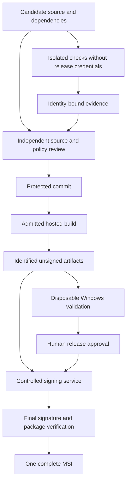

# Development-environment hardening for the Rust Windows time client

**Owner-decision amendment, 29 October 2026:** [NV-DEC-001](nevrotick-owner-decisions.md) confirms source-derived reuse with independent stress/bug verification and records the initial OpenPGP release alternative. Existing Authenticode-specific checks still apply to that preferred profile and remain not qualified if unavailable; qualify the separate OpenPGP artifact/installed-file trust path under architecture section 19.5 and research R-06. No missing-signature check may be converted to unconditional success. All other applicable compiler, lint, audit, evidence and hardening requirements remain. No application test is claimed by this amendment.

**Document:** RWTC-DEV-HARDENING-001, revision 1.0  
**Research date:** 28 October 2026  
**Baseline:** Product architecture RWTC-ARCH-001 revision 1.4  
**Status:** Enforcement specification and qualification plan with partially adopted development tooling. The original research created no application or execution evidence. The current [tooling record](../TOOLING.md) distinguishes installed tools and bootstrap controls from pending application, native-product and release qualification.

**Documentation amendments:** 29 October 2026 - explicit upstream-code verification and stress-testing policy; owner-directed garde adoption and mandatory function/module contract discipline; adopted native memory diagnostics and agent workflow; selected Windows x64 optimization settings with performance and native qualification still pending. Application gates remain pending implementation and qualification.

## 1. Purpose and recommended baseline

The development environment should make unsafe changes difficult to introduce, policy bypasses visible, and missing evidence impossible to report as a pass. The strongest useful setup combines a pinned compiler, strict coherent lint rules, dependency admission, isolated execution, independent behavioral tests, protected CI and verification of the actual Windows artifacts.

There is no defensible percentage by which this toolset will reduce bugs before we have measured the project. Rust, linting and scanners cannot establish correct clock control, source selection, NTS authentication, IPC authorization or Windows privilege boundaries by themselves. Those need explicit contracts and independently observed behavior.

### Adopt and qualify first

| Layer | Proposed required baseline | What it contributes |
| --- | --- | --- |
| Compiler | Exact stable Rust/MSVC toolchain, checked release arithmetic, explicit fault policy | Reproducible diagnostics and safer failure behavior |
| Source policy | rustfmt; compiler warnings; Clippy `all`, `pedantic` and selected restrictions; rustdoc; unsafe boundaries | Catches common mistakes and makes exceptions reviewable |
| Function/module contracts | Precise typed APIs; private fallible construction invoking shared garde rules; checked postconditions and current-state guards | Makes omitted field rules visible and prevents ordinary callers from constructing invalid domain values through public APIs |
| Dependency policy | Exact lock/feature graph; cargo-deny; native/build-script/proc-macro inventory | Known advisories, sources, licenses and unwanted capability checks |
| CI policy | actionlint, zizmor, secret scanning; protected policy and immutable action identities | Detects workflow errors and reduces credential/artifact substitution paths |
| Static analysis | Qualified CodeQL Rust analysis with documented gaps | Adds data-flow checks beyond the compiler and Clippy |
| Behavioral evidence | nextest, separate doctests, independent examples, proptest, bounded fuzzing | Checks real requirements and rare boundary behavior |
| Native memory and resources | Application Verifier Basics, full PageHeap and CDB on affected Windows paths; separate lifecycle retention measurements | Detects reached native heap/API misuse and challenges resource ownership; neither installed tools nor crash-free runs establish absence of leaks |
| Test sensitivity | At least 90% executable-line coverage per security module; at least 95% mutation score per critical source file | Preserves the accepted architecture's thresholds and exposes weak tests |
| Windows qualification | Native x64 MSVC execution, PE inspection, runtime mitigation queries, privileged-effect and installer tests | Establishes behavior that portable Rust tests cannot prove |
| Release | Complete artifact inventory/SBOM, independent exact-candidate review, isolated signing approval | Connects verified source and tests to the actual complete MSI |

Advanced tools are admitted for a named invariant: Miri for suitable Rust memory/aliasing behavior, Windows ASan for a qualified native surface, Loom for a small concurrency protocol, and Kani for a bounded arithmetic/admission property. Requiring all of them everywhere would add unsupported configurations and false assurance.

The compiler, analyzers and test tools are development dependencies and should not enlarge the installed service/UI payload. Runtime contracts use bounded Serde decoding, mandatory shared garde validation inside private fallible construction, and effect-time authorization under architecture section 6. Garde is a selected runtime dependency whose exact product graph still needs admission; it does not replace the decoder or trusted-state guards.

## 2. Authority, scope and unchanged decisions

The product is a Chrony-derived Rust Windows 11 client with a network engine, a narrow privileged clock broker, an ordinary-user UI and an administrative helper, delivered as **one complete MSI**. The initial native target is `x86_64-pc-windows-msvc`. ARM64 needs its own admitted toolchain, runtime and packaging evidence.

The architecture remains authoritative for product behavior and unresolved choices. In particular:

- Preserve selected Chrony provenance and the GPL-2.0-only compatibility review. The held AWS-LC/ring production graphs remain held pending authoritative review of the exact distribution.
- Preserve separate network and clock authority, bounded correction/bootstrap policies, real Windows token/pipe checks and complete installer lifecycle requirements.
- Do not adopt TUF, an automatic privileged updater, a different crypto provider, a package split or an ASVS exception through a development-tool change.
- Treat all existing CHECK-1 through CHECK-27 requirements as planned until their actual evidence exists. A configured scanner does not complete ASVS Level 3 verification.

The pinned website guidance at commit `6530d3a8d44cbe4f829b1e09edd3a1c90cffc087` informed the agent, security, testing and independent-review rules. Its TypeScript/Astro/npm commands are not Rust requirements. The security-audit guidance was used in design/guidance mode; this is not a completed codebase security audit.

**Policy language:** “required” describes the expected behavior of a gate or workflow, not proof that it exists or has passed. Explicitly adopted workflows apply within their documented scope; proposed gate implementations still need admission. Existing architecture requirements are preserved; new quantitative choices, such as the advisory refresh interval, are labelled as proposals. Use the tooling record and actual configuration to distinguish current enforcement from pending application evidence.

### 2.1 Restricted first UI milestone applicability

[Architecture section 16.5](windows-time-architecture.md#165-restricted-first-ui-milestone-ui-m0) incorporates the owner's NV-UI-M0-001 scope decision. UI-M0 is an unelevated native Win32 prototype with deterministic checked-in sample data, Status/Sources/Settings, source details and an ephemeral source-edit preview. Keep the sample-data label visible; local validation, **Update preview** and Cancel affect only in-memory state discarded on exit. Sync now is disabled with an explanation; protected actions are disabled or omitted. No live status, production IPC, NTP/NTS/DNS traffic, service operations, policy persistence, UAC, Apply or clock effects are permitted in this UI slice.

D1 (theme/contrast/text/DPI qualification), D2 (production freshness/reconnect, policy drafts/revisions/apply and administrative results) and D3 (full keyboard/focus, Narrator/UIA qualification) are **Deferred**, not Passed, Removed or N/A. Agents must not implement or qualify them or block UI-M0 on them. Preserve standard controls' inherited behavior and labels in one documented reference display configuration. Carry the canonical deferral ledger and triggers into the backlog/next-stage record: restore the relevant D2 rules before live status or real policy/protected commands, and D1/D3 before general-user preview/release or earlier support/qualification claims.

Retain applicable compiler/format/lint/dependency/review policies on the real UI crate, narrow documented unsafe FFI, correct native ownership/string/callback/error lifetimes and teardown, and the admitted toolchain/linker/binding direction. One owner controls the shared native adapter; serialize shared desktop interaction and build outputs. M0-01–08 require small editor behavioral checks, meaningful native window/mouse-flow observations at the reference configuration and independent restricted-scope review; cross-compilation alone does not complete them. Do not force broad fuzz/stress/soak, production security coverage/mutation, service, accessibility, signing or MSI qualification into this fixture-only milestone. Those requirements retain their later applicability. Other workstreams remain independent; UI-M0 completes neither P0 toolkit qualification, CHECK-22 nor release gates.

## 3. Development threat model and execution boundaries

### 3.1 Assets, actors and failure paths

Protect source and requirement integrity, maintainer credentials, dependency provenance, release artifacts, signing authority, test evidence and the clocks/services of development machines. Consider both malicious inputs and an agent making a plausible but incorrect change.

| Threat | Concrete failure path | Required control and remaining limit |
| --- | --- | --- |
| Untrusted contribution weakens its own check | PR edits workflow, lint allowlist or coverage manifest, then receives a green status | Independently protected policy review and required checks on the exact candidate; repository settings must be evidenced separately |
| Dependency executes during analysis | `build.rs`, a macro or generator reads credentials or downloads code | Credential-free OS-isolated execution, denied egress after acquisition, bounded filesystem/process access; Cargo flags alone are insufficient |
| Hardening flags disappear | Agent adds global `RUSTFLAGS` for warnings and replaces target CFG/link flags | Admit effective environment/configuration, inspect actual commands and final PE/runtime state |
| Dependency graph changes covertly | Feature unification activates a held crypto backend or server capability | Exact package/target/feature graph review and a failing forbidden-path fixture |
| Evidence is stale or incomplete | Wrong revision, omitted module, zero tests, missing shard or report-only scanner is called a pass | Identity-bound evidence, explicit expected scope, verified exit propagation and bad/good gate controls |
| Cache or artifact poisoning | Untrusted job populates an executable cache or substitutes a similarly named MSI | Separate trust domains; exact hashes, origin and artifact manifests; no executable promotion from untrusted output |
| Test harness masks a product bug | Production computes expected output; tests use a repaired mock; mutant build failure counts as killed | Independent oracle, actual entry point/effect, raw outcome accounting and separate review |
| Agent damages the host | Clock/SCM/installer tests run elevated on a shared workstation | Disposable guest, one state owner, externally enforced bounds, recovery independent of guest time |
| Tool or metadata ages silently | Frozen compiler is vulnerable or advisory DB is stale | Reviewed tool updates and fresh security metadata alongside reproducibility snapshots |
| Authorized release authority is compromised | Correct-looking release passes a stolen approver/provider identity | MFA, narrow roles, independent approval, origin enforcement and rehearsed revocation; this residual risk is not eliminated |

### 3.2 Proposed build and release trust flow



This is a proposed control flow. For SignPath Foundation, all workflow jobs leading to the signing request currently need GitHub-hosted runners; the separate Windows laboratory and its artifact lineage must fit a provider-approved procedure. Rebuilding after testing requires demonstrated equivalence or repeated relevant validation. The signer must never run arbitrary build scripts with its credential. See the standalone [signing guide](windows-time-signing-guide.md).

### 3.3 Agent workstation and sandbox rules

Run ordinary agents and editors without administrator rights. Keep the supported Windows host patched and retain Defender and the chosen Windows application-control/exploit protections. Do not introduce broad antivirus exclusions or disable security features to improve build times. Measure performance with the intended protections enabled.

Treat opening a repository in an IDE as an execution decision: build-script/proc-macro support, workspace tasks and extensions can invoke tools. Start with untrusted-workspace execution disabled, review task and extension configuration, and enable needed analysis inside the assigned boundary. Pin the admitted rust-analyzer/editor extensions separately where used; editor convenience checks are not authoritative CI evidence.

The execution boundary must provide an allowlisted environment, unprivileged identity, task-owned writable paths, restricted network, no host credential mounts or shared privileged sockets, and CPU/RAM/process/disk/wall-time limits. Tool caches should be immutable or separately owned where feasible. An ordinary folder, Git worktree, `cargo --offline`, or a container with a privileged host socket does not meet that boundary by itself.

**Hosted does not mean unprivileged.** GitHub-hosted Windows VMs run as administrators with UAC disabled. Their x64 hosted build images also do not by themselves establish behavior on our supported Windows 11 client environment. Qualify an actual reduced-token/execution boundary and its filesystem/network controls, or resolve a provider-approved alternative; the runner label alone cannot satisfy this requirement. Keep real Windows 11 user/elevation/security behavior in the separate supported-OS laboratory. [SC32]

No signing/publishing token, cloud credential, privileged OIDC grant, SSH agent, production trust-store access or unrelated checkout belongs in a build/analyzer sandbox. If a hosted integration requires a status-upload token, confine it to a separate minimal data-only upload stage. It must not execute scripts from the report artifact.

Use separate worktrees/output directories for parallel agents and one owner for `Cargo.lock`, shared contracts, tool policy and native lab state. A worktree does not isolate service names, registry keys, the VM clock or machine-wide settings. Do not schedule concurrent mutable-state experiments on the same guest.

### 3.4 Mandatory contracts for agent-written code

Apply the [hostile-input assumption](windows-time-architecture.md#61-validation-architecture-and-enforcement-order) to user-entered product data and external programmatic data alike. Identify each implemented admission path and its bounds; UI controls, local/admin origin, authenticated channels and prior acceptance do not establish payload safety. Require real-handler adversarial checks, including UI bypass, well-formed unauthorized/stale requests and aggregate resource pressure, with accepted neighboring controls and no partial protected effects on rejection.

Apply [architecture section 6.3.1](windows-time-architecture.md#631-contracts-for-every-function-and-module) to every function and module, including private helpers, trait implementations and callbacks. Encode preconditions and output invariants in types wherever possible. Document the remaining semantic units, ranges, resource/lifecycle obligations, permitted effects, failures and postconditions at their owner. An unchanged immutable validated type carries its invariant across a call; a transformation, mutation, deserialization or changed trusted context requires the corresponding check. Do not substitute repeated serialization or decorative validation annotations for this analysis.

DTO/settings validators use garde, called by the private fallible constructor before a domain value can be returned. UI feedback and service admission share the same pure rule definitions; the receiver independently decodes and constructs its input. No `allow_unvalidated`; each field needs actual validation/recursive validation or a `skip` with a nearby invariant-owner explanation and independent review. Metadata-only annotations do not count as validation. Inspect all constructors, `Deserialize` implementations, builders, defaults, mutable accessors and interior-mutable handles for bypasses. Keep checks active in release builds; `debug_assert!` and test-only validation do not enforce production contracts.

For each changed contract, identify its enforcement point and independent observation before implementation. Choose the applicable checks: runtime valid/invalid neighbors through the real constructor/consumer; external consumer compile-fail tests for forbidden construction/mutation with a passing supported-use control; checked-transform/postcondition and failure-atomicity cases; property tests for combinations; bounded Kani proofs for selected finite invariants. Compile-fail must arise from the intended restriction, not a broken fixture/import or unsupported toolchain. Trace source-to-effect bypasses with the admitted CodeQL workflow when cross-function reachability is uncertain; scanner success alone does not prove contract completeness.

Reviewers must reject a path that bypasses required validation, consumes the unchecked original instead of the checked result, silently drops a postcondition, or treats a stale authorization marker as current permission. Missing applicable evidence remains incomplete; agents cannot clear it by removing rules, weakening a constructor, broadening a skip or shrinking the selected test scope. Retain the actual small change scope: a trivial total helper need not acquire a new report or validator when its type and implementation already establish the complete contract.

The selected initial declaration is `garde = { version = "=0.23.0", default-features = false, features = ["derive"] }`; section 18.5 of the architecture owns dependency admission. No application Cargo workspace exists yet, so these instructions do not claim a locked graph, executed garde integration or enforced product CI. UI-M0's D1/D2/D3 deferrals remain in force; validate its actual fixture-only paths without introducing deferred production integrations.

## 4. Pinning and admitting the toolchain

### 4.1 Initial stable candidate

Start qualification with **Rust 1.99.1**. The official 15 October 2026 release fixes an x86_64 FFI `bool` return miscompilation, directly relevant to native boundary work. This is a researched candidate, not evidence that our future dependency graph and Windows application already build correctly under it. [C01]

Candidate `rust-toolchain.toml`:

```toml
[toolchain]
channel = "1.99.1"
profile = "minimal"
components = ["clippy", "rustfmt"]
targets = ["x86_64-pc-windows-msvc"]
```

Use edition 2024 after compatibility qualification. Record the package MSRV explicitly and test it separately if it differs from the release compiler. A pinned version is a reproducibility input, not permission to ignore future security or correctness fixes.

Record the actual compiler commit/LLVM, Cargo, Clippy, rustfmt, rustup, native target, Windows SDK, linker path/version, CRT/native libraries and runner image. Rustup overrides can supersede the repository file; inspect the effective toolchain, not just its text. Only one admitted toolchain file/configuration may govern the build. [C03]

Nightly analysis has a separate exact dated pin, compatible components, target directory and artifact label. Never use `RUSTC_BOOTSTRAP` to make a production build accept unstable options. Nightly instrumented artifacts must not be promoted as the stable release binary.

### 4.2 Tool admission record

Every executable tool needs an entry in a reviewed tool manifest:

| Field | Required evidence |
| --- | --- |
| Identity | Exact version/commit, upstream origin and downloaded artifact digest/signature |
| Compatibility | Host, target, Rust/SDK/runtime dependencies and known unsupported modes |
| Behavior | Effective configuration, rule/query set, input scope and whether it executes target-controlled code |
| Isolation | Filesystem/network/credential boundary and resource limits |
| Gate semantics | Expected exits/reports, failure propagation, empty-scope handling and positive/negative fixture |
| Maintenance | Owner, update schedule, relevant advisories and requalification triggers |

Do not insert invented action SHAs, SDK versions or tool checksums into a “ready” workflow. Their exact values are admission outputs. Existing architecture versions for cargo-deny/cargo-auditable remain candidates until qualified; a floating `latest` or an unverified install script is not a replacement.

Tool upgrades should be reviewed proposals: inspect release notes and relevant advisories, update pins, run affected tool controls and the necessary integrated checks. Group versions only when compatibility requires it. Keep evidence of the prior admitted configuration; rollback to a known vulnerable version needs its own decision.

## 5. Compiler, Clippy and API policy

### 5.1 Workspace policy with explicit inheritance

Cargo workspace lints require every member to opt in. Root declarations do not automatically govern all members or external dependencies. Broad lint groups should have priority `-1` and individual rules priority `0`, allowing explicit resolution of group membership. Check actual first-party members, targets, generated code and build scripts. [C04, C05]

Candidate root `Cargo.toml` fragment:

```toml
[workspace.lints.rust]
warnings = { level = "deny", priority = -1 }
unsafe_code = "deny"
unsafe_op_in_unsafe_fn = "deny"
unused_unsafe = "deny"
unused_must_use = "deny"
unfulfilled_lint_expectations = "deny"
unknown_lints = "deny"
renamed_and_removed_lints = "deny"
improper_ctypes = "deny"
improper_ctypes_definitions = "deny"
unexpected_cfgs = "deny"

[workspace.lints.clippy]
all = { level = "deny", priority = -1 }
pedantic = { level = "deny", priority = -1 }
undocumented_unsafe_blocks = "deny"
allow_attributes_without_reason = "deny"
allow_attributes = "deny"
multiple_unsafe_ops_per_block = "deny"
unused_result_ok = "deny"
unwrap_used = "deny"
expect_used = "deny"
panic = "deny"
todo = "deny"
unimplemented = "deny"
unreachable = "deny"
dbg_macro = "deny"
let_underscore_must_use = "deny"
as_conversions = "deny"
mem_forget = "deny"
exit = "deny"

[workspace.lints.rustdoc]
broken_intra_doc_links = "deny"
private_intra_doc_links = "deny"
```

Every member must contain:

```toml
[lints]
workspace = true
```

The repository checker must reject missing inheritance and prove that the intended target actually runs through the lint gate. A changed manifest must not quietly exclude the broker or a generated first-party module.

Clippy explicitly discourages blanket enabling `restriction` and `nursery`; choose the relevant restrictions individually. The supplied extra rules address unchecked conversions, ignored results, panic placeholders, unsafe documentation and hidden process/resource escapes. Their exact diagnostics and exceptions still need qualification against the pinned toolchain. [C02, C07]

The repository's [adoptable policy fragment](../policy/rust-workspace.toml) additionally rejects permanent local `allow` attributes, multiple unsafe operations in one block and discarded `Result::ok()` values. Its isolated pinned-tool controls accept fulfilled reasoned expectations and consumed optional results, and reject each corresponding violation. These are bootstrap enforcement observations; application target/feature and native qualification remain pending. See [the current tooling record](../TOOLING.md).

### 5.2 Unsafe, conversions and error behavior

Use `#![forbid(unsafe_code)]` at the roots of the pure numerical core, protocol/domain and other unsafe-free crates. The Windows/native adapter may relax the workspace `deny` for the smallest justified module/item with an explicit safety contract and independent review. A global `forbid` cannot be relaxed for necessary FFI; that is why the workspace baseline uses `deny` and the pure crates add `forbid`.

Safe wrappers must establish ownership, layout, alignment, aliasing, lifetime, callback/thread rules, cleanup and error handling. `undocumented_unsafe_blocks` checks for documentation; it cannot verify the argument. The unsafe inventory includes dependencies and native inputs, not just first-party `unsafe` tokens.

Use private validated types and `TryFrom`/`TryInto` at trust boundaries. Reject nonfinite floats, invalid units and out-of-range fixed-point/integer conversions explicitly. Name intentional NTP modulo/era arithmetic and test its edge cases independently. Do not move a dangerous `as` cast into an opaque helper just to silence the lint.

Select `indexing_slicing`, `arithmetic_side_effects` and disallowed API/type lists for the critical modules where they provide useful signal. Direct clock writes, unsafe ownership transfer and raw authority-sensitive calls should have one reviewed adapter boundary. A lint cannot guarantee that aliases, macros or native functions never bypass it; native effect tests and source review remain required.

Do not force secret-bearing types to implement `Debug` to satisfy a blanket style rule. Review logs for secret material, unbounded attacker strings and unintended path/address disclosure. Never discard lock-poisoning errors or background-task failures merely to avoid `unwrap`.

Test code can need assertions and fixture extraction. Permit these only in genuinely test-only scope with a reason; prove the production counterpart still fails. An intentional fatal handler needs a reviewed fault/cleanup policy. Ordinary assertions, indexing, allocation and dependency code may still panic even when `clippy::panic` is denied; this is not a panic-free proof.

`clippy::exit` also permits calls from `main`; review entry-point shutdown explicitly rather than treating that lint as a universal process-exit prohibition. Qualify the intended fatal-path behavior with its own control. [C07]

### 5.3 Exceptions and documented interfaces

Prefer narrowly scoped `#[expect(..., reason = "...")]` where supported, with denied `unfulfilled_lint_expectations` so obsolete exceptions fail. `forbid` cannot be lowered. A broad `allow` added by an agent to make CI pass is a policy change requiring independent review, not an automatic repair. [C06]

Require public boundary documentation: accepted representations, error cases, units/ranges, ownership, side effects, authorization and cancellation. Rustdoc runs as its own checked lane; passing Clippy alone does not validate documentation. Generated platform declarations may need a scoped documentation exception; hand-written privileged APIs do not inherit that exception.

All exceptions need the exact rule/path, reason, independent evidence, owner, approver and a review/expiry trigger. Do not grant a permanent waiver to an entire crate because one FFI call or test fixture is legitimate.

## 6. Build profiles and Windows mitigations

### 6.1 Checked arithmetic and an explicit fault policy

Selected release/verification settings and the separately proposed service fault profile:

```toml
[profile.release]
# Optimization candidate; measurements and native qualification remain required.
opt-level = 3
lto = "thin"
codegen-units = 1
overflow-checks = true
debug-assertions = false
panic = "unwind"
incremental = false
debug = "limited"
strip = "none"

[profile.verify-release]
inherits = "release"
debug-assertions = true

[profile.service-abort]
inherits = "release"
panic = "abort"
```

The initial explicit unwind profile is for qualification while the component fault policy is resolved. `service-abort` is a **candidate**, not the selected shipping service profile. Abort avoids unwinding but skips destructors; safe shutdown, SCM recovery and persisted clock budgets must be qualified before choosing it. No restart may reset a security budget or resume inconsistent actuation.

Cargo's ordinary release defaults omit overflow checks. Enabling them makes integer overflow panic; it does not validate floating-point finiteness, units or time semantics. Runtime security conditions must use checked branches and typed errors before a panic can occur. `debug_assert!` remains a development invariant, never the only authorization, length or correction-limit check. [C08]

Cargo cannot set `panic` through a per-package profile override, and test harness behavior does not establish the production executable's panic strategy. Separate component profiles require named builds and artifact identities. Run the exact shipping executables through their fault cases. Rust unwinding must not cross Windows callbacks; `catch_unwind` neither catches abort/all native faults nor makes corrupted state safe to resume. [C08, C09]

Run optimized invariant checks and the actual shipping profile. The selected optimization candidate uses `opt-level=3`, thin LTO and one codegen unit; this selection establishes no measured improvement. Section 6.5 defines its trade-offs and qualification limits. Compare size, CPU, power, precision and regression trajectories before retaining a claimed gain or changing to `opt-level="s"`/`"z"`, fat LTO or another codegen-unit count. CRT and stripping choices remain separate. Retain matching debugging symbols with a source-path/privacy policy. Do not enable fast-math behavior that invalidates estimator assumptions.

For optimization tasks, use [the performance optimization skill](../.agents/skills/implementation/optimize-rust-performance/SKILL.md) with [resource QA](../.agents/skills/testing/qa-performance-resources/SKILL.md). Start from a measured cost and owning path, define comparable baseline/candidate identities and a decision rule, attribute the bottleneck, then make and verify a causal change. Preserve raw repeated samples, correctness/hostile-input controls and memory, tail-latency, wakeup and recovery trade-offs. Profiling locates a cause; representative runs establish a claimed improvement. Preserve mandatory validation, checked arithmetic, security settings and bounded native-work custody. Architecture section 17 owns budgets; CHECK-21 and UI-M0 retain their existing applicability. The [measurement reference](../.agents/skills/implementation/optimize-rust-performance/references/measurement.md) documents conditional tools and evidence limits; it installs no profiler or benchmark dependency.

### 6.2 Target-specific Windows compiler/linker settings

The following target settings are already present in [`.cargo/config.toml`](../.cargo/config.toml). Pin and record the admitted linker: the [tooling record](../TOOLING.md) distinguishes native MSVC inputs and the explicit bundled-LLD/xwin bootstrap lane. Its recorded std-only PE/native-execution fixture does not qualify future application binaries or all runtime policies.

```toml
[target.x86_64-pc-windows-msvc]
rustflags = [
  # Currently admitted legacy baseline; OD-07's v3 migration is pending §6.7.
  # Do not use the build host's ISA or drop the mitigation flags below.
  "-C", "target-cpu=x86-64",
  "-C", "control-flow-guard=yes",
  "-C", "link-arg=/GUARD:CF",
  "-C", "link-arg=/DYNAMICBASE",
  "-C", "link-arg=/HIGHENTROPYVA",
  "-C", "link-arg=/NXCOMPAT",
  "-C", "link-arg=/WX",
]
```

`/WX` makes linker warnings fail, including warnings that might reveal an ignored setting. Qualify any substituted linker; do not assume identical flag behavior. Explicit protections document intent even where a linker default already supplies them. [C17]

**Critical bypass:** Cargo's flag sources are alternatives, not a simple append chain. `RUSTFLAGS="-D warnings"` or `CARGO_ENCODED_RUSTFLAGS` can replace the configured target flags and remove the intended hardening. With explicit `--target`, target flags also do not apply to host build scripts/proc macros. [C18]

The trusted build entry point must reject unreviewed environment/configuration overrides, wrappers and path substitutions. Admit `RUSTUP_TOOLCHAIN`, `RUSTFLAGS`, encoded flags, profile variables, `RUSTC_WRAPPER`, workspace wrappers, target linker settings, rustdoc flags and applicable Cargo configuration deliberately. Check ancestor/home/legacy Cargo config and command-line overrides. Record relevant effective values without dumping ambient secrets. Ordinary builds must reject lint-capping overrides; the bounded mutation instrument described later is a separately admitted lane.

### 6.3 What each protection actually proves

| Protection | Required handling | Evidence and limitation |
| --- | --- | --- |
| Control Flow Guard | Stable Rust `control-flow-guard=yes`, compatible native compilation/linking | Inspect load config and an admitted indirect-call fixture. `nochecks` is prohibited. A CFG image flag does not retrofit checks into prebuilt native objects or the supplied standard library. [C10, C11] |
| DEP | `/NXCOMPAT`; no product need for writable-executable generated code | Check every shipped image and applicable runtime policy. [C12] |
| ASLR | `/DYNAMICBASE`, x64 `/HIGHENTROPYVA`, required relocations/address compatibility | HIGHENTROPYVA depends on other image properties; inspect actual payloads. [C13, C14] |
| CET shadow stack | Qualify `/CETCOMPAT` separately on the supported x64 stack | Compatibility marker, not proof of enabled hardware enforcement; do not copy to ARM64. Record CPU/OS/VM support and actual policy. [C15] |
| Native stack-buffer protection | Preserve/check native MSVC `/GS` in applicable native compilation | Passing a native option to a Rust link does not instrument Rust functions. [C16] |
| Spectre mitigation | Qualify `/Qspectre` and libraries only for the relevant native graph/threat | Native compiler mitigation has limited pattern coverage and cost; not a generic Rust switch. [C20] |
| Rust stack protector / LLVM CFI | Separate research only | Current stack-protector/CFI interfaces have unstable/internal constraints; do not present them as a qualified stable Windows release setting. [C19, C21] |

Verify three layers: **effective build inputs, emitted images and effective runtime policy**. Use supported Windows process-policy APIs and handle failures. UI and broker can need different settings; do not turn on every process policy without testing legitimate operation. DLL search/load restrictions, valid-load controls, unexpected DLL canaries and the architecture's no-sideloading checks remain required. [C22; architecture CHECK-16/18/23]

### 6.4 Per-process mitigation qualification

Use [architecture section 15.4](windows-time-architecture.md#154-per-process-mitigation-profiles-and-startup-admission) as the canonical role/activation/failure contract and manifest schema. This 29 October refinement incorporates useful specificity from the supplied PDFCraft proposal without adopting its CRT, dependencies or UI architecture. Existing tooling observations remain scoped to their recorded fixture. All application-level cases below are **planned / not executed**.

For every delivered executable and applicable DLL, inspect the exact final PE and load configuration with `dumpbin /headers /loadconfig` or an admitted equivalent tool. Record the CFG `Guard`, `CF Instrumented` and `FID table present` indicators where applicable, DEP/ASLR properties, relocations and any selected CET marker. These checks must agree with actual build inputs and the native/prebuilt/static/standard-library inventory; a CFG-positive executable or one successful negative fixture does not prove complete linked-code coverage. `nochecks` remains prohibited. This requirement does not mandate installing Visual Studio just to obtain `dumpbin`. [C10, C11, C15]

Pair effective process-policy queries with independently observed behavior. The inspection tool must identify the exact running binary and launch path; saved registry configuration, a screenshot label or a successful setter is insufficient. Keep the expected profile under trusted build/install ownership. A support mask or unrecognized query result must not turn a missing required setting into a pass. Ordinary CFG, Strict CFG and hardware shadow-stack enforcement are separate observations.

| Case | Required observation | Legitimate control and scope |
| --- | --- | --- |
| Required-policy startup admission | Inject a failed setting/query, mismatched required field and audit-only result through the real initialization decision path; normal readiness and new protected work remain unavailable | Expected enforced state admits work. An explicitly optional unavailable hardware enhancement is diagnosed without masquerading as enforcement. Pure tests prove branching only; real OS failure/launch cases still require Windows. |
| ACG | A harmless executable-memory allocation/protection transition is denied under the qualified no-opt-out/no-downgrade profile; record effective bits | Ordinary heap use and the exact engine/broker/native-provider workflows succeed. Do not execute injected payloads or infer compatibility from absence of an intentional JIT. |
| Image loading | Separate controlled remote-image and low-mandatory-label canaries fail to load; CWD/PATH canaries exercise section 15.2 separately | The intended protected dependency loads from its expected path. Mark of the Web is not the low-label fixture; System32 preference is not a directory allowlist. |
| Strict CFG and handles | Optional Strict CFG denies an incompatible code-bearing DLL; strict-handle failure occurs in an isolated native fixture | Qualified executable modules/resource-only DLLs and valid handle ownership still work. Record debugger/Application Verifier presence and actual fields; do not use a non-permanent verifier state as permanent-enforcement evidence. |
| Headless/child restrictions | Prove selected Win32k denial and actual child-creation denial for an SCM-launched service under the installed profile | Final service APIs, boot-before-login, stop/restart and recovery work. A custom-parent child-policy fixture does not close the SCM gap. Test approved UI/helper activation separately; do not apply the headless profile to the GUI or shared installer host. |
| CET/HSP | Reconcile x64 marking, CPU/OS/VM support, effective enabled state, compatibility/strict mode and audit status | Legitimate native callbacks/unwinding paths work. Marking alone is not enforcement; optional unsupported hardware remains explicitly unsupported. |
| Lifecycle and mitigation failures | Preflight blocks an unusable required profile before clock takeover; reached update/fault cases preserve ownership, budgets, cleanup and bounded SCM recovery | A valid single-MSI install/update/repair/remove completes under each declared release profile. Existing CHECK-12/13/18/23 remain authoritative. |

Run native denial/termination tests only in the owned disposable Windows environment of architecture section 14.9, with independent observation, resource/time bounds and cleanup. No test changes the user's clock or global Exploit Protection policy. Audit-first trials apply only to controls with a documented audit mode; an audit event never passes an enforcement case. Preserve UI-M0 deferrals: full production accessibility/IME integration tests run at the existing reentry gates.

Tie records to the complete payload/SBOM and exact package; repeat affected cases when a toolchain, native provider, linked module, startup/hosting path, Windows support matrix or installer policy changes. Use the existing diagnostics and artifact records rather than a new background scanner. Do not copy `+crt-static`, admit held cryptographic providers or add a launcher solely to make a mitigation checklist appear complete.

### 6.5 Windows x64 optimization policy and evidence limits

The selected workspace release candidate is `opt-level=3`, `lto="thin"`, `codegen-units=1` and `incremental=false`; `verify-release` inherits those settings and enables debug assertions. Overflow checks, unwind policy, retained symbols and Windows mitigations remain. Ordinary development retains its incremental workflow. Thin LTO enables cross-crate optimization with less link work than fat LTO; one codegen unit reduces parallel code generation and can increase build time. Neither setting guarantees faster code, and level 3 can be slower than level 2. Compare useful runtime work, startup, tail latency, memory, binary size and build cost on the declared workload before claiming a benefit. No new profile, PGO pipeline or performance result is established here. [C08]

The supplied **Optimized build of the compiler** guide concerns rebuilding `rustc`, including `bootstrap.toml`, its allocator and `opt-dist`; it is not an application build recipe. Its Windows LTO warning links open issue **rust-lang/rust#109114**, checked 29 October 2026: unstable `-Zdylib-lto` with ThinLTO and dynamic Rust-library imports on MSVC. That issue does not establish a general failure of ordinary stable Cargo application ThinLTO. Keep the unstable/dynamic-library experiment outside the selected configuration, and qualify the actual compiler/linker/target/graph rather than assuming either immunity or universal breakage. [C24, C25]

The current admitted `target-cpu=x86-64` matches the pinned Rust 1.99.1 MSVC target's base CPU. [OD-07](nevrotick-owner-decisions.md#11-od-07--x64-baseline-and-runtime-optimization), accepted 30 October, now selects an intended `x86-64-v3` minimum and runtime-selected higher-feature functions. Section 6.7 owns its pending build/checker migration and supported CPU/OS/VM qualification; the older configuration and receipts do not qualify that change. Global v4 and build-host `native` compilation remain excluded. Application flags do not rebuild the supplied standard library or prebuilt native objects; rebuilding `std` is a separate unstable workflow and is not adopted. [C10, C28]

PGO remains an optional future experiment. Rust's pinned profiler runtime includes Windows/MSVC support, but a selected Windows instrumentation/link/runtime lane and compatible `llvm-profdata` must be admitted and observed. Train the actual Windows executable on representative bounded inputs; retain source, lock/features, complete effective flags, binary/tool identities, workload/seed, raw profiles and merged-profile hash. Use absolute paths, fresh owned profile output and matching generate/use settings; LLVM raw profiles have no forward/backward format guarantee, so prefer tools from the pinned toolchain. Missing/stale profiles or unexecuted training provide no result. [C26]

Preserve the complete hardening flag vector during PGO/CPU experiments: `RUSTFLAGS` or encoded flags replace configured target flags rather than appending automatically. Use a reviewed target-specific configuration or explicitly composed admitted vector, with `--target` separating target flags from host build scripts/proc macros. Ordinary Rust LTO does not automatically provide cross-language LTO for native dependencies; that requires a separately admitted compatible LLVM/native/linker arrangement. [C18, C29]

BOLT's documented inputs are X86-64/AArch64 ELF binaries; this target produces PE/COFF. BOLT is not selected for Windows application binaries. None of these settings closes CHECK-21's native performance/soak evidence, the emitted-image/runtime mitigation checks, or package/release gates. Reuse older receipts only for unchanged inputs; a profile or target-flag change requires fresh affected evidence. [C23, C27]

**Windows DLL-import qualification addendum, 29 October 2026:** The preceding reproducer distinction is not an immunity argument. Open issue **#27438** covers broader Rust/native `dllimport` handling, including native global-data declarations and build-script library selection. Historical **#81408** affected an ordinary Rust executable with cross-crate static data, ThinLTO and LLD. Later changes **#129079** and **#122790** revise that handling; the pinned compiler contains self-import generation and distinguishes regular in-process ThinLTO from linker-plugin LTO. It also retains a Windows regression test that executes binaries built with both `link` and `rust-lld`. Source/test presence is useful evidence, not a local execution of that test, a blanket fix for #27438, or qualification of this application's native graph. [C36]

ThinLTO remains an **unqualified optimization candidate**. Before a Windows release claim, compare `lto="off"` and `"thin"` through relevant native correctness and useful-work cases on the actual compiler/linker/graph; include cross-crate static/string use and reached Windows/CRT import paths, with isolated imported-data controls where that mechanism is being qualified. No Rust DLL in one artifact, successful linking, Linux tests or a different linker alone proves Windows runtime correctness. Turning LTO off does not repair incorrect FFI import declarations, and fat LTO is no presumed workaround. Retain CHECK-19/20/21 and existing native gates without treating this source investigation as a pass. [C36]

### 6.6 LLVM settings for this workload

For the pinned **Rust 1.99.1 / LLVM 23.1.1** Windows x64 toolchain, section 6.5's checked O3/ThinLTO/one-codegen-unit configuration is an **unmeasured optimization candidate**, not a Windows correctness qualification or proof of fastest code. Keep additional `llvm-args` and custom pass lists empty. The pinned compiler enables loop and SLP vectorization at O3 and builds LLVM's normal optimization/LTO pipelines, including their inlining, unrolling and target-cost decisions. This permits legal optimizations; it does not promise every loop will vectorize or every call will inline. [C30]

| Disposition | Setting or family | NevroTick constraint |
| --- | --- | --- |
| Recommended default | Selected checked profile; ordinary LLVM pipelines and cost models | Preserve exact timestamp arithmetic, admission, finite-result checks and useful failure paths. Keep the default loop/SLP/inliner/unroll decisions rather than a hand-written pass sequence. [C30] |
| Recommended default | Windows x64 target ABI, default relocation/code models and section 6.5 CPU baseline | Keep unwind metadata, CFG, ASLR/DEP, symbols and existing linker-warning failures. Do not transplant Unix, kernel, alternate calling-convention or nonrelocatable settings to the application. [C10, C23, C28] |
| Measurement only | O2 versus O3, LTO/codegen-unit alternatives and the admitted PGO experiment | Use the [performance measurement reference](../.agents/skills/implementation/optimize-rust-performance/references/measurement.md) for bounded candidate comparisons. Require unchanged numerical/hostile-input results and report runtime, tail latency, startup, retained resources, artifact size and build cost; section 6.5's native/release limits remain. |
| Avoid as blanket tuning | Forced vector widths, interleave/unroll factors, arbitrary inliner thresholds and disabled vectorizers | First identify a real hotspot and inspect the emitted code/remarks. Any narrowly justified experiment must use the exact pinned compiler's supported interface and retain independent numerical checks; no such override is selected. LLVM's cost model already accounts for profitability and code-size/register-pressure trade-offs. [C30, C34] |
| Avoid | Fast-math, no-NaN/no-infinity assumptions, reassociation, approximate arithmetic and global flush-to-zero/denormals-are-zero changes | These can change numerical behavior or the floating-point environment. Preserve the declared operation, rounding, special-value and subnormal contracts. This is not a claim that FMA is globally disabled: explicitly fused operations and compiler-permitted transformations must be assessed under their actual semantics. [C35] |
| Avoid as a stable configuration | Removed `-C inline-threshold`, unstable/internal `-Z tune-cpu`, raw LLVM switches and replacement pass pipelines | The pinned option table rejects `inline-threshold`; `tune-cpu` is an unstable option. Raw LLVM arguments/pass names have no general rustc CLI stability guarantee. A copied option name, successful parse or newer manual does not qualify its meaning on the admitted toolchain. [C31] |

For ordinary optimized MSVC-flavor links, the pinned rustc already requests `/OPT:REF,ICF`; unoptimized links request `/OPT:REF,NOICF`. Retained debug information causes `/DEBUG`, which the pinned LLD interprets as a full PDB request. That LLD derives nonincremental linking when REF/ICF are active; Cargo's `incremental=false` separately controls compiler caching. Do not duplicate these flags as a presumed performance improvement. A full PDB packages the information emitted: `debug="limited"` still omits Rust type/variable-level information. ICF can merge function/read-only-data addresses and complicate names/breakpoints; address uniqueness is not a safe identity contract. [C10, C32, C33]

Do not add `/LTCG` as a substitute for Rust LTO or `/DEBUG:FASTLINK` as PDB boilerplate. The pinned LLD warns and substitutes full PDB for FASTLINK, conflicting with `/WX`; native MSVC LTCG and cross-language LLVM LTO have their own input/toolchain requirements. Future native dependencies need their own admitted compiler flags, graph and emitted-object evidence; Rust flags do not retrofit their protections. Record effective inputs and exact artifacts under CHECK-19/20, and retain CHECK-21's separate native performance/soak obligations. This policy adds no code-generation argument, native qualification or performance result. [C17, C29, C32, C33]

### 6.7 v3 baseline and runtime CPU dispatch

[OD-07](nevrotick-owner-decisions.md#11-od-07--x64-baseline-and-runtime-optimization)
makes CPU optimization a required workstream. The intended Windows x64 minimum
is `x86-64-v3`; the current admitted build remains generic until the
[planned migration](plans/development-plan.md#81-x64-baseline-and-runtime-optimization-workstream).
The [research report](supporting-reviews/x86-runtime-optimization.md) records the
sources and limits. This section establishes no new flags, kernel or native pass.

| Owner/guarantee | Required implementation and independent observation |
| --- | --- |
| Build owner: baseline and artifacts | Change the target-specific CPU entry and exact checker/control expectations together. Preserve the complete CFG/ASLR/DEP and linker-warning vector, profiles, overflow checks, unwind policy and symbols. Inspect effective Rust/native/generated-object flags and final payloads; do not replace the vector through ambient `RUSTFLAGS`. Audit standard-library and prebuilt inputs separately. |
| Lifecycle/package owner: supported machines | Declare actual CPU/OS/VM rows. A prerequisite check that itself runs on the rejected machine must precede execution of any v3 payload. Observe useful behavior on a v3-capable baseline and clear refusal below it, including masked guest features. Keep one complete MSI; catching an illegal-instruction crash is not admission. Windows 11 branding alone proves no complete feature set. |
| Kernel/dispatch owner: available functions | Compile optional specializations ahead of time with explicit `#[target_feature]` sets. Use Rust runtime feature detection, including its OS vector-state checks; select only a function whose whole enabled set is available. `avx512f` alone is not full v4. The baseline path remains reachable; never globally enable AVX-512, alter XCR0, or treat detection as runtime recompilation. |
| Safety/algorithm owner: unchanged contracts | Keep unsafe code out of the pure core. Any necessary feature-specific unsafe boundary needs a narrow reviewed owner and checked safe interface outside that prohibition. Preserve length/alignment/bounds/lifetimes, exact integer time arithmetic, chronological floating-point operations, intermediate checks and error/failure atomicity. New reductions or FMA rounding require separately justified algorithm changes; no fast-math, reassociation or FTZ/DAZ shortcuts. |
| Crypto owner: independent capabilities | AES/PCLMUL/VAES are not guaranteed by v2/v3/v4. Use the admitted provider's feature dispatch and fallback; retain provider/licence/trust gates and qualify real small-packet and KE workloads separately. |
| Performance/QA owner: benefit and limits | Identify a real hotspot and predeclare useful-work metrics, noise/acceptance rule and finite campaign bounds. Compare baseline and each supported specialization on native Windows with normal protections. Require correctness/rejection parity and observe startup, tail latency, CPU/wakeups, retained resources and binary size. Hardware availability alone does not justify selecting AVX-512 over AVX2. |

Dispatch tests cover v3 fallback and supported AVX-512 subsets, required
feature absent, CPU feature masked by a VM, and OS vector state unavailable.
Distinguish the layers: unavailable baseline AVX state rejects v3 startup;
unavailable AVX-512 state with usable v3 selects the v3 fallback. A disabled
baseline feature must never be treated as merely a slower optional path.
An injected feature inventory may select/test a branch without executing an
unsupported instruction. A forced optimized execution must first satisfy the
real detector; a forced baseline mode may always disable an optimization. Retain
native supported/unsupported rows in addition to such selection controls.
Shared dispatch/API tests do not replace numerical checks of each implementation.

Implement only measured kernels and a small auditable selection seam; do not
scaffold a generic dispatch framework or product crates solely for this policy.
The workstream must evaluate meaningful candidates; an unused feature probe or
empty wrapper is no optimization result. Record a non-beneficial candidate and
its revisit trigger rather than shipping it as faster. Preserve CHECK-19/20
build/artifact evidence, CHECK-25 numerical/contract controls, CHECK-26 graph
admission and CHECK-21's independent native resource/soak obligations. Missing
native rows or a changed algorithm remain incomplete, not passing fallbacks.

## 7. Dependencies, auditors and supply-chain policy

### 7.1 Exact graph before execution

Commit `Cargo.lock`. Maintain a feature matrix for the portable core, production engine/provider, broker, UI/helper, packaging and each admitted native target. Record ordinary, build and macro dependencies plus native/generated/bundled material. Cargo features can unify through other paths; a direct `default-features=false` does not prove that a transitive path cannot enable defaults. [SC19]

Do not use `--all-features` as a universal security check. It can activate mutually exclusive providers or capabilities outside the product. Analyze and test every supported row explicitly, and demonstrate that a transitive feature cannot restore a held provider.

A dependency proposal must state what complexity or bug class it removes, exact versions/source, feature changes, build/macro/native behavior, license obligations, advisory evidence, target/MSRV compatibility and affected consumers. Verify source archive/tag parity when relevant. Popularity and an empty advisory report do not establish soundness.

Separate acquisition from execution. Command families include `cargo fetch --locked` to prepare exact inputs and `cargo build --frozen` for locked/offline Cargo resolution. Actual wrappers supply the admitted target/package/feature row. `--frozen` is **not** a network or filesystem sandbox for code executed by the build. [SC01–SC03]

After verified acquisition, deny egress independently and build from staged inputs with no automatic fallback downloads. Native archives, code generators and tool packages need the same provenance discipline as Rust crates. Build scripts' conventional `OUT_DIR` usage is not a security boundary.

### 7.2 Tool selection and overlap

| Tool | Decision | Important limit |
| --- | --- | --- |
| cargo-deny | Primary blocking dependency policy after qualification | Match exact graph, licenses, source/advisory policy and configured scope. [SC06] |
| cargo-audit | Optional distinct artifact scan with cargo-auditable; no redundant lockfile gate required | Repeating RustSec checks is not independent vulnerability evidence. [SC07, SC08] |
| cargo-auditable | Build-only candidate after PE/packaging qualification | Verify embedded inventory survives final transformations; it is not a signature or complete native SBOM. [SC08] |
| One SPDX/CycloneDX generator | Required reconciled release inventory; cargo-cyclonedx is a candidate | Include native objects, generated source, resources, tools and MSI contents beyond Cargo metadata. [SC14] |
| cargo-vet | Optional staged audit-record system | Needs real maintained review criteria/imports/deltas; exemptions are not performed audits. [SC15] |
| cargo-crev | Defer as an alternative review ecosystem | Running two overlapping trust systems at kickoff is not necessary. [SC16] |
| cargo-geiger | Optional unsafe inventory | Statistics do not prove soundness or cover all native/FFI risk. [SC17] |
| cargo-machete | Optional dependency hygiene | `--with-metadata` may modify the lockfile and uses all features; keep it out of an assumed immutable gate. [SC18] |

The repository bootstrap now installs pinned `cargo-cyclonedx` 0.5.9 in a
separate release-tool lane. Its [configuration and offline wrapper](../TOOLING.md#release-sbom-tooling)
produce Rust component inventories and reject target/feature graph mismatches;
they do not qualify a complete native/MSI SBOM. Every published version must
attach the reconciled, validated SBOM with its complete MSI and final signed-byte
checksums. S6.4/CHECK-26 retain package reconciliation and protected publication.

### 7.3 cargo-deny outcomes, not copied policy folklore

Require approved origins/revisions; applicable advisory disposition; denied unreviewed yanks/unmaintained paths; explicit license choices; bounded duplicate exceptions; forbidden capability/provider paths; and a complete graph scope including relevant build/dev tooling.

Current cargo-deny documentation contains configuration drift: an advisory sample includes `unsound`, while another section describes it as removed. Some historical license keys are also obsolete. Therefore this guide intentionally does not offer a guessed production `deny.toml`. Generate and verify the schema against the **admitted exact binary/source/help**, then exercise representative forbidden and allowed inputs. Set build/dev scope explicitly; current license defaults differ. [SC20–SC23]

SPDX `MIT OR Apache-2.0` permits a choice; `Apache-2.0 AND ISC` requires both. A broad allowlist accepting each token does not establish compatibility of the combined product. Preserve the architecture's exact-graph license gate, including native components. The generic `ring` clarification in cargo-deny examples is not authoritative evidence for our inspected release and must not be copied to erase an obligation. [SC21, SC22, SC24]

Standalone development-tool licensing and linked runtime licensing are different questions. Conversely, generated or copied material can affect distribution even when its producer was a development tool. Record the actual relationship rather than inferring clearance from the dependency category.

### 7.4 Advisory freshness and reproducibility

**Proposed policy:** a protected job refreshes security metadata daily, and merge/release decisions require a successful authenticated refresh receipt no older than **24 hours**. Retain its exact database commit/digest for reproducibility. All lanes in one decision consume the same snapshot; a later release also checks current evidence.

Distinguish upstream freshness from file modification/cache access time. Record origin, retrieval receipt, tool/configuration, graph/artifact identity and exceptions. A long-unchanged advisory entry is not stale merely because its original publication date is old.

Cargo-deny's documented database-age limit is checked when fetching is disabled and has its own timestamp semantics. Qualify that mechanism; it does not substitute for our refresh receipt. If current acquisition is unavailable, dependent merge/release decisions are **BLOCKED**, not green using silent stale data. Clearly labelled local offline results may still help development. [SC23]

RustSec primarily covers known Rust ecosystem records. Native libraries, SDK/installer tools, actions and analyzers require their own advisory tracking. An immutable vulnerable compiler remains vulnerable.

## 8. Static analysis, workflow checks and CI authority

### 8.1 CodeQL must run inside the execution boundary

Current GitHub documentation supports Rust CodeQL using `build-mode: none`. Despite the name, its Rust extractor uses rust-analyzer to compile/run build scripts and compile macro code. Treat it as target-controlled execution, with no release credentials or privileged OIDC. Do not invent a Rust manual-build extractor configuration. [SC04]

Qualify the extractor/query packs against real source, generated code, target/cfg and Windows paths. Seed independent safe/unsafe data-flow fixtures for packet/IPC/config inputs reaching length/allocation/path/FFI boundaries and sensitive effects. Record analyzed-file coverage and unsupported models. Standard queries may not understand our clock-authority protocol; add a reviewed project query or retain the distinct native/manual gate.

Relevant findings must block until corrected or independently dispositioned. Removing queries/excluding a module is a policy change. A green SARIF upload does not prove a relevant query ran or its finding could block the current commit. [SC04, SC09]

### 8.2 Focused workflow and secret checks

Use actionlint for workflow semantics and zizmor for selected security rules. Pin both and record modes/rules/suppressions. **zizmor SARIF output intentionally suppresses finding exit codes**; use an enforcing invocation or a tested report-policy evaluator in addition to publication. Offline mode skips online audits. Give online metadata access only to a separately scoped job, not to an untrusted compiler. [SC05, SC10, SC11]

Use a pinned Gitleaks CLI plus hosted secret scanning/push protection where available. Scan changes/tree on PRs, retained history at initial qualification and scheduled reviews, and final staging contents. Redact reports; report skipped/oversized files and history gaps. Synthetic fixtures test detection. Real exposure requires owner-led revocation/rotation, not merely deleting the current line. [SC12, SC13]

Run untrusted PR compilation with read-only access and no secrets. Prohibit privileged `pull_request_target` or `workflow_run` handlers that check out and execute untrusted PR code. Never interpolate untrusted titles/branch names into shell source. A platform default is defense in depth, not our policy boundary. [SC25, SC26]

### 8.3 Policy files, actions, caches and promotion

Protect workflow/gate code, lint/advisory exceptions, critical manifests, release permissions, lockfiles and tool pins with independent ownership review. Hosted branch/ruleset and environment settings must be evidenced, not inferred from YAML. Dismiss obsolete approval after relevant changes and bind results to the exact candidate/merge commit. An agent may propose a gate change; it cannot approve its own weakening.

Require an always-scheduled final gate with explicit dependencies, using GitHub's `always()` condition with `needs`. It must validate that every expected job/matrix shard has an explicit successful result and complete identity-bound evidence. Skipped, neutral, cancelled, missing or merely uploaded reports cannot satisfy a required analysis. GitHub can treat skipped jobs as successful, including a dependent job skipped after a failure, so checking a superficially green status is insufficient. Protect the aggregator itself; ensure applicable PR/merge-queue events invoke it and that its expected check source is enforced. [SC31]

Pin direct actions/reusable workflows to reviewed full SHAs and verify repository identity. GitHub's newer workflow dependency lockfiles also address transitive actions, but remain **public preview**. Called workflows use their own repository's lockfile. Evaluate compatibility and behavior before adoption; retain direct pins and explicit transitive review when the preview is unavailable. [SC26, SC27]

Partition caches by trust domain, toolchain, lock/configuration, target and features. Untrusted runs must not supply trusted release executables. Prefer a fresh release build from verified inputs. Treat artifacts and report archives as untrusted data: fixed schemas/size limits, safe extraction, no path traversal and no scripts executed by the importer.

SBOM, provenance attestation and Authenticode answer different questions. Verify subject hashes and identities; reconcile unsigned evidence with the documented signing transformation and verify the final payload/MSI again. No attestation proves the code is bug-free. [SC28]

## 9. Tests, coverage and evidence of bug detection

### 9.1 Meaningful execution and doctests

Use nextest for ordinary tests with explicit `--no-tests=fail`, and run `cargo test --doc` separately because nextest excludes doctests. Commands below illustrate the default-feature workspace only; the final gate wrapper must use the reviewed package/target/feature matrix and sandboxed inputs. [V01]

```text
cargo fmt --all -- --check
cargo clippy --workspace --all-targets --frozen --target x86_64-pc-windows-msvc
cargo doc --workspace --no-deps --frozen --target x86_64-pc-windows-msvc
cargo nextest run --workspace --frozen --target x86_64-pc-windows-msvc --no-tests=fail
cargo test --workspace --doc --frozen --target x86_64-pc-windows-msvc
```

These commands are not claims of available tools or a valid all-workspace product feature combination. Pin the tools first and replace broad selection where a row requires narrower packages/features. Use corresponding portable-core rows on Linux. Compiler warnings come from the lint policy; do not replace mitigation flags with a convenience `RUSTFLAGS` setting.

Record discovered tests, executed assertions, skips and subprocess results. A crate without executable doctests may legitimately have zero, if explicitly inventoried. Losing required doctests or filtering every relevant test must fail. Domain API checks should include a constructor/privacy compile-fail case and a legitimate construction case where appropriate.

### 9.2 Independent properties and oracles

Persist minimized proptest failures and generation seeds/configuration. Random generation is unlikely to find every isolated value; explicitly include zero/sign neighbors, min/max, era wrap, NaN/infinity, exact integers, duplicate/escaped keys and one-byte-over-limit inputs. [V10, V11]

The simulator owns independent true UTC, oscillator error, asymmetry and source faults. Production code must not compute its expected answer. Preserve analytic cases and protocol/crypto vectors alongside pinned Chrony trajectory comparison. For example, the architecture's `T1=0, T2=70, T3=80, T4=110` millisecond fixture yields +20 ms offset and 100 ms network delay. Include an asymmetric-delay case demonstrating bias; authentication does not remove that physical limitation.

Separate recorded-packet replay from first delivery delayed within an outstanding
authenticated request. Apply [architecture section 7.4](windows-time-architecture.md#74-nts-implementation-contract)
and the [protocol qualification matrix](../tasks/s0.1-protocol-comparison.md#replay-and-delayed-response-qualification)
under CHECK-6/7/8/9/21: completion/expiry, queued processing at the deadline,
restart with restored keys/cookies, suspend/resume and protected-response races
need discriminating rejection and healthy controls. Exercise real NTS admission
with independent crypto vectors before claiming authenticated replay protection;
the unauthenticated fixture cannot supply that evidence. For an otherwise
admissible first-delivery delay, demonstrate the independently expected bias and
uncertainty; rejection of every delayed sample is no proof of useful operation.

Compare selected/supporting/rejected identities, reason codes, uncertainty, polling and full correction accounting. Agreement with a translated upstream algorithm can reproduce a shared bug. Require an independently valid input that produces the intended effect and invalid/stale/unauthorized inputs that produce no forbidden effect. Round trips, mocks and a harness that repairs the output cannot establish production behavior.

### 9.3 Coverage: at least 90% for every security module

Maintain a reviewed manifest mapping security modules to production paths, targets and feature rows. Export machine-readable coverage and reconcile **every expected module** before computing at least 90% executable-line coverage for each one. A high workspace total cannot hide an uncovered authorization module.

cargo-llvm-cov documents working x64/i686 MSVC coverage and ARM64 MSVC default-setup limitations. Branch and doctest instrumentation remain nightly/unstable. Do not label Linux-only coverage as coverage of `cfg(windows)` code. Do not use `--ignore-run-fail` to turn a failed test run into a successful report. [V02]

Publish branch measurements separately with tool limitations and keep named adversarial branch tests regardless of instrumentation. Missing files, stale data, zero executable denominators and unsupported required modules are incomplete. Exclusions need review; test code/generated declarations do not stand in for production behavior. Preserve raw profiles and build/source identities.

### 9.4 Mutation: at least 95% for each critical source file

Keep the critical manifest covering parsers, authentication, selection/controller safety, IPC authorization, clock budgets, persistence migrations and lifecycle transactions. Changed-file campaigns qualify an affected change; the release gate still requires complete current critical scope.

For each file, retain generated/admitted mutants and these separate outcomes:

| Symbol | Meaning | Treatment |
| --- | --- | --- |
| K | Caught by a behavioral test | Counts as caught |
| M | Missed, with complete viable execution | Requires stronger tests or independently justified equivalence/exclusion |
| U | Unviable build | Not a test kill; explain instrumentation/build limitation |
| T | Timeout | Investigate; incomplete until resolved |
| X | Unexecuted/error/missing shard | Incomplete |
| E | Independently justified equivalence/exclusions, a subset of M | Report exact excluded cases and requirement-grounded rationale |

Report raw `K / (K + M)` and adjusted `K / (K + M - E)`. Require at least **95% adjusted for every file** and complete accounting. Every survivor requires stronger tests or independently justified equivalence/exclusion, as the architecture already requires. A backlog entry, generic risk acceptance or a passing numerical score does not discharge that obligation. An empty denominator is unresolved. A known non-equivalent security defect cannot be accepted merely because the percentage passes. Do not add build failures or timeouts to K or hide functions to improve the score. [Architecture §18.4; V03–V09]

Reconcile a second inventory: each critical requirement-bearing function/guard,
whether it generated mutants, why any behavior was skipped/unmodeled and the
independent alternative evidence. cargo-mutants 27.1.0 automatically skips
`unsafe fn` and generally cannot inspect macro/build-generated bodies; a mixed
file can have a nonempty 100% score while its critical callback generated none.
Absence from generation is outside K/M/E, not an equivalent missed mutant. Observe
derived Serde/garde admission and native callbacks through independently specified
raw inputs, handler/fault controls and reached native checks as applicable. Keep
unsupported obligations visible beside the score; do not retroactively invalidate
unchanged pure safe-core receipts based on a hypothetical unsafe callback.
See architecture S118 and the [mutation skill](../.agents/skills/testing/qa-mutation-testing/SKILL.md).

cargo-mutants' exit code does not implement this custom gate: retain the native result, parse its admitted report schema, and distinguish missed mutants from failed baseline/timeouts/tool errors. A complete missed-mutant report may be evaluated under the explicit threshold; arbitrary nonzero results must never become success through `|| true`. Windows-only campaigns need appropriate native hosts; enumeration of a `cfg(windows)` mutant on Linux is not execution. [V04, V05, V08]

Strict warnings can make useful mutations unviable. Upstream documents mutation-only `--cap-lints=true`; qualify that separate instrumented subprocess with an external build timeout because lint capping also suppresses long-running const-evaluation warnings. Ordinary lint/release policy stays strict. Record effective flags and prove that an injected behavioral defect compiles and is caught. This is a test instrument, not a production lint waiver. [V06, V07]

### 9.5 Fuzzing and native memory diagnostics

Use pinned Linux x64 nightly fuzzing for the portable core initially: NTP/NTS-KE parsing, strict DTO/domain admission, IPC framing, persisted state and numeric conversions. Seed valid inputs, assert semantic outcomes, and bound input bytes, duration, per-input time, RSS, jobs and artifact storage. A proposed 60-second changed-target smoke run is only a quick regression budget; scheduled campaigns need their own owner/budget and cannot promise exhaustive exploration.

Preserve and replay every failure. A reject-all parser or a harness that swallows every panic is not a passing fuzz target. Relevant minimized cases must run on the actual native product target as well.

**Windows support requires careful wording.** The cargo-fuzz README still says Unix-like systems only, but the Rust Fuzz Book documents Windows/MSVC AddressSanitizer setup. Rust 1.99.1's x64 MSVC target source declares AddressSanitizer support, while sanitizer selection remains unstable. The sources do not justify either blanket Windows impossibility or claiming our stack already works. [V12–V16, V18, V22–V24]

Qualify Windows x64 MSVC nightly fuzz/ASan separately against exact Rust, cargo-fuzz/libfuzzer-sys, native compiler, linker, CRT and sanitizer runtime. Require a deliberately faulty local fixture to produce its expected diagnostic and a valid neighbor to run. Inspect Rust and relevant native instrumentation. Do not infer ARM64 support from x64, install unsupported stable flags, or bypass the channel using `RUSTC_BOOTSTRAP`.

#### 9.5.1 Adopted native memory workflow

Application Verifier, GFlags/PageHeap and CDB from Windows SDK **10.0.28000.2957** are installed for development. The [tooling record](../TOOLING.md#native-windows-memory-diagnostics) owns installation, commands and observed bootstrap results; [the native-memory skill reference](../.agents/skills/testing/references/windows-memory.md) owns the agent procedure. Exact tool, DLL, debugger-configuration and image-profile admission is defined in [the policy](../policy/windows-memory.json) and enforced by [the guarded helper](../scripts/windows-memory.ps1). Do not copy installation snapshots into an application pass claim.

Select this lane when changing unsafe Windows adapters, native buffer/string/callback lifetimes, handle ownership or cleanup, or investigating a native crash. Trace acquisition, transfer, use and release through success, partial initialization, cancellation and recovery; name the paths the test must reach. UI-M0 keeps its bounded native-window and FFI scope: a relevant memory check does not activate D1–D3, production integrations or broad soak requirements.

1. Freeze the candidate and its symbols/configuration, select an owned Windows fixture and unique image basename admitted by the helper, and declare test inputs, duration, memory/output limits, cleanup owner and stop conditions. Run read-only Preflight as the ordinary-user debugger account. Tool presence does not authorize arbitrary privileged or hostile target execution.
2. Enable the exact per-image verifier/full-PageHeap profile in the separate elevated configuration shell before starting the candidate. Run CDB and the ordinary test candidate unelevated with the admitted current-user debugger configuration and local symbols. Real service/privilege experiments still require section 10's separately owned native lab and intended service identity. System-wide GFlags settings, unrelated process names and arbitrary extra verifier layers are outside this profile.
3. Observe effective settings and reached cases. Retain the first verifier stop/exception, stack, raw log, native exits and healthy behavior. A fault caught by CDB can still yield exit zero; classify actual diagnostics and independently observed outcomes. On tool/profile or relevant allocator/API changes, replay healthy and deliberately faulty controls for the claim. Bootstrap heap-overrun and invalid-handle controls do not qualify every allocator, Leak layer or application path.
4. Stop and account for owned processes, then Disable and verify both IFEO registry views against the protected ownership receipt, including after failure or timeout. Do not overwrite unexpected state or declare cleanup complete after an ambiguous restoration. The helper configures an image; it does not launch, sandbox or supervise the candidate. Its configuration-command timeout and post-collection output check do not enforce the test's resource limits.

PageHeap observes the heap paths it instruments and changes allocation cost and timing. Its settings persist until explicitly removed. Application Verifier's Leak layer reports tracked resources at DLL unload; outstanding resources alone are not proof of a leak. Use the dedicated lifecycle measurements below for retention, and retain the independent ASan/Miri admission limits above. [Microsoft PageHeap documentation](https://learn.microsoft.com/en-us/windows-hardware/drivers/debugger/gflags-and-pageheap), [Application Verifier layers](https://learn.microsoft.com/en-us/windows-hardware/drivers/devtest/application-verifier-tests-within-application-verifier).

#### 9.5.2 Retention and resource ownership

For changes to long-lived state, queues/caches, native resources or task cancellation, identify each allocation, handle, thread/task and permit owner, its bound and its release condition. Rust ownership and garde validation do not establish bounded retention: reference cycles, intentionally forgotten allocations, unbounded collections and abandoned work need explicit lifecycle contracts and observations. Native work retains custody and capacity permits until actual completion or qualified recovery, even if its waiting future is dropped.

Measure declared workloads after warm-up and after each repeated lifecycle/quiescent checkpoint, before process exit or fixture teardown can mask growth. Record private/committed memory, relevant allocation attribution, handles, threads/tasks, queues and permits; include USER/GDI objects when UI ownership changes. Require useful healthy work and bounded behavior on failures/cancellation, comparing retained state with the owner's declared budget rather than treating every outstanding allocation or cached page as a leak. Record unsupported resource/allocator observations as gaps.

Keep corruption instrumentation separate from representative performance measurements: full PageHeap changes memory usage and timing. Retain CHECK-21's one-hour baseline and 72-hour reconnect/fault soak on named hardware for the applicable product stage; neither a short instrumented run nor nextest's process/output `leak-timeout` replaces those observations. No application leak/soak result exists merely because the tool controls passed.

### 9.6 Bounded use of Miri, Loom and Kani

| Tool | Good initial question | Claim boundary |
| --- | --- | --- |
| Miri | Does a suitable core/unsafe abstraction test execute UB under the interpreter? | Significant FFI/system-call limits; cannot establish real SCM, token, pipe, CNG, power or clock enforcement. [V17] |
| Loom | Can cancellation release a native-job permit before the real job finishes, or publish a stale generation? | Only modeled synchronization/dependencies and stated scheduling/memory bounds; production correspondence must be reviewed. [V19] |
| Kani | Can a bounded fixed-width conversion or cumulative-budget admission violate its invariant? | Standard installation is not native Windows; finite inputs/unwind limits and satisfiable assumptions define the proof. [V20, V21] |

Add a tool only when it addresses a concrete uncovered invariant. Keep interpreter isolation, model a legitimate reachable witness, inject a fault to obtain a counterexample, and record unsupported operations. Reducing a proof bound or excluding a failing FFI case reduces the claim; it does not prove the omitted behavior.

### 9.7 Verification of upstream code and stress testing

Chrony and every other upstream codebase, crate, native library, tool, copied/ported implementation and generated component must be treated as potentially containing defects or vulnerabilities. Reputation, prior deployment, upstream tests, signatures and absent advisories do not exempt adopted behavior from independent verification. This is a verification requirement, not a claim that a particular upstream revision has a known defect. Apply [architecture sections 20.1 and 20.3](windows-time-architecture.md#201-independent-numerical-truth) to the exact revision, selected features, supported targets and actual NevroTick integration.

For each adopted component, record the relied-on requirements, trust/resource boundaries, independent expected results and applicable test families. Exercise production entry points and retained upstream algorithms as well as NevroTick adapters; testing only a wrapper is insufficient evidence for algorithm correctness. Reuse upstream suites and reference trajectories, but keep independently authored expectations so shared defects can be detected.

| Test family | Required question where applicable |
| --- | --- |
| Unit, boundary and property/model tests | Do valid cases, exact limits, arithmetic extremes and state transitions satisfy an independent contract, including combinations that ordinary examples miss? |
| Differential and golden-vector tests | Does the implementation match independently justified protocol/numerical facts and the intended upstream behavior? Diagnose disagreements; upstream parity alone cannot settle correctness. |
| Fuzzing, adversarial and negative tests | Do malformed, valid-shaped hostile, replayed, stale and oversized inputs preserve authority and resource limits, while valid neighbors still succeed? |
| Integration, interoperability and native tests | Does the selected code behave correctly through real module/process/protocol boundaries and supported Windows APIs, features and artifacts? |
| Concurrency, fault injection and recovery | Do cancellation, restart, suspend/resume, lost acknowledgements and unavailable/exhausted collaborators preserve ownership, cleanup and safe recovery under relevant interleavings? |
| Load, stress and soak tests | Do steady and burst workloads, limits and controlled overload, repeated faults and prolonged operation preserve correctness, measured budgets, responsiveness and recovery? |
| Regression, coverage and mutation checks | Do minimized failures remain reproducible, critical paths execute and independently specified assertions detect injected behavioral defects? Preserve the existing per-module/file thresholds and denominator rules. |

Stress campaigns must include relevant mixes of legitimate and malformed traffic, peer/client churn, loss/delay/reordering/replay, reconnect storms, extreme clock/drift conditions and repeated lifecycle events. Exercise resource exhaustion in owned fixtures. Declare workload, concurrency, duration, seeds, resource ceilings, stop conditions and external timeouts before execution. Measure CPU, memory, wakeups, handles/threads, queue/log growth, latency and recovery; observe forbidden clock/security effects and leaks before harness cleanup. Retain CHECK-21's one-hour baseline and 72-hour reconnect/fault soak on named hardware; do not substitute a short smoke or report only that nothing crashed.

Select techniques according to failure modes and supported environments; this does not mandate every technique for every file or authorize effects on shared hosts or public services. Preserve healthy controls, exact source/build/feature identities, first failures, seeds and minimized regression cases. A confirmed upstream defect requires a requirement-grounded correction and port/dependency-ledger entry, not weakened expectations to preserve parity. Reassess affected tests and stress cases after upstream fixes, version/feature changes or integration changes. Unsupported or unexecuted required cases remain gaps; test success never establishes absence of all bugs or vulnerabilities.

### 9.8 Diagnostics and shared-adapter verification

Implement the canonical [shared Windows adapter contract](windows-time-architecture.md#34-shared-windows-adapters-and-diagnostics) and [diagnostics contract](windows-time-architecture.md#123-logging-and-support). Inspect real emitters, subscribers, filters, writer queues and export consumers; unused safe wrappers/redaction helpers prove no reached path. These are application implementation gates, not checks performed by this documentation amendment.

| Check family | Independent expected observation |
| --- | --- |
| Required versus optional events | With optional output filtered to WARN/ERROR/OFF in the harness, an INFO-severity required event still reaches its required sink attempt. Exercise release feature/callsite/global-filter behavior and admitted dependency/log bridges; no duplicate records or compiled-out promised DEBUG. |
| Privacy and usefulness | Recognizable synthetic secrets through success, rejection, dependency errors, panic/report paths and export appear in no selected ordinary output at any enabled level. Bounded legitimate context remains useful. Verify actual field/counter/text encoding; raw dump/EVTX policy remains separate. |
| Control authority | A permitted administrator can start/stop scoped service collection; ordinary status/refresh users, stale revisions, malformed profiles, arbitrary paths/filter strings and neighboring unauthorized commands have no protected effect. Native tokens/peer identity remain CHECK-2 evidence. |
| Session state and expiry | Replayed starts do not renew; stale stops/replies cannot alter a successor. A helper exits after acknowledged admission without ending collection; UI closure does not renew it. Test partial activation, lost acknowledgements, broker-to-target control loss, broker/target restart, authorization revocation, duration/byte caps, UTC jumps and suspend/resume. Local expiry and failed-reset guard stop verbose capture; status never reports unacknowledged global success. |
| Clock independence | A verbosity-only change leaves the active source policy, estimator, valid correction and cumulative allowance unchanged. Log failure cannot authorize a request or block required cleanup. |
| Resource exhaustion and lifecycle | Concurrent component writers respect aggregate file allocations and bounded record/memory/queue/rate limits. Full/missing/denied sinks, floods, rotation/flush failures and stop/crash paths yield bounded loss/status without recursion, critical-path I/O waits or leaked native work. Include a healthy-event control. |
| Windows and feature boundaries | Verify actual provider/channel resource identity, access and retention under section 15.3; required/success and denied/failure paths on Windows. Inspect per-binary features/imports and correct resource-specific cleanup: sharing an adapter must not add GUI/TLS/clock-write composition to unrelated roles. |

Tie results to the exact candidate, enabled features, process roles and declared finite limits. Pure tests exercise records, mappings, bounded state transitions and fake sinks; native Windows tests establish pipe/token/SCM, callback lifetime and Event Log behavior. CHECK-21 measures INFO and bounded DEBUG cost under supported host security, including flood pressure and disabled-callsite overhead. Reuse CHECK-1/2/3/14/15/17/21/26/27 instead of creating parallel gate identities. Inspect cleanup before the harness hides leaks, and preserve unavailable/native cases as gaps. This work does not enable production diagnostics in UI-M0.

### 9.9 IPC identity, framing and native lifetime verification

Apply [architecture section 5.4](windows-time-architecture.md#54-native-ipc-implementation-and-qualification) with `security-local-ipc`, `implement-rust-contracts`, `qa-contract-tests` and `qa-security-boundaries`. Freeze endpoint roles, selected byte/message mode, actual native API/wrapper path, security descriptors, token tracking, process/endpoint generations, finite limits and feature/lockfile identity before qualification. Bind each case to the production entry point and an independent expected effect; the existence of upstream tests proves no product behavior.

| Area and checks | Hostile/fault case and required result | Legitimate control |
| --- | --- | --- |
| Listener ownership — CHECK-2/27 | Pre-created name, unauthorized extra instance, idle/disconnect storms, replacement-accept failure and last-handle loss cannot silently transfer the active namespace; lost ownership blocks admission/reacquires through first-instance checks | Concurrent/repeated permitted connections and later genuine restart succeed |
| Genuine peers — CHECK-1/2 | Same owner SID with a foreign instance, reused/stale PID, SCM pending-state ambiguity, wrong service, anonymous caller and failed identity query produce no privileged effect or trusted status | Genuine current service and intended client identity are established through held native objects |
| Request/token association — CHECK-2/25 | Fragmented/pipelined reads and changed security context cannot attribute one request to another caller; token acquisition fails without ambient/self fallback; no await/dispatch occurs while impersonating | Authorized identification-level client works, and the worker has reverted before processing the next request |
| Effective authority and reversion — CHECK-2/12 | Filtered admin, disabled/deny-only group, restricted token and wrong service SID fail their prohibited verbs; injected failed reversion stops process request execution and uses qualified external crash recovery | Current elevated/authorized request and healthy reversion succeed; owned recovery preserves clock limits |
| Wrapper configuration — CHECK-1/2/26 | Generic-rights/default-descriptor mismatch cannot cause ACL widening; unauthorized client cannot create instances, alter ownership/security or inherit privileged handles | Exact reviewed requested rights, DACL and QoS work together through actual selected APIs |
| Framing and overload — CHECK-3/25 | Cancellation at header/body/write boundaries, EOF, duplicate prefix, trickled bytes, stalled receiver and queue saturation preserve framing/correlation or close the connection; fixed deadlines/caps prevent indefinite retention or starvation | Valid maximum-size frames and permitted concurrent requests complete; late/partial replies never repeat an ambiguous clock effect |
| Native completion — CHECK-3/27 | Pending connects/reads/writes, cancellation-versus-success races and stop/disconnect retain operation storage/permits until actual completion; no unbounded write flush, replacement work or cleanup blockage | Correct connected/pending/partial native outcomes and post-recovery traffic succeed; resources release before harness teardown |
| Reached remote boundary — CHECK-2 | Controlled remote client with otherwise sufficient credentials is rejected by local-only pipe enforcement; firewall rejection or an unreachable peer alone is not evidence | Intended local request with matching product permissions succeeds |
| Compromised authorized engine — CHECK-3/25 | Actual engine identity submits oversize/truncated frames, wrong verbs, stale/replayed and overbudget proposals; bounds apply before forbidden allocation/effect | Current bounded engine request still receives the proper acknowledgement |

Pure tests can establish framing progress, strict decoding and substituted-token decisions. Tokens/DACLs, actual pipe peer attribution, pending-instance ownership, native cancellation and fatal reversion need isolated Windows fixtures. Real clock/fatal-broker cases obey section 14.9's disposable-VM limits and external observation/restoration plan; no experiments on the user's workstation or public services. Keep exact source/configuration, reached boundary, native outcomes, valid controls and remaining P0/native gaps. Do not call IPC hardened until the affected proofs pass; UI-M0 remains fixture-only.

### 9.10 Contract-review qualification matrix

The [30 October assessment](supporting-reviews/architecture-contract-review.md)
refines existing requirements; no rows below are executed product evidence.
Apply [architecture §20.2.1](windows-time-architecture.md#2021-contract-review-acceptance-refinements)
and freeze each policy/representation before its dependent interface is enabled.

| Owner and gate | Required independent evidence |
| --- | --- |
| Platform/security, S0.2/P3, CHECK-1/15 | Actual default owner, descriptor/inheritance and effective rights after runtime file creation/staging/replacement and relevant object creation. A second LocalService service cannot use owner rights to widen access; intended service access succeeds. |
| Broker/storage, S0.4/P4, CHECK-10/12/15 | Reservation write/flush → guarded clock call → outcome write/flush → acknowledgement. Inject faults on both sides of every seam, replay the same identity and inspect durable ledger plus external effects. Unknown outcomes stay conservatively charged; no duplicate step or refund from missing reply. Slew reservation, delivery and settlement remain separate. |
| Clock adapter, S0.4/P4, CHECK-10/11/12 | Read back mode and value and measure trajectories for owned base, owned transient and explicit handover. Cancellation/holdover/expiry retains the qualified owned mode; foreign/ambiguous ownership prevents resets. |
| Protocol/security, S0.7/P2, CHECK-8/9/15 | Fresh UDP/cookies/resumed tickets cannot reset full-authentication age. Exercise expired/unknown association age, failed full reauthentication, trust-policy changes and healthy full authentication under frozen lifetime/detection rules. |
| Core/security, S0.7/P2/P4, CHECK-9/15 | Wrong but intact persisted floor, followed by correct independent evidence, reaches the qualified narrowly authorized supersession. Preserve old record, budgets, step counts and installation ownership; unauthorized reset is rejected. |
| Core/protocol, P1/P2, CHECK-7/8/14 | Freeze independent groups, configured/eligible vote denominator, timeouts, fresh observation limits and exceptional quorum. Four fresh, two missing, duplicate operators, 2–2 disagreement and one fresh plus old predictors produce independently expected decisions. |
| Platform/installer, S0.4/P4/P6, CHECK-11/12/13/23 | Distinguish cold boot/restart, sleep/hibernate, Fast Startup and VM restore epochs. Queued SCM restarts during maintenance/re-enable do not bypass durable startup inhibition or silently replenish allowances. Restore only owned settings. |
| Tooling/QA, P1/P7, CHECK-19/25 | Mixed safe and unsafe/generated critical behavior proves that generated-mutant accounting cannot conceal missing functions/guards. Retain the required alternative behavioral evidence and unchanged 95% threshold. |
| Release/security, S0.6/P6, CHECK-9/18/23 | Execute the [signing matrix](windows-time-signing-guide.md#51-wrong-clock-and-offline-activation-matrix): installed startup/helper, first install, update/repair and uninstall/restoration under wrong dates, offline/stale caches and bounded native verification. Enforce key policy and project-specific identity independently of signature success/publisher text. |

Pure fixtures can qualify transition logic and fault-seam expectations. Filesystem
durability, actual token/owner access, SCM, clock mode/trajectory and signing
retrieval require supported Windows observations in owned disposable fixtures.
No production TTL, quorum or recovery allowance is supplied by this matrix.

## 10. Native Windows qualification and safe experiment ownership

Real Windows tests remain mandatory for service tokens/privileges, pipe identity and impersonation, protected files/registry, reparse/handle lifetime, process mitigations, DLL loading, clock effects, power/resume, accessibility and complete MSI lifecycle. Cross-compilation or a Linux model cannot close those checks.

Before any privileged experiment, complete the architecture's experiment card: owned guest, exact source/artifacts, allowed operations, absolute/rate/attempt limits, test endpoints, stop condition, external timeout, restoration steps and independent observation. An unspecified bound means the effect is not authorized. Ordinary agents remain unelevated; only the qualified lab task receives its necessary scoped authority.

Use one clock/state owner per disposable guest. Control host/guest time synchronization and keep recovery reachable independently of guest time. Mutation or fault injection cannot use the code being mutated as its only safety guard; the VM/lab boundary must enforce external limits.

Observe real protected effects and cleanup before fixture teardown or guest destruction can hide leaks. Account for processes, threads, handles, files, services and active clock adjustments. Restore only state whose ownership remains established; ambiguous successor ownership requires read-only/blocked recovery rather than overwriting another owner.

Retain first failures, retry reasons and cleanup evidence. A clean rerun after destroying the failed guest is additional evidence, not erasure of the original failure. Performance/resource and accessibility claims need their own measured tests with the supported security settings enabled.

## 11. Required CI tiers and checks on the checks

### 11.1 Ordered tiers

Independent checks within a tier may run concurrently in isolated owned environments. Every later tier consumes evidence for the same candidate identity.

| Tier | Required work | When and authority |
| --- | --- | --- |
| T0 — admission | Source/policy/tool identity, lock/feature/source/license/advisory disposition, workflow/secret checks, scope inventory | Before target-controlled execution; tools that invoke Cargo already need the sandbox |
| T1 — fast contracts | Formatting, compiler/Clippy/rustdoc, applicable constructor/consumer and external compile-fail controls, unit/property/API tests, doctests and qualified SAST | Every relevant PR/configuration change; checked postconditions and no privileged clock effects |
| T2 — affected behavior | Regression corpus, focused fuzzing, affected coverage/mutation, native integration, applicable native-memory and retention checks, lifecycle/accessibility checks | Based on changed requirements and milestone; missing affected evidence blocks that change |
| T3 — release candidate | Complete supported matrix, all required critical-file gates, native authority/mitigation/package checks, resource measurements, inventory/SBOM and independent review | Exact source/artifact candidate; full scope cannot be inferred from unrelated older focused runs |
| T4 — signing/publication | Provider acceptance, human approval, origin-bound signing, final payload/MSI verification and lifecycle evidence | Separate release authority; public release remains blocked until requirements pass |

Scheduled advisory/secret metadata refresh and long fuzz campaigns run separately and can reopen admitted inputs. They do not modify the lockfile or auto-accept risk.

This tier table specifies required evidence, not current CI coverage. The adopted native-memory helpers currently support owned manual Windows runs; no hosted application memory gate is established by installing them. A future CI lane must qualify its own identity/isolation, controls, diagnostic classification and restoration before reporting this evidence automatically.

### 11.2 Gate qualification controls

Run these when admitting a checker or changing its relevant configuration. Use isolated fixtures through the **same entry point and required CI status**, never the production release. Each failing case needs a legitimate neighboring case that passes.

| Gate | Required failing control | Required passing observation |
| --- | --- | --- |
| Scope/lints | Missing member inheritance, excluded critical target, unknown lint, stale expectation | All required members analyzed; permitted local exception remains narrow |
| Unsafe/error rules | Unsafe core block; ignored `Result` including `let _ =`; unchecked conversion; production placeholder panic | Safe/validated path and actual error handling succeed |
| Flags/artifacts | Injected override removes CFG; wrong/stale DLL or weakened PE fixture | Effective settings and every admitted payload reconcile with expected protections |
| Graph/license | Unapproved registry, held transitive provider, unresolved mandatory license conjunction | Reviewed exact graph and valid alternative grant accepted |
| Advisories | Known matched fixture, stale/missing refresh receipt, expired exception | Controlled unaffected fixture and current recorded snapshot accepted |
| Workflow/secrets | Unsafe trigger/checkout, shell injection, unpinned action, synthetic secret | Narrow workflow and ordinary similar data accepted without secret disclosure |
| SAST/reporting | Relevant seeded defect; SARIF-only success; empty/unsupported input | Intended query/file analyzed and failure reaches protected gate |
| Final CI status | Failed dependency, skipped required job, cancelled/missing shard or forged report | Always-scheduled protected aggregator accepts only complete successful required scope for the exact candidate |
| Hosted isolation | Sandbox child inherits administrator/escape authority or can read protected runner state | Independently checked reduced authority, bounded files/network and supported-OS lab behavior |
| Tests | Zero required selection, failed assertion, missing shard or hidden child error | Actual test reaches assertion; expected scope and child status preserved |
| Coverage | Required module omitted, below threshold, zero denominator or stale report | Known line/branch fixture reconciles and each module passes its own threshold |
| Mutation | Missed mutant, unviable build, timeout, zero mutants, unknown JSON, missing shard | Correct baseline and caught behavioral mutation; per-file math/outcomes remain distinct |
| Fuzz/model tools | Reject-all harness, swallowed failure, impossible assumptions or insufficient bounds | Valid accepted input/reachable witness and expected diagnostic/counterexample |
| Native memory diagnostics | Reached heap-overrun or invalid-handle control; disabled/wrong image profile or lost diagnostics | Healthy neighboring control completes, effective settings and intended fault/stack are observed, diagnostics cannot become an exit-zero pass, and owned settings are restored |
| Native effects | Unauthorized/stale operation, leak or failed restoration | Authorized bounded effect independently observed and owned cleanup established |
| Promotion | Wrong-source/wrong-workflow/tampered artifact | Approved exact artifact reaches only the authorized signing route |

Do not broaden tests merely to accumulate volume after the concrete risk is resolved. Keep meaningful focused checks during development and the required full release scope at its gate.

### 11.3 Evidence receipt

Each required run records:

- Candidate commit **and relevant dirty/generated content**, lock/configuration/fixture hashes and requirement IDs.
- Exact toolchain/SDK/tool/query/database identities and target/package/feature/profile selection.
- Actual commands, admitted environment overrides, discovered/ran/skipped scope and resource limits.
- Original subprocess exits, first failures, retries, cancellations and raw result/artifact hashes.
- Gate control results, exclusions, unsupported scope, reviewer and cleanup observations.
- Final state: **PASS, FAIL, BLOCKED, NOT RUN, or justified N/A**; UI-M0's explicitly scoped D1–D3 use **Deferred** with their re-entry triggers.

Skipped, timed-out, unsupported or missing required cases cannot be summarized as PASS. Reviewer agreement does not multiply executions or authorize risk acceptance. A green status for a previous commit is not evidence for the current candidate.

## 12. Repository files, adoption work and completion criteria

### 12.1 Repository files and remaining blueprint

| Path | Purpose and owner |
| --- | --- |
| `AGENTS.md` | Project-specific scope, authority, evidence and stop rules; engineering/security owners |
| `rust-toolchain.toml`, root/member `Cargo.toml`, `Cargo.lock` | Pins, workspace lint inheritance, profiles and exact graph; toolchain/dependency owner |
| `.cargo/config.toml`, scoped `clippy.toml` | Admitted compiler/linker policy and justified lint configuration |
| `deny.toml` | Exact-version validated dependency policy; security/license review |
| `.config/nextest.toml` | Bounded test execution, process limits and explicitly isolated native groups |
| `policy/tool-manifest.json` | Tool origins, exact versions/digests, target support and controls |
| `policy/windows-memory.json`, `policy/windows-debugger.xml` | Adopted native-tool pins, exact image profile and current-user debugger restrictions; native-tool owner |
| `scripts/setup-windows-memory.ps1`, `scripts/windows-memory.ps1`, `scripts/tests/test_windows_memory.ps1` | Adopted acquisition/configuration, guarded per-image lifecycle and helper controls; actual candidate execution/measurement remains separately owned |
| `policy/verification-manifest.toml` | Requirements to modules, critical files, feature rows and native tests |
| `policy/exceptions/` | Narrow reviewed exceptions with owner, evidence and expiry/reopen conditions |
| `verification/gate-fixtures/` | Independent deliberately bad/good checker controls |
| `verification/` scripts or a reviewed `xtask` crate | Gate orchestration, outcome/denominator checking and evidence receipts |
| `.github/workflows/`, `.github/CODEOWNERS` | Isolated checks, protected ownership, release separation and recorded hosted settings |
| `docs/toolchain-and-ci.md`, `docs/release-policy.md` | Admitted configuration and operational release/recovery procedures |

The table combines adopted bootstrap files and the remaining implementation blueprint; inspect the checkout and [tooling record](../TOOLING.md) before assuming a file or gate exists. Prefer one authoritative policy source with generated reports to contradictory duplicated rules. Gate implementation itself is security-relevant code and needs negative controls and independent review.

### 12.2 Finite adoption tasks

| Task | Exit evidence | Dependencies and limits |
| --- | --- | --- |
| DEV-01: Pin and isolate | Admitted stable tools/SDK, actual identities, sandbox preflight and bounded execution fixture | Can start with repository bootstrap; no production clock effects |
| DEV-02: Enforce lint/profile policy | Member inventory, strict lint/rustdoc controls, safe/unsafe and override fixtures, parsed configurations | Tool admission first; component panic policy remains a shipping gate |
| DEV-03: Admit dependency/CI policy | Exact graph/source/license dispositions, freshness receipt, workflow/secret/CodeQL controls | Preserve S0.1 crypto/license hold; actual held dependency blocks only dependent product work |
| DEV-04: Qualify behavioral evidence | Independent fixtures, nextest/doctests, 90% module and 95% file checkers with complete denominators | P1 core implementation and reviewed critical manifest; no empty green bootstrap |
| DEV-05: Qualify native analysis/lab | x64 Windows evidence, effective mitigations, bounded lab ownership; native-memory controls and candidate paths; separate retention, ASan and coverage results | AppVerifier/PageHeap/CDB bootstrap controls passed; application/native-product, Leak-layer, soak and ASan qualification remain pending. Tool controls cannot waive required native behavior |
| DEV-06: Protect promotion | Complete candidate inventory, provider-approved flow, independent release review and final MSI verification | OPEN-11 and production signing gates; no automatic public release from an agent |

Bound unresolved tool experiments by time, owner and decision criterion. If a tool cannot analyze a required surface, record the gap and choose an independently justified alternative; do not remove the requirement. Optional model tools need not block starting bounded P0 work.

### 12.3 What counts as ready

The environment is ready for a particular development stage when its required tools and configurations are admitted, isolation is demonstrated, checker controls pass, scope/ownership is recorded and the next task has an independent acceptance oracle. Later-stage requirements can remain explicitly pending until the relevant implementation exists.

The environment is ready for public release only when the complete artifact-specific matrix, license and signing decisions, native behavior, resource/accessibility checks and release recovery requirements are satisfied. A comprehensive document and strict compiler settings are preparation, not completed verification.

## 13. Research and review record

Three independent research workers examined compiler/Windows mitigations, dependency/CI security, and testing/verification. They read the relevant pinned guidance and canonical requirements and preserved their initial reports. Context7 was used for three targeted Cargo, cargo-deny and nextest documentation queries, followed by primary-source checks. No tool version was inferred to be qualified merely because its documentation was available through Context7.

Material ambiguities were retained explicitly: cargo-deny's rolling schema examples, cargo-fuzz's README versus Windows documentation, unstable sanitizer support, mutation under strict lints, hosted signing versus native lab execution, and analyzer coverage of Windows-only paths. This research did not execute product code, scanner fixtures or native experiments and makes no certification claim.

The sources below are upstream/vendor documentation and source repositories retrieved on 28 October 2026. Rolling documentation describes current behavior; implementation admission must bind it to exact versions. The architecture supplies project-specific thresholds and constraints. Additional fresh review findings and corrections are recorded with the document bundle's research evidence.

## 14. Primary sources

### Compiler, lint and Windows sources

- **C01:** [Announcing Rust 1.99.1](https://blog.rust-lang.org/2026/10/15/Rust-1.99.1/).
- **C02:** [Clippy lint groups](https://doc.rust-lang.org/clippy/lints.html).
- **C03:** [Rustup overrides](https://rust-lang.github.io/rustup/overrides.html).
- **C04:** [Cargo workspaces](https://doc.rust-lang.org/cargo/reference/workspaces.html#the-lints-table).
- **C05:** [Cargo manifest lint section](https://doc.rust-lang.org/cargo/reference/manifest.html#the-lints-section).
- **C06:** [Rust diagnostic attributes](https://doc.rust-lang.org/reference/attributes/diagnostics.html).
- **C07:** [Official Clippy lint catalog](https://clippy.rust-lang.org/stable/index.html).
- **C08:** [Cargo profiles](https://doc.rust-lang.org/cargo/reference/profiles.html).
- **C09:** [Rustonomicon FFI and unwinding](https://doc.rust-lang.org/nomicon/ffi.html#ffi-and-unwinding).
- **C10:** [rustc codegen options](https://doc.rust-lang.org/rustc/codegen-options/index.html#control-flow-guard).
- **C11:** [MSVC /guard](https://learn.microsoft.com/en-us/cpp/build/reference/guard-enable-control-flow-guard?view=msvc-170).
- **C12:** [MSVC /NXCOMPAT](https://learn.microsoft.com/en-us/cpp/build/reference/nxcompat-compatible-with-data-execution-prevention?view=msvc-170).
- **C13:** [MSVC /DYNAMICBASE](https://learn.microsoft.com/en-us/cpp/build/reference/dynamicbase-use-address-space-layout-randomization?view=msvc-170).
- **C14:** [MSVC /HIGHENTROPYVA](https://learn.microsoft.com/en-us/cpp/build/reference/highentropyva-support-64-bit-aslr?view=msvc-170).
- **C15:** [MSVC /CETCOMPAT](https://learn.microsoft.com/en-us/cpp/build/reference/cetcompat?view=msvc-170).
- **C16:** [MSVC /GS](https://learn.microsoft.com/en-us/cpp/build/reference/gs-buffer-security-check?view=msvc-170).
- **C17:** [MSVC linker /WX](https://learn.microsoft.com/en-us/cpp/build/reference/wx-treat-linker-warnings-as-errors?view=msvc-170).
- **C18:** [Cargo configuration and rustflags](https://doc.rust-lang.org/cargo/reference/config.html#buildrustflags).
- **C19:** [Rust unstable stack_protector](https://doc.rust-lang.org/unstable-book/compiler-flags/stack-protector.html).
- **C20:** [MSVC /Qspectre](https://learn.microsoft.com/en-us/cpp/build/reference/qspectre?view=msvc-170).
- **C21:** [Rust unstable sanitizers: CFI](https://doc.rust-lang.org/unstable-book/compiler-flags/sanitizer.html#controlflowintegrity).
- **C22:** [GetProcessMitigationPolicy](https://learn.microsoft.com/en-us/windows/win32/api/processthreadsapi/nf-processthreadsapi-getprocessmitigationpolicy).
- **C23:** [Rust Windows MSVC target support](https://doc.rust-lang.org/rustc/platform-support/windows-msvc.html).
- **C24:** [Optimized build of the Rust compiler](https://rustc-dev-guide.rust-lang.org/building/optimized-build.html). Compiler-build scope, not an application recipe.
- **C25:** [Rust issue #109114: unstable dylib ThinLTO on Windows MSVC](https://github.com/rust-lang/rust/issues/109114). Open when checked 29 October 2026; scope and status must be rechecked for dependent changes.
- **C26:** [Rust PGO workflow](https://doc.rust-lang.org/rustc/profile-guided-optimization.html), [Rust 1.99.1 profiler runtime build](https://github.com/rust-lang/rust/blob/1.99.1/library/profiler_builtins/build.rs), and [LLVM raw profile format/version limits](https://llvm.org/docs/InstrProfileFormat.html#raw-profile-format).
- **C27:** [BOLT input binary requirements](https://github.com/llvm/llvm-project/blob/main/bolt/README.md#input-binary-requirements).
- **C28:** [Rust 1.99.1 Windows x64 target source](https://github.com/rust-lang/rust/blob/1.99.1/compiler/rustc_target/src/spec/targets/x86_64_pc_windows_msvc.rs), [LLVM x86 microarchitecture levels](https://clang.llvm.org/docs/UsersManual.html#x86), and [Cargo's separate unstable build-std workflow](https://doc.rust-lang.org/cargo/reference/unstable.html#build-std).
- **C29:** [Rust cross-language/linker-plugin LTO and Windows toolchain constraints](https://doc.rust-lang.org/rustc/linker-plugin-lto.html).
- **C30:** Pinned Rust 1.99.1 [vectorization selection](https://github.com/rust-lang/rust/blob/58cf8f9c35b355199727627d07ae34a4e2846d67/compiler/rustc_codegen_ssa/src/back/write.rs#L229-L237), [LLVM optimization inputs](https://github.com/rust-lang/rust/blob/58cf8f9c35b355199727627d07ae34a4e2846d67/compiler/rustc_codegen_llvm/src/back/write.rs#L589-L599), and [default pipeline construction](https://github.com/rust-lang/rust/blob/58cf8f9c35b355199727627d07ae34a4e2846d67/compiler/rustc_llvm/llvm-wrapper/PassWrapper.cpp#L900-L938).
- **C31:** Pinned Rust 1.99.1 [removed inline-threshold option](https://github.com/rust-lang/rust/blob/58cf8f9c35b355199727627d07ae34a4e2846d67/compiler/rustc_session/src/options.rs#L2242-L2245), [unstable tune-cpu definition](https://github.com/rust-lang/rust/blob/58cf8f9c35b355199727627d07ae34a4e2846d67/compiler/rustc_session/src/options.rs#L2922-L2923), and [raw LLVM argument stability limits](https://doc.rust-lang.org/rustc/codegen-options/index.html#llvm-args).
- **C32:** Pinned Rust 1.99.1 [MSVC-flavor optimization flags](https://github.com/rust-lang/rust/blob/58cf8f9c35b355199727627d07ae34a4e2846d67/compiler/rustc_codegen_ssa/src/back/linker.rs#L1012-L1023), [PDB request](https://github.com/rust-lang/rust/blob/58cf8f9c35b355199727627d07ae34a4e2846d67/compiler/rustc_codegen_ssa/src/back/linker.rs#L1075-L1084), and its pinned LLVM submodule's [PDB handling](https://github.com/rust-lang/llvm-project/blob/1b9c0d5ff9bbe7634aead059efe6b11a7eeba145/lld/COFF/Driver.cpp#L1803-L1831) / [incremental-link default](https://github.com/rust-lang/llvm-project/blob/1b9c0d5ff9bbe7634aead059efe6b11a7eeba145/lld/COFF/Driver.cpp#L2261-L2270).
- **C33:** Microsoft [COMDAT removal/folding and identity/debugger caveats](https://learn.microsoft.com/en-us/cpp/build/reference/opt-optimizations?view=msvc-170), [PDB modes](https://learn.microsoft.com/en-us/cpp/build/reference/debug-generate-debug-info?view=msvc-170), and [native LTCG input requirements](https://learn.microsoft.com/en-us/cpp/build/reference/ltcg-link-time-code-generation?view=msvc-170).
- **C34:** LLVM [vectorizer profitability, width and unroll cost models](https://llvm.org/docs/Vectorizers.html).
- **C35:** LLVM [fast-math flag semantics, including contraction and reassociation](https://llvm.org/docs/LangRef.html#fast-math-flags), and Clang [floating-point and denormal-environment controls](https://clang.llvm.org/docs/UsersManual.html#controlling-floating-point-behavior).
- **C36:** Broader [Windows dllimport issue #27438](https://github.com/rust-lang/rust/issues/27438), [2024 native-global-data discussion](https://github.com/rust-lang/rust/issues/27438#issuecomment-2360332201), ordinary-application [ThinLTO/LLD issue #81408](https://github.com/rust-lang/rust/issues/81408), later changes [#129079](https://github.com/rust-lang/rust/pull/129079) and [#122790](https://github.com/rust-lang/rust/pull/122790), pinned [import handling](https://github.com/rust-lang/rust/blob/58cf8f9c35b355199727627d07ae34a4e2846d67/compiler/rustc_codegen_llvm/src/consts.rs), [self-import generation](https://github.com/rust-lang/rust/blob/58cf8f9c35b355199727627d07ae34a4e2846d67/compiler/rustc_codegen_ssa/src/back/write.rs#L2294-L2315), and the [native dual-linker regression test](https://github.com/rust-lang/rust/blob/58cf8f9c35b355199727627d07ae34a4e2846d67/tests/run-make/msvc-lld-thinlto-imp-symbols/rmake.rs).

### Dependency and CI sources

- **SC01:** [Cargo fetch and locked/offline/frozen semantics](https://doc.rust-lang.org/cargo/commands/cargo-fetch.html).
- **SC02:** [Cargo build scripts](https://doc.rust-lang.org/cargo/reference/build-scripts.html).
- **SC03:** [Rust procedural macros](https://doc.rust-lang.org/reference/procedural-macros.html).
- **SC04:** [CodeQL build options for compiled languages](https://docs.github.com/en/code-security/reference/code-scanning/codeql/build-options-for-compiled-languages).
- **SC05:** [zizmor usage, modes, exit codes and personas](https://docs.zizmor.sh/usage/).
- **SC06:** [cargo-deny checks](https://embarkstudios.github.io/cargo-deny/checks/index.html).
- **SC07:** [RustSec overview and tooling](https://rustsec.org/).
- **SC08:** [cargo-auditable upstream README](https://github.com/rust-secure-code/cargo-auditable).
- **SC09:** [CodeQL system requirements](https://codeql.github.com/docs/codeql-overview/system-requirements/).
- **SC10:** [actionlint upstream README](https://github.com/rhysd/actionlint).
- **SC11:** [zizmor audit rules](https://docs.zizmor.sh/audits/).
- **SC12:** [Gitleaks upstream README](https://github.com/gitleaks/gitleaks).
- **SC13:** [GitHub secret scanning](https://docs.github.com/en/code-security/concepts/secret-security/secret-scanning).
- **SC14:** [CycloneDX Cargo upstream README](https://github.com/CycloneDX/cyclonedx-rust-cargo).
- **SC15:** [Cargo Vet introduction](https://mozilla.github.io/cargo-vet/).
- **SC16:** [cargo-crev upstream repository](https://github.com/crev-dev/cargo-crev).
- **SC17:** [cargo-geiger intended use](https://github.com/geiger-rs/cargo-geiger).
- **SC18:** [cargo-machete README](https://github.com/bnjbvr/cargo-machete).
- **SC19:** [Cargo features](https://doc.rust-lang.org/cargo/reference/features.html).
- **SC20:** [cargo-deny sources config](https://embarkstudios.github.io/cargo-deny/checks/sources/cfg.html).
- **SC21:** [cargo-deny licenses interpretation](https://embarkstudios.github.io/cargo-deny/checks/licenses/index.html).
- **SC22:** [cargo-deny licenses config](https://embarkstudios.github.io/cargo-deny/checks/licenses/cfg.html).
- **SC23:** [cargo-deny advisories config](https://embarkstudios.github.io/cargo-deny/checks/advisories/cfg.html).
- **SC24:** [SPDX 3.0.1 license expression specification](https://spdx.github.io/spdx-spec/v3.0.1/annexes/spdx-license-expressions/).
- **SC25:** [GitHub securely using pull_request_target](https://docs.github.com/en/actions/reference/security/securely-using-pull_request_target).
- **SC26:** [GitHub secure use reference](https://docs.github.com/en/actions/reference/security/secure-use).
- **SC27:** [GitHub workflow dependency lockfiles](https://docs.github.com/en/actions/concepts/security/workflow-dependency-lockfiles).
- **SC28:** [GitHub artifact attestations](https://docs.github.com/en/actions/concepts/security/artifact-attestations).
- **SC29:** [cargo-deny common CLI options](https://embarkstudios.github.io/cargo-deny/cli/common.html).
- **SC30:** [cargo-deny check CLI](https://embarkstudios.github.io/cargo-deny/cli/check.html).
- **SC31:** [GitHub required status checks and skipped-job behavior](https://docs.github.com/en/pull-requests/how-tos/merge-and-close-pull-requests/troubleshooting-required-status-checks).
- **SC32:** [GitHub-hosted runner images and administrative privileges](https://docs.github.com/en/actions/reference/runners/github-hosted-runners).

### Verification sources

- **V01:** [cargo-nextest: Running tests](https://nexte.st/docs/running/).
- **V02:** [cargo-llvm-cov README](https://github.com/taiki-e/cargo-llvm-cov).
- **V03:** [cargo-mutants: Using the results](https://mutants.rs/using-results.html).
- **V04:** [cargo-mutants: Getting started](https://mutants.rs/getting-started.html).
- **V05:** [cargo-mutants: Exit codes](https://mutants.rs/exit-codes.html).
- **V06:** [cargo-mutants: Strict lints](https://mutants.rs/lints.html).
- **V07:** [cargo-mutants: Hangs and timeouts](https://mutants.rs/timeouts.html).
- **V08:** [cargo-mutants: Stability](https://mutants.rs/stability.html).
- **V09:** [cargo-mutants: The mutants.out directory](https://mutants.rs/mutants-out.html).
- **V10:** [Proptest: Failure Persistence](https://proptest-rs.github.io/proptest/proptest/failure-persistence.html).
- **V11:** [Proptest: Limitations of Property Testing](https://proptest-rs.github.io/proptest/proptest/limitations.html).
- **V12:** [cargo-fuzz README](https://github.com/rust-fuzz/cargo-fuzz).
- **V13:** [Rust Fuzz Book: Fuzzing on Windows](https://rust-fuzz.github.io/book/cargo-fuzz/windows.html).
- **V14:** [Rust Fuzz Book: Windows Setup](https://rust-fuzz.github.io/book/cargo-fuzz/windows/setup.html).
- **V15:** [LLVM: libFuzzer](https://llvm.org/docs/LibFuzzer.html).
- **V16:** [Rust Unstable Book: sanitizer](https://doc.rust-lang.org/unstable-book/compiler-flags/sanitizer.html).
- **V17:** [Miri README](https://github.com/rust-lang/miri).
- **V18:** [Microsoft: AddressSanitizer](https://learn.microsoft.com/en-us/cpp/sanitizers/asan?view=msvc-170).
- **V19:** [Loom 0.7.2 crate documentation](https://docs.rs/loom/0.7.2/loom/).
- **V20:** [Kani: Installation](https://model-checking.github.io/kani/install-guide.html).
- **V21:** [Kani: Loops, unwinding, and bounds](https://model-checking.github.io/kani/tutorial-loop-unwinding.html).
- **V22:** [Rust 1.99.1 x86_64_pc_windows_msvc target source](https://github.com/rust-lang/rust/blob/1.99.1/compiler/rustc_target/src/spec/targets/x86_64_pc_windows_msvc.rs).
- **V23:** [Rust sanitizer stabilization tracking issue 123615](https://github.com/rust-lang/rust/issues/123615).
- **V24:** [Rust 1.99.1 compiler options source](https://github.com/rust-lang/rust/blob/1.99.1/compiler/rustc_session/src/options.rs).

Related documents: [architecture revision 1.4](windows-time-architecture.md), [MSI signing guide](windows-time-signing-guide.md), [ASVS applicability worksheet](asvs-5.0.0-applicability.md), [independent architecture review](windows-time-review.md) and [unadopted update-system assessment](windows-time-update-assessment.md).
