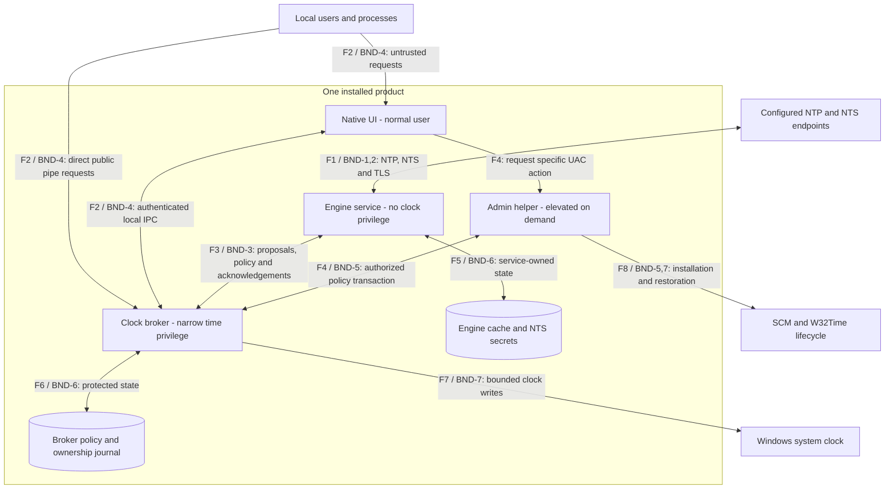
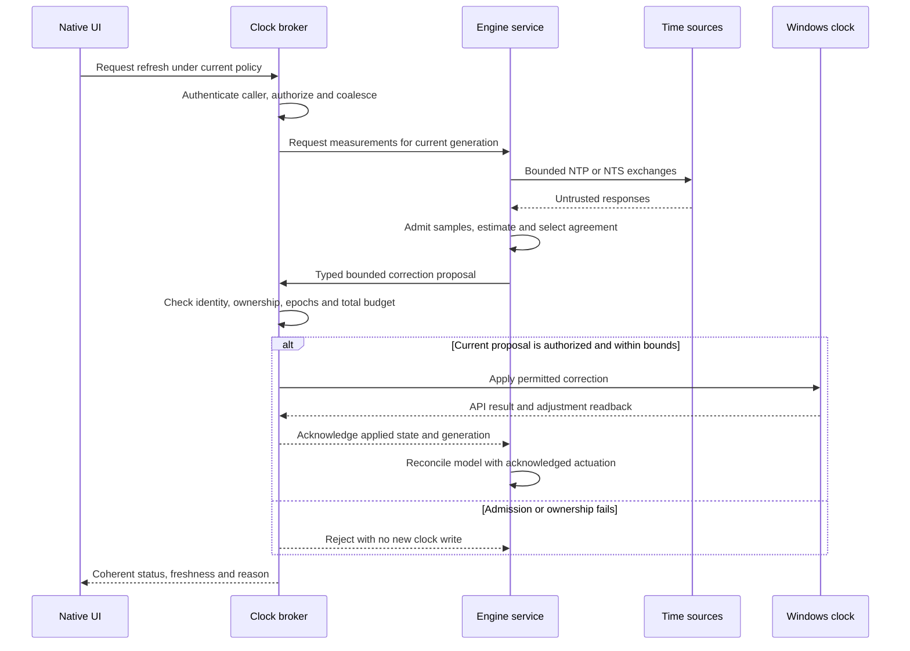
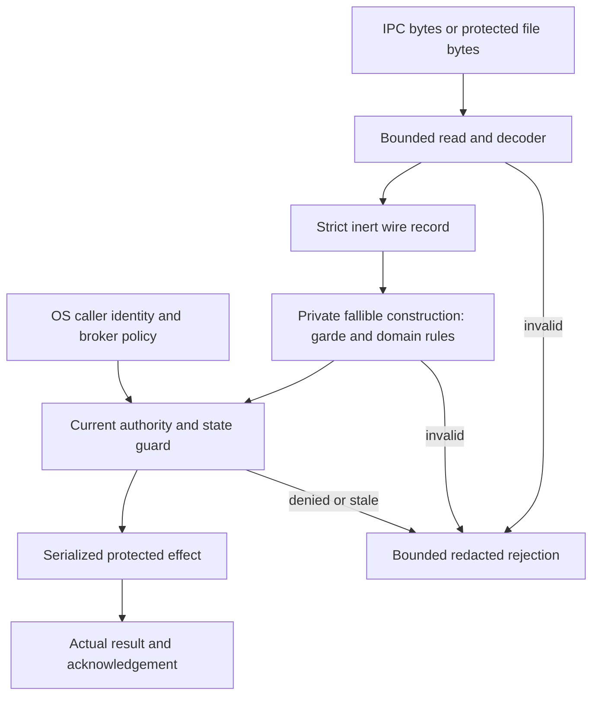
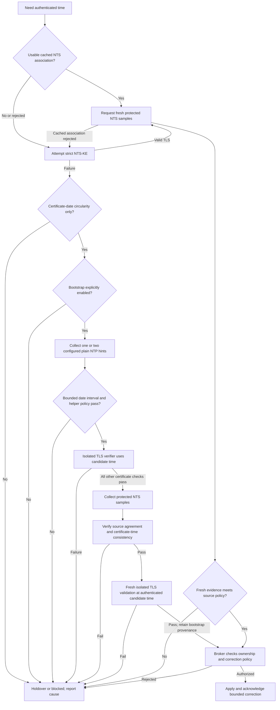
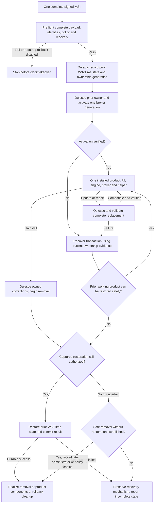

# Rust Windows Time Client — Architecture diagrams

**Plan:** RWTC-ARCH-001, revision 1.4, 28 October 2026  
**Status:** selected design; no application or Windows runtime has been qualified

These editable Mermaid views are extracted from the [canonical architecture and threat model](windows-time-architecture.md). Keep each diagram in that plan authoritative and regenerate this companion when the architecture changes. GitHub and other Mermaid-capable Markdown renderers display the diagrams directly; the fenced source is also available to edit.

**Distribution contract:** one signed complete MSI per supported architecture contains the native UI, engine service, privileged clock broker, helper and required payloads. One product owns install/update/repair/removal. Runtime process separation restricts authority; it does not require separate packages. Any future MSIX must satisfy the same complete-product contract.

## Reading the views

The runtime view shows where authority changes. The sequence view shows who validates a proposed correction and acknowledges applied state. The validation view traces bounded input through domain construction to current authority and effects. The recovery view keeps provisional TLS time separate from the Windows clock. The lifecycle view explains ownership and rollback. Revision 1.4 preserves all five diagram source blocks and their process/installation boundaries. The full review reconciles conditional native HTTP retrieval, entropy exceptions and verifier date-range qualification in the main plan and worksheet; it does not create a new process or package. See the [full review report](windows-time-review.md). Full invariants, threat scenarios, limitations and test gates remain in the main plan.

## 1. Runtime architecture

The outer box is an **installation boundary**, not a shared privilege boundary. UI, engine, broker and helper run under different effective authorities. The numbered crossings map to the flow inventory in section 14. Other local processes can call the public pipe directly; the official UI is not an authorization boundary. F1 also covers conditional certificate AIA/root/revocation retrieval, potentially performed by delegated Windows services; the held verifier route and actual egress owner must qualify under section 18.7.2. The time-endpoint node is not proof that all retrieval is engine-only or limited to those endpoints. The installer also creates protected files and service configuration, as detailed in section 19.

## 2. Correction request and acknowledgement

An API success/readback acknowledges what the backend applied or accepted; it does not itself measure end-to-end UTC accuracy. An unknown acknowledgement is reconciled against broker state before retry. The UI request carries no target timestamp or destination. Both diagrams describe required future behavior, not tested implementation.

## 3. 6.1.1 Input-to-effect validation flow

The guard uses trusted caller identity, current policy/ownership and broker-maintained budgets; none is supplied by the wire record as proof. Transport authentication and coarse endpoint access checks already occur before a client is allowed expensive work. Decode and construction failures have no protected effect. A successful clock operation updates the model only through the actual acknowledgement. A file read has a file/schema-specific authority context, not a fabricated IPC caller.

The constructor obligatorily invokes shared garde DTO/settings validation and the
domain rules before publishing a value. Internal function/module contracts carry
unchanged immutable invariants through typed APIs and check transformed outputs
or changed context as required by [architecture section 6.3.1](windows-time-architecture.md#631-contracts-for-every-function-and-module).
This is the adopted design, not an executed application validation result.

## 4. Recovery decision flow

The operating-system clock is unchanged throughout candidate-time TLS work. Plain hints never enter the ordinary source population or authorize a clock write. Two-helper mode requires both helpers and does not silently become one-helper mode. Agreement and a subsequent fresh handshake improve consistency; they cannot erase the residual expired-compromised-key attack or manufacture trusted UTC from unauthenticated hints. The detailed admission rules in sections 8.1-8.4 remain authoritative.

## 5. Installation and removal ownership flow

The removal node is a transaction, not an instruction to delete recovery code first: section 11 and section 19.2 require durable restoration results before removing the last recovery mechanism. Update-driven removal of the old version does not release ownership to W32Time. Every rate reset, including cleanup, requires current ownership. A private journal cannot overrule a later administrator or Group Policy decision.
