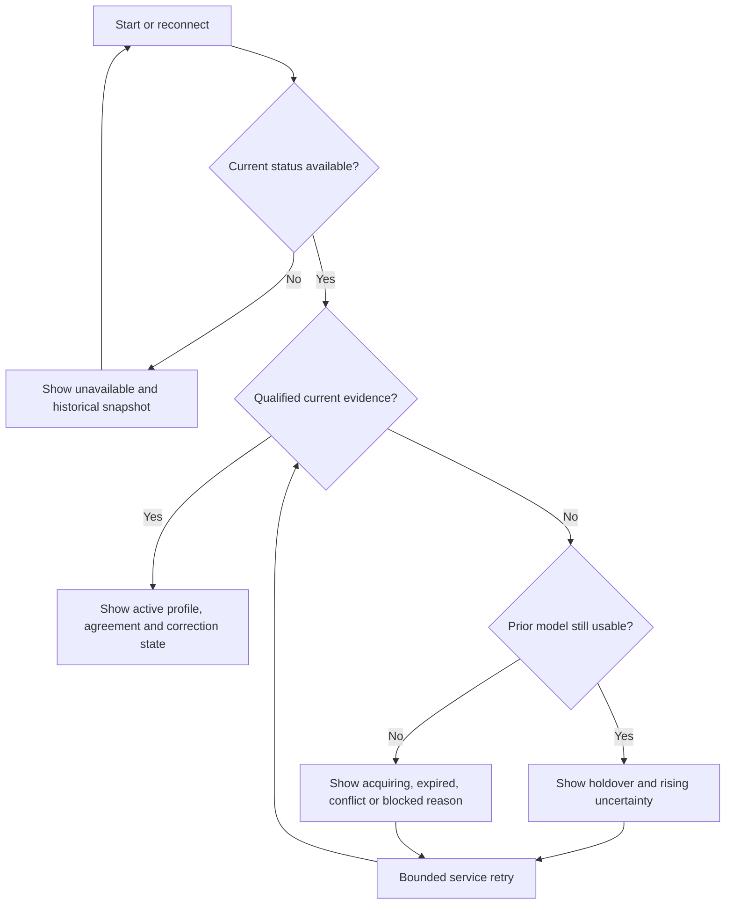

# Basic features and v1 delivery plan

**Document:** RWTC-FEATURES-001, revision 1.0  
**Date:** 28 October 2026  
**Baseline:** Architecture RWTC-ARCH-001 revision 1.4  
**Status:** Proposed v1 product requirements and implementation slices. No application implementation, Windows experiment or acceptance test was performed for this plan.

## 1. Product goal and launch scope

Build a small Windows 11 application that keeps system time synchronized in the background, recovers from ordinary interruptions, and explains clearly when safe synchronization is unavailable. Installation, updates and removal use one complete package. Everyday status and refresh actions work without elevation; machine-wide trust and clock policy remain administrative operations.

The motivating problem is a time service that stops working without a useful explanation. Therefore the first release should prioritize **unattended operation, honest health information, safe recovery and actionable diagnosis**. A decorative clock face or a large dashboard would contribute less to that goal.

**Owner amendment, 29 October 2026:** [NV-DEC-001](nevrotick-owner-decisions.md) records the accepted choices and distinguishes recommendations; [NV-RESEARCH-001](nevrotick-research-handoff.md) assigns unresolved evidence. UI-M0 remains unchanged.

The launch target remains supported Windows 11 x64, a native English-first UI, NTPv4 and NTS client support, and one complete MSI under the declared Authenticode or initial OpenPGP profile. The application is useful with its window closed and before anyone logs in. It does not require an account or a remote control plane.

[OD-07](nevrotick-owner-decisions.md#11-od-07--x64-baseline-and-runtime-optimization)
selects an intended **x86-64-v3** minimum for that x64 product, with qualified
runtime-selected higher-feature optimizations. The package must identify an
unsupported CPU/OS/VM before starting v3 payloads; AVX-512 remains optional.
The [build and native workstream](plans/development-plan.md#81-x64-baseline-and-runtime-optimization-workstream)
is pending: current generic binaries and fixture UI observations do not establish
that compatibility claim or a measured performance improvement.

This document translates [architecture revision 1.4](windows-time-architecture.md) into user capabilities, screens, defaults, failure behavior and implementable slices. It does not replace that specification, select new dependencies, clear the license/crypto holds, adopt TUF, or close any native/signing gate. Existing source/trust and correction requirements remain authoritative. New presentation choices are proposals for the first implementation.

### Current UI entry milestone: UI-M0

The owner's restricted first UI scope, NV-UI-M0-001, is incorporated in [architecture section 16.5](windows-time-architecture.md#165-restricted-first-ui-milestone-ui-m0). Build an unelevated native Win32 fixture-only prototype: Status, Sources, Settings, source details and a bounded source-edit preview. Checked-in deterministic fixtures feed a small presentation boundary; keep **Prototype — sample data** visible, including equivalent context in standalone dialogs. Local validation, **Update preview** and Cancel affect only in-memory preview state, which is discarded on exit. Sync now is disabled with an explanation; machine-policy controls are visibly unavailable. No live status, production IPC, NTP/NTS/DNS traffic, services, policy persistence, UAC, Apply or host-clock effects belong in this slice.

D1 (theme/contrast/text/DPI qualification), D2 (production freshness/reconnect, drafts/revisions/apply and administrative results) and D3 (full keyboard/focus, Narrator and UI Automation qualification) are **Deferred**. Agents must not implement or qualify them during UI-M0 or make them completion prerequisites. Preserve standard controls' inherited behavior and accessible labels. Restore the relevant D2 rules before each live-status, real-policy or protected-command integration; restore D1/D3 before general-user preview/release or earlier support/qualification claims. The UI owner carries their triggers into the backlog and next-stage record.

Use the real UI crate with applicable Rust/dependency/unsafe-FFI checks and one owner for the shared native adapter. Observe ordinary resizing, launch/minimize/restore/close and the mouse-driven preview flow in one documented Windows 11 x64 reference display configuration; compilation alone is insufficient. Small editor behavioral checks and native observations support M0-01–08 in the canonical section; no broad production qualification campaign is required. UI-M0 does not complete P0 toolkit qualification, S-0, CHECK-22 or release gates. Other workstreams retain their requirements and may proceed independently. The product requirements below remain applicable to their later integrations and release.

### The ten basic capabilities

| ID | Capability | User benefit |
| --- | --- | --- |
| F-01 | One complete installation and maintenance lifecycle | Install, update, repair and remove one understandable product |
| F-02 | Automatic background synchronization using NTS or explicitly selected NTP | Time maintenance continues independently of the window and login |
| F-03 | Automatic source selection and combination | A bad or unavailable server does not automatically become the clock reference |
| F-04 | Clear current status | Understand service availability, authentication, agreement, freshness and required action |
| F-05 | Sync now | Request a fresh check without administrative elevation |
| F-06 | Safe source/profile/settings management | Inspect configuration freely and change machine policy through an explicit administrative action |
| F-07 | Recovery from ordinary interruptions | Reconnect after outages, resume safely after sleep and reconcile service failures |
| F-08 | Wrong-date recovery and exceptional-correction review | Recover authenticated time where possible without silently trusting plain hints or making unlimited clock jumps |
| F-09 | Useful local diagnostics and support export | Find out what failed and share bounded, redacted evidence |
| F-10 | Minimal accessible UI with optional tray visibility | Use the app with keyboard/Narrator and choose whether a UI observer remains running |

Security, accessibility and resource behavior are acceptance conditions across these features. They are not optional settings that users must discover and enable.

## 2. Feature specifications

### F-01 — Install and maintain one product

The MSI contains the UI, synchronization engine, clock broker, administrative helper, required resources and licenses. Setup explains that synchronization runs in the background and, on an authorized unmanaged machine, the product becomes the active clock controller in place of Windows Time. Setup/privacy information also explains connections to configured time servers and the DNS/certificate-validation services allowed by the admitted network policy.

Setup checks readiness and preserves the existing Windows Time configuration before handing over. It must not overwrite peer/domain settings or invent a universal state to restore later. Managed machines initially observe without taking control. The ordinary UI opens without inheriting installer elevation.

Updates use one complete MSI authenticated under the explicitly selected release profile; see architecture section 19.5 and OD-05. Repair preserves valid configuration, ownership records and consumed correction allowances. Uninstall removes the product components and restores the applicable previous Windows Time state while respecting subsequent administrator or Group Policy changes. An interrupted or failed operation reports its actual restoration outcome and retains the required recovery mechanism.

**Acceptance:** clean install, boot without login, UI closure, complete update, repair and uninstall with no UI present; inject a takeover/maintenance failure and prove the prior or successor owner is respected. A successful file copy is not sufficient installation readiness. [Architecture §§11, 19; CHECK-5/13/18/23]

### F-02 — Synchronize automatically in the background

The recommended profile uses NTS-authenticated sources. The engine gathers measurements, learns clock behavior and sends bounded correction proposals to the broker. Normal correction prefers the architecture's qualified gradual-adjustment policy. Services start and operate without a logged-in user; closing or crashing the UI does not stop them.

Support an explicitly selected plain-NTP profile for environments that need it. It uses the same source-quality machinery but is always labelled **Unauthenticated**. The product never changes from NTS to NTP because a server is unreachable or a certificate fails. Observe-only measures reference time without allowing this product to change the clock.

Polling, retries and reacquisition are bounded by the admitted provider and resource policy. Users should not need to choose a polling interval or understand oscillator-frequency parameters during normal setup.

Respect server Kiss-o'-Death control packets: show a useful source-level reason
when polling is slowed or access is refused. Use the reviewed upstream behavior
and admission rules in [architecture §7.3](windows-time-architecture.md#73-ntp-client-behavior).
A control reply is not a fresh measurement; it cannot enable plain-NTP fallback
or reduce the configured agreement requirement. This belongs to production
acquisition/status integration, not fixture-only UI-M0.

**Acceptance:** independently observed clock behavior while the UI is closed, and successful reacquisition after a controlled network interruption. An NTS authentication failure must not produce a plain-NTP correction. Observe-only startup and restart must make no clock writes, including adjustment resets. [Architecture §§4, 7, 9–10; CHECK-6/9/10/12]

### F-03 — Select a principal source and compatible supporters

Source selection is automatic. It admits valid responses, compares current estimates, rejects inconsistent or stale sources, chooses a principal and combines compatible supporters. The UI should call these **Main**, **Supporting**, **Not used**, or **Waiting**, with a plain-language reason available for each.

Do not implement “pick the server with the lowest ping.” Response speed alone does not establish correct time. Preserve Chrony's selected statistical/majority behavior, the configured minimum agreement and reselection stability.

The existing starting proposal is four independently operated NTS identities, with at least two agreeing eligible identities **and** the majority rule satisfied. That is a configuration proposal, not a promise that any two of four names suffice. Hostname aliases or several addresses from one operator do not automatically establish independence. The shipped provider set must also have a compatible time-scale/leap policy. RFC 8633 supports using diverse sources and explains the limitations of too few or correlated sources. [R1]

**Acceptance:** controlled agreeing, disagreeing, stale and duplicate sources yield the expected membership and reasons; a fast wrong source is rejected. Loss of agreement does not silently reduce the minimum or enter single-source mode. [Architecture §7; CHECK-7/8]

Before production integration, freeze the majority population, independent groups,
timeout behavior and observation-age limits under [architecture §7.2](windows-time-architecture.md#72-sample-to-clock-pipeline).
An older usable predictor is not fresh independent corroboration. Authentication,
cookie renewal and reachability do not by themselves refresh a time measurement.

### F-04 — Show truthful status immediately

The main window answers four questions: **Is the product operating? Is the current reference authenticated? How fresh and usable is the evidence? Is action needed?**

Show a concise headline, current profile, source agreement, age of the last qualified estimate, estimated offset/uncertainty and the next activity or remedy. Show source details separately. “A service is running,” “a packet arrived” and “the clock is synchronized” are different claims.

Keep the last snapshot visible during disconnection, clearly marked as historical. A missing pipe connection alone does not prove that a service stopped. Display a confirmed service failure only when the available evidence establishes it. Reopening or refreshing the window cannot make old measurements fresh.

Use **Time sync active** for qualified ongoing tracking, with **Gradually correcting the clock** where applicable. Avoid an unqualified **Time is correct** or a green shield suggesting guaranteed UTC accuracy. Observe-only always says that clock changes by this product are disabled.

**Acceptance:** running-but-unqualified, disconnected, expired, conflicting, waiting-for-approval and healthy cases have distinct truthful presentations. A stale or incompatible status record cannot fabricate a current success. [Architecture §§6, 9, 16; CHECK-14/22/25]

### F-05 — Request a fresh check with Sync now

The button means **request fresh measurements under the active configuration**. It is available without UAC to local interactive users permitted by installation policy. It sends no new server address, target time or clock-change authority.

Feedback distinguishes **Checking**, **Already checking**, **Waiting for enough agreeing sources**, **Try again after the current limit**, **Correction in progress**, and a specific blocked/unavailable outcome. The UI remains responsive. Repeated requests are coalesced/rate-limited and cannot reset recovery or correction budgets.

If the measurements require an exceptional correction, the app presents the separate review action from F-08. The click itself never authorizes that change. Closing the window does not cancel service-owned synchronization work.

**Acceptance:** a permitted ordinary user can request a real check; repeated clicks and direct IPC calls remain bounded. Invalid evidence or missing authority prevents correction, while a later valid request still succeeds after the limiting condition clears. [Architecture §§4.2, 5, 16; CHECK-2/3/14/25/27]

### F-06 — Inspect and change sources and profiles safely

Ordinary users can read the settings summaries and source information permitted by installation policy without elevation. Protected material remains service-owned. Per-user appearance preferences also remain ordinary-user operations. Changing the source set, trust/profile, bootstrap configuration or clock policy uses a specific elevated helper operation and a current policy revision.

The editor separates **Draft changes** from **Active settings**. Apply first summarizes the changed behavior, including loss of authentication in plain-NTP mode and any exceptional-correction implications. It then invokes UAC for that operation. Successful activation publishes one validated revision; cancellation, invalid input, stale revision or storage failure leaves the previous active policy intact.

Offer NTS, NTP and observe-only deliberately, with no mixed authenticated/plain voting. Bootstrap helpers have a separate editor and no normal-source selection role. Keep raw step/rate tuning out of the basic UI; expose only approved policy choices and their consequences. A deliberate single-source profile and unrestricted numerical tuning are deferred from this feature scope.

Changing an already-active installation to observe-only stops new product actuation and safely cancels attributable work while ownership is still established. It does **not** implicitly re-enable Windows Time. Show the actual known owner/state; a dedicated “hand control back to Windows” action remains a separately specified future transaction. [Architecture §§7.5, 10–12]

**Acceptance:** valid authorized changes apply once; concurrent edits cannot overwrite a newer revision silently; cancelled UAC preserves configuration. No UI preference or untrusted draft changes machine policy. [CHECK-2/3/15/25]

### F-07 — Recover after ordinary interruptions

Handle offline startup, source outages, adapter/network changes, suspend/resume, external clock changes and separate engine/broker failures. Use bounded retry/reacquisition and preserve valid protected state. Ordinary network recovery should not require reinstalling, clearing settings or restarting the UI.

When fresh measurements disappear, show holdover only while the prior model remains valid; age and uncertainty increase. After its budget expires, clearly show that the estimate is no longer usable. No new phase correction comes from absent/disputed sources, and neither plain NTP nor Windows Time becomes an automatic fallback.

On sleep, clock discontinuity or generation change, discard obsolete work and rebuild the time mapping. Do not count time asleep as delivered active adjustment. Service recovery must reconcile actual state and current ownership before cleanup: an old numeric rate or saved journal does not authorize resetting someone else's adjustment.

**Acceptance:** restore legitimate sources after each fault and observe successful fresh acquisition. Late callbacks have no effect; repeated crashes do not reset budgets. Lost/ambiguous ownership produces read-only blocked handling, including for cleanup. [Architecture §§9–11; CHECK-10/11/12/27]

### F-08 — Recover from a bad date and review large changes

These are two separate operations: obtaining acceptable authenticated time, and authorizing the resulting Windows clock correction.

Try usable cached NTS associations and normal NTS establishment first. The optional recovery helpers are **off by default**. An administrator can select one or two plain-NTP helpers to supply a provisional date only when certificate-date circularity is the relevant blocker. Two-helper mode requires both; it never degrades silently to one. Enabling one-helper mode must explain that it is weaker: one unauthenticated source supplies the date used to check certificates. Both modes visibly label the unauthenticated date basis during recovery; two agreeing helpers do not make the hint authenticated.

The hints affect only the isolated certificate-time recovery path. They cannot set Windows time, vote in normal NTS selection or alter normal drift/leap history. All other required certificate checks, authenticated-source agreement, date/era bounds and final isolated validation remain enforced. This depends on the qualified Windows verifier; unavailable required checks mean visible blocked/holdover behavior. NTS authentication does not remove every risk of a compromised server, network delay or an unauthenticated bootstrap date. [Architecture §8; R2]

If the accepted result lies outside tested automatic correction limits, show **Review clock correction — Administrator required**. Display the direction, magnitude/target interval, evidence freshness, consequence and single-use nature. A changed generation, policy, estimate or expired proposal requires a new review. Declining leaves the clock unchanged by that proposal.

**Owner goal OD-02:** include approximately 100-year local-date errors in recovery qualification. Exact true-date/era bounds, authenticated quorum and direction/runtime correction policy remain open. The tentative 12-hour plain-NTP limit is not an adopted value; preserve separate acquisition and broker authority.

Cached authentication must also meet the [association lifetime contract](windows-time-architecture.md#74-nts-implementation-contract);
a fresh packet need not mean a fresh full authentication decision. A wrong but
intact saved time floor needs the qualified narrow supersession route in
[§8.1](windows-time-architecture.md#81-recovery-order), preserving prior evidence
and all correction/ownership budgets. The supported recovery journey includes
wrong-clock/offline helper activation and repair/restoration under the selected
signing profile. No generic security-state reset or signature bypass is added.

**Acceptance:** a qualified recovery succeeds while the clock remains unchanged until all gates and correction authority pass. Wrong-name certificates, forged NTS messages, disagreeing helpers and stale approvals fail safely. Successful NTS acquisition alone cannot bypass the correction gate. [CHECK-3/9/10; OPEN-5/6/8]

### F-09 — Explain failures and export useful diagnostics

Diagnostics starts with the observed problem and a useful remedy. It contains a bounded recent-event timeline, last failure, product/component compatibility, active profile and relevant policy/ownership state. Technical details are expandable; process names, pipe paths and TLS implementation choices are not required knowledge for normal use.

Differentiate observed facts from hypotheses. For example: **No reply from the configured servers** is an observation; **Your firewall is blocking NTP** is only a possible cause without further evidence. Offer checks the user can take without recommending weaker authentication.

Provide **Copy summary** and **Export diagnostics** with a preview. Default export redacts private endpoints and usernames and never contains NTS cookies/keys, TLS secrets, credentials or arbitrary memory. Export is initiated and written by the ordinary UI from bounded redacted data; a caller's filename never becomes an arbitrary privileged service write. No automatic upload or telemetry is enabled.

Normal application logging uses INFO with admitted dependency messages at WARN or stricter. Troubleshooting uses a temporary, scoped DEBUG session under [architecture section 12.3](windows-time-architecture.md#123-logging-and-support): service collection requires administrative authorization; users control only their own UI diagnostics without elevation. Show the effective component scope, remaining duration and partial/failed collection honestly, with a stop action for the authorized owner. Required security/service events remain independent of optional verbosity. This belongs to production F-09/P3/P5; UI-M0 gains no live switch.

Use event ordering that remains intelligible when wall time is wrong. Full/unavailable logs must not obstruct safe cleanup. If a service is confirmed unavailable after recovery attempts, explain the standard complete-package repair route; a bespoke restart/service-control button is not part of this v1 command surface.

**Acceptance:** representative failures produce accurate causes/actions; hostile input and log flooding remain bounded; a useful ordinary event survives redaction. Export does not reveal protected state. Unauthorized service-profile changes fail; temporary collection expires across UTC changes/restart/resume, and unavailable sinks do not misrepresent synchronization or suppress required-event routing. [Architecture §§5.3, 12, 16; CHECK-14/17/22]

### F-10 — Provide a small accessible native UI and optional tray

Use one small main window with Sources, Settings and Diagnostics. Native controls, system visual preferences and progressive disclosure support familiarity and resource efficiency. English is the initial language; typed localized messages and stable reason codes prepare for later locales without requiring them now.

Every critical action must work with keyboard and Narrator and expose correct UI Automation semantics. Support contrast themes, text scaling, at least 200% display scaling, multi-monitor DPI changes, visible focus, cancellation and focus restoration. Do not reorder focused source rows or announce every changing offset. Microsoft's accessibility guidance and WCAG2ICT inform the native evaluation; neither a framework nor this document establishes conformance. [R3, R4]

Provide an **opt-in tray mode**, off by default: keep a small UI observer when the window closes, show an accessible status indicator, and offer Open, Sync now and Quit UI under the same permissions. A separate opt-in starts that tray observer at sign-in; enabling it does not alter service startup. Quit UI leaves synchronization running. All critical flows remain accessible from the main window.

The tray is a visibility preference, not an extra clock controller or independent watchdog. Its memory/wakeup budget and actual accessibility must qualify before shipping. Rich notifications and historical charts are deferred.

**Acceptance:** complete critical journeys using keyboard/Narrator at the supported scaling; default window closure leaves no UI process. Chosen tray mode preserves ordinary-user authority, reflects current/stale status honestly, and stays within its separately measured budget. [Architecture §§16–17; CHECK-21/22]

## 3. Screens and information hierarchy

### 3.1 Main window

Use this reading order:

1. **Profile and headline:** for example, NTS / Time sync active, or Observe only / Clock changes disabled.
2. **Current activity or remedy:** gradual correction, collecting measurements, network retry, approval or ownership problem.
3. **Evidence:** agreement, last qualified estimate age, estimated offset and uncertainty.
4. **Service availability:** show a connection/start/failure condition prominently when it prevents a current claim.
5. **Actions:** Sync now, Sources, Settings, Diagnostics.

A compact illustrative summary might read:

> **Time sync active**  
> NTS authenticated · 3 eligible sources agree  
> Last qualified estimate: 24 seconds ago  
> Estimated offset: +12 ms — Windows is behind  
> Next scheduled check: in 40 seconds

These are copy/layout examples, not measured values or default intervals. The positive-offset convention comes from the architecture: reference time minus local Windows time. Display sensible precision and explicit units. Explain uncertainty according to the actual model; do not invent symmetric bounds or a probability percentage.

There is no need for a continuously ticking decorative clock, permanent chart rendering or dozens of statistical fields on this screen.

### 3.2 Sources

The default list shows identity, authentication, Main/Supporting/Not used/Waiting role, freshness and a reason. The details pane adds offset, delay, model uncertainty, operator group and time scale. Show the canonical server identity alongside any friendly label.

Distinguish **last reply** from **last accepted measurement**. An authenticated but inconsistent server remains authenticated and rejected. Place recovery helpers in a separate section labelled **Date recovery only — no vote in normal synchronization**. Source inspection is read-only; the edit action opens machine settings and explains its authority requirement.

Source details and Diagnostics expose the **certificate-time basis** separately from packet authentication, and retain a discoverable successful-bootstrap history. Both one-helper and two-helper recovery preserve that note after Tracking resumes. Show the service-published basis, such as a saved authenticated model or a plain-NTP date hint; current NTS authentication does not retroactively authenticate the original hint. Do not clear this history merely because the headline becomes healthy. [Architecture §8.3]

### 3.3 Settings

Use three main groups: **Time sources and trust**, **Clock correction**, and **Appearance**. Less frequent About/version/privacy/license information can live in Diagnostics or Help. This follows the principle of grouping infrequent behavior/preferences into a dedicated settings surface; the particular WinUI implementation examples in Microsoft's settings guidance are not a reason to change our native toolkit. [R5]

Keep Apply/Cancel for machine-policy drafts. Simple per-user display choices can apply immediately. Field validation identifies the invalid value and remedy without exposing secrets. Warn before leaving an unsaved draft; do not elevate merely to view settings.

### 3.4 Diagnostics

Present **Current issue → What it affects → Suggested next action**, followed by recent events and expandable technical evidence. About includes the complete product version, license/privacy information and a user-initiated link to the official release page. Opening that page is not an automatic update or an authorization to install a package.

## 4. State and freshness presentation

The UI presents authoritative service state; it does not invent a second clock-trust state machine. Observe-only and NTS/NTP are profile information, while service availability is a separate dimension. [Architecture §§6, 9]

| Authoritative condition | Suggested user wording | What it means |
| --- | --- | --- |
| Initializing | Starting and checking configuration | No success inferred before ownership/policy readiness |
| Acquiring | Checking time sources | Waiting for enough admissible current evidence |
| Tracking | Time sync active | Current policy is met; show authentication and any correction still in progress |
| Holdover | No fresh time check — using the previous model | Prior estimate remains within its declared budget; uncertainty is increasing |
| Conflict | Time sources disagree | No new correction from disputed measurements |
| Reacquiring | Rechecking after a change | Old-generation exchanges no longer count |
| BootstrapHints / BootstrapNts | Recovering secure time using an unauthenticated approximate date | Provisional recovery; the hints have not changed Windows time |
| Expired | No usable current time estimate | Prior quality/age budget expired; bounded retries continue |
| Blocked | Synchronization needs attention | A named policy, trust, privilege or ownership prerequisite is missing |
| Stopping | Finishing background work | Cleanup is pending or its failure must be reported |
| Status connection unavailable | Status unavailable — last update was … | Retained information is historical; service health may be unknown |
| Observe-only profile | Measuring reference time — clock changes disabled | Successful measurement is not product clock correction |

Four timestamps must remain distinguishable: a source's last valid reply, the last qualified agreeing estimate, the last broker-acknowledged applied correction, and the UI snapshot's age. Do not label any one of them simply **Last synced** without stating what it measures.

Age/retry presentation uses the admitted monotonic/generation semantics. If restart/suspend evidence makes an elapsed value unknown, show unknown/reacquiring instead of deriving a reassuring age from a wrong wall clock. Never convert a requested but rejected correction into **Clock updated**.

The following is a simplified **presentation flow**, not a replacement for the runtime state machine:

A blocked or conflicting state can take precedence over a still-usable prior model; always show its cause. The diagram compresses the reading decision only and does not permit a policy bypass or forced retry past a blocking prerequisite.

## 5. Default settings and authority

| Setting or behavior | Proposed launch default | Authority / qualification |
| --- | --- | --- |
| Background operation | Services start independently of login | Installer-owned, qualified recovery |
| Normal trust profile | Existing NTS-only baseline pending OD-03 resolution | Pool preference does not establish an NTS preset or silently authorize a default trust downgrade |
| Source preset | Target four diverse NTS operators; supplied directory is discovery input | Candidate shortlist in research R-04; qualification and exact identities remain open. Pool defaults require a vendor zone and an explicit role |
| Agreement | Existing minimum-two-plus-majority proposal | Freeze the tested policy; never reduce automatically |
| Plain NTP | Available by deliberate profile change | Administrator; permanently visible unauthenticated label |
| Recovery hints | Off | Administrator explicitly chooses one or two helpers |
| Two-helper recovery | Both must satisfy policy | No silent one-helper fallback |
| Normal correction | Qualified bounded gradual adjustment | Numeric limits remain OPEN-5/7 |
| Exceptional correction | Review required beyond qualified automatic limits; investigate wider authenticated recovery | OD-02 behavior goal; current single-use approval or explicitly qualified preauthorization, with persistent budgets |
| Managed machines | Observe-only | Takeover requires explicit authorization and applicable policy checks |
| Window closure | Exit UI; services continue | Current user |
| Tray visibility | Off; user can enable it | Per-user; separate resource/accessibility qualification |
| Tray at sign-in | Off; separate opt-in while tray is enabled | Per-user fixed installed UI path; no service-policy change |
| Appearance | Follow supported Windows system preferences | Per-user; no custom theme engine required |
| Language | English | Other locales require explicit adoption and QA |
| Diagnostics | INFO application output; reviewed dependency messages WARN or stricter; bounded redacted export | Shared contract in architecture section 12.3; finite scoped DEBUG, administrative service control, per-user UI control; no secret data or privileged arbitrary export path |
| Remote telemetry/crash upload | Off | No account or automatic support upload required |
| Updates | User-initiated complete MSI under declared release profile | OD-05/architecture section 19.5; no silent downgrade of release trust |

The source preset is a release deliverable, not an invitation to hard-code unreviewed endpoints. For each proposed provider, record operator, identity, protocol, supported delegation/ports, usage policy, intended population and time scale. Do not silently enroll a public fleet in a service whose published terms do not permit it. If a suitable default set cannot be qualified, record that as an onboarding/release blocker rather than claim a zero-configuration experience.

The basic UI does not expose a “force time,” “ignore certificate errors,” “reset security budgets,” “prefer fastest server,” or unrestricted service-control command. These would bypass or complicate the existing contract.

## 6. Essential user journeys

### A. Personal computer, normal first use

Install one MSI → review background synchronization and handover explanation → standard installation elevation → transactional readiness/takeover → open the ordinary UI → see acquisition become qualified tracking.

The first launch goes directly to status. A short dismissible explanation identifies Sync now and Diagnostics; a second mandatory configuration wizard is unnecessary when the qualified preset is usable. If setup is incomplete, show the exact missing action rather than a fake healthy sample screen.

### B. The computer was offline or asleep

Services detect the interruption → maintain only permitted holdover behavior → invalidate obsolete work on resume/change → acquire fresh observations → resume qualified tracking. The UI can remain closed throughout. On reopening it reports the actual current state and any retained recovery event.

### C. The date is badly wrong

Attempt cached/strict NTS → if appropriate, use only already-enabled helper recovery → obtain fully qualified authenticated evidence → either apply a policy-permitted correction or request a specific administrative review. If a required gate cannot pass, show its remedy and keep recovery provenance. The user is never offered a certificate-bypass button.

### D. The user wants different servers

Open Settings without elevation → edit a bounded draft → validate identities/profile compatibility → review the behavioral change → elevate for Apply → activate one current revision or leave the previous one intact. An outdated settings window must refresh and obtain a new review before replacing newer policy.

### E. Synchronization appears to have stopped

Open the app → distinguish connection failure from a confirmed service failure → inspect the first useful cause and recovery outcome → follow source/network/policy or complete-package repair guidance. Copy or export a redacted summary if necessary. Do not recommend weakening NTS merely because it is failing.

### F. The user removes the application

Use the product's one Installed apps entry → standard elevated removal → cancel only currently owned transient work → restore the applicable prior Windows Time state → remove components and report the result. Removal must work without the UI running. A later owner or Group Policy change is respected.

## 7. Visibility when the window is closed

This tradeoff must be explicit. Default closure leaves **no UI process**. Service recovery and retained events help the product recover and explain what happened later, but if both services stop and no UI observer is running, the product cannot promise a new immediate on-screen warning.

The optional tray gives a logged-in user ongoing visibility while that observer runs. It can show degraded/unavailable status and open Diagnostics. It is not an independent availability guarantee: if the tray also stops, it cannot display a warning. Critical settings and recovery never depend on finding the tray icon.

A compulsory watcher, an independent watchdog service and always-on notification delivery would be additional architecture/resource decisions. They are outside this v1 plan. Rich Windows toast notifications can be considered later with qualified activation, accessibility, deduplication and privacy behavior. The first release uses clear in-window status, the optional tray indicator and bounded durable diagnostics.

## 8. Acceptance scenarios and evidence

Every row below is **planned / not executed**. Test valid behavior and a relevant failure/forbidden effect through the actual entry point. Use independent timestamp fixtures and controlled time/network sources; implementation-produced expected output is not an independent oracle. Native authority, service lifecycle, clock trajectory and assistive-technology claims require the real supported Windows environment.

This AC catalog describes the full product. UI-M0 uses the restricted M0-01–08 checks in [architecture section 16.5](windows-time-architecture.md#165-restricted-first-ui-milestone-ui-m0); sample-data observations do not complete full-product cases, and D1–D3 remain Deferred without blocking UI-M0.

Apply the [contract-review refinements](windows-time-architecture.md#2021-contract-review-acceptance-refinements)
to AC-02/03/04/05/09/11/12/13/15: fresh votes versus retained predictors, full
authentication age, intact-floor supersession, durable correction uncertainty,
actuator mode/value, Fast Startup epochs, queued recovery and wrong-clock/offline
maintenance. A lost reply never permits a duplicate correction or a success label;
retaining product ownership never implicitly hands synchronization to Windows.

| Case | Features | Scenario and required observation | Existing checks |
| --- | --- | --- | --- |
| AC-01 | F-01/02/10 | Boot without login, synchronize, open/close/crash UI, then log off. Service behavior continues; default closure leaves no UI process. | CHECK-12/21/23 |
| AC-02 | F-02/04/07 | Remove all usable sources, age through holdover and expiry, then restore them. No fake freshness or fallback; recovery succeeds without reinstall/reset. | CHECK-9/11/14 |
| AC-03 | F-03/04 | Fast wrong, agreeing, stale and duplicate sources produce independently expected membership and reasons. Source loss cannot manufacture votes or lower the policy. | CHECK-7/8/14 |
| AC-04 | F-02/06 | Valid NTS succeeds; wrong identity, invalid signatures/AEAD, forged NAK and outages never select plain NTP. Deliberately authorized NTP mode remains labelled. | CHECK-2/6/9 |
| AC-05 | F-04 | Old/malformed/incompatible snapshots and failed connections cannot become current Tracking. Source reply, accepted estimate, applied correction and snapshot ages remain distinct. | CHECK-14/25 |
| AC-06 | F-05 | Ordinary-user refresh succeeds; request storms/direct IPC stay bounded. Refresh carries no destination/target time and cannot override correction authority. | CHECK-2/3/25/27 |
| AC-07 | F-06 | Valid current policy applies atomically. Cancelled UAC, invalid input, storage failure and stale-revision edits preserve the active policy. | CHECK-2/3/15/25 |
| AC-08 | F-06/07 | Startup/restart already configured observe-only makes no product clock write. During active-to-observe transition, valid-owner cleanup precedes completion; lost/ambiguous ownership prevents a blind reset. No implicit Windows Time handback. | CHECK-5/10/12 |
| AC-09 | F-08 | Cached NTS and strict NTS take precedence. Qualified helper recovery leaves global time unchanged until final authentication/agreement and broker authority pass; successful recovery retains its certificate-time basis/history. | CHECK-6/9/10 |
| AC-10 | F-08 | Two-helper timeout/disagreement/alias cannot become one-helper mode. Successful one- and two-helper paths preserve discoverable hint provenance after Tracking resumes; wrong-name certificate never enters hint recovery. | CHECK-8/9/14 |
| AC-11 | F-08 | Correct current exceptional approval works once; stale/changed/expired/replayed approval fails. Acquisition success does not authorize an oversized correction. | CHECK-3/10/12 |
| AC-12 | F-07 | Suspend/resume, Modern Standby, external clock change and late callbacks preserve generation boundaries. Time asleep is not counted as delivered slew. | CHECK-10/11/27 |
| AC-13 | F-01/07 | Kill engine and broker during correction. Recover only with current ownership; ambiguous/successor state blocks resets. Crash loops preserve consumed budgets. | CHECK-10/12/27 |
| AC-14 | F-01/06 | Managed-policy takeover defaults to observation; later GPO/controller activation causes honest conflict handling without fighting the owner. | CHECK-5/13 |
| AC-15 | F-01 | Update/repair/uninstall with UI closed and old sessions; inject interruption. No partial product, permissive reset, stale-owner restoration or false completion. | CHECK-13/18/23 |
| AC-16 | F-09 | Failures yield useful redacted evidence; required events survive optional filters; authorized temporary DEBUG expires; floods/full storage cannot block cleanup or create success. | CHECK-2/14/17/27 |
| AC-17 | F-04/06/08/09/10 | Complete status, editing, UAC cancellation, correction review and export using keyboard/Narrator, contrast and 200% scaling. Focus/announcements remain usable. | CHECK-22 |
| AC-18 | F-10 | Tray disabled means no retained UI; enabled tray and sign-in preference affect only the user observer. Quit UI leaves synchronization active; stale status is labelled. | CHECK-14/21/22 |
| AC-19 | F-02/03/07 | Independently generated offset/drift/asymmetry cases and real clock measurements establish convergence/holdover behavior within the declared test envelope. | CHECK-7/8/10/11/24 |
| AC-20 | All | Measure startup, idle/active CPU, memory, wakeups, log bounds and package size on the declared Windows machine with supported protections enabled. | CHECK-21 |

Resource targets remain those of architecture §17, including separate service/UI/tray accounting; they are unmeasured goals. Do not invent an internet-accuracy SLA, recovery deadline or automatic step threshold to complete a feature card. The [development-hardening specification](windows-time-development-hardening.md) governs test scope, coverage/mutation gates, independent review and truthful evidence accounting.

## 9. Delivery slices for agentic development

The feature scope can be delivered in small integrated slices while preserving the architecture's P0–P7 dependencies. UI-M0 is the restricted UI entry milestone, not a substitute for S-0 or a prerequisite for independent engine/broker/protocol/installation work. Inspect the current repository before choosing implementation commands.

| Slice | Observable result | Work ownership and prerequisites | Exit evidence |
| --- | --- | --- | --- |
| UI-M0 — Restricted native preview | Fixture-only Status/Sources/Settings, source details, ephemeral editor and ordinary native window behavior | UI workstream; one native-adapter owner, coordinated presentation work and independent restricted-scope review | [M0-01–08](windows-time-architecture.md#165-restricted-first-ui-milestone-ui-m0), including native reference-configuration observations; D1–D3 **Deferred** with triggers; no live/protected effects or P0/full-product completion claim |
| S-0 — Qualified foundations | A bounded lab can exercise platform/authority/installer assumptions and an accessible status prototype | Existing P0 cards plus DEV-01–03; platform, security, dependency/license, packaging and UI owners | Actual tool/environment/privilege evidence; finite decisions or explicit blockers. No unqualified production clock writes. |
| S-1 — Independently checked time model | Core admits/rejects supplied data and derives explainable main/supporting membership | Portable core and verification owners, P1; pinned Chrony provenance and numerical/input contracts | Independent valid/fault vectors, trajectory comparisons, bounded fuzz/property evidence and inherited critical-file gates |
| S-2 — Usable observe-only client | Actual admitted NTS/NTP acquisition, secured status and a minimal real read-only window | Network, broker/IPC and UI owners; P2/P3 plus early P5; exact provider/verifier graph qualified | Real acquisition/status, denial cases and ordinary-user behavior; observation makes no global clock writes |
| S-3 — Safe unattended synchronization | One owned controller corrects time before login and with UI closed | Broker/platform, installer and engine owners; P3/P4 authority/ownership prerequisites | Independent real clock trajectory, stop/restart/ownership cases, bounded native work and installation handover |
| S-4 — Recovery and administrative workflows | Source editing, wrong-date recovery and single-use correction review work through the same policy | Network/platform/UI owners; P2/P4/P5 with resolved relevant OPEN-5/6/8 decisions | AC-07–14 valid/failure pairs; no stale approvals, downgrade or hint-derived clock write |
| S-5 — Finished basic experience | Main/Sources/Settings/Diagnostics, optional tray, support export and complete maintenance are usable | UI, accessibility, packaging and platform owners; P5/P6; lifecycle work began in S-0 | Keyboard/Narrator/scaling, source/state truthfulness, resource measurements and interrupted-maintenance cases |
| S-6 — Exact public release candidate | One complete package with verified features and declared release profile | P6/P7; David/release/signing/license owners and independent verifier | Complete feature/architecture matrix, actual profile-specific authenticity and installed-file evidence, supported clean-machine lifecycle and no unresolved dependent blocker |

Do not build the entire settings UI against invented responses and call that S-2. Prototype data must be visibly labelled, and the integrated exit needs actual admitted service data. Similarly, a headless numerical test cannot qualify Windows clock control.

Parallel agents may work on independent core, UI presentation and fixture tasks with frozen shared contracts. One owner controls policy/status schemas, `Cargo.lock`, installer identity and each mutable Windows lab. A UI worker cannot redefine authorization or freshness to make its screen simpler.

### First implementation task card

The first UI implementation task is UI-M0 under [architecture section 16.5](windows-time-architecture.md#165-restricted-first-ui-milestone-ui-m0): establish or reuse the real native shell, add the bounded fixture presentation model, integrate the selected surfaces and independently review the restricted candidate. Do not implement a refresh command or attach live services in this slice. Other workstreams may continue S-0 and their existing development bootstrap independently.

Before later live status, restore D2 and define/test field ownership, state/profile/health meaning, freshness/clock basis, generations, offset sign/units, stable reasons and action outcomes. Restore policy/result semantics before real editing or protected commands, and D1/D3 before the specified preview/release claims. Source/provider licensing and platform feasibility remain prerequisites for their dependent executable paths. UI-M0 supplies no evidence that those later gates are complete.

## 10. Defer from the basic release

| Capability | Why it can wait / reopening condition |
| --- | --- |
| Rich toast notifications and an independent watchdog | Additional activation/observer/privacy/availability work; revisit after tray visibility and measured recovery are understood |
| Historical charts, long-term statistics and clock overlays | Current status, recent events and export cover the initial diagnosis need |
| Direct restart/stop/pause-for-a-duration controls | Need precise fixed-service authority, expiry, cleanup and ownership semantics; current Sync now/observe-only/repair paths remain clear |
| Dedicated handback-to-Windows button | Requires the explicit elevated transaction already identified by the architecture; uninstall retains the established restoration path |
| Config import/export or free-form policy editor | Additional parser/migration/privileged-input surface; bounded native settings first |
| Single-source mode and arbitrary controller tuning | Weaker trust or additional numerical policy; add only with explicit labelled requirements and evidence |
| Automatic background updates or TUF integration | Separate update trust, version/rollback and recovery design; complete MSI updates under the explicit release profile remain the baseline |
| Complete MSIX channel or native ARM64 support | Equivalent complete-product and platform qualification required |
| Russian and other locales | Adopt translations with placeholder/plural, layout and accessibility parity; English first |
| Remote dashboard, accounts, fleet control, plugins/scripts, NTP server/PTP/refclocks | Outside the workstation client problem and current threat model |

Time zones, daylight-saving policy, alarms and world-clock features remain Windows responsibilities. The product disciplines UTC; it does not need to become a general clock application.

## 11. Decisions still needed before their dependent work

| Decision | What must be established | Owner / gate |
| --- | --- | --- |
| Shipped source preset | Resolve OD-03 Pool/NTS role; qualified operator diversity, identities, vendor/provider permission, polling, delegation, reachability and compatible time scale | Network/release; P0/P2 and source policy |
| Automatic correction and holdover limits | Tested magnitude/rate/direction/count/age/error bounds and current approval behavior | Platform/security; OPEN-5/7/13 |
| Wrong-date recovery | Accepted date/era range, helper policy and actual Windows certificate/revocation behavior | Network/security; OPEN-6/8 |
| Plain-NTP assurance claims | Explicit unauthenticated profile and resolution of applicable ASVS interpretation/exception questions | Security owner; OPEN-9 |
| Supported Windows builds | Actual client OS, architecture, power modes and protection configurations | Platform/release; OPEN-2 |
| UI and tray qualification | Actual UIA, keyboard, Narrator, scaling, startup/closure and measured resource behavior | UI/accessibility; OPEN-10/13 |
| Complete release path | Exact compatible graph, installer-tool eligibility, OD-05 release profile/key or publisher, installed-file trust and lifecycle recovery | License/packaging/release; OPEN-1/11/14 |

These are existing phase gates or concrete refinements of them. Missing evidence is not a reason to silently weaken the feature. Proposed UI copy, default presentation and tray choices can be refined with user testing without changing the security semantics.

## 12. Sources, review and readiness

This plan is based primarily on the maintained [architecture](windows-time-architecture.md), [development-hardening specification](windows-time-development-hardening.md), [signing guide](windows-time-signing-guide.md) and their existing verification requirements. The following primary sources were checked on 28 October 2026 for the limited external claims above:

- **R1:** [RFC 8633 — NTP Best Current Practices](https://www.rfc-editor.org/rfc/rfc8633.html), especially source count/diversity and time-scale compatibility.
- **R2:** [RFC 8915 — Network Time Security](https://www.rfc-editor.org/rfc/rfc8915.html), authentication, downgrade and certificate-time considerations.
- **R3:** [Microsoft Windows accessibility checklist](https://learn.microsoft.com/en-us/windows/apps/design/accessibility/accessibility-checklist), native interaction and assistive-technology evaluation.
- **R4:** [W3C WCAG2ICT](https://www.w3.org/TR/wcag2ict/), informative application of WCAG principles to non-web software.
- **R5:** [Microsoft guidelines for app settings](https://learn.microsoft.com/en-us/windows/apps/design/app-settings/guidelines-for-app-settings), settings organization; framework-specific implementation is not adopted.

Two independent contributors examined user experience and failure/authority behavior against revision 1.4 and the pinned planning/testing/security guidance. The integrated document receives a separate independent review; its record is retained with the full documentation bundle. No source availability, reviewer agreement, mock or written acceptance case is represented as an executed product test.

The plan defines a usable basic product and a bounded implementation starting point. Product readiness still depends on completing the named slices and their actual evidence. The next action is the existing authorized planning handoff; repository creation and implementation remain separate work when requested.
